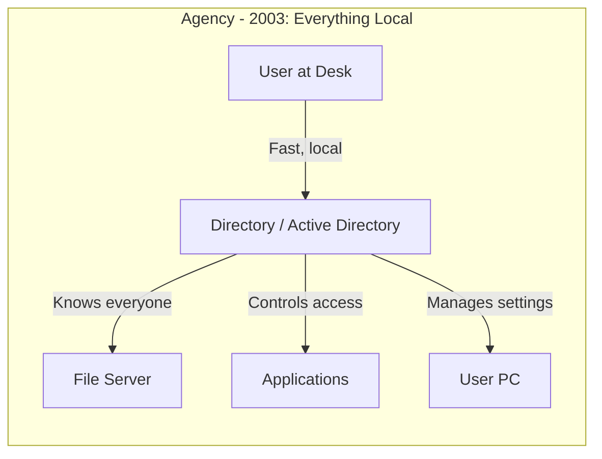
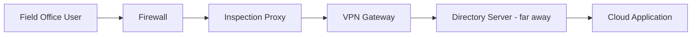
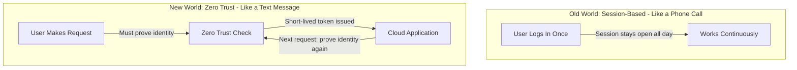
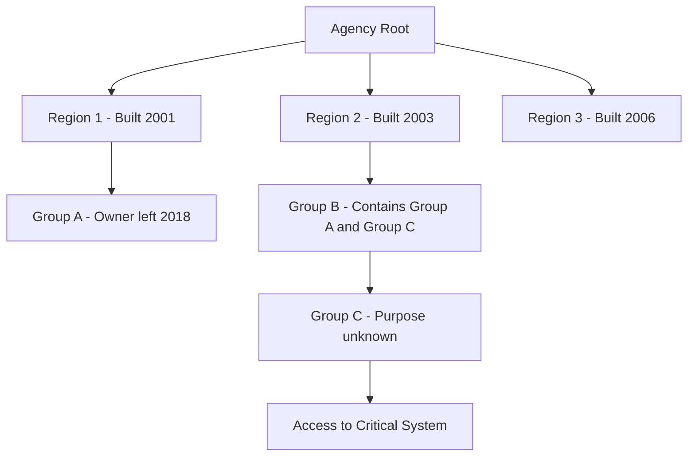
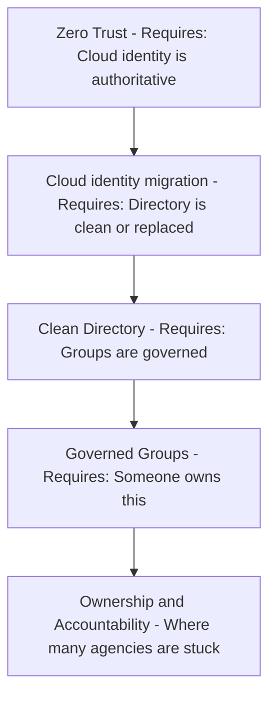

# Prologue — Why Modernization Is Hard: The Problem Nobody Wants to Own

**A plain-language explanation of what broke, why it stays broken, and what has to change**

> **Who this is for:** Agency leadership, IT managers, budget committees, and anyone who has sat in a meeting wondering why "just move it to the cloud" keeps turning into a multi-year effort. No technical background is required. The chapters that follow (00–10) give the technical detail; this prologue gives the argument.

---

## The World We Built — And Why It Worked

For about twenty years, federal agency IT was built around one simple assumption: **your users, your servers, and your data were all in the same building — or at least the same city.**

Think of it like a post office in a small town. The mail carriers know every address. Packages arrive fast because everything is local. The whole system runs smoothly because nothing is far away.

In that world, Microsoft's Active Directory (AD) was the town's address book. It told every computer who a person is, what they're allowed to do, and which printer, file server, or application they can reach. It worked well because the address book, the users, and everything they needed were all nearby.

The key word is **local**. Authentication was fast. Policies applied quickly. Everything knew where everything else was.

---

## What Changed — Three Shifts

Three things happened, roughly in this order, and each one strained something that was working.

### Shift 1: Servers left the building

Agencies consolidated their data centers. Regional offices that used to have their own servers were connected back to a central facility, sometimes hundreds of miles away. The address book stayed, but now it was far away — like a post office that moved its records to a warehouse in another state, so every lookup is a long-distance call.

### Shift 2: The internet became the network

Then came cloud services — email in Microsoft 365, documents in SharePoint Online, meetings in Teams. Users were now connecting to things that weren't in the agency building or the central data center. AD was designed to describe things inside the agency; it wasn't designed to decide who may reach a cloud application from a field office.

### Shift 3: Security got layered on top

To protect everything, agencies added security layer after security layer. Each solved a real problem, but most were designed for the old world, where everything was local and connections were long-lived.

The result can be a user in a regional office whose request to open a document passes through several security checkpoints, each of which can break the connection.

---

## The Session Problem

**The old world ran on long-lived sessions. The new world checks again and again.**

A **session** is like a phone call: you prove who you are once, at the beginning, and the connection carries your identity until you hang up. Much of traditional IT works this way.

Zero Trust, the security model federal agencies are required to adopt,[^pr-m2209] works more like a series of text messages: each request carries short-lived proof of identity, and access is re-evaluated as conditions change.[^pr-n207] Microsoft's implementation can even revoke access mid-session when a critical event occurs, such as an account being disabled.[^pr-cae]

**Why this matters:** when frequent re-checking and network inspection are placed in front of applications built for long-lived sessions, those applications can see dropped connections and users see failures that are hard to diagnose. This is a common pattern, not a universal one, and it is one reason the series treats applications and the access plane together (Chapters 07 and 08).

---

## The Directory Problem Nobody Talks About

Meanwhile, AD — the address book everything depends on — has accumulated risk. In many agencies:

- **It was never set up cleanly.** Regional offices built their own structures; naming and policy grew to solve immediate problems.
- **Consolidation stacked structures rather than rationalizing them.**
- **Nobody owns it.** Everyone depends on it, nobody champions it; symptoms get fixed and causes stay.
- **Groups became hard to govern.** Nested groups created by people who left years ago grant access nobody remembers approving.

**Microsoft hasn't retired AD** — it is still a supported part of Windows Server 2025[^pr-adds] — but Microsoft's guidance now points organizations toward a cloud-first model in which Entra ID is the authoritative directory and AD is minimized.[^pr-soa] Federal policy points the same way: OMB M-22-09 calls for centralized, agency-managed identity and phishing-resistant multifactor authentication.[^pr-m2209]

Entra ID is better suited to cloud applications, but it has no folder (organizational-unit) tree. The delegation and policy targeting that AD's tree encoded — however imperfectly — have to be rebuilt deliberately. Agencies with a well-governed AD will find the transition demanding; agencies without one will find it much harder.

---

## The Cascade: Each Fix Assumes the Last One Is Done

This is why modernization stalls. Each step assumes the previous one is finished.

Mandates arrive with dates attached — M-22-09 set end-of-fiscal-year-2024 targets[^pr-m2209] — but the foundations those mandates assume often weren't built.

---

## What Has to Be True

Five prerequisites recur in federal Zero Trust guidance (NIST SP 800-207 and the CISA Zero Trust Maturity Model)[^pr-n207][^pr-ztmm]:

| # | What must exist | Why it matters |
|---|-----------------|----------------|
| 1 | **A single authoritative source of identity** | Every user, device, and service account needs exactly one authoritative record. |
| 2 | **A governed directory before migration** | Groups, permissions, and ownership should be rationalized *before* moving to a flat cloud directory, not after. |
| 3 | **Continuous verification, not one-time login** | Access is re-evaluated as conditions change, not only at the start of a session. |
| 4 | **Telemetry used for management, not just stored** | Sign-in and access events feed back into governance, not just incident response. |
| 5 | **Governance that runs automatically** | Manual review alone can't keep up with a hybrid environment; checks need to run continuously. |

---

## What the Series Does About It

The chapters that follow turn each prerequisite into specific work:

| Prerequisite | What the series does | Where |
|---|---|---|
| 1. Single authoritative identity | Makes the HR system and Entra ID the source of identity and access data, and retires AD as the source of authority | Chapters 04, 09 |
| 2. Governed directory first | Runs a read-only inventory of the entire AD estate (eleven dependency categories), then rationalizes before anything moves | Chapters 00, 02 |
| 3. Continuous verification | Replaces network location with Conditional Access, device compliance, phishing-resistant MFA, and continuous access evaluation | Chapters 05, 08 |
| 4. Telemetry for management | Compares the live tenant against the intended state every night and opens a tracked item for every difference | Chapters 03, 09 |
| 5. Governance that runs automatically | Delivers every change as a reviewed, signed plan with a rollback and an evidence record | Chapters 01, 03 |

For budget readers, the cost drivers are licensing (Entra ID P1/P2 or ID Governance, and Intune), a small platform build (Chapter 01), and above all staff time for the inventory and rollout, phased as in Chapter 09. Chapter 10 lists the questions a sponsor should ask monthly.

---

## The Bottom Line

The technology exists. Modernization is hard because **each new requirement assumes a foundation that was never built.** Zero Trust assumes governed identity, governed identity assumes a clean directory, and a clean directory assumes someone owns it.

So start with the foundation, not the mandate: *what do we actually know about our own identity environment, right now, with certainty?* [Chapter 00](00-the-problem.md) begins there.

---

**Next:** [Chapter 00 — The Problem](00-the-problem.md)

## Authoritative references

- OMB, [M-22-09: Moving the U.S. Government Toward Zero Trust Cybersecurity Principles](https://www.whitehouse.gov/wp-content/uploads/2022/01/M-22-09.pdf)
- NIST, [SP 800-207, Zero Trust Architecture](https://csrc.nist.gov/pubs/sp/800/207/final)
- CISA, [Zero Trust Maturity Model](https://www.cisa.gov/zero-trust-maturity-model)
- Microsoft Learn, [Microsoft Entra cloud-first identity guidance](https://learn.microsoft.com/en-us/entra/identity/hybrid/guidance-it-architects-source-of-authority)

[^pr-m2209]: OMB, *M-22-09: Moving the U.S. Government Toward Zero Trust Cybersecurity Principles* (January 2022), which requires agency-managed identity, phishing-resistant MFA, and actions by the end of FY2024. <https://www.whitehouse.gov/wp-content/uploads/2022/01/M-22-09.pdf>
[^pr-n207]: NIST, *SP 800-207, Zero Trust Architecture*. <https://csrc.nist.gov/pubs/sp/800/207/final>
[^pr-cae]: Microsoft Learn, *Continuous access evaluation in Microsoft Entra*. <https://learn.microsoft.com/en-us/entra/identity/conditional-access/concept-continuous-access-evaluation>
[^pr-adds]: Microsoft Learn, *What's new in Windows Server 2025* (Active Directory Domain Services section, which introduces new forest and domain functional levels). <https://learn.microsoft.com/en-us/windows-server/get-started/whats-new-windows-server-2025>
[^pr-soa]: Microsoft Learn, *Microsoft Entra cloud-first identity guidance*, which describes the path from hybrid to a cloud-first, AD-minimized state. <https://learn.microsoft.com/en-us/entra/identity/hybrid/guidance-it-architects-source-of-authority>
[^pr-ztmm]: CISA, *Zero Trust Maturity Model* (five pillars and three cross-cutting capabilities). <https://www.cisa.gov/zero-trust-maturity-model>
