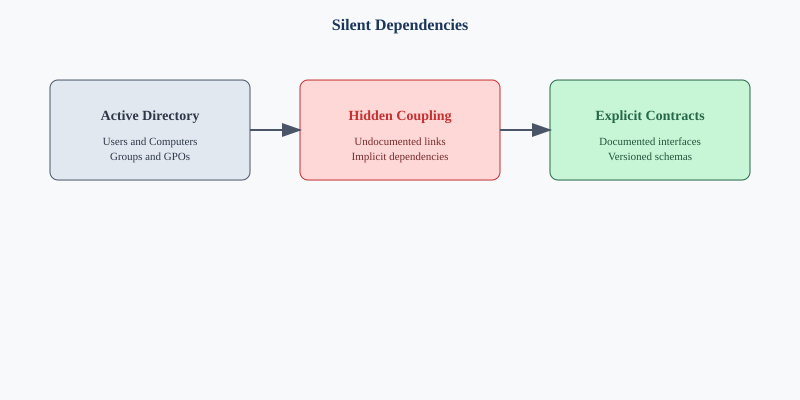

# Chapter 00 — The Problem Nobody Talks About

**Active Directory was never just an identity store. It was the implicit governance model.**

> New to the topic, or reading for leadership or budget? Start with the [Prologue — Why Modernization Is Hard](00-prologue-why-modernization-is-hard.md). This chapter takes its argument as given.

## The thesis

Active Directory was the **implicit governance model** for every network service an organization ran. Teams that treat "AD to Entra ID" as a users-and-groups project retire the directory and silently break the governance, and most of the failures take months to surface. This series is about avoiding that.

## What was sold in 1999

Active Directory shipped with Windows 2000 as an identity directory: a replicated, Kerberos-anchored replacement for NT domains. That was true but incomplete. Over the following decades every Windows-era infrastructure service wired itself into AD, not by grand design but because AD was the only enterprise-wide, governed, authenticated, replicated namespace available. What a server was called, where it sat in the organization, who could manage it, which certificates it trusted, which DHCP scope and policies applied, which SPNs its accounts held: AD answered all of it. A ten-year-old forest was the most load-bearing governance infrastructure the organization owned, and nobody had written it down as such.

## What breaks when AD goes away

Microsoft has not deprecated Active Directory Domain Services; it remains a supported role in Windows Server 2025[^cs00-adds2025]. What has changed is where Microsoft invests and what it recommends: a cloud-first identity model in which Entra ID becomes the source of authority and on-premises AD is minimized[^cs00-soa]. In that model Entra ID takes over from AD DS as the primary directory, Intune takes over from Group Policy, Conditional Access takes over from the network perimeter, Azure Arc extends cloud management to on-premises hosts, Entra certificate-based authentication takes over from AD CS-anchored smart-card logon, and Azure private DNS and private resolvers take over from AD-integrated DNS zones. Retiring AD is therefore an organizational decision, not a vendor deadline.

Each substitution is a valid target, but the tools arrived without a framework. When users are migrated into a flat directory and victory is declared, eleven categories of object that AD silently governed are left behind:

| # | Object Type | What AD Was Doing | What Breaks Without Governance |
|---|-------------|-------------------|-------------------------------|
| 1 | **Users** | Identity lifecycle, OU placement, attribute authority | Orphaned accounts, privilege drift, compliance gaps |
| 2 | **Computers** | Domain join, GPO targeting, machine certificates | Unmanaged endpoints, missing patches, security exposure |
| 3 | **Service Accounts** | SPNs, Kerberos delegation, password management | Application authentication failures, silent service outages |
| 4 | **Security Groups** | Access control, policy scoping, resource permissions | Permission sprawl, ungoverned access, audit failures |
| 5 | **Group Policy Objects** | Device configuration, security baselines, software deployment | Configuration drift, inconsistent baselines, compliance gaps |
| 6 | **DNS / DHCP** | Name resolution, IP allocation, AD-integrated zones | Name resolution failures, IP conflicts, split-brain DNS |
| 7 | **PKI / Certificate Services** | Certificate issuance, auto-enrollment, CRL distribution | Silent certificate expiration, authentication failures, mTLS breaks |
| 8 | **RADIUS / NPS** | 802.1X network access, VPN authentication, Wi-Fi auth | Network access failures, VPN outages, unauthorized access |
| 9 | **LDAP** | Application authentication, directory queries, legacy integrations | Application login failures, directory query errors, broken integrations |
| 10 | **SPNs / App Registrations** | Kerberos service principal names, application identity | Application SSO breaks, delegation failures, service identity loss |
| 11 | **Trust Relationships** | Cross-domain authentication, forest trusts, selective authentication | Cross-domain access failures, authentication breaks between organizations |

### Silent failure is the real enemy

These failures rarely throw clear errors. A certificate doesn't renew because enrollment was never re-pointed. A new device fails network access because a group lookup returns empty. An LDAP application stops working because its bind account was deleted. No log line says "governance has failed"; there is only a long tail of untraceable outages and an audit the organization cannot pass.

## The OU tree was the governance tree

AD's OU tree was not a folder system. It was a **delegation graph, policy inheritance engine, operational boundary and security scope in one structure**. Placing a user in an OU at once assigned the branch's delegated administrators, applied every policy along the path, scoped container-based group rules, and drew an audit boundary of responsibility.

A flat cloud directory does none of this by default. Dynamic groups, administrative units and Conditional Access don't rebuild the model automatically; the reconstruction must be explicit, with organizational position expressed as attributes, dynamic groups materializing structure, administrative units scoping delegation, and Conditional Access enforcing policy. Done well, the result is equivalent to what AD provided and in several ways cleaner.

## Why naïve migrations fail

Most "AD to Entra ID" projects are scoped around users, groups and mailboxes, the visible part. The larger, invisible part is the eleven categories above. A successful modernization must:

1. **Enumerate the hidden dependencies** before anything retires.
2. **Map each to a modern target**, not always one-to-one.
3. **Preserve governance continuity**, with no gap in who owns delegation.
4. **Deliver changes through a deterministic, governed pipeline**, not one-off admin actions.
5. **Detect drift** between plan and reality, continuously.

Organizations rarely fail because they can't list objects. They fail because nobody treats these five steps as a discipline.

## What the framework provides

The framework treats all eleven categories as one governed surface, with one transformation approach, one authoritative source of intended state, one evidence pipeline and one drift detector, orchestrating Microsoft and third-party tools. It runs from a platform host with version control for governance artifacts, an HTTPS reverse proxy, Kerberos and PKI bridges to the legacy forest, and automation (PowerShell, Python, APIs) that reads the estate, computes and validates plans, and delivers them. The target surface spans Entra ID, administrative units, Intune, Azure Arc, IPAM, DNS, DHCP, SASE, MFA and certificate-based authentication.

## What this series covers

| Chapter | Covers |
|---------|--------|
| 00a | Applicability and scope. Which clouds and environments the target state assumes. |
| 01 | The platform host. What runs on it and why. |
| 02 | Analyzing the legacy estate. Forest discovery, GPO inventory, DNS/DHCP, Kerberos, certificate services. |
| 03 | The engine. Turning analysis into a plan and a plan into delivered state. |
| 04 | Identity. Attribute-driven structure, dynamic groups, administrative units. The OU-tree replacement. |
| 05 | Policy. GPO retirement. Intune compliance. Conditional Access. |
| 06 | Services. DNS, DHCP, and IP address management in the hybrid model. |
| 07 | Compute. Device transformation. Domain-joined to cloud identity + device management + Arc. |
| 08 | Access plane. MFA, Zero Trust, SASE, certificate-based authentication. |
| 09 | Roadmap. Phased plan, gates, rollback, cutover. |
| 10 | Leadership takeaway. Instruments versus orchestra. |
| App. A | Federal requirements mapping (M-22-09, CISA ZTMM v2, NIST SP 800-207, 800-53). |

## The dependency chain

Every chapter places itself on one chain. The arrows are dependencies, not a calendar: workstreams overlap (Chapter 09), but nothing on the right can finish before what is on its left.

| Step | What must be true before moving on | Chapter |
|---|---|---|
| **Inventory** | All eleven categories enumerated, read-only, with provenance | 02 |
| **Plan** | Changes expressed as reviewed, authorized, rollback-paired plans | 01, 03 |
| **Identity** | Entra ID authoritative for people and delegation; HR drives lifecycle | 04 |
| **Policy** | Group Policy regenerated into Intune, Conditional Access, machine configuration | 05 |
| **Network services** | DNS, DHCP, and IPAM governed outside AD | 06 |
| **Devices and servers** | PCs Entra joined; servers Arc-connected; SPNs resolved | 07 |
| **Access plane** | Phishing-resistant MFA, Conditional Access, ZTNA; certificate issuance off AD | 08 |
| **Retire AD DS** | No live dependency on AD authentication, or documented Kerberos islands | 09 |
| **Prove steady state** | Zero drift and zero-action plans, evidenced continuously | 09, 10 |

## The bottom line

AD retirement is a **governance transformation**, not a migration project. The hard part is not the API calls but deciding the target state, proving it is right and keeping it right. This series describes how.

## Key takeaways

1. AD governs eleven categories of infrastructure, not just users and groups; each must be mapped before AD retires.
2. Retiring AD is an agency decision supported by Microsoft cloud-first guidance, not a vendor deadline.
3. The work follows one dependency chain, from inventory to proven steady state.

## Authoritative references

- Microsoft Learn, [What's new in Windows Server 2025](https://learn.microsoft.com/en-us/windows-server/get-started/whats-new-windows-server-2025)
- Microsoft Learn, [Microsoft Entra cloud-first identity guidance - Microsoft Entra ID](https://learn.microsoft.com/en-us/entra/identity/hybrid/guidance-it-architects-source-of-authority)

---

**Previous:** [Prologue — Why Modernization Is Hard](00-prologue-why-modernization-is-hard.md)  
**Next:** [Applicability and scope](00a-applicability.md) · [Chapter 01 — Platform Foundation](01-platform-foundation.md)

[^cs00-adds2025]: Microsoft Learn, *What's new in Windows Server 2025*. The Active Directory Domain Services section introduces new forest and domain functional levels. <https://learn.microsoft.com/en-us/windows-server/get-started/whats-new-windows-server-2025>
[^cs00-soa]: Microsoft Learn, *Microsoft Entra cloud-first identity guidance - Microsoft Entra ID*. It describes the path from hybrid to a cloud-first, AD-minimized state. <https://learn.microsoft.com/en-us/entra/identity/hybrid/guidance-it-architects-source-of-authority>
