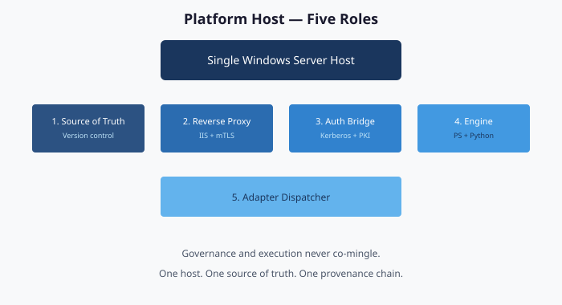

# Chapter 01 — Platform Foundation

**Windows Server 2025 + IIS + version control + Kerberos + enterprise PKI — the host that runs the transformation**

> **Dependency chain:** Inventory → **Plan** → Identity → Policy → Network services → Devices and servers → Access plane → Retire AD DS → Prove steady state — this chapter builds the platform that runs every step.

## The architectural claim

Every analysis, plan, delivery and evidence artifact the framework produces can run on one Windows Server 2025 host, with a standby for recovery: not a cluster or a cloud-native control plane. The property that matters is a *single authoritative writer*, and one host is the simplest way to get it. This is a reference architecture to be built from standard components, not an existing product.

## Why one host

The host is a governance substrate, not an application server, and that brings four properties:

- **Single source of truth.** One repository holds the authoritative artifacts; two writers would diverge. Replication serves recovery, not load-sharing. Where high availability is required, a hot standby with automatic, witness-gated failover keeps one authority available without creating a second writer.
- **Deterministic provenance.** Every plan, delivery and drift report traces to a commit on the canonical repository. Distribution dilutes provenance; one host concentrates it.
- **Bounded attack surface.** One hardened Tier-0 host (CIS baseline, application control, code integrity) is a simpler security story than a fleet of services, though it is also a concentrated high-value target and must be protected as one.
- **Operational simplicity.** One patch cadence, backup policy, recovery playbook and compliance scope. Every extra moving part is another source of drift.

When scale is needed, it comes from the target surface (Entra ID, Intune and vendor APIs scale natively), not from fanning out the substrate.

## The five roles

### 1. Canonical source of truth

**Version control (for example, Gitea).** Every governance artifact (group rules, delegation matrices, plans, policy libraries, adapter manifests, drift reports) is a versioned file. Every change is a signed, attributable commit; nothing is a portal click or a verbal assurance.

The repository sits behind the reverse proxy, uses enterprise PKI for HTTPS and client certificates, and replicates to a standby: by default a cold standby with manual failover and stated RPO/RTO, or a hot standby with witness-gated failover where HA is required. Off-premises backup covers total-site loss.

### 2. HTTPS reverse proxy and client-certificate terminator

**IIS with URL Rewrite and Application Request Routing.** IIS terminates TLS, enforces mutual TLS for administrative access, adds HSTS and HTTP/2, and forwards to version control on loopback. The repository stays off the network while still supporting certificate-based administrative access.

### 3. Legacy-to-modern authentication bridge

**Kerberos and enterprise PKI.** The host holds three memberships at once:

- It is **domain-joined** to the legacy Active Directory forest (for Kerberos-anchored reads of the forest, Group Policy, DNS zones, and certificate services).
- It is **Azure Arc-connected** (for a system-assigned managed identity that authenticates outbound calls to Azure Resource Manager[^cs01-arcmi]; Microsoft Graph calls use a workload identity granted only the permissions it needs).
- It holds an **enterprise-CA-issued server certificate** for TLS. Arc onboarding uses a service principal or interactive sign-in, not a client certificate from the enterprise CA.[^cs01-arcsp]

The AD side is read-only by policy, using a least-privilege forest-reader account. The cloud side is read-write, because plans land there.

### 4. Transformation engine host

Assessment, planning and delivery run here:

- **PowerShell** (for example 7.4+) for AD-side reads (ActiveDirectory, GroupPolicy, DnsServer and DhcpServer modules), repository API calls, provenance writes and tests.
- **Python** (for example 3.12+) for graph analysis of OU trees and dependencies, and schema validation.
- **API integrators** that wrap Microsoft Graph, Azure Resource Manager, Intune, IPAM, ITSM, PAM and posture-assessment output behind uniform contracts.

Every script lives in the repository, every run writes a signed log entry, and every API call carries a correlation ID tied to a plan and a commit.

### 5. Adapter dispatcher

Each AD dependency category (PKI, RADIUS, LDAP, DHCP and so on) is reached through a defined adapter interface. Vendor implementations plug in behind it, so a new IPAM, CA or NAC vendor needs no engine change.

## Separation of governance and execution

**Governance and execution never mix on the host.** The governance layer validates plans, signs commits, enforces boundary rules and writes audit entries, but never touches the target. The execution layer takes an authorized plan, calls the adapters and writes back a structured result, but decides nothing. They run under separate service accounts, credential stores and log streams. Revoking either stops the system safely without leaving the other able to act alone. A component that both decides and acts can cover its tracks; separating them keeps every change auditable and reversible.

## Integration surface

Each integration has an adapter specification and a validation approach:

| Integration | Direction | Purpose |
|-------------|-----------|---------|
| Active Directory forest (legacy) | Read-only | Forest/domain/OU discovery, GPO inventory, DNS/DHCP read, Kerberos SPN audit |
| Certificate services (legacy PKI) | Read-only | Template analysis, privilege-escalation path check, certificate inventory |
| Cloud identity | Read-write | User/group/device/administrative-unit/policy provisioning |
| Device management | Read-write | Compliance policies, configuration profiles, enrollment |
| Hybrid management (Arc) | Read-write | Hybrid server enrollment, tag management, policy assignment |
| IP address management | Read-write | IPAM records, DHCP scope governance |
| Network access control | Read-write | RADIUS policy, 802.1X, device posture |
| IT service management | Read-write | Change and incident integration |
| Privileged access management | Read-write | Vault and safe integration |

Drift detection re-validates every integration on a schedule.

## Operational properties

- **Tier-0:** hardened baseline, application control, code integrity, endpoint protection and SIEM forwarding.
- **Provenance-bound:** configuration changes are commits; portal changes are prohibited by procedure and caught by drift monitoring.
- **Attribute-governed:** organizational tags in Azure Resource Manager, targeted by tag-scoped Azure Policy and machine configuration.[^cs01-mc]
- **Drift-monitored:** attributes, administrative-unit membership, repository team mapping and Arc heartbeat are reported on a schedule.
- **Recoverable:** nightly backup plus the standby described above, with documented recovery objectives.

## What the platform host is not

- **Not a domain controller.** It is domain-joined, not domain-hosting. When the forest retires, the host is rebuilt as a workgroup, Arc-managed server.
- **Not part of the target surface.** It governs Entra ID, Intune and Arc from outside them, on-premises or Arc-projected, so it survives tenant-level events.
- **Not a product.** It is well-known components configured in a specific way, with no proprietary binary.
- **Not a replacement for human review.** People still review and authorize; the host runs execution and holds the repository.

## Cross-references

Build procedures belong in a separate, PowerShell-first runbook. Record the reverse-proxy placement and the standby model in the project's own decision log.

## Key takeaways

1. One authoritative repository and writer; the host is the simplest way to get that, with a standby for recovery.
2. Governance (decide) and execution (act) run under separate identities, credentials, and logs.
3. The host reads AD read-only and writes to the cloud only through authorized plans.

## Authoritative references

- Microsoft Learn, [Access Azure resources with managed identity on Azure Arc-enabled servers - Azure Arc](https://learn.microsoft.com/en-us/azure/azure-arc/servers/managed-identity-authentication)
- Microsoft Learn, [Connect hybrid machines to Azure at scale - Azure Arc](https://learn.microsoft.com/en-us/azure/azure-arc/servers/onboard-service-principal)
- Microsoft Learn, [What is Azure Machine Configuration? - Azure Machine Configuration](https://learn.microsoft.com/en-us/azure/governance/machine-configuration/overview/01-overview-concepts)

---

**Previous:** [Applicability and scope](00a-applicability.md)  
**Next:** [Chapter 02 — Analyzing the Client/Server Estate](02-analyzing-the-estate.md)

[^cs01-arcmi]: Microsoft Learn, *Access Azure resources with managed identity on Azure Arc-enabled servers - Azure Arc*. <https://learn.microsoft.com/en-us/azure/azure-arc/servers/managed-identity-authentication>
[^cs01-arcsp]: Microsoft Learn, *Connect hybrid machines to Azure at scale - Azure Arc*. <https://learn.microsoft.com/en-us/azure/azure-arc/servers/onboard-service-principal>
[^cs01-mc]: Microsoft Learn, *What is Azure Machine Configuration? - Azure Machine Configuration*. <https://learn.microsoft.com/en-us/azure/governance/machine-configuration/overview/01-overview-concepts>
