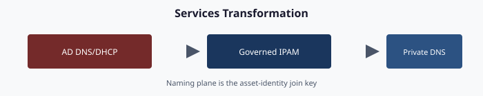

# Chapter 06 — Services: DNS, DHCP, IPAM in the Hybrid-Cloud Model

**Active Directory-integrated DNS → private resolution · Active Directory DHCP → governed hybrid DHCP · informal IPAM → governed IP address management**

> **Dependency chain:** Inventory → Plan → Identity → Policy → **Network services** → Devices and servers → Access plane → Retire AD DS → Prove steady state

## The services claim

DNS, DHCP and IP address management are the services organizations almost always defer when they modernize Active Directory, on the theory that because they still work they don't need to move. In the author's experience, AD-integrated DNS, AD-authorized DHCP and informal IPAM are frequent sources of post-migration governance regression: fine from the outside, silently broken inside.

## Why these three, why together

The three form one addressing and resolution surface:

- **DNS** resolves names, usually from AD-integrated zones that replicate with AD and inherit its access model.
- **DHCP** assigns addresses from servers authorized in the forest.
- **IPAM** records which ranges exist, who owns them and which records point where. Without it, DNS and DHCP drift.

Moving DNS but leaving AD-authorized DHCP gives two authorities for assignment and resolution. Moving both but leaving IPAM in a spreadsheet produces conflicts and ghost records. The framework treats the three as one domain: IPAM owns addressing, and DNS and DHCP derive from it.

## DNS — AD-integrated to private resolution

AD-integrated zones live inside the AD replication graph. In most forests every domain controller is also a DNS server,[^cs06-adidns] updates replicate through AD, and zone ACLs use AD groups. As a result, every DC sits in the name-resolution trust path; AD can't retire until DNS moves; stale records from deleted computer objects need AD-side cleanup; and domain-joined clients find DCs through AD-registered SRV records,[^cs06-dclocator] so DNS and AD retirement must be sequenced together.

The target has three layers:

| Layer | Target | Purpose |
|-------|--------|---------|
| **Authoritative on-premises** | Non-AD-integrated DNS (file-backed Windows DNS or a DDI appliance) | Records for the on-premises namespace once AD-integrated zones retire |
| **Hybrid resolution** | Azure DNS Private Resolver (inbound and outbound endpoints, forwarding rulesets)[^cs06-dnspr] | Resolution in both directions between virtual networks and on-premises |
| **Authoritative cloud** | Azure Private DNS zones linked to virtual networks (including Private Link zones)[^cs06-pdnslink] | Records for cloud workloads and private endpoints |

On-premises conditional forwarders point to the resolver's inbound endpoint, which answers from the private zones linked to its virtual network. Virtual networks keep using Azure-provided DNS;[^cs06-vnetdns] a forwarding ruleset attached to the outbound endpoint and linked to those networks sends on-premises domains to the on-premises servers. Arc-connected servers stay on-premises and use on-premises DNS.

The DNS adapter **discovers** zones, records (with age and staleness), forwarders and recursion settings; **flags risk** (stale records, ownerless zones, aliases to decommissioned resources); **proposes** a target per zone (private DNS, keep on-premises, or retire); **migrates** one zone at a time with per-zone rollback; and **validates** record by record, including names other services depend on, such as CRL distribution points. Records carry the owning object's attributes, so a record whose device has been deleted shows up as orphan drift.

Migration runs in six steps: inventory (Chapter 02); a steward-reviewed target for each zone; one low-risk pilot zone; zone-by-zone cutover with a validation gate per zone; deletion of AD-integrated zones, with the forest's own `_msdcs` and domain zones retiring last alongside the DCs; and steady state with zero DNS drift.

## DHCP — AD-authorized to governed DHCP

Windows DHCP servers in an AD environment must be authorized in the forest before they lease addresses; that authorization (rogue-server detection) lives in AD.[^cs06-dhcpauth] Assessments commonly find reservations for MAC addresses not seen in years, options that push DNS servers whose addresses will change, oversized scopes, and failover relationships never tested.

The target depends on the environment:

- **On-premises-heavy:** keep DHCP on dedicated, governed hosts, decoupled from forest authorization.
- **Cloud-forward:** Azure virtual networks assign addresses through built-in platform DHCP with no scopes to manage;[^cs06-vnetfaq] on-premises subnets still need a DHCP service (Windows DHCP on non-domain-joined hosts or a DDI appliance).
- **Hybrid:** both, with IPAM as the single source of truth.

The DHCP adapter discovers every server (joined or not), scope, reservation, failover relationship and option set, especially scope-level DNS overrides, and writes changes only through the plan pipeline. Scopes are tagged with the site they serve, which enables ownership drift checks and blast-radius analysis.

## IPAM — informal to governed

Many organizations discover during modernization that they have no real IPAM: a spreadsheet one person maintains, a stale wiki page, or partial tools covering some subnets, with reservations that conflict with actual use. The goal is **one governed IPAM system** covering the full address surface. Options include Azure Virtual Network Manager IPAM for Azure address space[^cs06-ipam] and DDI products for on-premises networks. Whatever the product, the adapter discovers ranges, syncs host records with DNS and reservations with DHCP, tags every change with a correlation ID, and commits it to the repository.

IPAM is the source of truth, and DNS and DHCP produce matching records from it. Disagreement between IPAM and either service is *hierarchy drift*: the tree exists, but the leaves don't agree. Every services run therefore produces one coordinated plan of IPAM, DNS and DHCP actions, and the plan fails validation if any of the three would drift from the others. There is no DNS-only run.

## Validation

Services migration passes when:

- IPAM covers the full address surface, and every private DNS record and DHCP reservation matches an IPAM entry;
- every on-premises conditional forwarder targets the resolver's inbound endpoint, and every virtual network that needs on-premises names is linked to a forwarding ruleset on the outbound endpoint;
- AD-integrated zones are retired or excluded with a documented rationale.

## Why "Phase 2" never comes

The common pattern is to modernize identity and policy and leave DNS, DHCP and IPAM for "Phase 2," which rarely happens. AD is retired for sign-in but kept because DNS still lives there. A forest that still hosts AD-integrated DNS has not been retired. Services migration is core modernization, not a follow-on.

## Key takeaways

1. DNS, DHCP, and IP address management move together, with IPAM as the source of truth.
2. Hybrid resolution uses Azure DNS Private Resolver; AD-integrated zones retire last, with the domain controllers.
3. A forest that still hosts DNS has not been retired.

## Authoritative references

- Microsoft Learn, [Locating Active Directory Domain Controllers in Windows and Windows Server](https://learn.microsoft.com/en-us/windows-server/identity/ad-ds/manage/dc-locator)
- Microsoft Learn, [Azure DNS Private Resolver Overview](https://learn.microsoft.com/en-us/azure/dns/dns-private-resolver-overview)
- Microsoft Learn, [What is a virtual network link subresource of Azure DNS private zones](https://learn.microsoft.com/en-us/azure/dns/private-dns-virtual-network-links)
- Microsoft Learn, [Azure Virtual Network Name Resolution Guide](https://learn.microsoft.com/en-us/azure/virtual-network/virtual-networks-name-resolution-for-vms-and-role-instances)
- Microsoft Learn, [Install and configure DHCP Server on Windows Server](https://learn.microsoft.com/en-us/windows-server/networking/technologies/dhcp/quickstart-install-configure-dhcp-server)
- Microsoft Learn, [Azure Virtual Network FAQ](https://learn.microsoft.com/en-us/azure/virtual-network/virtual-networks-faq)
- Microsoft Learn, [What is IP address management (IPAM) in Azure Virtual Network Manager?](https://learn.microsoft.com/en-us/azure/virtual-network-manager/concept-ip-address-management)
- Microsoft Learn, [Domain Name System (DNS) in Windows and Windows Server](https://learn.microsoft.com/en-us/windows-server/networking/dns/dns-overview)

---

**Previous:** [Chapter 05 — Policy Transformation](05-policy-transformation.md)  
**Next:** [Chapter 07 — Compute Transformation](07-compute-transformation.md)

[^cs06-dclocator]: Microsoft Learn, *Locating Active Directory Domain Controllers in Windows and Windows Server*. <https://learn.microsoft.com/en-us/windows-server/identity/ad-ds/manage/dc-locator>
[^cs06-dnspr]: Microsoft Learn, *Azure DNS Private Resolver Overview*. <https://learn.microsoft.com/en-us/azure/dns/dns-private-resolver-overview>
[^cs06-pdnslink]: Microsoft Learn, *What is a virtual network link subresource of Azure DNS private zones*. <https://learn.microsoft.com/en-us/azure/dns/private-dns-virtual-network-links>
[^cs06-vnetdns]: Microsoft Learn, *Azure Virtual Network Name Resolution Guide*. <https://learn.microsoft.com/en-us/azure/virtual-network/virtual-networks-name-resolution-for-vms-and-role-instances>
[^cs06-dhcpauth]: Microsoft Learn, *Install and configure DHCP Server on Windows Server*. <https://learn.microsoft.com/en-us/windows-server/networking/technologies/dhcp/quickstart-install-configure-dhcp-server>
[^cs06-vnetfaq]: Microsoft Learn, *Azure Virtual Network FAQ*. Azure virtual networks provide DHCP to Azure VMs; a DHCP server in an Azure VM can serve on-premises clients through a relay agent. <https://learn.microsoft.com/en-us/azure/virtual-network/virtual-networks-faq>
[^cs06-ipam]: Microsoft Learn, *What is IP address management (IPAM) in Azure Virtual Network Manager?*. <https://learn.microsoft.com/en-us/azure/virtual-network-manager/concept-ip-address-management>
[^cs06-adidns]: Microsoft Learn, *Domain Name System (DNS) in Windows and Windows Server*. <https://learn.microsoft.com/en-us/windows-server/networking/dns/dns-overview>
