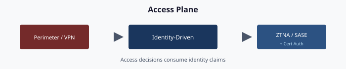

# Chapter 08 — Access Plane: SASE, Zero Trust, MFA, Certificate-Based Auth

**The identity-bound access plane that replaces the Active Directory network perimeter**

> **Dependency chain:** Inventory → Plan → Identity → Policy → Network services → Devices and servers → **Access plane** → Retire AD DS → Prove steady state

## The access claim

Retiring Active Directory removes the network perimeter as an authorization boundary. Its replacement is an **identity-bound access plane** with four coordinated surfaces: **Zero Trust** (the architectural model), **Conditional Access** (policy enforcement, Chapter 05), **SASE** (edge delivery), and **phishing-resistant MFA with certificate-based authentication** (proof of identity). Every access decision becomes a per-request evaluation of identity, device and signal, made at the cloud edge, logged, and visible to the drift engine.

## The model — Zero Trust

Zero Trust is a set of architectural principles,[^cs08-n207] not a product:

1. **Verify explicitly.** Identity, device posture, risk and session state are evaluated per request; being inside the network confers no trust.
2. **Use least-privilege access.** Access is time-bound and scoped to resource and purpose, with no standing privilege.
3. **Assume breach.**[^cs08-zt] Treat every session as potentially compromised; continuous access evaluation can revoke it mid-flight, and break-glass exclusions stay minimal and audited.

No single control is Zero Trust. The pattern is Conditional Access, Intune compliance, privileged identity management and certificate-based authentication working together. Three AD-era patterns retire with it:

- **Network segment as authority.** IP allowlists stop being authoritative; policy is per identity, device and session.
- **Pass-through AD Kerberos.** Modernized services accept short-lived cloud tokens instead of domain-controller tickets. Services on a documented Kerberos island keep Kerberos until they retire.
- **Persistent administrative rights.** Domain Admins, local administrator groups and never-expiring service accounts move to just-in-time elevation, group managed service accounts on remaining Kerberos islands,[^cs08-gmsa] or workload identity federation for cloud workloads.[^cs08-wif]

## SASE — the edge delivery surface

Secure Access Service Edge (SASE) is the cloud-delivered security surface[^cs08-gsa] that replaces the on-premises firewall, VPN, proxy and CASB stack. The framework does not pick a vendor; it governs the integration contract.

| Component | Function | Integration |
|-----------|----------|-------------|
| **Zero Trust Network Access** | Per-application access; replaces VPN | Attribute-scoped application groups; Conditional Access enforces compliance and MFA |
| **Secure Web Gateway** | Outbound web filtering and DLP | Attribute-scoped user groups; logs to the SIEM |
| **Cloud Access Security Broker** | Inline enforcement for sanctioned cloud apps | Reads the cloud app catalog; attribute-scoped policies |
| **Firewall as a Service** | Distributed firewall plane | Policy targeted by projected tags |
| **Data Loss Prevention** | Content-aware filtering | Attribute-scoped sensitive-data groups |

Whatever the vendor, the contract is the same:

1. **Federation.** Users authenticate through Entra ID; there is no local SASE user database.
2. **Group targeting.** Policies reference attribute-scoped dynamic groups.
3. **Device posture.** The Intune compliance signal is a policy input.
4. **Logging.** Access logs go to the SIEM, and the drift engine correlates them with Entra sign-in logs.
5. **Provenance.** Policy changes flow through the repository, never through direct portal edits.

## Phishing-resistant MFA

Phishing-resistant methods are required for every privileged user and for all users on high-risk resources.[^cs08-m2209]

| Method | Phishing-resistant | Typical use |
|--------|--------------------|-------------|
| **FIDO2 security keys** | Yes | Tier-0 administrators, high-privilege users |
| **Windows Hello for Business** (and Platform SSO on macOS)[^cs08-psso][^cs08-whfb] | Yes | Default daily sign-in on user PCs |
| **Certificate-based authentication** (PIV/CAC) | Yes | Smart-card holders |
| **Passkey in Authenticator** (device-bound)[^cs08-passkey] | Yes | Mobile and cross-device sign-in |
| **Authenticator push** (number matching always on)[^cs08-numm] | No; resists push fatigue, not phishing | Transition and secondary method |
| **SMS / voice** | No | Not permitted |

The Conditional Access library (Chapter 05) requires FIDO2 or CBA for Tier-0 administrators, privileged roles and break-glass test accounts; requires MFA for everyone else with an authentication strength that excludes SMS and voice;[^cs08-authstr] and requires stronger methods for sensitive applications. Where smart cards exist, CBA is the user default: card plus PIN reaches the same phishing-resistant session as Windows Hello for Business.

## Cloud certificate-based authentication — the AD CS retirement path

Smart-card logon has historically been anchored in AD CS and AD DS. When AD DS retires, that validation path goes with it unless the chain is re-anchored in Entra ID.

Entra CBA accepts X.509 certificates from CAs in the tenant's PKI-based trust store, which holds root and issuing CA certificates and their revocation-list locations.[^cs08-cbaca] At sign-in, Entra ID validates the chain, binds the certificate to a user through username-binding rules (for example SAN principal name, RFC 822 name, or issuer and serial number, with high-affinity bindings preferred),[^cs08-cbacfg] issues a token, and evaluates Conditional Access. The user still inserts a card and enters a PIN; only the end of the validation chain moves.

The retirement sequence:

1. Add root and issuing CA certificates, with revocation-list locations, to the PKI-based trust store.
2. Configure username bindings.
3. Enable CBA as an authentication method.
4. Require CBA for designated attribute-scoped groups through Conditional Access.
5. Validate smart-card sign-ins in the sign-in logs.
6. Retire the AD smart-card logon GPO (Chapter 05).

Issuance is a separate decision. An AD CS *enterprise* CA depends on AD DS,[^cs08-entca] so issuance must move before AD retires: to a standalone CA, a managed cloud PKI service,[^cs08-cpki] or a third-party or federal shared-service CA. For PIV/CAC, the agency's PIV issuer usually already fills this role. The framework keeps issuance and the Entra trust store pointed at the same CAs.

## Privileged access management

Every privileged account, whether a domain-admin equivalent, cloud administrator or break-glass account, goes through a PAM vault, whichever vendor supplies it:

- **No standing privilege.**[^cs08-pim] Each use requires explicit MFA-gated, time-bound, purpose-documented elevation.
- **Break-glass accounts** are vaulted, with dual-approval checkout, session recording and rotation on release.
- **Elevated service accounts** use managed identities and workload identity federation where possible, gMSAs on remaining Kerberos islands, and vaulted accounts only as a last resort.
- **Session recording** (video, keystrokes, command lines) goes to the SIEM. This is a third-party PAM capability, not part of Entra PIM.

Two drift types apply here: a vaulted account missing from Entra ID is *orphan drift*; a privileged Entra account that is not vaulted is *phantom drift*.

## Continuous access evaluation

A Zero Trust session is not "good for twelve hours." With continuous access evaluation, Entra ID and participating services revoke a live session when:

- the user's password changes, or the account is disabled or deleted;
- the network location moves to a blocked range (with strict location enforcement enabled);
- user risk rises to high, for example on leaked credentials detected by Entra ID Protection.[^cs08-idp]

CAE works only with CAE-capable applications,[^cs08-cae] and reacts to these critical events and IP-location changes, not to every Conditional Access condition. A device-compliance change, for example, takes effect at the next token refresh, so policies are written with that in mind.

## The access plane in one flow

1. **Boot.** Intune compliance checks pass and the disk unlocks with an escrowed key.
2. **Sign-in.** Smart card and PIN; CBA validates the chain; a CAE-capable token is issued.
3. **Conditional Access.** Compliant device, phishing-resistant MFA, expected location and low risk: allowed.
4. **Apps.** Single sign-on covers later authentications; CAE can revoke the session if risk rises.
5. **Internal apps.** ZTNA accepts the cloud token, checks compliance, MFA and attribute scope, proxies the connection and logs it. No VPN.
6. **Privileged change.** Just-in-time elevation re-challenges MFA, grants a time-boxed window, records the session and emits the event.
7. **End of day.** Tokens expire or refresh at the next sign-in, and the cycle restarts.

Each step is attribute-scoped and logged. Any failure becomes a tracked item.

## Validation

Access-plane migration passes when:

- every user's primary method is FIDO2, a passkey, Windows Hello for Business or CBA, with no SMS or voice as primary;
- every smart-card user signs in through Entra CBA, not AD-anchored smart-card logon;
- user-facing policies target attribute-scoped dynamic groups;
- at least ZTNA, a secure web gateway and a CASB are in place and federated with Entra ID;
- every privileged account goes through PAM with session recording, and break-glass use is audited on a schedule;
- CAE is enabled for supported applications, with strict location enforcement where location policies apply;
- the VPN remains only for named legacy applications with an end-of-life date.

## Key takeaways

1. Access decisions move from network location to identity, device, and risk, enforced by Conditional Access.
2. Phishing-resistant MFA (FIDO2, Windows Hello, passkeys, PIV/CAC via CBA) is the target for all users.
3. Certificate issuance needs a successor before AD retires, because an enterprise CA depends on AD DS.

## Authoritative references

- Microsoft Learn, [Zero Trust as a security foundation](https://learn.microsoft.com/en-us/security/zero-trust/zero-trust-overview)
- NIST, [SP 800-207, Zero Trust Architecture](https://csrc.nist.gov/pubs/sp/800/207/final)
- Microsoft Learn, [Workload Identity Federation - Microsoft Entra Workload ID](https://learn.microsoft.com/en-us/entra/workload-id/workload-identity-federation)
- Microsoft Learn, [Group Managed Service Accounts overview](https://learn.microsoft.com/en-us/windows-server/identity/ad-ds/manage/group-managed-service-accounts/group-managed-service-accounts/group-managed-service-accounts-overview)
- Microsoft Learn, [Windows Hello for Business overview](https://learn.microsoft.com/en-us/windows/security/identity-protection/hello-for-business/)
- Microsoft Learn, [Configure Platform SSO for macOS devices - Microsoft Intune](https://learn.microsoft.com/en-us/intune/device-configuration/settings-catalog/configure-platform-sso-macos)
- Microsoft Learn, [How number matching works in MFA push notifications for Authenticator - Microsoft Entra ID](https://learn.microsoft.com/en-us/entra/identity/authentication/how-to-mfa-number-match)
- Microsoft Learn, [Enable and support passkeys in Authenticator for Microsoft Entra ID - Microsoft Entra ID](https://learn.microsoft.com/en-us/entra/identity/authentication/how-to-enable-authenticator-passkey)
- Microsoft Learn, [Overview of Conditional Access Authentication Strengths - Microsoft Entra ID](https://learn.microsoft.com/en-us/entra/identity/authentication/concept-authentication-strengths)
- OMB, [OMB M-22-09: Moving the U.S. Government Toward Zero Trust Cybersecurity Principles](https://www.whitehouse.gov/wp-content/uploads/2022/01/M-22-09.pdf)
- Microsoft Learn, [How to configure certificate authorities for Microsoft Entra certificate-based authentication - Microsoft Entra ID](https://learn.microsoft.com/en-us/entra/identity/authentication/how-to-configure-certificate-authorities)
- Microsoft Learn, [Set Up Microsoft Entra CBA - Microsoft Entra ID](https://learn.microsoft.com/en-us/entra/identity/authentication/how-to-certificate-based-authentication)
- Microsoft Learn, [What is the Certification Authority Role Service in Windows Server?](https://learn.microsoft.com/en-us/windows-server/identity/ad-cs/certification-authority-role)
- Microsoft Learn, [Microsoft Cloud PKI for Microsoft Intune - Microsoft Intune](https://learn.microsoft.com/en-us/intune/cloud-pki/)
- Microsoft Learn, [Continuous access evaluation in Microsoft Entra - Microsoft Entra ID](https://learn.microsoft.com/en-us/entra/identity/conditional-access/concept-continuous-access-evaluation)
- Microsoft Learn, [What is Global Secure Access? - Global Secure Access](https://learn.microsoft.com/en-us/entra/global-secure-access/overview-what-is-global-secure-access)
- Microsoft Learn, [What is Privileged Identity Management? - Microsoft Entra ID Governance](https://learn.microsoft.com/en-us/entra/id-governance/privileged-identity-management/pim-configure)
- Microsoft Learn, [What are risk detections? - Microsoft Entra ID Protection](https://learn.microsoft.com/en-us/entra/id-protection/concept-identity-protection-risks)

---

**Previous:** [Chapter 07 — Compute Transformation](07-compute-transformation.md)  
**Next:** [Chapter 09 — Migration Roadmap](09-migration-roadmap.md)

[^cs08-zt]: Microsoft Learn, *Zero Trust as a security foundation*. <https://learn.microsoft.com/en-us/security/zero-trust/zero-trust-overview>
[^cs08-n207]: NIST, *SP 800-207, Zero Trust Architecture*. <https://csrc.nist.gov/pubs/sp/800/207/final>
[^cs08-wif]: Microsoft Learn, *Workload Identity Federation - Microsoft Entra Workload ID*. <https://learn.microsoft.com/en-us/entra/workload-id/workload-identity-federation>
[^cs08-gmsa]: Microsoft Learn, *Group Managed Service Accounts overview*. <https://learn.microsoft.com/en-us/windows-server/identity/ad-ds/manage/group-managed-service-accounts/group-managed-service-accounts/group-managed-service-accounts-overview>
[^cs08-whfb]: Microsoft Learn, *Windows Hello for Business overview*. <https://learn.microsoft.com/en-us/windows/security/identity-protection/hello-for-business/>
[^cs08-psso]: Microsoft Learn, *Configure Platform SSO for macOS devices - Microsoft Intune*. <https://learn.microsoft.com/en-us/intune/device-configuration/settings-catalog/configure-platform-sso-macos>
[^cs08-numm]: Microsoft Learn, *How number matching works in MFA push notifications for Authenticator - Microsoft Entra ID*. <https://learn.microsoft.com/en-us/entra/identity/authentication/how-to-mfa-number-match>
[^cs08-passkey]: Microsoft Learn, *Enable and support passkeys in Authenticator for Microsoft Entra ID - Microsoft Entra ID*. <https://learn.microsoft.com/en-us/entra/identity/authentication/how-to-enable-authenticator-passkey>
[^cs08-authstr]: Microsoft Learn, *Overview of Conditional Access Authentication Strengths - Microsoft Entra ID*. <https://learn.microsoft.com/en-us/entra/identity/authentication/concept-authentication-strengths>
[^cs08-m2209]: OMB, *OMB M-22-09: Moving the U.S. Government Toward Zero Trust Cybersecurity Principles*. M-22-09 requires phishing-resistant MFA for agency staff, contractors, and partners. <https://www.whitehouse.gov/wp-content/uploads/2022/01/M-22-09.pdf>
[^cs08-cbaca]: Microsoft Learn, *How to configure certificate authorities for Microsoft Entra certificate-based authentication - Microsoft Entra ID*. <https://learn.microsoft.com/en-us/entra/identity/authentication/how-to-configure-certificate-authorities>
[^cs08-cbacfg]: Microsoft Learn, *Set Up Microsoft Entra CBA - Microsoft Entra ID*. <https://learn.microsoft.com/en-us/entra/identity/authentication/how-to-certificate-based-authentication>
[^cs08-entca]: Microsoft Learn, *What is the Certification Authority Role Service in Windows Server?*. <https://learn.microsoft.com/en-us/windows-server/identity/ad-cs/certification-authority-role>
[^cs08-cpki]: Microsoft Learn, *Microsoft Cloud PKI for Microsoft Intune - Microsoft Intune*. <https://learn.microsoft.com/en-us/intune/cloud-pki/>
[^cs08-cae]: Microsoft Learn, *Continuous access evaluation in Microsoft Entra - Microsoft Entra ID*. Strict location enforcement is in public preview at the time of writing. <https://learn.microsoft.com/en-us/entra/identity/conditional-access/concept-continuous-access-evaluation>
[^cs08-gsa]: Microsoft Learn, *What is Global Secure Access? - Global Secure Access*. Microsoft's Security Service Edge offering is Global Secure Access (Entra Internet Access and Entra Private Access). <https://learn.microsoft.com/en-us/entra/global-secure-access/overview-what-is-global-secure-access>
[^cs08-pim]: Microsoft Learn, *What is Privileged Identity Management? - Microsoft Entra ID Governance*. <https://learn.microsoft.com/en-us/entra/id-governance/privileged-identity-management/pim-configure>
[^cs08-idp]: Microsoft Learn, *What are risk detections? - Microsoft Entra ID Protection*. <https://learn.microsoft.com/en-us/entra/id-protection/concept-identity-protection-risks>
