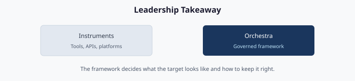

# Chapter 10 — Leadership Takeaway: Instruments vs. Orchestra

**What this series means for an executive sponsor deciding whether to run it**

> **Dependency chain:** Inventory → Plan → Identity → Policy → Network services → Devices and servers → Access plane → Retire AD DS → Prove steady state — this chapter is the sponsor's view of the whole chain.

## The framing that matters

Microsoft provides the instruments. The framework provides the orchestra.

Cloud identity, device management, hybrid management, Conditional Access, private DNS, privileged identity management and baseline assessment tools are each excellent. None of them tells an organization how to govern the move from the Active Directory-centric Client/Server era to the Hybrid-Cloud Zero-Trust era. That is the gap the framework fills.

Microsoft steers new investment toward a cloud-first identity model[^cs10-soa] while AD DS remains supported.[^cs10-adds2025] The replacements are individually strong, but collective replacement needs something no platform vendor supplies: a way to decide the target, get there, prove it was done right, and keep it right. Without one, organizations migrate in pieces, lose governance continuity, and finish with a modernized surface that cannot answer last year's audit questions.

## What the framework is — and is not

The framework is an **orchestration, governance and evidence layer** above Microsoft and third-party modernization tools:

- A **single Windows Server 2025 host** running version control, a reverse proxy, a Kerberos bridge and enterprise PKI (Chapter 01).
- A **canonical repository** of policies, plans and evidence, stored as versioned, signed files.
- A **transformation engine** (PowerShell, Python and API integrators) that reads the estate, produces deterministic plans and delivers them (Chapters 02–03).
- A **target surface** of identity, policy, services, compute and access, one chapter each (Chapters 04–08).
- An **illustrative program roadmap** with seven gates, five workstreams and mechanically evaluable exit criteria (Chapter 09).

It is **not** a replacement for the native tools; it orchestrates them. It is **not** a product: it is a reference architecture to be built, and while the framework needs no license, the services it orchestrates do (for example Entra ID P1/P2 or ID Governance, and Intune). It is **not** a shortcut: running without it tends to produce the Chapter 09 failure modes of half-migrations, drift and audit findings.

## The instruments, revisited

| Instrument | What it does | What it does not decide |
|------------|--------------|-------------------------|
| **Cloud identity** | Cloud identity directory | What your organizational structure should become |
| **Device management** | Device enrollment and policy | Which Group Policy Objects map to which profiles |
| **Hybrid management** | Hybrid server management | Which servers retire versus hybrid-project |
| **Conditional Access** | Access-policy enforcement | Which users need which policies |
| **Just-in-time privilege** | Just-in-time privilege[^cs10-pim] | Which roles stay standing-privileged |
| **Baseline assessment tools** | Baseline assessment | What to do with the findings |
| **Private resolver** | Hybrid DNS resolution[^cs10-dnspr] | Which zones are authoritative where |
| **Certificate-based authentication** | Certificate-based authentication | Who gets certificates versus FIDO2 |

The middle column is operationally mature. The right-hand column is what the framework governs.

## The governance properties that matter

1. **The authoritative source is the operational truth.** Attributes, dynamic groups, Conditional Access policies, device profiles and server tags are defined in the repository before they exist in the target. The target is a materialization, not the source.
2. **Every change is a plan.** Nothing reaches the target except through an authorized plan, so every change has provenance by construction.
3. **Drift is detected, not reported.** Divergence between source and reality becomes a tracked item within hours, before auditors find it.
4. **Evidence is built in.** Every plan produces an evidence packet, and authorization packages regenerate from the source instead of spreadsheets.
5. **Governance and execution are separate.** A component that could both decide and act could cover its tracks; these cannot.

## How to evaluate an engagement

An executive sponsor should require a "yes" to each of these:

- Is the authoritative source in version control, not a vendor portal or shared drive?
- Can every production change be traced to a signed commit?
- Is drift detection continuous, not quarterly?
- Does the target surface come from plan artifacts, so every change has a rollback?
- Is the platform host one hardened Tier-0 box?

Once the program is underway, the steering committee should ask monthly (thresholds are illustrative):

1. **What is the drift trend?** Rising drift is a leading indicator of failure.
2. **What share of production changes had a signed plan?** In steady state, anything short of all of them means ad-hoc changes have returned.
3. **What share of employees have valid organizational attributes?** Set a threshold, such as 95%, and treat a drop as a regression.
4. **How many Group Policy Objects are active?** The number should fall every month of Phase 4; a plateau above zero is a blocker.
5. **How many devices have stayed hybrid-joined past the agreed limit (for example, 180 days)?** A growing number means the program is stuck at Chapter 07.

## What to do next

1. **Treat the series as project guidance.** Turn it into versioned artifacts: adapter interfaces, policy libraries, validation checks. The series is the narrative; the artifacts are the authority.
2. **Run a read-only assessment** (Chapter 02). A first pass typically takes days to a few weeks, depending on forest size and access approvals, and its output feeds every later decision.
3. **Stand up the platform host** (Chapter 01). Everything else follows from it.

Microsoft has supplied the instruments for the new era. The framework is the orchestra, and this series is the score. Retiring Active Directory is a governance transformation, and it should be run as one.

## Key takeaways

1. The platform tools exist; what is missing is a governed way to sequence and evidence them.
2. Ask monthly: drift trend, share of changes with a signed plan, active GPOs, hybrid-joined age.
3. Start with a read-only assessment (Chapter 02).

## Authoritative references

- Microsoft Learn, [What is Privileged Identity Management? - Microsoft Entra ID Governance](https://learn.microsoft.com/en-us/entra/id-governance/privileged-identity-management/pim-configure)
- Microsoft Learn, [Azure DNS Private Resolver Overview](https://learn.microsoft.com/en-us/azure/dns/dns-private-resolver-overview)
- Microsoft Learn, [Microsoft Entra cloud-first identity guidance - Microsoft Entra ID](https://learn.microsoft.com/en-us/entra/identity/hybrid/guidance-it-architects-source-of-authority)
- Microsoft Learn, [What's new in Windows Server 2025](https://learn.microsoft.com/en-us/windows-server/get-started/whats-new-windows-server-2025)

---

**Previous:** [Chapter 09 — Migration Roadmap](09-migration-roadmap.md)  
**Next:** [Appendix A — Federal Requirements Mapping](appendix-a-requirements-mapping.md)  
**End of series**

This concludes the series. Read Chapters 00–10 in order for the full arc, or use the series overview to find a topic.

[^cs10-pim]: Microsoft Learn, *What is Privileged Identity Management? - Microsoft Entra ID Governance*. <https://learn.microsoft.com/en-us/entra/id-governance/privileged-identity-management/pim-configure>
[^cs10-dnspr]: Microsoft Learn, *Azure DNS Private Resolver Overview*. <https://learn.microsoft.com/en-us/azure/dns/dns-private-resolver-overview>
[^cs10-soa]: Microsoft Learn, *Microsoft Entra cloud-first identity guidance - Microsoft Entra ID*. <https://learn.microsoft.com/en-us/entra/identity/hybrid/guidance-it-architects-source-of-authority>
[^cs10-adds2025]: Microsoft Learn, *What's new in Windows Server 2025*. <https://learn.microsoft.com/en-us/windows-server/get-started/whats-new-windows-server-2025>
