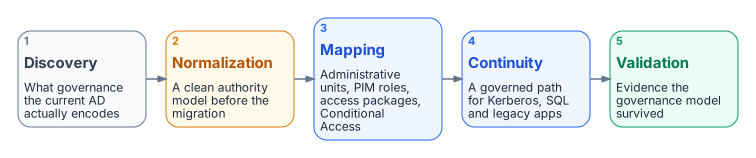

# AD to Entra ID — The Structural Migration Problem

**Why the governance gap between Active Directory and Entra ID is structural, not technical**

> For the plain-language version of why this migration is hard (for leadership and budget readers), see the [Prologue — Why Modernization Is Hard](../client-server-to-hybrid-cloud/00-prologue-why-modernization-is-hard.md). This paper assumes that argument and focuses on the structural mapping.

## Problem, solution, ask

**Problem.** Active Directory’s organizational-unit hierarchy *is* the organization’s governance model — delegation boundaries, Group Policy inheritance, administrative scope. Entra ID flattens all of it, Microsoft’s roadmap is forcing the move, and most organizations never had a clean Active Directory to begin with, so the authority model they must reconstruct exists only as tribal knowledge.

**Solution.** Treat the migration as governance discovery, normalization, mapping, continuity, and validation — not a tools project. Every Active Directory delegation concept has an explicit Entra counterpart (administrative units, privileged identity management, Conditional Access, entitlement management) that has to be built explicitly rather than inherited from a tree.

**Ask.** Before any directory-synchronization setting is touched, commission the discovery of what the current Active Directory actually encodes, and design around the two limits that decide whether the mapping works: administrative units cannot nest, and the attributes that drive administrative-unit membership are Active Directory-mastered for every synced user.

## The Core Problem

Active Directory’s hierarchical model is not just a technical structure. It is an *organizational model*. Organizational units carry governance: delegation boundaries, Group Policy inheritance, administrative scope, role-based access, and organizational authority chains. Enterprises and agencies built twenty to thirty years of operational process on top of that hierarchy.

Entra ID flattened all of it. What remains is objects in a tenant, some groups, and Conditional Access policies — but the *governance model* that Active Directory’s tree encoded is gone. Microsoft’s answer has largely been “use administrative units” and “redesign your access model” — which is technically correct but operationally brutal for large organizations.

And organizations reading Microsoft’s roadmap are right: it is clearly moving in one direction. Hybrid is a transitional state, not a destination.

## The Actual State of Active Directory in Most Organizations

Most enterprises — federal agencies included — never achieved a clean, well-governed Active Directory. What they actually have is decades of organic growth: regional domain controllers that were never fully consolidated, organizational units that reflect org charts from 2003, Group Policy Objects layered on top of Group Policy Objects, service accounts nobody remembers creating, and trust relationships that exist because someone needed something to work fast fifteen years ago.

The “centralization” wave that followed did not clean it up. It just added a layer on top. The mess is still there, just now behind a load balancer.

And nobody wants to own it. Active Directory became infrastructure that everyone depends on and nobody champions. It just runs. Until it does not.

## The Forced Migration Problem

The worry that Microsoft will force Entra ID on organizations that never got Active Directory right is not paranoia. It is pattern recognition. Microsoft did this with Exchange to Exchange Online. They did it with Skype for Business to Teams. The pattern is always the same: deprecation notices, then hybrid support windows, then end of support, then the migration is forced. And the organizations that were already clean made the transition reasonably well. The ones that were not clean got hurt badly.

The difference with Active Directory to Entra ID is that the **governance gap is structural**, not just technical. An organization cannot script its way out of a flat directory if its entire authority model depended on organizational-unit hierarchy. It has to *reconstruct* the governance model in a new paradigm — administrative units, privileged identity management, Conditional Access, entitlement management — and that reconstruction requires understanding what was there in the first place. Most organizations do not have that documentation. It is tribal knowledge, if it exists at all.

## What a Framework Brings to This Problem

What this problem calls for is not just a migration tool. It is a **governance discovery, mapping, and reconstruction capability**. Specifically:

- **Discovery** — what governance model the current Active Directory actually encodes, whether it was set up right or not.
- **Normalization** — rationalize the chaos into a clean authority model before the migration, not after.
- **Mapping** — translate hierarchical governance concepts into Entra ID equivalents (administrative units, privileged identity management roles, access packages, Conditional Access policies).
- **Continuity** — ensure Kerberos-dependent services, SQL, legacy applications, and on-premises systems have a governed transition path, not a cliff.
- **Validation** — prove the governance model survived the migration with evidence.

{fig-alt="Five cards left to right: 1 discovery of what governance the current AD encodes; 2 normalization into a clean authority model before the migration; 3 mapping to administrative units, PIM roles, access packages and Conditional Access; 4 continuity, a governed path for Kerberos, SQL and legacy apps; 5 validation, evidence that the governance model survived."}

That is a capability that hospitals, banks, universities, manufacturers, and federal agencies all need. The federal compliance angle is just one vertical of a much broader need.

### Active Directory Governance Concepts → Entra ID Equivalents

The reconstruction is not guesswork. Every Active Directory delegation concept has a direct Entra counterpart — but it must be built explicitly rather than inherited structurally.

| Active Directory Concept | Entra ID Equivalent | Notes |
|--------------------------|---------------------|-------|
| Organizational Unit | Administrative Unit | Administrative-unit membership is attribute-driven, not container-based. **Administrative units cannot nest** — an organizational-unit tree does not map onto an administrative-unit tree, only onto a flat set of attribute-selected administrative units. |
| Organizational-unit-scoped delegation | Entra role scoped to administrative unit | Same role (for example, User Administrator) — different scope binding. |
| Group Policy inheritance down organizational-unit tree | Device-management policy sets targeted at dynamic groups | Group rule replaces organizational-unit position. |
| Domain Admin | Global Administrator | Privileged-identity-management-eligible only; never permanently active. |
| Helpdesk delegation on leaf organizational unit | Authentication Administrator scoped to administrative unit | Administrative-unit membership rule matches organizational attributes. |
| Site-linked Group Policy Object (network policy) | Conditional Access + named locations | Token-based, not session/proximity-based. |
| Organizational-unit read delegation for service accounts | Microsoft Graph scoped API + least-privilege Entra role | Explicit scope; no implicit organizational-unit traversal. |
| Security group creation by department admin | Groups Administrator scoped to department administrative unit | Role + administrative unit together replace organizational-unit access-control list. |
| Privileged service account organizational unit | Workload Identity Administrator (privileged-identity-management-gated) | No organizational-unit containment; explicit role binding. |

## Two limits decide whether this mapping works

**Administrative units cannot nest.** An organizational-unit tree does not become an administrative-unit tree. It becomes a flat set of administrative units whose membership is selected by attribute, so any governance that depended on inheritance *down* the organizational-unit tree has to be re-expressed as an explicit predicate per administrative unit rather than carried by containment.

**The attributes that drive administrative-unit membership are Active Directory-mastered, not cloud-mastered.** For a user with directory synchronization enabled, Microsoft Graph treats the on-premises extension attributes as **read-only** — the source of authority is on-premises Active Directory. In a hybrid organization that is every user, so the attribute values the administrative-unit rules match on are written in Active Directory and reach Entra by directory sync. Two consequences: the migration cannot stamp attributes cloud-side for synced users, and every administrative-unit membership change inherits a sync-latency hop. Device extension attributes are cloud-mastered and *are* writable, which is why the device plane and the user plane behave differently.

The mapping step operationalizes this table: for each delegation record found in discovery, it produces the administrative-unit definition, the membership rule (attribute predicate), and the role-assignment record needed in Entra. The output is executable guidance, not a spreadsheet.

## The Strategic Question

The reason this matters is architectural: compliance machinery (authorization packages, continuous monitoring, evidence generation) is a **vertical add-on** to the core governance engine, not the other way around. That engine should be clean and universal, with the compliance module layered on top.

Core operating principles — single source of truth, evidence anchored to an authoritative source, and explicit drift — apply here as one instance of those principles applied to directory governance specifically, not as a separate principle set.

## What This Means Strategically

The underlying principles are not federal-specific. They are universal identity governance principles that happen to have been first proven in a high-rigor environment. That is actually the strongest argument for the approach:

> *We built this to survive high-compliance environments and Zero Trust mandates. For other enterprises, it is easier.*

The high-compliance work is not a liability in a broader context. It is a proof of concept at a high standard of rigor.

## The Architecture Decision This Pointed To

Enterprise directory governance should not be a separate product that happens to share some ideas with a governance framework. It is the same core concepts applied to the enterprise directory governance problem. The compliance layer is one vertical. Enterprise directory governance is another. The core engine — single source of truth, identity as root namespace, deterministic policy, embedded governance — is the same underneath both.

That means directory governance belongs inside the framework as a **governance domain** in its own right — distinct from the data-source adapters it consumes, but governed by the same envelope. Rather than standing outside the platform, it brings the directory migration problem under the governance envelope.

## The Session vs. Telemetry Divide

The governance gap described above has a deeper architectural root: networks were built on session-oriented protocols (Kerberos, Group Policy, SQL Windows Authentication) that assume client/server proximity, while Zero Trust boundary controls assume continuous, stateless, telemetry-driven verification. Those two trust models are not compatible, and the collision between them is what makes Active Directory-to-Entra migrations break in ways that look like bugs but are actually structural mismatch. Nobody wants to own the fix because it means admitting the problem is the entire architecture, not one system.

---

*Cleaned extraction for project use. No internal branding or document identifiers.*
