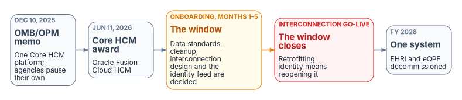

# Chapter 02 — Federal HR 2.0 and the Core HCM Platform

*Federal HR 2.0 is not the project. It is the opening: the HR side is rebuilt anyway, and the identity side is left to the agency.*

::: {.callout-note}
## In this chapter
What OPM HRIT is and who OPM is in this story. Five decades of federal HR consolidation. The Federal HR 2.0 program facts and the wave clock. Why Federal HR 2.0 is the opportunity to start HR-driven identity, and when the window closes. What OPM requires of the identity leg, and what it leaves to the agency.
:::

## OPM HRIT and Federal HR 2.0

OPM HRIT is the Office of Personnel Management's Human Resources Information Technology line — the shared-services program through which OPM delivers HR systems and workforce data services across the federal government: personnel action processing (the SF-50 pipeline), the electronic Official Personnel Folder (eOPF), and the government-wide HR data backbone, Enterprise Human Resources Integration (EHRI). Since December 2025 the program has a directing instrument: the joint OMB/OPM memorandum *Creating "Federal HR 2.0" by Consolidating Core Human Capital Management Across the Federal Government* (December 10, 2025), which consolidates 100+ agency Core HCM systems onto one government-wide platform and — significant for integration planning — schedules eOPF and EHRI to become **redundant and decommissioned** once the Core HCM platform absorbs their function. Anything built against the EHRI/eOPF feed shapes is building against systems the program has already scheduled for retirement; the durable integration surface is the Core HCM platform's own (federation, SCIM provisioning, extracts).

**Who OPM is in this story.** Not just a policy shop. Under OMB M-19-16 (*Centralized Mission Support Capabilities for the Federal Government*, April 2019), OPM was designated the **HR Quality Services Management Office (HR QSMO)** — the government-wide standards owner and storefront for HR IT. The policy direction is explicit: agencies procure HR technology through the QSMO's vetted marketplace rather than building bespoke systems.

## Fifty years of consolidation

Every milestone in the program's history moves the same direction: fewer systems, more authoritative data, shared delivery. The modernization approach in this workbook is not a novel invention — it is the landing point that five decades of federal HR consolidation policy have been driving toward.

| Year | Milestone | What Changed |
|---|---|---|
| 1972 | **CPDF** | The Central Personnel Data File — OPM's first government-wide personnel data system |
| 2002 | **e-Gov era** | e-Payroll consolidates 26 federal payroll providers to 4; eOPF begins digitizing the paper personnel folder |
| 2004 | **HR Line of Business** | OPM-led shared-services program; the federal HR business reference model; agency HR moves to shared service centers |
| ~2010 | **EHRI** | Enterprise Human Resources Integration replaces CPDF — the government-wide HR data warehouse plus electronic OPF |
| 2019 | **HR QSMO** | OMB M-19-16 designates OPM the HR Quality Services Management Office — standards owner and storefront |
| 2021 | **QSMO marketplace** | The vetted HR IT catalog opens; agencies steered to standards-aligned shared solutions |
| 2025 | **Federal HR 2.0** | The joint OMB/OPM memorandum (December 10, 2025) directs one government-wide Core HCM platform; agencies pause their own Core HCM modernization |
| 2026 | **Core HCM award** | The Federal HRIT Modernization Core HCM contract is awarded to Oracle (June 11, 2026) — **Oracle Fusion Cloud HCM**, SaaS, the workforce platform this workbook uses for its principal implementation example; Wave 1 agency transitions begin |
| 2027 | **Wave transitions** | Wave 2 completes in FY 2027; each agency's onboarding runs ~8 months with interconnections live around month 5 |
| 2028 | **One system** | Government-wide adoption goal (FY 2028); eOPF and EHRI become redundant and are decommissioned |

: The OPM HRIT timeline — five decades of consolidation {.striped .hover}

## The program facts

| Fact | Value | Source |
|---|---|---|
| Directing instrument | OMB/OPM memo, *Creating "Federal HR 2.0" by Consolidating Core Human Capital Management Across the Federal Government* | Dec 10, 2025 (Vought/Kupor) |
| Platform | **Oracle Fusion Cloud HCM** (SaaS) | Award announced Jun 11, 2026 |
| Wave 1 (begins FY26, concludes FY27) | DHS, USDA, HHS, DOI, OPM, DOT, VA, EPA (~900K FTE) | Memo, Appendix A |
| Wave 2 (fully in FY27) | The remaining agencies listed in the memo (~1.1M FTE) | Memo, Appendix A |
| First go-lives | Initial deployments slated to go live **January–March 2027**, with the first agencies starting onboarding as FY27 begins | OPM Director, reported Sep 1, 2026[^c02-mt] |
| Agency onboarding shape | ~8 months; **interconnection(s) go-live ≈ month 5**; legacy systems discontinued at cutover | Memo, Appendix B |
| Government-wide adoption goal | FY 2028 | Memo |
| Standing systems | eOPF and EHRI continue near-term, then are made **redundant and decommissioned** by Core HCM | Memo |
| Agency obligation now | **Pause own Core HCM modernization**; execute the Appendix C preparation actions | Memo, §II |
| Interface requirement (procurement) | PWS Appendix A Requirements Checklist Req #5: **SCIM 2.0 near-real-time provisioning** | Solicitation 24322626R0007 (verified 2026-04-30) |

## Why this is the opportunity, not the project

An agency doesn't choose whether to implement Federal HR 2.0; the memo and the waves decide that. What the agency does choose is whether identity rides along. Four facts make HR 2.0 the cheapest moment it will get to start HR-driven identity:

| HR 2.0 rebuilds anyway | What it gives identity |
|---|---|
| New interconnections with the agency, designed during onboarding | An HR-driven identity feed can be designed in, not bolted on later |
| HR data cleaned and converted for the migration | Worker type, organization, duty station and supervisor fixed once, at the source |
| One platform with one interface for every agency | One standards-based crosswalk instead of one per HR provider |
| A solicitation that requires SCIM 2.0 near-real-time provisioning | The protocol Entra ID's inbound provisioning consumes |

: What Federal HR 2.0 rebuilds anyway, and what that gives identity {.striped .hover}

One limit applies to all four: Federal HR 2.0 is a program for **federal employees**. Contractors and vendors are not in it. Their source is a separate decision (Chapter 05), and the HR 2.0 onboarding is the right time to make it, because the contingent-worker capability of the same platform is one of the options.

The agency's own move from Active Directory to Entra ID is the second half of the opening (Chapter 04): the directory that HR will drive is being redesigned at the same time.

{fig-alt="Five boxes left to right. Dec 10 2025, OMB/OPM memo. Jun 11 2026, Core HCM award, Oracle Fusion Cloud HCM. Amber: onboarding months 1 to 5, the window; data standards, cleanup, interconnection design and the identity feed are decided. Red: interconnection go-live, the window closes; retrofitting identity means reopening it. FY 2028: one system, EHRI and eOPF decommissioned."}

Two consequences follow:

1. **The window closes at the interconnection.** The first Wave 1 agencies go live
   between January and March 2027. For a Wave 2 agency the interconnections go
   live around month 5 of onboarding. An HR-driven identity feed designed into
   that onboarding costs a fraction of one retrofitted after it.
2. **EHRI-shaped thinking has an expiry date.** Anything that treats the EHRI/eOPF
   feeds as the durable HR data interface is building against a system the memo
   has already scheduled for decommissioning. The durable interface is the Core
   HCM platform's own surface — HCM Extracts, ATOM feeds, REST/SCIM — carrying
   OPM's standard data elements.

## What OPM requires, and what it leaves to the agency

No OPM document mandates or specifies Entra ID integration — which is exactly why the agency has to propose it. The program fixes the HR side — the platform, the waves, the interface requirements in the solicitation — and leaves the identity side to each agency. The Entra-specific design in Chapters 04–08 is an agency implementation decision built on Microsoft's own Oracle HCM integration guidance. Until mid-2026 the HR side of this architecture had to be planned agnostically, because the government-wide vendor was undecided. The award removed that uncertainty without changing the architecture: the identity model is source-independent while each source contract remains explicit, so if the program changes again the source contract and boundary transformation change while the governed identity model and downstream lifecycle services remain stable.

::: {.callout-tip}
## Continue the series
[← Previous: Chapter 01 — Why HR Is the Source of Authority](01-why-hr-is-the-source-of-authority.md) · [Index](index.md) · [Next: Chapter 03 — Attribute Authority →](03-attribute-authority.md)
:::

<!-- Third-party sources (kept separate from Microsoft and federal primary sources) -->

[^c02-mt]: **Third-party source (trade press).** MeriTalk, "OPM Eyes $40M Annual Cost for Governmentwide HR Platform," Sep 1, 2026, <https://www.meritalk.com/articles/opm-eyes-40m-annual-cost-for-governmentwide-hr-platform/> (accessed Oct 19, 2026). Reports OPM Director Scott Kupor's statement that initial deployments are slated to go live between January and March.
