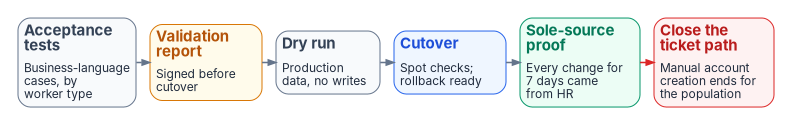

# Appendix C — Acceptance and Cutover

*A population is cut over when HR is provably its only source of accounts — not when the pipeline first runs.*

::: {.callout-note}
## In this appendix
Acceptance tests and who signs them. The validation report. Dry run, cutover and rollback. Proving HR is the sole source. Closing the ticket path. Where an agency does already run an HR connector.
:::

{fig-alt="Six boxes left to right: acceptance tests (business-language cases, by worker type); amber validation report (signed before cutover); dry run (production data, no writes); blue cutover (spot checks; rollback ready); green sole-source proof (every change for 7 days came from HR); red close the ticket path (manual account creation ends for the population)."}

## Acceptance

Acceptance tests are written in business terms, by worker type and event, so that HR, the business and security can read them:

| Scenario | Expected outcome |
|---|---|
| A hire is entered with a start date two weeks out | The account exists, disabled, before day one; baseline access is ready on day one |
| A reassignment to another organization takes effect | The old organization's access is gone and the new one's present within the agreed interval; a review opens on what remains |
| A separation takes effect | Sign-in is blocked and sessions revoked at the effective time; PIV, devices and access are revoked and reconciled |
| An employee goes on leave without pay | The account is kept and restricted; nothing is deprovisioned |
| A separation is cancelled | What the separation disabled is re-enabled from the corrected record, with evidence |
| A contractor converts to employee | Same person and key; access re-derived; manually assigned contractor access removed |
| A record fails validation | It lands in quarantine with a reason; nothing partial reaches the directory |

: Acceptance scenarios, stated in business terms {.striped .hover}

Defects are graded by severity; anything that could leave a separated person with access, or lock out an active one, blocks acceptance. Sign-off comes from HR, the identity owner, the ISSO and the business owner of the population.

## The validation report

A short report gates every cutover: the acceptance results, open defects and their dispositions, the drift baseline for the population, the privacy and security checks of Appendix B, and the rollback plan. It is signed before the cutover is scheduled.

## Dry run, cutover and rollback

- **Dry run** on production data with writes disabled: the pipeline computes what it would do, and every difference from the directory is explained.
- **Cutover** for one population at a time, aligned with that population's move to Entra ID where the two coincide (Chapter 04). Spot-check named records immediately after the first cycle.
- **Rollback** is written down before cutover: pause the provisioning job, quarantine the batch, and return the population to the prior process while the cause is fixed.

## Proving HR is the sole source

For seven days after cutover, every create, change and disable for the population must trace to an HR event and a provenance record. Any change that doesn't — a ticket, a script, a hand edit — is a finding, and the clock restarts once it is closed.

## Closing the ticket path

When the proof holds, the manual path for creating and changing accounts in that population closes: the service desk stops accepting account-creation tickets for it, and any exception goes through the governed exception process (Appendix A). This is the visible end state of HR-driven identity: nobody requests an account for a new hire, because the hire causes it.

## Where an HR connector already exists

Some agencies already run a script or connector that creates accounts from an HR extract. The same sequence applies, with one more step: once HR-driven provisioning is the proven sole source, revoke the old connector's credentials, keep its state and logs for the records schedule, and decommission it — an irreversible step that is signed off like the cutover itself.

::: {.callout-tip}
## Continue the series
[← Previous: Appendix B — Security and Privacy Assessment](appendix-b-security-and-privacy.md) · [Index](index.md)
:::
