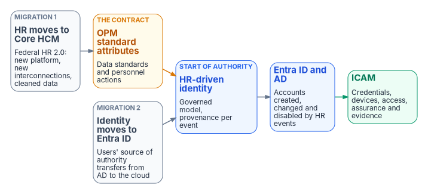

# HR-Driven Identity Modernization: An Enterprise Data Architecture Case Study {.unnumbered}

::: {.callout-important appearance="default"}
## Status — Draft series
This series consolidates what used to be nine separate pages on HR-driven identity (two execution plans, a vendor-neutral lifecycle guide, three reference-deployment write-ups, a whitepaper, an architecture note and a dynamic-group library) into one ordered reading sequence, and adds a chapter on credentials and certificates. It's a **draft**. Program facts about Federal HR 2.0 are dated and change; check them at engagement time.
:::

::: {.callout-tip}
## Download the full series
**[hr-driven-iam-bundle.docx](../../downloads/hr-driven-iam-bundle.docx)** — every chapter concatenated into one Word document. Regenerated on every site deploy.

One chapter at a time: [00](../../downloads/hr-driven-iam-00.docx) · [01](../../downloads/hr-driven-iam-01.docx) · [02](../../downloads/hr-driven-iam-02.docx) · [03](../../downloads/hr-driven-iam-03.docx) · [04](../../downloads/hr-driven-iam-04.docx) · [05](../../downloads/hr-driven-iam-05.docx) · [06](../../downloads/hr-driven-iam-06.docx) · [07](../../downloads/hr-driven-iam-07.docx) · [08](../../downloads/hr-driven-iam-08.docx) · [09](../../downloads/hr-driven-iam-09.docx) · [10](../../downloads/hr-driven-iam-10.docx) · [11](../../downloads/hr-driven-iam-11.docx)
:::

An agency's identity platform can prove, cryptographically and at every hop, that a claim was signed by the party allowed to sign it. It can't tell you whether the claim is *true*: whether the person behind the credential still works for the agency, still holds the position the access was granted for, still reports to the supervisor who approved it. Those are workforce facts. They originate in workforce business processes and are recorded in the human capital system of record; identity services consume governed projections of them and remain authoritative for credentials, authentication, sessions, directory objects, and policy enforcement.

This series is a proposal: use Federal HR 2.0 and the move from Active Directory to Entra ID together to **start HR-driven identity**, so that accounts, credentials, access and their removal become timely, explainable *consequences* of personnel records rather than tickets. It is not a plan to implement HRIT; HRIT is happening regardless. It is a plan to use it. It's written for a federal civilian agency in the commercial Microsoft cloud at GCC-Moderate / FedRAMP Moderate, receiving its HR data from the government-wide Federal HR 2.0 platform (Oracle Fusion Cloud HCM). For federal employees its contract is OPM's standard personnel data — the government-wide data standards and nature-of-action codes — mapped once into a governed workforce identity model; vendor field names are replaceable boundary logic. HRIT does not cover contractors and vendors, so they need their own authoritative source mapped into the same model (Chapter 05).

{fig-alt="Two grey boxes, HR moves to Core HCM and Identity moves to Entra ID, feed an amber box for OPM standard attributes and a blue box for HR-driven identity, which drives Entra ID and AD and then ICAM."}

## Modernization outcomes

- **Day-one readiness:** required accounts and approved baseline access are available when an affiliation begins.
- **Separation-to-block latency:** logical access is blocked at the effective separation time, or within the agency-approved threshold.
- **Revocation completion:** PIV and derived credentials, device certificates, sessions, and application-specific credentials are reconciled to completion.
- **Mover convergence:** access derived from the prior assignment is removed, the new baseline applied, and residual exceptions reviewed.
- **Correlation coverage:** governed workforce identities reconcile with enabled enterprise accounts.
- **Orphan reduction:** enabled accounts without a current, approved authority record are found and resolved.
- **Explainable access:** covered entitlements trace to a rule, an approved exception, an authoritative attribute, or a privileged-access decision.
- **Continuous evidence:** provenance, provisioning results, workflow outcomes, exceptions, and drift findings come out of normal operation.

The canonical model and provisioning services exist to produce these outcomes; Chapter 00 sets out the scope, authority boundaries, and principles behind them.

## Reading sequence

Chapters 00–02 make the case and set the context. Chapters 03–05 define the data: who owns which attribute and what it's called everywhere. Chapters 06–09 turn the data into lifecycle, credentials, access and evidence. Chapter 10 is the execution plan and Chapter 11 an illustrative deployment.

::: {#chapters}
:::

## How this series relates to other parts of the site

- **[SQL Server Identity Transformation, Book 07](../case-studies/sql-server-narrative/Book_07.md)** applies the attribute-to-access chain of Chapter 08 to SQL Server logins and database roles.
- **[SQL Server Identity Transformation, Book 10](../case-studies/sql-server-narrative/Book_10.md)** covers the move from AD CS to Microsoft Cloud PKI; Chapter 07 covers only the certificate steps of the leaver sequence.
- **[Federal Compliance Vol I Book 04](../compliance/Vol_I_Book_04_HRIT_Identity_Org_SSOT.md)** carries the compliance treatment of the same controls (AC-2, IA-4, PS-4, PS-5, SI-12). The architecture contributes mechanisms and evidence to them; it doesn't satisfy them on its own.
- **[Client-Server to Hybrid-Cloud, Chapter 04](../client-server-to-hybrid-cloud/04-identity-transformation.md)** covers the move from the OU tree to attribute-driven structure.
- **[The AD → Entra ID Identity Modernization Guide](../books/b02-identity/09-building-the-entra-target.md)** covers directory migration, the companion dimension to inbound provisioning.
