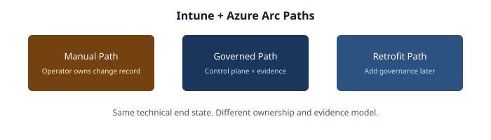

# Intune + Azure Arc Modernization

Three paths to the same technical end state.

| Path | Description |
|------|-------------|
| [Manual Path](intune-arc-manual-path.md) | Operator owns the change record. No central control plane. |
| [Governed Path](intune-arc-governed-path.md) | Same end state, bound to organizational intent and continuous evidence. |
| [Retrofit Path](intune-arc-retrofit-path.md) | Add governance to an estate already modernized under the manual path. |

---

*Cleaned extractions for project use.*
