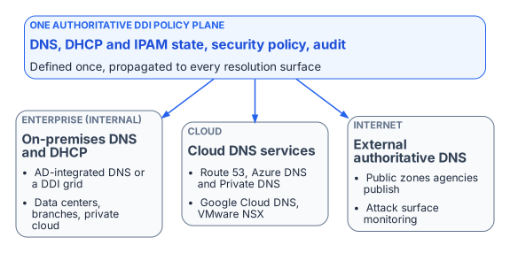
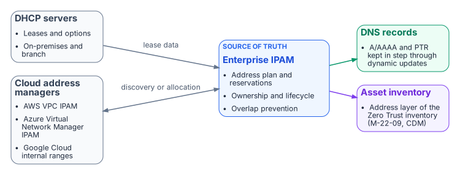

# Chapter 01 — DNS Is Now the Control Plane

*Why DNS, DHCP and IPAM can no longer be run as a commodity utility.*

::: {.callout-tip}
## Download this chapter
**[next-generation-ddi-ch01-bundle.docx](../../downloads/next-generation-ddi-ch01-bundle.docx)**: this chapter as a Word document, with its figures. The [whole book](../../downloads/next-generation-ddi-bundle.docx) is also available.
:::

## Problem, Solution, Ask

**Problem.** DNS has quietly become the application surface, the security enforcement plane, and the PKI and identity substrate of the hybrid multi-cloud enterprise. Most agencies still run it as a commodity utility across as many as five independent platforms: Active Directory DNS or an on-premises DDI grid, AWS Route 53, Azure DNS and Azure Private DNS, Google Cloud DNS, and VMware NSX. The result is split-brain DNS that breaks private connectivity, SaaS endpoint selection, certificate trust and Layer 7 Zero Trust policy at once. It surfaces as certificate errors and access denials, rarely as DNS errors.

**Solution.** One authoritative DDI (DNS, DHCP and IP address management) policy plane that propagates DNS, DHCP and IPAM state consistently to every resolution surface, with edge interception (for example the redirect-dns data policy in Cisco Catalyst SD-WAN) pointed at resolvers under agency control rather than around them. This is an architectural requirement, not a product. Enterprise DDI platforms, and cloud-native resolvers managed as code, can all be evaluated against it (Chapter 11). As one concrete data point, Infoblox Government Cloud, which runs in AWS GovCloud (US) and holds a FedRAMP Moderate authorization, added its Universal DDI management service to that authorized offering in July 2026.[^c01-fedramp][^c01-ibxpr]

**Ask.** Authorize the architecture decision to operate a single authoritative DDI policy plane. Assign an owner (typically the enterprise architecture or network operations lead) to complete the five configuration decisions in Chapter 08 within 90 days and report residual risk to the authorizing official.

## For Decision Makers

DNS fragmentation across independent platforms produces split-brain DNS: the same query resolves to different answers depending on where it originates. That is no longer a lookup inconvenience. It breaks private connectivity, SaaS endpoint selection, certificate trust and FQDN-based Zero Trust policy at the same time. A single authoritative DDI policy plane is the structural fix.

- **Split-brain DNS is structural, not a bug to patch.** Independent per-cloud DNS systems diverge because they share no state (Chapter 02).
- **DNS is now a security and PKI dependency.** Certificate validation, OCSP and CRL lookups, token audiences and FQDN-based policy all fail quietly under split-brain (Chapter 06).
- **Edge interception can silently bypass the policy plane.** The SD-WAN redirect-dns destination determines whether response policy zones (RPZ), DNSSEC validation and logging apply at all (Chapter 05).
- **Some cloud optimizations stop at the commercial boundary.** Microsoft 365 informed network routing (INR) is not available in GCC-Moderate, GCC High or DoD. The DDI architecture is unaffected; that one optimization is simply unavailable (Chapter 05 and the [Applicability](00-applicability.md) page).
- **Five configuration decisions carry the operational risk:** the redirect-dns target, forwarding chain order, per-cloud conditional forwarding, Active Directory DNS inventory before decommissioning, and OCSP/CRL reachability (Chapter 08).

## DNS in the Modern Hybrid Multi-Cloud Enterprise

DNS was specified in 1983 (RFC 882 and 883) and redefined in 1987 (RFC 1034 and 1035)[^c01-rfc882] to map hostnames to addresses in a distributed, hierarchical database. In a hybrid multi-cloud agency it now also publishes private endpoint addresses, selects public SaaS front doors, enforces security policy, supports certificate validation, identifies services for Zero Trust policy and, through wildcard namespaces, defines the application surface.

### Three DNS Perspectives Under a Single Control Plane

{fig-alt="A policy plane at the top connects to three perspectives: enterprise internal DNS, cloud DNS services, and external authoritative DNS."}

A unified DDI policy plane manages DNS from three interconnected perspectives:

- **Enterprise (internal):** AD-integrated DNS or an on-premises DDI grid, DNS views, high availability and anycast, and role-based administration for data centers, branches and private clouds.
- **Cloud:** Amazon Route 53, Azure DNS and Azure Private DNS, and Google Cloud DNS, with discovery of cloud networks and federation with cloud IPAM.
- **Internet (external authoritative):** the public zones the agency publishes, whether self-hosted or on a managed authoritative service, together with monitoring of the external attack surface.

The typical agency landscape spans on-premises AD DNS or a DDI grid; Route 53 public and private hosted zones with Route 53 Resolver; Azure Private DNS zones with Azure DNS Private Resolver; Google Cloud DNS private zones and DNS peering; and the VMware NSX DNS service. Each has its own console, API and failure modes. Managed separately, they create a combinatorial synchronization burden. A single new Azure private endpoint can require changes to an Azure Private DNS zone, Private Resolver forwarding rulesets, Route 53 outbound rules and on-premises conditional forwarders.

### Hybrid Cloud IPAM and DHCP

{fig-alt="DHCP servers and cloud address managers feed an enterprise IPAM, which keeps DNS records in step and supplies the address layer of the asset inventory."}

A central IPAM is the authoritative record of the address plan, reservations and ownership across on-premises and cloud address space, and it is what prevents overlaps. DHCP lease data and dynamic DNS updates keep address and name records in step through each record's lifecycle. Existing Microsoft DHCP servers can be discovered and brought under the same inventory during transition. This is also the address layer of the continuous asset inventory that Zero Trust architectures depend on.[^c01-ztmm]

::: {.callout-note}
## What this chapter establishes
1. DNS now carries private endpoint publication, SaaS front-door selection, security policy and service identity, so it has to be governed as a control plane, not run as a utility.
2. Several independent DNS platforms (as many as five) with no shared state make split-brain structural.
3. The answer is one authoritative DDI policy plane, with five configuration decisions carrying most of the risk.
:::

---

**Previous:** [Applicability](00-applicability.md)  
**Next:** [Chapter 02 — Split-Brain DNS: The Structural Problem](02-split-brain-dns.md)

[^c01-fedramp]: FedRAMP Marketplace, Infoblox Government Cloud (package FR2017257053), authorized at Moderate since December 15, 2022. <https://www.fedramp.gov/marketplace/products/FR2017257053/>
[^c01-ibxpr]: **Third-party source (vendor).** Infoblox, "Infoblox Government Cloud Achieves FedRAMP Moderate Certification, Bringing Modern DDI and Asset Visibility to Federal Agencies," press release, July 22, 2026. <https://www.infoblox.com/news/news-events/press-releases/infoblox-government-cloud-achieves-fedramp-moderate-certification-bringing-modern-ddi-and-asset-visibility-to-federal-agencies/>
[^c01-rfc882]: IETF RFC 882, *Domain Names — Concepts and Facilities*, November 1983; superseded by RFC 1034 and RFC 1035 (November 1987). <https://www.rfc-editor.org/rfc/rfc882>; <https://www.rfc-editor.org/rfc/rfc1034>; <https://www.rfc-editor.org/rfc/rfc1035>
[^c01-ztmm]: CISA, *Zero Trust Maturity Model*, Version 2.0. <https://www.cisa.gov/zero-trust-maturity-model>
