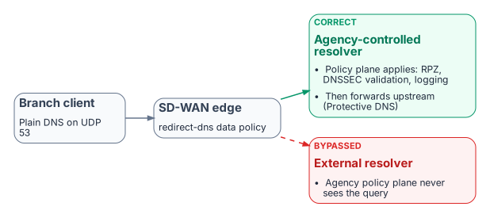
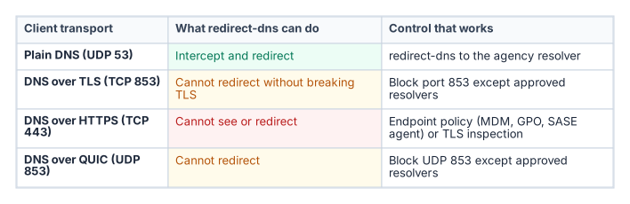

# Chapter 05 — Edge Interception, Encrypted DNS and Rogue DHCP

*Where queries escape the governed resolver path.*

::: {.callout-tip}
## Download this chapter
**[next-generation-ddi-ch05-bundle.docx](../../downloads/next-generation-ddi-ch05-bundle.docx)**: this chapter as a Word document, with its figures. The [whole book](../../downloads/next-generation-ddi-bundle.docx) is also available.
:::

## SD-WAN DNS Interception

{fig-alt="A branch client sends plain DNS on UDP 53 to the SD-WAN edge, whose redirect-dns data policy sends it either to an agency-controlled resolver, where RPZ, DNSSEC validation and logging apply before forwarding upstream to Protective DNS, or to an external resolver that the agency policy plane never sees."}

SD-WAN edges can intercept DNS regardless of the resolver a client was configured with. In Cisco Catalyst SD-WAN this is the redirect-dns action of a centralized data policy: the edge router matches DNS traffic and sends it to a policy-designated resolver. Cisco documents the feature for IPv4 DNS over UDP only; DNS over TCP and DNS carried inside overlay tunnels are not redirected.[^c05-cisco] The destination decides whether agency policy applies:

- **Correct path:** branch client → SD-WAN edge → network-addressable agency-controlled resolver → DDI policy plane (response policy zones, DNSSEC validation, logging) → per-cloud private resolvers, with internet-bound recursion forwarded through Protective DNS.
- **Bypassed path:** branch client → SD-WAN edge → an external resolver outside agency control → public recursion. The agency policy plane never sees those queries.

DNSSEC validation must happen on a resolver the agency controls. A forwarding resolver can validate if it requests and checks DNSSEC records, but if redirect-dns or conditional forwarding hands queries to an upstream resolver outside agency control, the agency loses control of its validation policy and trust anchors (Chapter 06).

### Microsoft 365 informed network routing

Microsoft 365 informed network routing (INR) lets a supported SD-WAN share network-quality data with Microsoft so that Microsoft 365 traffic takes the best path; the Cisco integration requires Cisco IOS XE SD-WAN 20.4 / 17.4 or later.[^c05-inr] Microsoft documents INR as available only for the Worldwide commercial cloud; it is not supported in the GCC-Moderate, GCC High, DoD, Germany or China clouds. For agencies in those clouds, local internet breakout and application-aware routing remain the main Microsoft 365 optimizations. None of this changes the DDI design: INR is a routing optimization, not a DNS dependency.

## Encrypted DNS and Bypass Controls

{fig-alt="Table of four transports. Plain DNS on UDP 53 can be intercepted and redirected to the agency resolver. DNS over TLS on TCP 853 and DNS over QUIC on UDP 853 cannot be redirected without breaking the session, so block port 853 except to approved resolvers. DNS over HTTPS on TCP 443 cannot be seen or redirected, so it needs endpoint policy or TLS inspection."}

Client-side encrypted DNS to a public resolver is the most common bypass. M-22-09 requires encrypted DNS wherever it is technically supported, and CISA's implementation guidance requires that agency egress resolution still pass through Protective DNS.[^c05-m2209][^c05-cisaedns] The goal is therefore not to prohibit encrypted DNS but to make sure it terminates at an agency-controlled or CISA Protective DNS resolver rather than an ungoverned public service. Practical controls:

- **Know what the edge can reach.** redirect-dns works on plain DNS only. It cannot redirect DNS over TLS (TCP 853) or DNS over QUIC (UDP 853) without breaking the session, because the client validates the resolver's certificate; those ports can be blocked except to approved resolvers.[^c05-rfc7858] DNS over HTTPS runs on TCP 443 alongside ordinary web traffic, so neither redirect-dns nor port blocking can isolate it.
- **Control the endpoint.** MDM, Group Policy or a SASE or DDI endpoint agent should point clients' encrypted DNS at the governed resolver, and disable or restrict browser-level DoH. Windows supports configuring DoH to a named resolver.[^c05-doh]
- **Block known public encrypted DNS endpoints** at the network edge, with exceptions only for approved resolvers.
- **Alert on resolution-path anomalies**, such as connections from hosts whose queries never appear in the governed resolver logs.

## DHCP Option 6 and Rogue DHCP

A rogue DHCP server that hands out a malicious resolver in option 6 can move an entire subnet onto an attacker-controlled resolver in one step, past every response policy zone and Protective DNS control. In IPv6 networks, rogue router advertisements carrying the RDNSS option (RFC 8106)[^c05-rfc8106] can do the same and are often the larger attack surface. Unified DHCP and IPv6 governance addresses this through:

- Centralized scope and option management with change control and an audit trail.
- Rogue DHCP and router advertisement detection, through DHCP snooping and RA Guard on the access switches, lease analysis and network discovery.
- Consistent option 6 and RDNSS values across every authorized DHCP server and router.
- IPAM integration, so unauthorized leases are visible immediately.

::: {.callout-note}
## What this chapter establishes
1. The redirect-dns destination decides whether agency policy applies at all, and redirect-dns only handles IPv4 DNS over UDP.
2. Encrypted DNS must terminate at an agency-controlled or Protective DNS resolver; DoH can be governed only at the endpoint.
3. Rogue DHCP and rogue router advertisements can move a whole subnet to an attacker resolver in one step.
:::

---

**Previous:** [Chapter 04 — The Active Directory DNS Departure](04-active-directory-dns-departure.md)  
**Next:** [Chapter 06 — DNS Identity, Certificates and DNSSEC](06-dns-identity-and-dnssec.md)

[^c05-cisco]: Cisco, *Cisco Catalyst SD-WAN Policies Configuration Guide, Cisco IOS XE Catalyst SD-WAN Release 17.x*, "Redirect DNS in Cisco Catalyst SD-WAN Service-Side VPNs" (restrictions: IPv4 only; UDP only, not TCP; no DNS from the overlay tunnel; service-side VPN support from 17.8.1a / 20.8.1). <https://www.cisco.com/c/en/us/td/docs/routers/sdwan/configuration/policies/ios-xe-17/policies-book-xe/redirect-dns.html>
[^c05-inr]: Microsoft Learn, "Microsoft 365 informed network routing" (WW Commercial only; Cisco IOS XE SD-WAN 20.4/17.4 or later). <https://learn.microsoft.com/en-us/microsoft-365/enterprise/office-365-network-mac-perf-cpe?view=o365-worldwide>
[^c05-m2209]: OMB M-22-09, *Moving the U.S. Government Toward Zero Trust Cybersecurity Principles*, January 26, 2022, section on encrypted DNS. <https://www.whitehouse.gov/wp-content/uploads/2022/01/M-22-09.pdf>
[^c05-cisaedns]: CISA, *Encrypted DNS Implementation Guidance*, May 2024. <https://www.cisa.gov/resources-tools/resources/encrypted-dns-implementation-guidance>
[^c05-rfc7858]: IETF RFC 7858 (DNS over TLS), RFC 8484 (DNS over HTTPS) and RFC 9250 (DNS over QUIC). <https://www.rfc-editor.org/rfc/rfc7858>; <https://www.rfc-editor.org/rfc/rfc8484>; <https://www.rfc-editor.org/rfc/rfc9250>
[^c05-doh]: Microsoft Learn, "Secure DNS Client over HTTPS (DoH) on Windows Server 2022." <https://learn.microsoft.com/en-us/windows-server/networking/dns/doh-client-support>
[^c05-rfc8106]: IETF RFC 8106, *IPv6 Router Advertisement Options for DNS Configuration*, March 2017. <https://www.rfc-editor.org/rfc/rfc8106>
