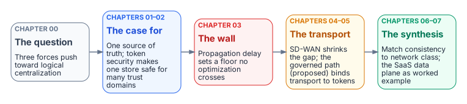

# The Physics of a Single Source of Truth

::: {.callout-tip}
## Download the full white paper
**[ssot-network-physics-bundle.docx](../../downloads/ssot-network-physics-bundle.docx)** — every chapter in this white paper concatenated into one Word document. Regenerated on every site deploy.
:::

## Thesis in one paragraph

The fashionable architecture of the last decade — fragment data into many
small, service-owned databases — overcorrected, and the fragmentation it
created became the largest single source of governance drift. Three forces now
push the pendulum back toward **logical centralization**: wide-area networks
that are fat and application-aware, **token-based (zero-trust) security** that
lets one logical store safely serve many trust domains, and the discipline of a
**single source of truth (SSOT)** as the cheapest thing to reason about. This
white paper argues that the era of small SQL servers *as sources of truth* is
over — but that small databases survive, repurposed as disposable caches,
read replicas, and compliance-stamped exceptions. It then confronts the one
wall none of this moves: the speed of light. Network optimization (SD-WAN
differentiated transport, forward error correction, clock distribution) can
take you *to* the physical latency floor with a tight tail, but never *below*
it — so the correct architectural move is not "make global sync fast" but
"need less global sync." the Federal Modernization Program's own SaaS data plane (the program decision) is the worked
reference example throughout.

## Who this is for

- **Architects and platform engineers** weighing centralized vs. distributed
  data topologies for a multi-tenant or multi-region service.
- **CISOs and zero-trust practitioners** evaluating how identity-based security
  changes the data-isolation calculus.
- **Network engineers** deciding what SD-WAN path differentiation can and
  cannot buy a database tier.
- **Governance and compliance teams** mapping data-residency and blast-radius
  constraints onto a consolidation strategy.

## Chapters

{fig-alt="Five cards left to right: Chapter 00, the question (three forces push toward logical centralization); Chapters 01–02, the case for (one source of truth, token security); Chapter 03, the wall (the propagation floor); Chapters 04–05, the transport (SD-WAN narrows the gap; the proposed governed path); Chapters 06–07, the synthesis (match consistency to network class; the SaaS data plane worked example)."}

- **00** — [Executive Summary — The Centralization Question](./00-executive-summary.html)
  - The pendulum, the three forces, and the wall that does not move
  - *Audience:* Executive stakeholders · architects · CISO

- **01** — [Logical Centralization and the Single Source of Truth](./01-logical-centralization.html)
  - Why fewer authoritative copies beats more, and how hardware ate the scaling objection
  - *Audience:* Architects · platform engineers · data owners

- **02** — [Token-Based Security as the Enabler](./02-token-security-enabler.html)
  - How zero-trust identity removes the historical reason to fragment data
  - *Audience:* CISO · zero-trust practitioners · platform engineers

- **03** — [The Speed-of-Light Tax](./03-speed-of-light-tax.html)
  - Propagation delay vs. everything else, and why strong consistency is a latency problem
  - *Audience:* Architects · network engineers · SRE

- **04** — [SD-WAN and Differentiated Transport](./04-sdwan-differentiated-transport.html)
  - Path classes, tail-latency reduction, FEC, and clock distribution for keeping large databases in sync
  - *Audience:* Network engineers · platform engineers · SRE

- **05** — [The Governed Path — Token-Bound Transport and the Application-Aware Overlay](./05-governed-path-transport.html)
  - *Forward-looking (Proposed, the program decision).* Why an efficient edge device needs an identity-anchored fabric, and how the path becomes governed evidence
  - *Audience:* Network architects · zero-trust practitioners · platform engineers

- **06** — [Matching Consistency Classes to Network Classes](./06-consistency-network-classes.html)
  - The synthesis: aligning the data layer's consistency model with the network layer's transport tiers
  - *Audience:* Architects · platform engineers · network engineers

- **07** — Reference Architecture — the Federal Modernization Program SaaS Data Plane
  - How the program decision and the program decision implement centralize-the-truth / distribute-the-copies in practice
  - *Audience:* Architects · platform engineers · governance teams

## Provenance

This white paper is an analysis document. Its FMP-specific claims trace to
the canonical decision records they cite — principally
**the program decision** (Azure SaaS architecture), **the program decision** (passwordless Entra
Postgres auth), **the program decision** (GCC-Moderate boundary), and **the program decision** (diagram
source-of-truth doctrine) under `src/fmp/canon/adr/` — and, for the
forward-looking Chapter 5, the *Proposed* **the program decision** (Application-Aware
Networking and Token-Bound Transport) — and to the substrate
operating principle of SSOT recorded in `AGENTS.md` and `the program decision`. Per the Federal Modernization Program
provenance doctrine, external facts (networking physics, vendor behavior) are
authoritative only where this document cites their source directly; where a
claim rests on a Federal Modernization Program decision, the ADR is named inline.

## A note on figures

This white paper uses no generative-AI raster figures and no inline Mermaid.
Each figure is generated from a committed source in
`docs/images/diagrams/ssot-network-physics/` with the site's shared diagram
renderer (`scripts/diagrams/render.py`): SVG for the web, a 2x PNG for the Word
edition.
