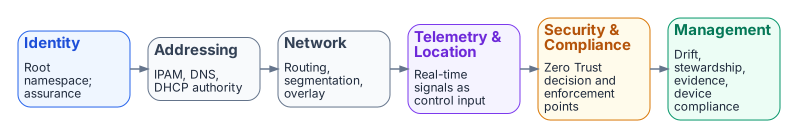

# Six-Plane Architecture

**The six control planes and their governance roles**

The modernization control surface decomposes into **six control planes**. Each plane is authoritative for its domain, and all six operate as a single deterministic system.

{fig-alt="Six cards left to right with arrows: Identity (root namespace, assurance), Addressing (IPAM, DNS, DHCP), Network (routing, segmentation, overlay), Telemetry & Location (real-time signals as control input), Security & Compliance (Zero Trust decision and enforcement points), Management (drift, stewardship, evidence, device compliance)."}

## The six planes

| Plane | Role |
|-------|------|
| **Identity** | Root namespace and assurance engine |
| **Network** | Routing, segmentation, and overlay transport |
| **Addressing** | Deterministic IPAM and DNS/DHCP authority |
| **Telemetry & Location** | Real-time signals for routing, security, and compliance |
| **Security & Compliance** | Zero Trust enforcement and authorization alignment |
| **Management** | Governance, drift detection, configuration management, device compliance |

## Why six planes

The decomposition is not arbitrary. Each plane corresponds to a distinct authority boundary: a single source of truth, a single set of authoritative schemas, and a single class of drift findings. The six-plane cut is the smallest decomposition that:

1. Names every authoritative source an authorizing official needs to evaluate during review.
2. Maps cleanly to operational roles — every mission-class lands inside exactly one plane.
3. Avoids the “everything is identity” overload that collapses addressing, telemetry, and management into the identity plane and loses the ability to drift-detect them independently.

## Plane-by-plane summary

### Identity plane
Root namespace. Every actor — human, service principal, device, workload — is named here exactly once. Assurance levels are anchored on this plane. Downstream planes consume identity claims; they do not mint them.

### Network plane
Routing, segmentation, and overlay transport. Owns the path-level decisions that flow from identity context (who) and addressing (where). Replaces perimeter logic with an identity-driven overlay.

### Addressing plane
Deterministic IPAM/DNS/DHCP. Names are derived from identity and policy, not assigned by a parallel administrative process. Addressing is computed from the identity plane, not maintained as an independent source.

### Telemetry & Location plane
Real-time signal carrier. Every component emits telemetry in canonical claim form. Telemetry is treated as control input, not as after-the-fact reporting: drift findings, evidence claims, and policy decisions all originate as telemetry events.

### Security & Compliance plane
Zero Trust enforcement and authorization alignment. Holds the policy decision points and policy enforcement points that consume identity, addressing, and telemetry to evaluate access.

### Management plane
Governance and configuration management. Where the system is run from: drift detection, stewardship, evidence regeneration, device compliance reporting.

## How the planes interact

Cross-plane interaction is deterministic and one-directional at the authoritative level: identity feeds addressing feeds network feeds telemetry feeds security-and-compliance feeds management. Cycles exist only at runtime (for example, management drift findings trigger identity re-evaluation), and every cycle is mediated by an explicit artifact, never by ad-hoc coupling.

This means every plane has exactly one authoritative input, and any deviation surfaces as a drift finding rather than as silent inconsistency.

## What this means for an authorization package

An authorizing official can expect:
- A per-plane control narrative rather than a perimeter-centric one.
- Citations for every policy intent.
- Drift findings scoped per plane — identity drift, addressing drift, telemetry drift each carry their own evidence trail rather than collapsing into a single “system drift” line item.

---

*Cleaned extraction for project use. No internal branding or document identifiers.*
