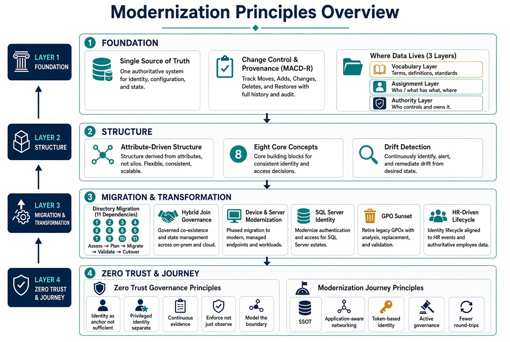

# Modernization Principles

**Consolidated principles for a governed modernization program**

This document collects the core principles extracted from the cleaned architecture, guides, and libraries. It is written for program leadership, architects, and operators who need the rules without the full narrative.

---

## 1. Single Source of Truth

Every important claim has exactly one authoritative origin. All other representations are provenance-anchored pointers, not copies.

- Runtime systems read from the authoritative source; they do not write to it except through a governed change process.
- Every derived artifact cites the document and version it was derived from.
- Drift is evaluated against the single source of truth.
- Without a single source of truth, every system holds a slightly different copy of the same claim. Over time those copies diverge, and no one can say which is authoritative.

---

## 2. Change Control and Provenance (MACD-R)

Every operational change — every Move, Add, Change, Deletion, and Reset — travels five clauses. An operation that skips one is unauthorized by construction:

1. **It originates with the single source of truth.** Work is created by divergence between the source of truth and the estate.
2. **It carries an authoritative authorization.** The approval resolves from the authority model, not from whoever is nearby.
3. **It executes under least privilege, elevated just-in-time.** The executing actor activates a time-boxed, scoped role and holds no standing privilege.
4. **It closes with provenance.** No closure counts unless it carries its proof — the verification payload, a timestamp, and the identity of the checking mechanism.
5. **It emits verified, secured evidence automatically.** The closure record flows into the continuous-monitoring stream with no human assembly.

**Closure Provenance Doctrine:** A task closed by a human clicking “complete” with no machine-readable verification is prose, not evidence. Human-only closure is an exception state, not a path. Reports are derivations from the closure stream, never compilations of assertions.

---

## 3. Attribute-Driven Structure

Hierarchical governance (organizational units, Group Policy inheritance, delegation boundaries) is reconstructed inside a flat directory using coded organizational attributes.

- Attributes are encoded in extension attributes on users and devices using a structured codebook.
- Dynamic group membership, administrative-unit scoping, Conditional Access targeting, and license assignment are all driven by those attributes.
- Administrative units cannot nest. An organizational-unit tree becomes a flat set of attribute-selected administrative units.
- For synced users, the facets that drive administrative-unit membership are Active Directory-mastered, not cloud-mastered.

**Five drift categories:** Schema, Value, Hierarchy, Orphan, Phantom.

---

## 4. Where Data Lives

Organizational attributes live in three places at once:

| Layer | Where it lives | Role |
|-------|----------------|------|
| **Vocabulary** | Version-controlled codebook | Defines the language |
| **Assignment** | Extension attributes on the directory object | Carries the runtime data |
| **Authority** | The HR system | Source of truth |

If the three disagree, the resolution order is **HR → directory → codebook validation → drift event**. IT never edits the attribute slots by hand.

---

## 5. Directory Migration — The Hidden Surface

Active Directory was the implicit governance model for eleven categories of infrastructure objects: users, computers, service accounts, security groups, Group Policy Objects, DNS/DHCP, PKI, RADIUS, LDAP, service principal names, and trust relationships.

When Active Directory goes away, every one of these services loses its governance anchor — and most of them fail silently.

**Critical silent-failure risks:**
- PKI / Certificate Services — certificates stop auto-enrolling.
- RADIUS / 802.1X / VPN — network access control stops authenticating.
- LDAP Proxy — legacy applications that authenticate via LDAP bind stop working.

**Six migration phases:** Discover → Normalize → Map → Migrate → Validate → Decommission.

---

## 6. Eight Core Concepts

| # | Concept | Definition |
|---|---------|------------|
| 1 | Single source of truth | Every claim has one authoritative origin. |
| 2 | Conversation as atomic unit | Every interaction binds identity, certificates, addressing, path, quality of service, and telemetry. |
| 3 | Identity as root namespace | Every address, certificate, subnet, policy, and telemetry event derives from identity. |
| 4 | Deterministic addressing | Addressing is identity-derived and policy-driven. |
| 5 | Certificate-anchored overlay | Mutual TLS anchors tunnels, services, and trust relationships. |
| 6 | Telemetry as control | Telemetry is a real-time control input, not passive reporting. |
| 7 | Embedded governance | Governance is executed through orchestrated workflows, not manual tickets. |
| 8 | User experience first | The migration is invisible to end users if governance was done right. |

---

## 7. Hybrid Join Without Governance

Converting a large domain-joined fleet to hybrid join is a near-effortless tenant switch (service connection point + Group Policy). That effortlessness is the hazard.

**The ungoverned path** keeps the connectivity benefit and spends the truth-and-accountability layer: ownership, one object per machine, scoped rollout, provenance, lifecycle, and a single console of record.

**The governed path** reaches the same end state but routes the bulk state change through an active reconciliation control plane:
- Address before you actuate (organizational attributes on every device).
- Cap the blast radius (high-blast-radius classes remain gated on human approval).
- Execute through plan and apply with dry-run.
- Bake enforcement in report-only first.
- Reconcile duplicates and lifecycle.
- Emit evidence an authorizing official can sign.
- Cover the whole denominator (non-Windows, BYOD, guests, servers).

---

## 8. Device and Server Modernization

**Observe before you change anything.**

Four phases:
1. **Observe** — NTLM audit, service principal name inventory, SQL audit, device-management posture.
2. **Onboard** — hybrid management onboarding, device-management auto-enrollment.
3. **Harden** — service principal name repair, NTLM restriction, Conditional Access baseline.
4. **Watch** — Conditional Access drift, cross-domain status.

**Key rules:**
- Audit before you restrict NTLM. Premature blocking breaks legacy applications.
- Never embed a service-principal secret in a Group Policy startup script.
- Always exclude break-glass accounts from Conditional Access before enforcing.
- Domain-unjoin is a separately sequenced decision; onboarding does not imply it.

---

## 9. HR-Driven Lifecycle

The HR system is the system of truth for organizational placement. The directory is the system of record for identity.

**Operating rules:**
- Organizational attributes are derived, never hand-set.
- The match key (HR person identifier ↔ directory employee identifier) must be populated before the first full sync.
- Every event produces a provenance record. No record, no closure.
- One master per attribute. Writeback carries only identity-plane-mastered values to HR for display.
- Cutover from hybrid to cloud-native is a configuration change, not a rebuild.

---

## 10. Conditional Access Principles

- **All matching policies apply.** Additive evaluation; no priority number.
- **Block overrides grant.**
- **Multiple grant controls combine as AND by default.**
- **Session controls are additive.**
- **Exclusions are absolute.**
- Deploy in **report-only** first; promote to enforce as a separate change.
- Always exclude a break-glass group before enforcing.
- Target via dynamic groups built from organizational attributes.
- Unpopulated attributes cause policy bypass.

---

## 11. Group Policy Object Sunset Principles

Three related but distinct programs:
- **Net-new device onboarding** — governance at procurement time.
- **Existing-fleet Group Policy Object sunset** — replacement of Group Policy Objects on currently deployed endpoints.
- **Regenerate, not copy** — the philosophy governing how replacement policies are authored.

**Assignment precedence:**
- Compliance policies: most restrictive wins.
- Configuration profiles: last write wins.
- Endpoint security: takes precedence over configuration profiles for the same setting.

**Conflict rule:** Where device management and a Group Policy Object target the same setting, last-writer-wins produces unpredictable results. Document overlapping settings and retire the Group Policy Object copy once device management owns the setting.

---

## 12. Drift Detection

The drift engine does not believe the assumption that the HR system, the directory, and the codebook still agree. It re-checks on a schedule and emits a structured finding when they do not.

**Six-phase loop:** Snapshot → Compare → Classify → Alert → Remediate → Verify.

**Five categories:**
- **Format** — typed value fails its expected pattern (critical, no auto-fix).
- **Value** — enumerated value not in the enumeration (high, sometimes auto-fixed).
- **Slot** — two facets fighting over the same slot (critical, no auto-fix).
- **Orphan** — enumeration value with zero matching principals (medium, flag only).
- **Phantom** — principal carries a deprecated value (medium, reassign when successor defined).

Critical findings halt the remediation pass.

---

## 13. SQL Server Identity Transformation

Windows Authentication was good engineering for its world. The destination is cloud identity authentication (OAuth tokens, managed identity for the engine, multi-factor authentication for humans).

**Precondition most narratives skip:** You cannot migrate the authentication of an estate you have not first assessed and consolidated.

**Three states:**
- **Before** — domain controller is the authentication authority; NTLM is the silent fallback.
- **During** — both paths live simultaneously (controlled risk).
- **After** — no domain controller in the path; token carries identity and context.

---

## 14. Education, Training, and Test Plans

- **Education** builds the mental model (governance is a system, identity is the primitive, maps replace inventories, provenance is non-negotiable, modernization is a lifecycle, drift is the feedback signal).
- **Training** has two tracks: Contributor (land a reviewed change) and Operator (run discovery and drift tools and interpret the output).
- **Test plans** live in one catalog. Every plan has a canonical entry, declares its pass signal, and stays in the catalog when retired.

---

## 15. Zero Trust Governance Principles

Programs that read a Zero Trust maturity model as a five-pillar shopping list and buy a tool per pillar stall at Initial or low Advanced maturity. Maturity is defined as five pillars *operated through* three cross-cutting capabilities: Visibility and Analytics, Automation and Orchestration, and Governance. Governance is the capability most programs shortchange.

**Five governance principles:**

1. **Identity is a necessary anchor, not a sufficient one.** Identity must function as the addressing root the other pillars resolve against, and that root must be defended as the highest-value target. It is not self-authenticating once established. Continuous access evaluation, short token lifetimes, and phishing-resistant credentials are required.
2. **Privileged and administrative identity needs controls of its own.** Administrative identity is the root of the root. Privileged access is time-boxed and just-in-time, not standing. Break-glass accounts are governed artifacts, not unwritten exceptions.
3. **Continuous evidence is a governance property, not a tool feature.** Evidence must be reproducible, machine-readable, and regenerable from the closure stream. Per-tool evidence that cannot be re-executed is an assertion, not evidence.
4. **Governance must enforce, not only observe.** A program that names an owner and writes a policy but never wires in automated, preventive enforcement has built a reporting system, not a control.
5. **The cloud boundary must be modeled, not assumed away.** Network, every cloud service provider, and on-premises virtualization must be assessed as one governed system. A cloud service provider’s own tool can only ever see its own platform; the organization is the only party positioned to hold one Zero Trust posture across all of them.

---

## 16. Modernization Journey Principles

The path forward from session-based, perimeter-era architecture to continuous verification rests on five principles:

1. **Single source of truth.** Every important claim has exactly one authoritative origin. Other systems hold derived or subordinate copies.
2. **Application-aware networking.** Policy is written against named services and identities, not just packets and addresses.
3. **Token-based identity.** Short-lived, continuously evaluated tokens replace long-lived sessions.
4. **Active governance.** Continuous drift detection and evidence replace periodic assessment.
5. **Fewer synchronous round-trips.** Architecture reduces the number of times an application must reach a distant authority.

These principles separate the system of record from the in-path enforcer. Every era conflates the two; the destination is to keep them distinct.

---

*Consolidated principles for project use. No internal branding or document identifiers.*
