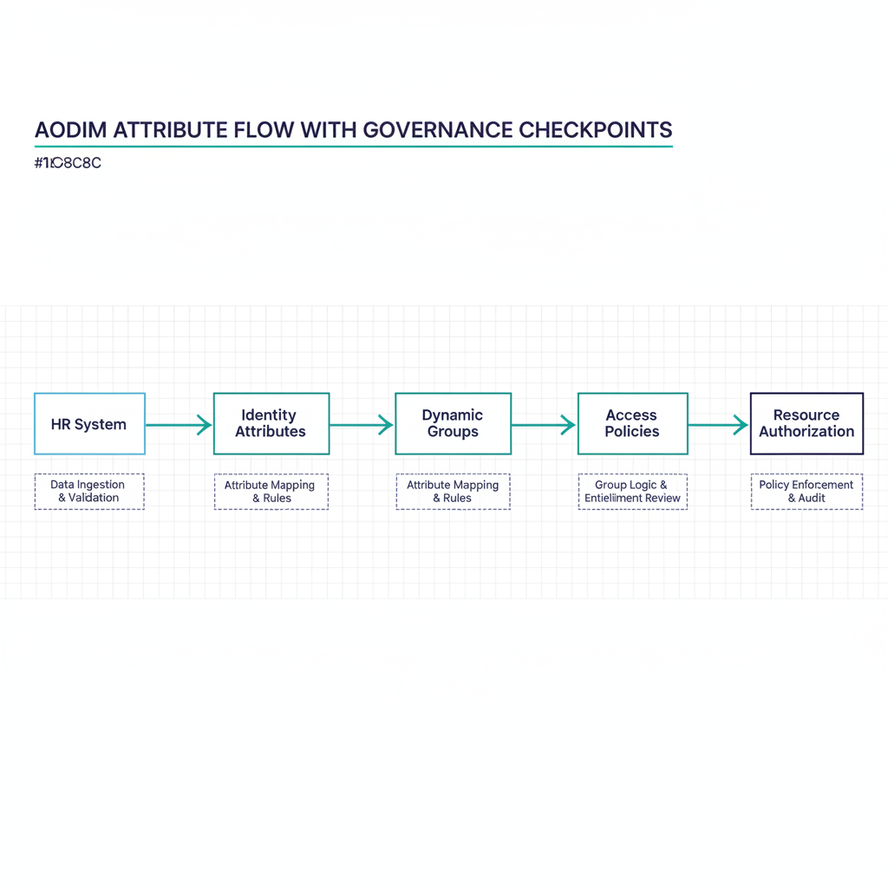
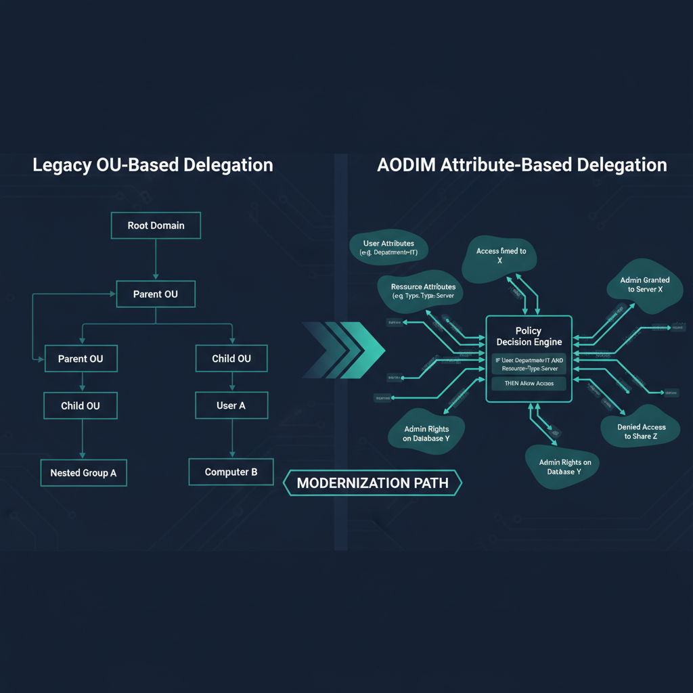
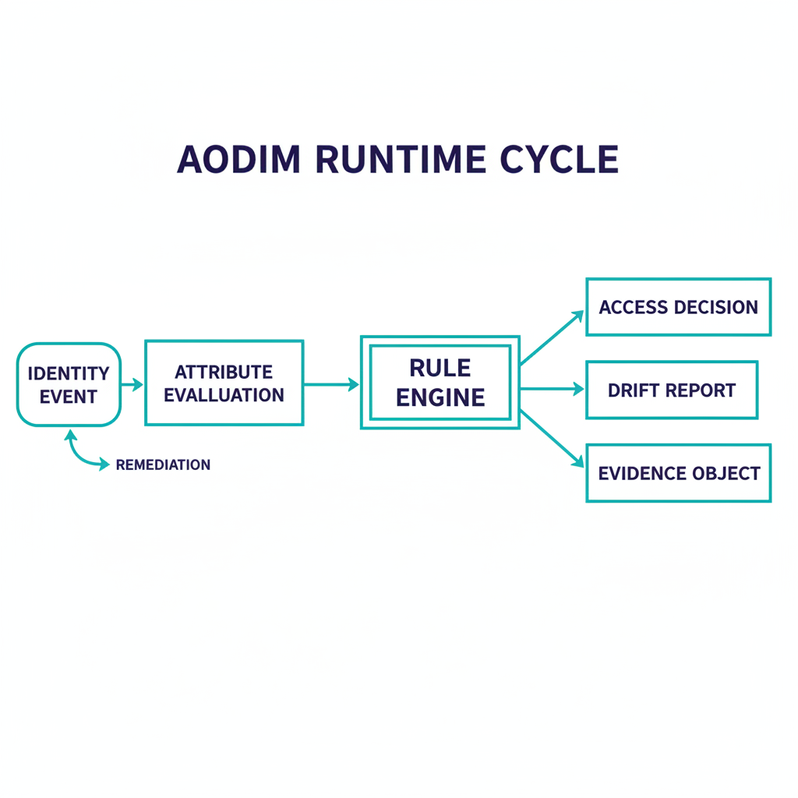

AODIM --- Attribute-Oriented Directory & Identity Model

Executive Summary

Modern enterprises using cloud identity platforms face a mismatch between dynamic organizational structures and static access control models. AODIM addresses this by making identity attributes the authoritative driver of access, enabling automated, deterministic, and scalable identity governance.

This document tracks the canonical AODIM specification,
FMP_006 — AODIM Architecture (v1.1).

Core Principle

Identity attributes define organizational structure; access is computed, not assigned.

Problem Statement

Traditional directory systems rely on hierarchical placement (OUs), which do not translate well to cloud environments. This leads to:

\- Manual access management

\- Poor handling of role changes (movers)

\- Over-permissioning

\- Audit complexity

Architecture Overview

{#fig-aodim-architecture-image-01 fig-alt="Technical architecture diagram showing the AODIM attribute flow: HR System..." width="100%"}


HR System → Identity Attributes → Dynamic Groups → Access & Policy Enforcement

Dynamic Group Model

Groups are defined by boolean composition over attribute predicates:

\- Single-attribute rules (`-eq` / `-in`) — all principals carrying a value in one attribute

\- Multi-attribute AND rules — principals matching every clause across multiple attributes

\- Multi-attribute OR / set rules — cross-cutting groupings

Example Rules:

```
(attr2 -eq "IT")                              # All IT department users
(attr2 -eq "IT") and (attr3 -eq "InfraOps")   # IT / Infrastructure division
(attr1 -in ["NCR","EASTUS","WESTUS"])         # All US-region users
```

See the Dynamic Group Library (FMP_152)
for the canonical rule inventory.

Delegation Model

{#fig-aodim-architecture-image-02 fig-alt="Side-by-side comparison diagram: Left panel labeled 'Legacy OU-Based..." width="100%"}


Administrative Units and scoped roles replace OU-based delegation. AU membership is driven by the same attributes, per the
Delegation Matrix (FMP_154).

Operational Flow

{#fig-aodim-architecture-image-03 fig-alt="Operational flow diagram showing the AODIM runtime cycle: Identity Event..." width="100%"}


HR updates → Attribute change → Group recalculation → Access update

Key Benefits

\- Automatic access alignment

\- Deterministic and explainable access

\- Reduced operational overhead

\- Continuous least privilege

Risks and Mitigations

\- Data quality → validation pipelines

\- Group sprawl → naming standards

\- Complexity → governance model

Reference Implementation

Includes:

\- Attribute schema

\- Dynamic group rules

\- CLI tool for simulation and explanation

CLI Example

Commands:

```shell
# Assign attribute values from an AD export and report findings
fmp orgtree assess --from-export ad-users.json --out assignments.json

# Run one governance pass over a tenant snapshot (dry-run by default):
# detects drift and reports the remediation it would apply
fmp orgtree govern snapshot.json --out report.json
```

`fmp orgtree govern` in its default dry-run mode is the simulation and
explanation surface: it recomputes attribute assignments and reports the access recalculation a transfer or role change
would produce, without writing.

Strategic Impact

\- Enables Zero Trust

\- Aligns HR, IT, Security

\- Supports SaaS environments

Conclusion

AODIM transforms identity into a dynamic control plane where access follows the user automatically.
