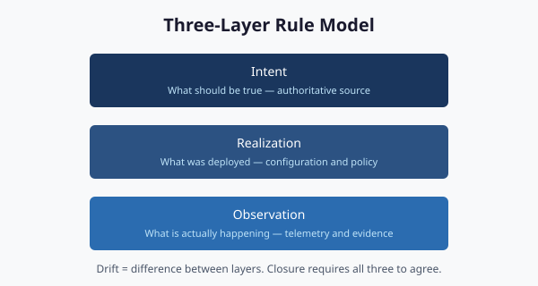

# Three-Layer Rule Model

**Separating authoritative rules, policy mappings, and runtime enforcement**

Rule authoring is separated into **three distinct layers** so that policy intent, evaluation logic, and runtime enforcement can be reasoned about, versioned, and drift-detected independently. Mixing them — the typical “policy-as-config” failure mode — collapses three different change boundaries into one and loses the ability to assess each layer for its own risk profile.

## The three layers

| Layer | Authoritative for | Change boundary |
|-------|-------------------|-----------------|
| **Authoritative rules** | What rules exist and what they mean | Governance review |
| **Policy mappings** | Which rules apply to which controls or scopes | Schema-validated change |
| **Runtime enforcement** | How rules are evaluated against live state | Code change + tests |

Each layer has its own change cadence, its own review surface, and its own drift class.

## Layer 1 — Authoritative rules

The single source of truth for rule existence and semantics. A rule declares:
- A stable, versioned identifier.
- A semantic statement in human-readable form.
- Schema constraints that any concrete instance must satisfy.
- Provenance — the document that authored it.

What this layer does not declare: which components apply it, which controls it maps to, or how it is enforced at runtime. Those belong to the other layers.

## Layer 2 — Policy mappings

The mapping between authoritative rules and operational scope. A policy entry says: “Component X applies rule R within scope S.” Schema validation ensures that every policy entry references a rule that actually exists. A dangling policy entry is a provenance finding, not a runtime crash.

Policy changes are higher-cadence than rule changes: a mapping can be added or retired without invoking the full governance-review process. The schema gates ensure mappings stay consistent.

## Layer 3 — Runtime enforcement

The evaluation logic that consumes rules and policy mappings against live state. The runtime layer is the only layer allowed to mutate observable state. Authoritative rules and policy mappings are read-only at runtime; only the runtime layer can act.

## How drift maps onto the layers

| Drift class | Layer where the mismatch lives |
|-------------|--------------------------------|
| Schema | Authoritative rules — declared schema vs. actual claim structure |
| Semantic | Authoritative rules ↔ Runtime — meaning has shifted between layers |
| Provenance | Policy — a mapping references a rule that no longer resolves |
| Authorization | Runtime — a component emitted outside its authorized envelope |
| Identity | Runtime — issuer cannot be resolved |

## Why three layers and not two

1. **Cadence mismatch.** Rule changes require governance review. Mapping changes do not. Folding mappings into the rule layer either slows mapping work or weakens review discipline.
2. **Blast radius.** A bad mapping is recoverable by a registry edit. A bad rule edit is recoverable only through formal supersession.
3. **Drift attribution.** The drift engine can tell a reviewer whether a finding represents a meaning shift or a mapping mistake. That distinction is lost if both live in the same artifact.

## What this means for an authorization package

- Per-layer evidence trails. Rule changes carry a review record; policy changes carry a schema-validated diff; runtime changes carry tests and remediation contracts.
- Independent reviewability. A reviewer can challenge “is this rule’s meaning correct?” separately from “is this mapping right?” separately from “does the code do what the rule says?”
- Targeted remediation. When drift is found, only the affected layer is rebuilt.

---

*Cleaned extraction for project use. No internal branding or document identifiers.*
