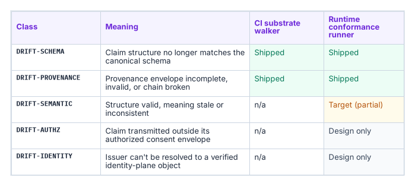
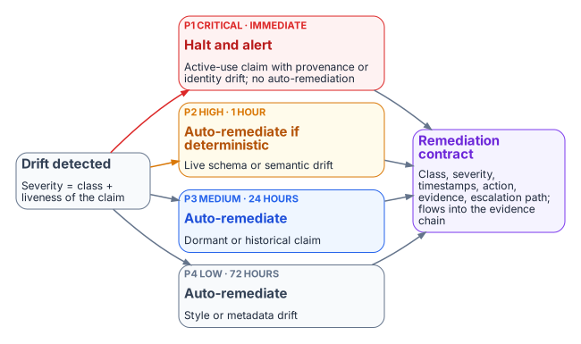
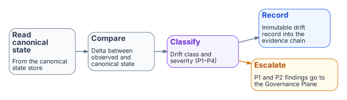

# Drift Engine

FMP treats **drift as a first-class operational signal**, not as an
exception. The Drift Engine is the substrate-wide subsystem that classifies,
prioritizes, and remediates the gap between *declared* canonical state and
*observed* runtime reality.

The companion executive brief is
[Drift Engine Overview](../executive-briefs/drift-engine-overview.md). This
page is the architectural depth: how the engine is structured, what it
catches today, and what is reserved for runtime maturity.

{fig-alt="A table of five classes. DRIFT-SCHEMA and DRIFT-PROVENANCE are shipped on both the CI substrate walker and the runtime conformance runner. DRIFT-SEMANTIC is runtime only, target (partial). DRIFT-AUTHZ and DRIFT-IDENTITY are runtime only, design only."}

## Five-class taxonomy

FMP defines exactly five drift classes, declared in
`16_DriftDetectionStandard.qmd` §2:

| Class | Meaning | Detection surface |
|---|---|---|
| `DRIFT-SCHEMA` | Claim structure no longer matches canonical schema | CI substrate walker |
| `DRIFT-SEMANTIC` | Structure valid, meaning stale or inconsistent | Runtime conformance runner |
| `DRIFT-PROVENANCE` | Provenance envelope incomplete, invalid, or chain broken | CI substrate walker + runtime |
| `DRIFT-AUTHZ` | Claim transmitted outside authorized consent envelope | Runtime conformance runner |
| `DRIFT-IDENTITY` | Issuer cannot be resolved to a verified identity-plane object | Runtime conformance runner |

Five is the right number because each class corresponds to a distinct failure
mode that requires a distinct remediation contract. Collapsing them (e.g.
calling everything "configuration drift") loses the ability to assign
severity and SLA deterministically.

## Severity model

Every drift finding carries a severity, also canonically defined:

| Severity | When | Auto-remediate? | SLA |
|---|---|---|---|
| `P1` (critical) | Active-use claim with provenance or identity drift | No — halt + alert | Immediate |
| `P2` (high) | Live schema or semantic drift | Yes, if deterministic | 1 hour |
| `P3` (medium) | Drift in dormant or historical claim | Yes | 24 hours |
| `P4` (low) | Style or metadata drift, no semantic impact | Yes | 72 hours |

Severity is computed deterministically from the drift class plus the liveness
of the affected claim — it is not a judgment call.

{fig-alt="Drift detected branches to four cards: P1 critical, immediate, halt and alert with no auto-remediation; P2 high, 1 hour, auto-remediate if deterministic; P3 medium, 24 hours, auto-remediate; P4 low, 72 hours, auto-remediate. All four lead to a remediation contract record that flows into the evidence chain."}

## Detection surfaces

### CI substrate walker (shipped today)

`fmp substrate walk` and `fmp substrate drift`
(source) emit two drift classes
on every PR via `substrate-drift.yml`:

- **`DRIFT-SCHEMA`** — verifies module paths declared in
  `substrate-manifest.yaml` (FMP_200) actually exist in the tree.
- **`DRIFT-PROVENANCE`** — verifies that every registry document referenced
  from a manifest, ADR, or registry resolves to a real canon artifact.

`fmp substrate drift` is the CI-friendly entry point: exit code 0 = clean,
non-zero = drift detected. The full structured report is available via
`fmp substrate walk --json`.

### Runtime conformance runner (target / partial)

The runtime detection surface — semantic, authorization, identity — is
defined in canon and partially implemented. Adapters that pass the runtime
conformance runner emit a remediation contract for every drift event:

```yaml
remediation_contract:
  drift_class: "DRIFT-*"
  severity: "P1|P2|P3|P4"
  detection_timestamp: ISO8601
  detected_by: "{adapter_id | workflow_id}"
  auto_remediated: true | false
  remediation_action: "halt | fix | flag | log"
  remediation_timestamp: ISO8601
  remediation_evidence: "{commit_sha | audit_record_id}"
  escalation_path: "Canon Steward | Architecture Lead | CISO"
```

Source: `16_DriftDetectionStandard.qmd` §4.

The **Drift Fabric** view ties the detection surfaces above into a single
pipeline — canonical state read, delta comparison, classification, and the
HIGH/CRITICAL escalation arrow into the Governance Plane:

{fig-alt="Four steps left to right: read canonical state, compare observed with canonical state, classify class and severity P1 to P4, record an immutable drift record into the evidence chain. An amber branch from classify escalates P1 and P2 findings to the Governance Plane."}

## Maturity matrix

| Drift class | CI surface | Runtime surface |
|---|---|---|
| `DRIFT-SCHEMA` | **SHIPPED** | **SHIPPED** |
| `DRIFT-PROVENANCE` | **SHIPPED** | **SHIPPED** |
| `DRIFT-SEMANTIC` | n/a | **TARGET** (partial) |
| `DRIFT-AUTHZ` | n/a | **DESIGN-ONLY** |
| `DRIFT-IDENTITY` | n/a | **DESIGN-ONLY** |

For an authoritative shipped-vs-target snapshot, see
Substrate Status.

## Why this is different from a config-drift tool

Three properties distinguish the FMP Drift Engine from generic
configuration-drift tooling:

1. **Canon-anchored, not snapshot-anchored.** Drift is measured against a
   numbered canon document with a version, not against an arbitrary
   "last-known-good" snapshot. Reproducibility is built in: the same canon
   version always yields the same expected state.
2. **Five-class taxonomy with deterministic severity.** Operators do not
   triage drift findings; severity is a pure function of class plus
   liveness. This collapses the "is this serious?" debate into "did the
   classifier run correctly?"
3. **Remediation contracts are first-class evidence.** Every remediation —
   auto or human — emits an evidence record that flows back through the
   [Evidence Chain](evidence-chain.md) into OSCAL artifacts. There is no
   parallel "drift log" disconnected from the SSP.

## What this means for an ATO package

A drift finding in an FMP-anchored system carries:

- A canonical class (`DRIFT-*`) traceable to FMP_200 / canon-numbered
  drift standard.
- A severity computed deterministically.
- A remediation contract with timestamps, action, and signed evidence.
- An escalation path that lands at a named role, not a generic distribution
  list.

3PAOs assessing such a system can verify the drift posture by running
`fmp substrate walk` themselves rather than trusting a snapshot — the engine
is designed for independent re-execution.
