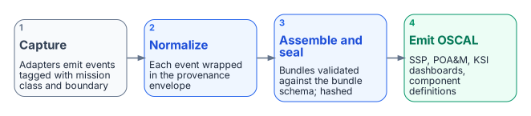
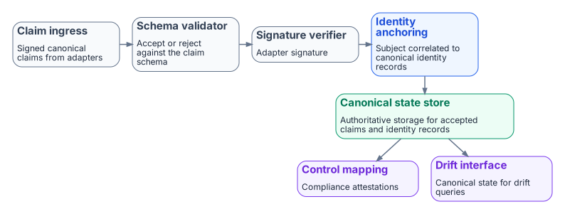
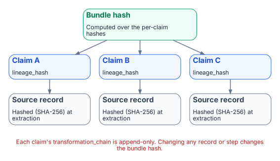
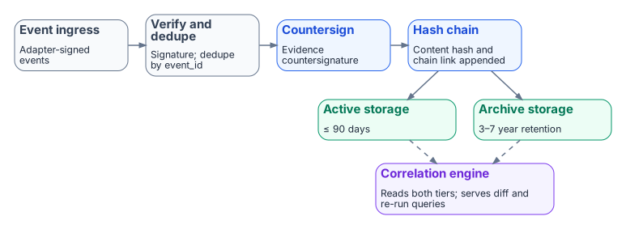

# Evidence Chain

FMP's evidence chain is the architectural mechanism that turns runtime
telemetry into **assessor-ready compliance artifacts with traceable
provenance at every step**. The chain is deterministic: same inputs, same
canon version, same evidence bundle.

The companion executive brief is
[Evidence Fabric Overview](../executive-briefs/evidence-fabric-overview.md).
This page is the architectural depth — the four-stage pipeline, the
provenance envelope, and the determinism guarantees.

{fig-alt="Four cards left to right: 1 capture, adapters emit events tagged with mission class and boundary; 2 normalize, each event wrapped in the provenance envelope; 3 assemble and seal, bundles validated against the bundle schema and hashed; 4 emit OSCAL: SSP, POA&M, KSI dashboards and component definitions."}

## Four-stage pipeline

Stage-by-stage responsibility:

1. **Telemetry event capture** — adapters at the system boundary emit
   structured events. Each adapter declares its `mission-class` and
   `boundary` so the captured event carries authoritative source classification
   from the moment of emission.
2. **Canonical claim normalization** — every event is wrapped in the
   provenance envelope defined in
   `15_ProvenanceProfile.qmd` §3.
   This is the chain's structural backbone (see below).
3. **Evidence bundle assembly + sealing** — claims are grouped into bundles
   per the program decision
   (assemble → seal → submit → close). Bundles are validated against
   `evidence-bundle.schema.json`
   which enforces hash-bearing provenance at item and bundle scope.
4. **OSCAL artifact emission** — sealed bundles feed the OSCAL pipeline that
   emits SSP, POA&M, KSI dashboards, and Component Definitions, with every
   field traceable back to the originating claim.

The **Truth Fabric** view of stages 1–2 is the canonical claim-intake
pipeline that turns adapter-signed events into the Canonical State Store
the rest of the chain reads from:

{fig-alt="Claim ingress, schema validator (accept or reject), signature verifier and identity anchoring in a row, leading down to the canonical state store, which feeds control mapping (compliance attestations) and the drift interface (canonical state for drift queries)."}

## Provenance envelope

Every claim emitted into the chain carries this envelope, verbatim from
canon:

```yaml
provenance:
  claim_id: "urn:fmp:claim:{domain}:{claim_type}:{uuid}"
  issuer_identity: "{entra_object_id | agency_issuer_id}"
  source_system: "{system_name}:{version}"
  source_classification: "authoritative | derived | synthesized"
  extraction_timestamp: ISO8601
  extraction_method: "api | batch | stream | manual"
  transformation_chain:
    - step: 1
      transform: "{transform_name}"
      applied_by: "{adapter_id}"
      applied_at: ISO8601
  lineage_hash: "{SHA-256 of source record at extraction}"
  schema_version: "1.0"
  signature: "{mTLS certificate thumbprint}"
```

Three properties of this envelope matter for assessor review:

1. **`source_classification` is canonical.** A claim is `authoritative`,
   `derived`, or `synthesized` — and a 3PAO can verify the classification
   by re-executing the adapter. There is no "trust me" classification.
2. **`transformation_chain` is append-only.** Once a step is recorded and
   signed, it cannot be removed or reordered. Re-execution that would
   produce a different chain is itself a `DRIFT-PROVENANCE` finding.
3. **`lineage_hash` is per-claim.** Every claim hashes its source record at
   extraction time. The bundle hash is computed over those hashes, giving
   a tamper-evident tree.

{fig-alt="A bundle hash at the top computed from three claims, each with a lineage_hash, each computed from a source record hashed with SHA-256 at extraction. A red note: each claim's transformation_chain is append-only, and changing any record or step changes the bundle hash."}

## Determinism guarantees (the program decision)

Per the program decision,
the evidence chain is built for **deterministic regeneration**. Concretely:

- **No silent drops.** Every input event is either accepted, rejected with
  reason, or queued — never silently lost.
- **Append-only writes.** Evidence storage is immutable; updates are new
  records that supersede prior ones with explicit provenance.
- **Ordered records.** Replays produce identical ordering, not "best-effort"
  ordering.
- **Idempotent ingestion.** Re-ingesting the same source record twice yields
  the same canonical claim, not a duplicate.

The operational consequence: the same canon version processing the same
input bundle always produces a byte-identical evidence bundle. A 3PAO can
re-run the assembly months later and verify the bundle hash matches the
original, without coordinating with the original adapter operator.

The **Evidence Fabric** view of stages 3–4 shows the write-side pipeline
with the two-tier storage that backs deterministic regeneration —
adapter-signed events flow through countersignature and hash-chain
anchoring into Active (≤ 90 days) and Archive (3–7 year) storage tiers,
both readable by the Correlation Engine that serves diff and re-run
queries:

{fig-alt="Event ingress, verify and dedupe by event_id, countersign, and hash chain in a row. The hash chain writes to active storage (90 days or less) and archive storage (3 to 7 years); a correlation engine reads both and serves diff and re-run queries."}

## What ships today

| Capability | Maturity |
|---|---|
| Provenance envelope schema (FMP_PP_001 v1.0) | **SHIPPED** |
| Evidence bundle schema + lifecycle (the program decision) | **SHIPPED** |
| OSCAL SSP / POA&M / KSI / Component Def generators | **SHIPPED** |
| Deterministic regeneration (the program decision properties) | **SHIPPED** for canon-anchored generators |
| Continuous event-time capture across all adapters | **TARGET** |
| Cryptographic signing with agency-issued certs | **DESIGN-ONLY** (envelope reserves the field) |

The **event-time capture chain is design-defined but not fully wired in
current production flow**. The structural pieces — provenance envelope,
bundle schema, lifecycle, OSCAL emission — all ship today; end-to-end
continuous capture across every adapter is target-state.

## What this means for an ATO package

An FMP-anchored evidence bundle gives a 3PAO four properties they cannot
get from a screenshot-based evidence package:

1. **Independent re-execution.** The bundle can be regenerated from canon
   and source data without the original operator's involvement.
2. **Per-claim source classification.** Authoritative claims are
   distinguished from derived claims at the field level, not in narrative
   prose.
3. **Tamper-evident lineage.** The hash tree binds every claim to a source
   record; modification anywhere in the chain breaks the bundle hash.
4. **Drift-coupled.** A `DRIFT-PROVENANCE` finding from the
   [Drift Engine](drift-engine.md) directly identifies the affected
   claim(s) in the evidence bundle, so remediation is scoped, not
   rebuild-the-whole-package.

This is what "canon-anchored evidence" means in practice — and is the
operational basis for treating FMP evidence as deterministically reviewable
rather than periodically attested.
