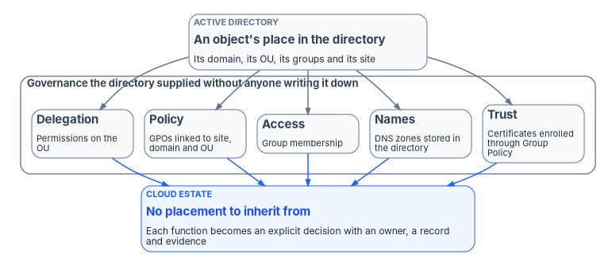

# Chapter 01 — Why Modernize, and Why Now

*The estate's governance was never written down because the directory supplied it, and the clocks that now set the schedule belong to other people.*

::: {.callout-note}
## In this chapter
The governance a typical federal estate runs on without knowing it, because Active Directory supplied it through where objects sit. The external clocks, federal policy and vendor support dates, that now set the modernization schedule, each checked against its primary source on the date in its note, and what those clocks do and don't require. Why the work can't be run as a set of separate projects, and what the rest of this book sets up instead: a charter, principles, a gated plan, decision rights and a portfolio of complementary projects.
:::

Most federal IT estates still run on the client/server model they built in the early 2000s. Users sign in to a Windows domain, servers trust that domain, and an Active Directory forest sits at the center, answering questions nobody thinks to ask any more. The model has outlasted several waves of change because it works. Email and collaboration moved to Microsoft 365, workloads spread into one or more commercial clouds, and the directory kept answering.

Two things have changed. First, the target estate doesn't have a directory that answers those questions on its own. A cloud tenant has no organizational units to inherit policy from, no forest that every server trusts by default, and no place in a tree that quietly decides who administers what. Every one of those answers has to be rebuilt as an explicit decision. Second, the schedule is no longer the agency's own. Federal policy and vendor support dates now arrive from outside, on fixed dates, whether the agency is ready or not.

This chapter makes the case that both facts together turn modernization into a program, not a set of projects.

[Book 01, Chapter 01](../b01-transformation-arc/01-why-modernization-is-hard.md) tells the longer history of how federal IT reached its current shape; this chapter starts from where the estate is now.

{#fig-ch01-implicit-governance fig-alt="At the top, a slate card labeled an object's place in Active Directory: its domain, its organizational unit, its groups and its site. Five arrows lead down to five slate cards in a group titled governance the directory supplied without anyone writing it down: delegation, from permissions on the organizational unit; policy, from Group Policy objects linked to sites, domains and OUs; access, from group membership; names, from DNS zones stored in the directory; and trust, from certificates enrolled automatically through Group Policy. All five lead to one blue card at the bottom: the cloud estate has no placement, so each function becomes an explicit decision with an owner, a record and evidence."}
