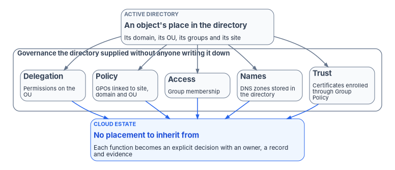
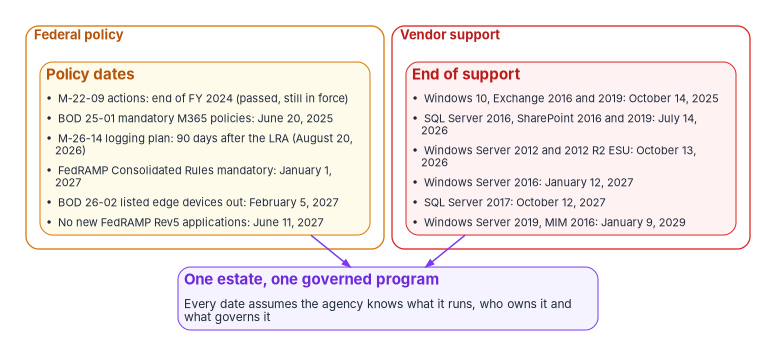

# Chapter 01 — Why Modernize, and Why Now

*The estate's governance was never written down because the directory supplied it, and the clocks that now set the schedule belong to other people.*

::: {.callout-note}
## In this chapter
The governance a typical federal estate runs on without knowing it, because Active Directory supplied it through where objects sit. The external clocks, federal policy and vendor support dates, that now set the modernization schedule, each checked against its primary source as of October 21, 2026, and what those clocks do and don't require. Why the work can't be run as a set of separate projects, and what the rest of this book sets up instead: a charter, principles, a gated plan, decision rights and a portfolio of complementary projects.
:::

Most federal IT estates still run on the client/server model they built in the early 2000s. Users sign in to a Windows domain, servers trust that domain, and an Active Directory forest sits at the center, answering questions nobody thinks to ask any more. The model has outlasted several waves of change because it works. Email and collaboration moved to Microsoft 365, workloads spread into one or more commercial clouds, and the directory kept answering.

Two things have changed. First, the target estate doesn't have a directory that answers those questions on its own. A cloud tenant has no organizational units to inherit policy from, no forest that every server trusts by default, and no place in a tree that quietly decides who administers what. Every one of those answers has to be rebuilt as an explicit decision. Second, the schedule is no longer the agency's own. Federal policy and vendor support dates now arrive from outside, on fixed dates, whether the agency is ready or not.

This chapter makes the case that both facts together turn modernization into a program, not a set of projects. [Book 01, Chapter 01](../b01-transformation-arc/01-why-modernization-is-hard.md) tells the longer history of how federal IT reached its current shape; this chapter starts from where the estate is now.

{#fig-ch01-implicit-governance fig-alt="At the top, a slate card labeled an object's place in Active Directory: its domain, its organizational unit, its groups and its site. Five arrows lead down to five slate cards in a group titled governance the directory supplied without anyone writing it down: delegation, from permissions on the organizational unit; policy, from Group Policy objects linked to sites, domains and OUs; access, from group membership; names, from DNS zones stored in the directory; and trust, from certificates enrolled automatically through Group Policy. All five lead to one blue card at the bottom: the cloud estate has no placement, so each function becomes an explicit decision with an owner, a record and evidence."}

## Governance nobody wrote down

When an agency describes its governance, it usually points to policies, boards and authorization packages. Much of the governance that actually operates every day is somewhere else: in the shape of the directory.

Active Directory introduced the organizational unit with Windows 2000, as a container for grouping objects "for administrative purposes, such as delegating administrative rights and assigning policies."[^c01-ou] That one design decision carries most of the argument. Placing a user or computer in an OU decided, at the same moment and without a separate record, several things that a modern estate has to decide explicitly:

- **Who administers it.** Control over an OU and the objects in it is set by the access control lists on the OU, and AD DS lets owners delegate full or limited control over those objects to other users or groups.[^c01-logical] Moving an account into a regional OU quietly handed it to that region's administrators.
- **Which policy applies to it.** Group Policy objects are linked to sites, domains and OUs, and are applied in that order, with the container closest to the user or computer winning.[^c01-gpo] Security baselines, firewall rules, drive mappings and certificate settings followed the object's position in the tree.
- **What it can reach.** Group membership granted access to file shares, applications and databases, and nested groups carried access a long way from the decision that granted it.
- **How it is named.** DNS zones stored in Active Directory replicate through directory replication, and domain controllers accept secure dynamic updates to them.[^c01-adidns] Name resolution for the whole estate rode on the forest.
- **Whether it is trusted.** An enterprise certificate authority uses identity information already in Active Directory, and Group Policy designates which users and machines receive which certificates.[^c01-adcs] Wi-Fi, VPN, smart-card sign-in and server TLS trusted whatever the directory enrolled.

None of this was wrong. It was efficient, and for a quarter century it meant an agency got a working governance model as a side effect of running a directory. The cost is that the model was never stated. The decisions live in OU placement, group nesting, GPO links and inherited permissions. Book 01 counts eleven categories of object the directory governs this way ([Book 01, Chapter 02](../b01-transformation-arc/02-the-problem.md)), and Book 02 maps them as the hidden migration surface ([Book 02, Chapter 04](../b02-identity/04-the-hidden-migration-surface.md)).

### Why the cloud doesn't inherit it

Microsoft Entra ID doesn't reproduce the tree. Its closest equivalent, the administrative unit, restricts a role's permissions to a defined part of the organization, but administrative units can't be nested and an object can belong to several at once.[^c01-au] Policy in the cloud estate is assigned to groups and evaluated per sign-in, not inherited from a container ([Book 05, Chapter 01](../b05-devices/01-why-group-policy-cant-come-to-the-cloud.md)). Access is a Conditional Access decision ([Book 04](../b04-access/index.md)). Names and addresses move to a DDI platform ([Book 08](../b08-ddi/index.md)), and certificate trust to a target PKI ([Book 07](../b07-pki/index.md)).

Each replacement is better defined than what it replaces, and each requires someone to decide what the old placement meant. That is the work most migration plans leave out. An agency that moves users and groups and retires the forest without recovering those decisions doesn't modernize its governance. It deletes it, and finds out later which decisions the directory had been making. [Book 02, Chapter 01](../b02-identity/01-why-identity-matters.md) traces the consequences for identity in detail.

The same pattern runs through the people side of the estate. In many agencies the directory, not the HR system, is the working record of who exists, who reports to whom and who should approve what. When the directory changes, that implicit authority changes with it. [Book 03](../b03-hr-identity/index.md) argues that HR, not IT, should decide who exists, and shows how to rebuild the authority deliberately.

## The clocks that now set the schedule

For most of the client/server era, an agency could choose when to change its estate. That is no longer true. Two kinds of clock now set dates from outside: federal policy, and the support lifecycles of the products the estate runs on. Neither waits for the agency's own plan.

{#fig-ch01-external-clocks fig-alt="Two groups side by side. The amber group on the left, labeled federal policy, lists M-22-09 actions due by the end of fiscal year 2024, passed but still in force; BOD 25-01 mandatory Microsoft 365 policies due June 20, 2025; the M-26-14 Agency Logging Plan, due 90 days after CISA published the Logging Reference Architecture on August 20, 2026; FedRAMP Consolidated Rules mandatory January 1, 2027; BOD 26-02 decommission of listed end-of-support edge devices due February 5, 2027; and no new FedRAMP Rev5 applications after June 11, 2027. The red group on the right, labeled vendor support, lists Windows 10 and Exchange Server 2016 and 2019, ended October 14, 2025; SQL Server 2016 and SharePoint Server 2016 and 2019, ended July 14, 2026; Windows Server 2012 and 2012 R2 Extended Security Updates, ended October 13, 2026; Windows Server 2016, ends January 12, 2027; SQL Server 2017, ends October 12, 2027; and Windows Server 2019 and Microsoft Identity Manager 2016, end January 9, 2029. Arrows from both groups lead to one violet card: one estate, one governed program."}

### Federal policy

The federal clocks are set by a small number of documents. Each carries a different kind of authority, and the dates matter less than what each actually asks for. [Book 11, Chapter 03](../b11-zero-trust/03-what-the-mandates-require.md) reads the Zero Trust instruments in full; this table gives the dates.

| Instrument | Issued | What it sets | Dates |
|---|---|---|---|
| OMB M-22-09, *Moving the U.S. Government Toward Zero Trust Cybersecurity Principles* | January 26, 2022 | A federal Zero Trust strategy "requiring agencies to meet specific cybersecurity standards and objectives"; it covers on-premises and hybrid systems as well as cloud[^c01-m2209] | By the end of fiscal year 2024 (passed; the actions remain in force) |
| CISA BOD 25-01, *Implementing Secure Practices for Cloud Services* | December 17, 2024 | Mandatory SCuBA configurations for production cloud tenants with a finalized CISA baseline, continuous assessment and reporting[^c01-bod2501] | Tenant inventory February 21, 2025; tools April 25, 2025; mandatory policies June 20, 2025; new tenants baselined before their authorization to operate |
| CISA BOD 26-02, *Mitigating Risk From End-of-Support Edge Devices* | February 5, 2026 | Inventory and removal of end-of-support devices on the agency network boundary that are reachable from the internet[^c01-bod2602] | Inventory within 3 months; decommission listed devices within 12 months (February 5, 2027); all identified devices within 18 months; continuous discovery within 24 months |
| OMB M-26-14, *Ensuring Effective and Efficient Agency Logging and Network Visibility to Defend Against Evolving Cyber Threats* | May 22, 2026 | Rescinds M-21-31; a risk-based logging approach built on continuous event monitoring and on threat hunting, investigation, response and forensics[^c01-m2614] | Agency Logging Plan within 90 days of CISA's Logging Reference Architecture, then maturity Levels 1, 2 and 3 within 120, 180 and 320 days |
| FedRAMP *Consolidated Rules for 2026* | Launched June 25, 2026 | How cloud service offerings are certified, in Classes A to D[^c01-fedramp-launch] | Mandatory for all stakeholders January 1, 2027, with some areas carrying their own applicability and effective dates; over the following year every cloud service provider must follow the rules to keep its certification; no new Rev5 certification applications after June 11, 2027[^c01-fedramp-dates] |

CISA published the Logging Reference Architecture on August 20, 2026.[^c01-lra] Counted from that date, M-26-14's agency deadlines fall on November 18, 2026 for the logging plan, December 18, 2026 for Level 1, February 16, 2027 for Level 2 and July 6, 2027 for Level 3. Those four dates are the program's arithmetic, not dates OMB published; an agency should confirm them with its own CISO office.

### Vendor support

The second set of clocks is the support lifecycle of what the estate runs. After end of support there are no new security updates, non-security updates, assisted support or content updates.[^c01-eos2026] For an estate built in the early 2000s, the dates cluster:

| Product | End of support | Status on October 21, 2026 |
|---|---|---|
| Windows 10 (Enterprise, Education, Home and Pro) | October 14, 2025[^c01-eos2025] | Passed |
| Exchange Server 2016 and 2019; Office 2016 and 2019 | October 14, 2025[^c01-eos2025] | Passed |
| SQL Server 2016; SharePoint Server 2016 and 2019 | July 14, 2026[^c01-eos2026] | Passed |
| Windows Server 2012 and 2012 R2, Extended Security Updates Year 3 | October 13, 2026[^c01-eos2026] | Passed |
| Windows Server 2016 | January 12, 2027[^c01-eos2027] | Under three months away |
| SQL Server 2017 | October 12, 2027[^c01-eos2027] | About a year away |
| Windows Server 2019; Microsoft Identity Manager 2016 | January 9, 2029[^c01-eos2029] | Within a typical program's horizon |

Two of these deserve a note. Microsoft extended Microsoft Identity Manager 2016's end of support from January 13, 2026 to January 9, 2029,[^c01-mim] so an agency that synchronizes HR data into Active Directory through it has a date, not an open-ended bridge. And Windows Server 2016 is the operating system of many domain controllers built in the last decade; its date falls inside the window in which most agencies will still be running a forest.

A vendor date is not a federal mandate on its own, but the two connect. BOD 26-02 turns end of support into a directed action for internet-facing edge devices,[^c01-bod2602] and every system security plan asserts flaw remediation that an unsupported product can't deliver. Running past end of support becomes a risk acceptance an authorizing official has to sign.

### What the clocks don't require

The clocks are often quoted for more than they say. Four corrections recur, and the program plans against the documents, not the summaries:

- **FedRAMP certifies cloud services; it doesn't authorize the agency's estate.** FedRAMP says agencies use its certifications as reusable security evidence, but "each agency still authorizes its own federal information systems," and should never create a standalone authorization to operate for a cloud service offering.[^c01-fedramp-use] The 2027 date changes what providers publish and agencies inherit. It doesn't put an agency's own systems out of compliance. [Book 10, Chapter 03](../b10-cloud-boundary/03-what-changed-at-fedramp.md) sets out what changed.
- **"Moderate" is now a certification class.** FedRAMP's notice on the new designations says Class C "will include the current Moderate baseline" and Class D the High baseline.[^c01-ntc0004] The workbook uses the class names.
- **No federal document requires a Zero Trust maturity stage.** M-22-09 sets specific actions; CISA's Zero Trust Maturity Model calls itself a guide ([Book 11, Chapter 03](../b11-zero-trust/03-what-the-mandates-require.md)).
- **BOD 25-01 covers cloud tenants, not the forest.** Its scope is production cloud tenants with a finalized SCuBA baseline,[^c01-bod2501] so it says nothing directly about on-premises Active Directory ([Book 11, Chapter 04](../b11-zero-trust/04-scuba-and-bod-25-01.md)). The forest still matters to it: hybrid identity, synchronized accounts and on-premises administrators decide much of what a tenant's configuration can actually enforce.

The result is less dramatic than the usual pitch and harder to argue with. Nothing makes the estate fail on a single date. Instead the estate is surrounded by deadlines, each binding a different part of it, and each assuming the agency knows what it runs, who owns it and what governs it.

## Why one program, not a set of projects

Federal modernization has usually been attempted as a sequence of independent projects: a mail migration, a device refresh, a cloud landing zone, a Zero Trust initiative. Each has its own sponsor, budget and finish line. The governance argument above explains why that approach stalls.

Every project touches the same implicit decisions. Moving devices to Intune needs the policy that GPO links carried. Retiring AD-integrated DNS needs the names the forest registered. Moving certificate trust needs the enrollment the directory controlled. Enforcing Conditional Access needs the access that groups granted. If each project rediscovers those decisions on its own, they are rediscovered differently, and the estate ends up with several partial answers to the same question. If no project owns them, they fall between projects until something breaks.

The clocks make the cost visible. The external dates in the tables above don't line up with any single project's scope. A Windows Server 2016 deadline touches domain controllers, certificate authorities, file servers and line-of-business applications at once. M-26-14's logging objectives apply to every information system the agency owns or operates, including those run by third parties on its behalf.[^c01-m2614] A program can sequence the work against those dates. A collection of projects can only race them.

The sequencing has a logic of its own, and it starts with identity. Policy, access, devices and data all decide on the basis of who or what is asking, so identity has to be authoritative before the decisions that depend on it can be trusted. Network services, addressing and certificates follow, because they carry the names and trust everything else relies on. Telemetry and automated governance come last in the build and first in importance once running, because they are how the program proves that the target state holds. That is the program's design position, and [Book 01, Chapter 12](../b01-transformation-arc/12-migration-roadmap.md) turns it into seven phases and six gates.

### A typical starting state

The workbook describes the estate it is written for as a *framing pattern*, not a real engagement. No agency's names, metrics or timelines appear, and none should be inferred. The pattern is recognizable across the civilian government:

- decades of client/server architecture, with Active Directory, on-premises SQL Server and a traditional network perimeter;
- Microsoft 365 in a government cloud as the main collaboration platform, with some workloads in other clouds or on-premises virtualization;
- an Active Directory environment in some stage of migration to Entra ID, with hybrid identity in place;
- a Zero Trust effort run pillar by pillar, with little correlation across pillars;
- telemetry from many tools, partly normalized in a SIEM;
- authorization evidence assembled by hand for each assessment cycle, and a backlog of findings with a long tail.

[Appendix B](appendix-b-engagement-archetype.md) develops the pattern into a full engagement archetype, labeled as illustrative throughout.

### What a governed program needs

The program's answer, set out in the rest of this book, has five parts. Each is a chapter.

| Part | What it settles | Chapter |
|---|---|---|
| A charter | Why the program exists, what is in and out of scope, and what success means | [Chapter 03](03-the-charter.md) |
| Principles | The fifteen rules every domain follows, each carried in depth by a named book | [Chapter 04](04-the-principles.md) |
| A phased plan with gates | Seven phases and six gates, and the evidence each gate requires | [Chapter 05](05-the-program-plan.md) |
| Complementary projects | The portfolio of projects that run inside the program rather than beside it | [Chapter 06](06-the-project-portfolio.md) |
| Decision rights | Who sponsors, who decides, who does the work and who clears each gate | [Chapter 07](07-who-runs-the-program.md) |

Chapters 08 to 10 then walk the plan in order, from pre-flight and assessment through design, pilot and rollout to retirement and steady state.

### What leadership should take from this

Three working conclusions follow, and they shape everything after this chapter.

1. **Fund and govern the program as a sequence.** Projects inside it can run in parallel, but they share one dependency chain and one set of gates. Budget lines that treat them as independent will produce independent answers to shared questions.
2. **Hold gates on evidence, not on the calendar.** A gate passes when the evidence shows the target state holds: the inventory is complete, the decision was recorded, the drift is zero. Schedules matter, and the external clocks above are real, but a gate passed on a date without its evidence only moves the failure later.
3. **Be honest about maturity.** Much of what this workbook describes is a target design, not a claim about what any agency has finished. Where a chapter describes the program's reference design or an illustrative example, it says so. A roadmap is a governed delivery arc, not a statement that the work is done.

The case for modernizing now is not that something breaks on a particular date. It is that the estate's governance was never written down, the dates that bind the estate now belong to OMB, CISA, FedRAMP and the vendors, and the only way to meet them without losing the governance is to recover it deliberately, once, in one program. [Chapter 02](02-how-to-use-this-workbook.md) explains how the workbook is built to help.

::: {.callout-tip}
## Continue the book
[← Previous: Book index](index.md) · [Next: Chapter 02 — How to Use This Workbook →](02-how-to-use-this-workbook.md)
:::

[^c01-ou]: Microsoft Learn, "Users in Active Directory Domain Services" (Windows 2000 introduces the organizational unit, used for delegating administrative rights and assigning policies), <https://learn.microsoft.com/windows/win32/ad/users-in-active-directory-domain-services> (accessed Oct 21, 2026).
[^c01-logical]: Microsoft Learn, "Understanding the Active Directory Logical Model," Active Directory organizational units (control determined by ACLs on the OU; delegation of authority), <https://learn.microsoft.com/windows-server/identity/ad-ds/plan/understanding-the-active-directory-logical-model> (accessed Oct 21, 2026).
[^c01-gpo]: Microsoft Learn, "Group Policy processing" (local, site, domain and OU processing order; the closest container overrides), <https://learn.microsoft.com/windows-server/identity/ad-ds/manage/group-policy/group-policy-processing> (accessed Oct 21, 2026).
[^c01-adidns]: Microsoft Learn, "Active Directory-Integrated DNS Zones" (zone data replicated by Active Directory replication; secure dynamic updates), <https://learn.microsoft.com/windows-server/identity/ad-ds/plan/active-directory-integrated-dns-zones> (accessed Oct 21, 2026).
[^c01-adcs]: Microsoft Learn, "What is Active Directory Certificate Services?," Benefits (endpoint identity information in Active Directory used to register certificates; Group Policy designates which users and machines receive which certificates), <https://learn.microsoft.com/windows-server/identity/ad-cs/active-directory-certificate-services-overview> (accessed Oct 21, 2026).
[^c01-au]: Microsoft Learn, "Administrative units in Microsoft Entra ID" (restrict role permissions to a portion of the organization; users can be members of multiple administrative units; administrative units can't be nested), <https://learn.microsoft.com/entra/identity/role-based-access-control/administrative-units> (accessed Oct 21, 2026).
[^c01-m2209]: Office of Management and Budget, M-22-09, *Moving the U.S. Government Toward Zero Trust Cybersecurity Principles*, January 26, 2022 (standards and objectives by the end of FY 2024; "also addresses on-premise and hybrid systems"), <https://www.whitehouse.gov/wp-content/uploads/2022/01/M-22-09.pdf> (accessed Oct 21, 2026).
[^c01-bod2501]: Cybersecurity and Infrastructure Security Agency, Binding Operational Directive 25-01, *Implementing Secure Practices for Cloud Services*, December 17, 2024 (scope; required actions 1 to 6 and their deadlines), <https://www.cisa.gov/news-events/directives/bod-25-01-implementing-secure-practices-cloud-services> (accessed Oct 21, 2026).
[^c01-bod2602]: Cybersecurity and Infrastructure Security Agency, Binding Operational Directive 26-02, *Mitigating Risk From End-of-Support Edge Devices*, February 5, 2026 (edge device definition; required actions at 3, 12, 18 and 24 months), <https://www.cisa.gov/news-events/directives/bod-26-02-mitigating-risk-end-support-edge-devices> (accessed Oct 21, 2026). The February 5, 2027 date is twelve months from issuance.
[^c01-m2614]: Office of Management and Budget, M-26-14, *Ensuring Effective and Efficient Agency Logging and Network Visibility to Defend Against Evolving Cyber Threats*, May 22, 2026 (rescission of M-21-31; prioritization of continuous event monitoring and of threat hunting, investigation, response and forensics for all information systems owned or operated by or for the agency; agency actions at 90, 120, 180 and 320 days from release of the Logging Reference Architecture), <https://www.whitehouse.gov/wp-content/uploads/2026/05/M-26-14-Ensuring-Effective-and-Efficient-Agency-Logging-and-Network-Visibility-to-Defend-Against-Evolving-Cyber-Threats.pdf> (accessed Oct 21, 2026).
[^c01-lra]: Cybersecurity and Infrastructure Security Agency, "Logging Reference Architecture" (publish date August 20, 2026; supports the Agency Logging Plan required by M-26-14), <https://www.cisa.gov/Logging> (accessed Oct 21, 2026).
[^c01-fedramp-launch]: FedRAMP, "Propelling Change: FedRAMP Launches Consolidated Rules for 2026," June 25, 2026, <https://www.fedramp.gov/2026-06-25-propelling-change-fedramp-launches-consolidated-rules-for-2026/> (accessed Oct 21, 2026).
[^c01-fedramp-dates]: FedRAMP, "Important Dates for the Consolidated Rules for 2026," entries "Mandatory Adoption" (January 1, 2027: the rules "take mandatory effect for all stakeholders, subject to specific overall applicability and effective dates within certain areas"; over the next year all cloud service providers must follow them to maintain FedRAMP Certification) and "End of New Rev5 Certifications" (June 11, 2027), <https://www.fedramp.gov/2026/timeline/> (accessed Oct 21, 2026).
[^c01-fedramp-use]: FedRAMP, "Using a FedRAMP Certified Cloud Service," *Consolidated Rules for 2026*, <https://www.fedramp.gov/2026/agencies/use/> (accessed Oct 21, 2026).
[^c01-ntc0004]: FedRAMP, Notice NTC-0004, *Initial Outcome from RFC-0020 FedRAMP Authorization Designations*, February 25, 2026, <https://www.fedramp.gov/notices/0004/> (accessed Oct 21, 2026).
[^c01-eos2025]: Microsoft Learn, "Ending Support in 2025," <https://learn.microsoft.com/lifecycle/end-of-support/end-of-support-2025> (accessed Oct 21, 2026).
[^c01-eos2026]: Microsoft Learn, "Ending Support in 2026" (what end of support means; SQL Server 2016 and SharePoint Server 2016 and 2019 on July 14, 2026; Windows Server 2012 and 2012 R2 ESU Year 3 on October 13, 2026), <https://learn.microsoft.com/lifecycle/end-of-support/end-of-support-2026> (accessed Oct 21, 2026).
[^c01-eos2027]: Microsoft Learn, "Ending Support in 2027," <https://learn.microsoft.com/lifecycle/end-of-support/end-of-support-2027> (accessed Oct 21, 2026).
[^c01-eos2029]: Microsoft Learn, "Ending Support in 2029" (Windows Server 2019 and Microsoft Identity Manager 2016, January 9, 2029), <https://learn.microsoft.com/lifecycle/end-of-support/end-of-support-2029> (accessed Oct 21, 2026).
[^c01-mim]: Microsoft Learn, "Microsoft Identity Manager 2016 news and updates," Updates in MIM 2016 SP3 (end of support extended from January 13, 2026 to January 9, 2029), <https://learn.microsoft.com/microsoft-identity-manager/microsoft-identity-manager-2016> (accessed Oct 21, 2026).
