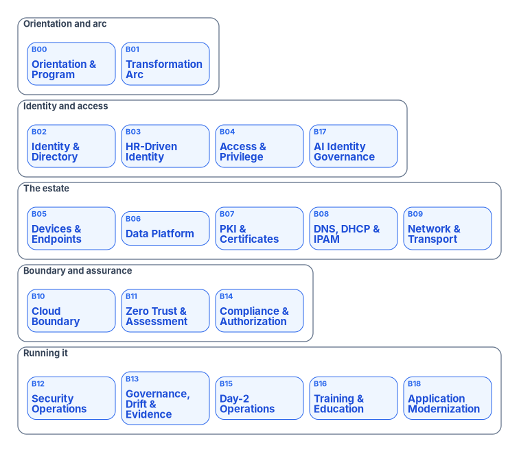

# Chapter 02 — How to Use This Workbook

*Eighteen books, one question each, and every external claim traceable to the source that makes it.*

::: {.callout-note}
## In this chapter
How the Federal Modernization Workbook is organized into eighteen topic books and why each one follows the same Why / What / Who / How shape. How claims are verified and footnoted, and how to tell an external fact from a program design position or an illustrative example. What the diagrams, Word editions and presentations are, and how they stay in step with the chapters. What happened to the workbook's earlier pages. What the workbook covers and what it doesn't, reading paths for each role, and a map of the books, including one by Cybersecurity Framework Function.
:::

The workbook grew the way most program material grows: as whitepapers, operational guides, executive briefs, case studies and series, each written when a question came up. That produced depth on many topics and no reliable way through them. The same subject could appear in four places, in four states of currency, with no sign of which one to trust.

The books fix that. Each book takes one topic, consolidates every page the workbook had on it into an ordered reading sequence, checks every external claim against a primary source as of the day it was built, and replaces the earlier pages. This chapter explains how the books are built so that a reader can use them with confidence, and so that a reader who finds a problem knows where to look.

{#fig-ch02-map-of-the-books fig-alt="Five groups of book cards. Orientation and arc: Book 00, Orientation and Program, why modernize and why now; Book 01, The Transformation Arc, why modernization is so hard. Identity and access: Book 02, Identity and Directory; Book 03, HR-Driven Identity; Book 04, Access and Privilege; Book 17, AI Identity Governance. The estate: Book 05, Devices and Endpoints; Book 06, Data Platform, SQL Server identity; Book 07, PKI and Certificates; Book 08, DNS, DHCP and IPAM; Book 09, Network and Transport. Boundary and assurance: Book 10, Cloud Boundary and Landing Zone; Book 11, Zero Trust and Assessment; Book 14, Federal Compliance and Authorization. Running it: Book 12, Security Operations and Telemetry; Book 13, Governance, Drift and Evidence; Book 15, Compliance Automation and Day-2 Operations; Book 16, People, Training and Education. All eighteen books are published, shown in blue."}

## Eighteen books

The workbook is organized as eighteen books, numbered B00 to B17. Book 00, this one, is the front door: it makes the case for modernizing now and sets out the program that the other books carry out. Book 01 tells the end-to-end transformation arc from client/server to hybrid cloud. Books 02 to 17 each take one domain in depth.

The numbering follows the dependency chain [Chapter 01](01-why-modernize-now.md) describes. Identity comes first because every later decision depends on it; the estate's infrastructure follows; boundary, assurance and operations come after. The map above groups the books that way, and the [book index](../index.md) lists them with their status.

The books are written to be read in any order. Each one states what it assumes and links to the book that carries a topic in depth rather than repeating it. When two books touch the same subject, one is the authoritative home and the other links to it. Book 01, for example, is the canonical source for the program's phases and gates, and every other book, including this one, uses its phase names.

## Every book asks four questions

Each book opens with one question, its **Why**, and then answers three more. The four questions are the same in every book so that a reader who has learned one can find their way through any other.

| Part | Question it answers | What you find there |
|---|---|---|
| **Why** | Why does this topic matter, and why can't it stay as it is? | The argument and the stakes, in plain language |
| **What** | What actually changes? | The concepts, the federal requirements read from the documents, and the target design |
| **Who** | Who decides, who does the work and who owns the result? | Roles, decision rights and the tools each role uses |
| **How** | How is it done? | Discovery, assessment, build, migration and steady-state operation, with procedures and scripts |

Appendices follow the How chapters and carry reference material: requirements crosswalks, assessment modules, interface catalogs and illustrative examples. Every book's index page has a table that maps its chapters to the four parts, reading paths for its audiences, and a note on where it sits among the other books.

The four questions are also the shape of every presentation and every executive summary in the workbook. A sponsor who reads only the Why chapters of each book will understand the case for the program; an engineer who reads only the How chapters will be able to do the work, with links back to the reasons.

## How claims are verified

Every external factual claim in a book is checked against a primary source on the day the book is built, and carries a footnote. "External" means anything the workbook didn't decide for itself: Microsoft product behavior and names, feature tiers, limits and retirement dates; federal policy from OMB, CISA, NIST and FedRAMP; protocol facts; and statistics.

### Reading a footnote

A footnote names the source, its title and date where it has one, the link, and the date it was opened:

> Office of Management and Budget, M-22-09, *Moving the U.S. Government Toward Zero Trust Cybersecurity Principles*, January 26, 2022, (link) (accessed Oct 21, 2026).

The access date matters. Product names change, retirement dates move and federal guidance is revised or rescinded, as M-26-14 rescinded M-21-31 in May 2026.[^c02-m2614] A footnote tells you what the source said on that date. If a claim matters to a decision you are about to make, open the source and check it again.

Primary sources come first. Microsoft claims are checked on Microsoft Learn and Microsoft's lifecycle pages; federal claims on whitehouse.gov, cisa.gov, nist.gov and fedramp.gov. Secondary reporting is used only to find a primary source, never as the citation.

### Three kinds of statement

The books distinguish three kinds of statement, and it is worth learning to tell them apart.

- **External fact.** Something a vendor or the government says. It is footnoted. If a book got it wrong, the fix is to correct the claim and its footnote.
- **Program design position.** Something the Federal Modernization Program decides: that identity comes first, that a gate passes on evidence, that a particular attribute carries a particular meaning. These are stated as the program's position ("the program's position is…", "in the program's model…") and need no footnote, because the program is the source. They are open to argument, not to fact-checking.
- **Illustrative example.** A worked example, a sample estate, a sample timeline or a framing pattern. These are labeled as illustrative. The case studies in the workbook are framing patterns, not real engagements: they describe a recognizable kind of agency without naming one, and no metric in them comes from a real program.

The workbook is agency-agnostic throughout. Where an agency-specific fact helps, it appears only as a generic example.

### The verification record

Each book keeps a verification file for every chapter, in a `_verification/` folder beside the chapters. Those files aren't published on the site but are in the repository; [Book 02's](https://github.com/WhalerMike/modernization-workbook/tree/main/docs/books/b02-identity/_verification) are an example. Each file has two tables:

- a **claims log**, listing every external claim in the chapter, where it appears, the verdict (verified, corrected, removed, restated as design, or unverifiable) and the source; and
- a **carry-forward ledger**, recording where each section of each earlier page went, or why it wasn't carried.

The claims log is where corrections are visible. When an earlier page said something the primary source doesn't support (a section number that doesn't exist, a deadline stated in calendar days when the rule says business days, a requirement that turns out to be guidance), the log records the original claim and what replaced it. The ledger is the guarantee that consolidation lost nothing by accident.

## Diagrams

Diagrams are drawn in one house style and committed as source files. Each one is generated from a short text source by a shared renderer, so every diagram in every book uses the same palette, type and layout rules, and changing a diagram means editing its source and rendering it again. The site shows the SVG rendering; the Word editions use a PNG rendering at twice the resolution.

Colors carry meaning, and the meaning is the same in every book:

| Color | Meaning |
|---|---|
| Blue | Microsoft Entra ID, the target path |
| Slate | Active Directory, neutral infrastructure |
| Green | Done, satisfied, recommended |
| Amber | Interim, conditional, needs a decision |
| Red | Legacy risk, blocked, fails |
| Violet | Governance, monitoring, delegation |

Every diagram has a white background and no title inside the image. The caption beneath it carries the title, and each figure has a full text description for screen readers. A diagram states only what its chapter argues or what a vendor documents; color is never the only signal, because each box carries its words. Where a diagram and its chapter disagree, the chapter is authoritative.

## Word editions

Each book is published as one Word document, regenerated from the chapters on every site deploy, and linked from the book's index page. The Word edition carries the same text, footnotes, tables and diagrams as the site, with a table of contents, so it can be printed, annotated, attached to a decision memo or read offline. Because it is rebuilt from the chapters each time, it never drifts from the site. Some longer books also publish their parts as separate documents.

## Presentations

Every book has a 15-minute briefing deck that follows the book's four questions. The [Presentations](../../presentations/index.md) page lists them all, each in four forms:

- **Deck**: the editable PowerPoint file, with full speaker notes, for presenting live. Every slide names the chapter and the primary sources behind it.
- **Narrated**: the same deck with recorded narration on every slide, set to play on its own.
- **Script**: the narration as text, for rehearsal or for reading instead of watching.
- **Captions**: the narration as timed captions in WebVTT, the W3C text format for captions and other time-aligned data,[^c02-webvtt] built into each narrated deck and also published as a separate `.vtt` file for video players.

PowerPoint can carry WebVTT captions for audio and video in current Windows and Mac versions,[^c02-ppt-captions] and the Presentations page explains how to turn them on in a slide show. The decks are built to meet Section 508, whose standards for electronic content incorporate the WCAG Level A and AA success criteria,[^c02-508] and the workbook targets WCAG 2.1 AA. Like the Word editions, the decks are generated from the chapters by scripts in the repository, so a changed chapter produces a changed deck.

## What happened to the earlier pages

When a book is built, the pages it replaces leave the site. They move to the repository's [`archive/`](https://github.com/WhalerMike/modernization-workbook/tree/main/archive) folder, one subfolder per book, where their history stays intact. Their old web addresses don't break: a redirect at each old address forwards the reader to the chapter that replaced it, so bookmarks and links in old emails keep working. The redirects are listed in one file in the repository, [`scripts/redirects.yml`](https://github.com/WhalerMike/modernization-workbook/blob/main/scripts/redirects.yml).

Two consequences follow for readers. First, if a link lands you on a chapter rather than the page you expected, the chapter is the current version of that material. Second, the site publishes only the books and the presentations. Anything else in the repository is either archived, waiting for its book, or working material, and none of it is authoritative over a published chapter.

{#fig-ch02-anatomy-of-a-book fig-alt="At the top, a slate card for the earlier pages: whitepapers, guides, briefs and case studies. A dashed arrow leads right to a slate card: archived in the repository, with old addresses forwarding to the new chapters. An arrow labeled consolidated into leads down to a central blue card, the book: one opening question, Why, What, Who and How chapters, and appendices. Two violet cards on either side feed the book: the verification file for each chapter, with a claims log and carry-forward ledger, and the diagram sources, rendered in one house style. From the book, three green arrows lead down to three green cards: site chapters, with footnoted and dated sources; the Word edition, regenerated on every deploy; and the 15-minute deck, with narrated, script and captions editions."}

## Reading paths

Nobody needs to read the whole workbook. These paths start with the chapters that answer each role's first questions; every book's index page has its own paths for going deeper.

| Role | Start with | Then |
|---|---|---|
| **Executive sponsor** | This book, Chapters 01, 03 and 07; [Book 01, Chapter 01](../b01-transformation-arc/01-why-modernization-is-hard.md) | The 15-minute presentation of each book in scope; [Book 01, Chapter 09](../b01-transformation-arc/09-who-leads-the-transformation.md) for the questions to ask each month |
| **CIO and CISO** | This book, Chapters 01 to 05 and 07 | [Book 11, Chapter 03](../b11-zero-trust/03-what-the-mandates-require.md) for the Zero Trust mandates; [Book 10, Chapter 03](../b10-cloud-boundary/03-what-changed-at-fedramp.md) for FedRAMP |
| **Program and project managers** | This book, Chapters 05 to 10 and Appendix A | [Book 01, Chapter 12](../b01-transformation-arc/12-migration-roadmap.md) for the roadmap; the Who chapter of each book in the portfolio |
| **Architects** | [Book 01](../b01-transformation-arc/index.md), all of it | [Book 02](../b02-identity/index.md) and [Book 05](../b05-devices/index.md), then [Books 08](../b08-ddi/index.md) to [10](../b10-cloud-boundary/index.md) |
| **Engineers doing the work** | This book, Chapter 08; [Book 02, Chapter 07](../b02-identity/07-read-only-discovery.md) for read-only discovery | The How chapters and assessment appendices of the book for your domain |
| **Authorizing officials, ISSOs and assessors** | [Book 10, Chapters 03, 08 and 11](../b10-cloud-boundary/index.md); [Book 11, Chapters 03, 08 and 10](../b11-zero-trust/index.md) | This book, Appendix A, for control traceability |
| **HR and identity data owners** | [Book 03](../b03-hr-identity/index.md), Chapters 01 to 03 | [Book 02, Chapter 06](../b02-identity/06-who-owns-the-migration.md) for who owns the migration |

Training and education have their own book, [Book 16, People: Training & Education](../b16-people/index.md). For a quick team briefing, the narrated presentations are the fastest route.

## What the workbook covers, and what it doesn't

The workbook covers workforce identity and the internal systems that federal employees and contractors use: the directory, devices, access, certificates, naming, the network, security operations and the day-two help desk. It doesn't cover public-facing digital services or the sign-on the public uses for them. OMB M-26-18 governs that side: it requires agencies to offer Login.gov on in-scope public-facing websites with authentication, defines "public-facing" as "intended to be accessed and used by members of the public, rather than by Federal Government employees or contractors acting on behalf of an agency," and says agencies "remain responsible for applying appropriate digital identity controls for enterprise identity."[^c02-m2618] The statute behind it draws the same line: 6 U.S.C. §1523(b)(1) requires a single sign-on platform for public websites that require authentication and, in the next clause, multi-factor authentication for remote access and for every account with elevated privileges.[^c02-1523] The workbook carries the second of those, not the first. Likewise, OMB M-23-22 applies to websites and digital services "intended for use by the public," and only encourages agencies to apply it to internal-facing ones, with one internal requirement: HTTPS on all web traffic, internal and public.[^c02-m2322]

Two federal obligations do reach the internal systems the program builds, and the books apply them where they arise. The 21st Century IDEA Act requires each agency to ensure, "to the greatest extent practicable, that any Intranet established after the date of enactment of this Act" meets the Act's criteria for websites and digital services, among them Section 508 accessibility, a secure connection, a search function and usability on mobile devices.[^c02-idea] And Section 508 applies to the information technology federal employees use, not only what the public uses; [Book 04, Chapter 09](../b04-access/09-access-governance.md) and [Book 15, Chapter 03](../b15-day2-operations/03-intake-triage-and-routing.md) apply it to self-service portals and the help desk.[^c02-794d] The [Federal Framework Crosswalk](../../research/federal-framework-crosswalk.md) in the Research section maps the books against the wider set of federal frameworks.

## Map of the books

| Book | Topic | Opening question | Group |
|---|---|---|---|
| B00 | [Orientation & Program](index.md) | Why modernize, and why now? | Orientation and arc |
| B01 | [The Transformation Arc: Client-Server to Hybrid Cloud](../b01-transformation-arc/index.md) | Why is modernization so hard? | Orientation and arc |
| B02 | [Identity & Directory: AD to Entra ID](../b02-identity/index.md) | Why does identity matter? | Identity and access |
| B03 | [HR-Driven Identity & Lifecycle](../b03-hr-identity/index.md) | Why should HR, not IT, decide who exists? | Identity and access |
| B04 | [Access & Privilege](../b04-access/index.md) | Why is every access decision a policy decision? | Identity and access |
| B05 | [Devices & Endpoints: GPO to Intune and Arc](../b05-devices/index.md) | Why can't Group Policy come to the cloud? | The estate |
| B06 | [Data Platform: SQL Server Identity](../b06-data-platform/index.md) | Why is the database where legacy authentication hides? | The estate |
| B07 | [PKI & Certificates](../b07-pki/index.md) | Why do certificates outlive every migration? | The estate |
| B08 | [DNS, DHCP & IPAM](../b08-ddi/index.md) | Why is DNS now the control plane? | The estate |
| B09 | [Network & Transport](../b09-network/index.md) | Why does physics decide the architecture? | The estate |
| B10 | [Cloud Boundary & Landing Zone](../b10-cloud-boundary/index.md) | Why does the authorization boundary decide what you can use? | Boundary and assurance |
| B11 | [Zero Trust & Assessment](../b11-zero-trust/index.md) | Why is Zero Trust a whole-agency property, not a product? | Boundary and assurance |
| B12 | [Security Operations & Telemetry](../b12-security-operations/index.md) | Why can't you defend what you can't see? | Running it |
| B13 | [Governance, Drift & Evidence](../b13-governance/index.md) | Why does compliance decay the day after the audit? | Running it |
| B14 | [Federal Compliance & Authorization](../b14-compliance/index.md) | Why does every control need proof, not a promise? | Boundary and assurance |
| B15 | [Compliance Automation & Day-2 Operations](../b15-day2-operations/index.md) | Why does modernization succeed or fail at the help desk? | Running it |
| B16 | [People: Training & Education](../b16-people/index.md) | Why do people, not tools, close the gap? | Running it |
| B17 | [AI Identity Governance](../b17-ai-identity/index.md) | Why do AI agents need identities and owners? | Identity and access |

The [book index](../index.md) shows each book's status and when it was last updated.

### The books by NIST Cybersecurity Framework Function

NIST's Cybersecurity Framework 2.0 organizes cybersecurity outcomes under six Functions.[^c02-csf] The table gives each Function's definition in NIST's words and the books that carry it as a primary subject. It is the workbook's own reading of the books, not a NIST mapping.

| Function | NIST's definition | Primary books |
|---|---|---|
| GOVERN | "The organization's cybersecurity risk management strategy, expectations, and policy are established, communicated, and monitored." | B00, B01, B10, B13, B14, B17 |
| IDENTIFY | "The organization's current cybersecurity risks are understood." | B01, B11, B17 |
| PROTECT | "Safeguards to manage the organization's cybersecurity risks are used." | B02 to B09, B16 |
| DETECT | "Possible cybersecurity attacks and compromises are found and analyzed." | B12 |
| RESPOND | "Actions regarding a detected cybersecurity incident are taken." | B12 |
| RECOVER | "Assets and operations affected by a cybersecurity incident are restored." | B14 ([Chapter 06](../b14-compliance/06-contingency-and-continuity.md)) |

RECOVER is the thinnest. The program's rollback points and gates recover from a failed change, not from an incident, so incident recovery rests on Book 14's contingency planning.

## If you find a problem

The workbook is maintained in public. If a claim is wrong, a source has changed, a link is broken or something in a deck or a page isn't accessible to you, open an issue in the [repository](https://github.com/WhalerMike/modernization-workbook/issues). Name the book, chapter and claim, and the source you think is right. Corrections go through the same check as the original: the claim is re-verified against the primary source, the footnote and the verification file are updated, and the Word edition and deck are rebuilt from the corrected chapter.

::: {.callout-tip}
## Continue the book
[← Previous: Chapter 01 — Why Modernize, and Why Now](01-why-modernize-now.md) · [Book index](index.md) · [Next: Chapter 03 — The Program Charter →](03-the-charter.md)
:::

[^c02-m2614]: Office of Management and Budget, M-26-14, *Ensuring Effective and Efficient Agency Logging and Network Visibility to Defend Against Evolving Cyber Threats*, May 22, 2026 ("Effective immediately, OMB Memorandum M-21-31 is rescinded"), <https://www.whitehouse.gov/wp-content/uploads/2026/05/M-26-14-Ensuring-Effective-and-Efficient-Agency-Logging-and-Network-Visibility-to-Defend-Against-Evolving-Cyber-Threats.pdf> (accessed Oct 21, 2026).
[^c02-webvtt]: World Wide Web Consortium, *WebVTT: The Web Video Text Tracks Format*, Candidate Recommendation Draft, May 20, 2026, <https://www.w3.org/TR/webvtt1/> (accessed Oct 21, 2026).
[^c02-ppt-captions]: Microsoft Support, "Add closed captions or subtitles to media in PowerPoint" (WebVTT caption files for video and audio; supported versions on Windows and Mac), <https://support.microsoft.com/office/add-closed-captions-or-subtitles-to-media-in-powerpoint-df091537-fb22-4507-898f-2358ddc0df18> (accessed Oct 21, 2026).
[^c02-508]: U.S. Access Board, *Information and Communication Technology (ICT) Standards and Guidelines* (Revised 508 Standards), E205.4 and 702.10.1 (electronic content conforms to WCAG 2.0 Level A and AA success criteria, incorporated by reference), <https://www.access-board.gov/ict/> (accessed Oct 21, 2026).
[^c02-m2618]: Office of Management and Budget, M-26-18, *Scaling Use of Login.gov to Deliver a Universal Sign-on for Public Services*, August 31, 2026, Scope and Applicability and note 3, <https://www.whitehouse.gov/wp-content/uploads/2026/08/M-26-18-Scaling-Use-of-Login.gov-to-Deliver-a-Universal-Sign-on-for-Public-Services.pdf> (accessed Oct 23, 2026).
[^c02-1523]: 6 U.S.C. §1523(b)(1)(D)–(E) (2023 edition), <https://www.govinfo.gov/content/pkg/USCODE-2023-title6/html/USCODE-2023-title6-chap6-subchapII-sec1523.htm> (accessed Oct 23, 2026).
[^c02-m2322]: Office of Management and Budget, M-23-22, *Delivering a Digital-First Public Experience*, September 22, 2023, §II (scope) and §III.A.5 ("Agencies shall encrypt all web traffic across their websites and digital services as HTTPS, including both public-facing (internet-facing) and internal-facing traffic"), <https://www.whitehouse.gov/wp-content/uploads/2023/09/M-23-22-Delivering-a-Digital-First-Public-Experience.pdf> (accessed Oct 23, 2026).
[^c02-idea]: 21st Century Integrated Digital Experience Act, Pub. L. 115-336, §3(a) and §3(c), December 20, 2018, <https://www.govinfo.gov/content/pkg/PLAW-115publ336/html/PLAW-115publ336.htm> (accessed Oct 23, 2026).
[^c02-794d]: 29 U.S.C. §794d(a)(1)(A)(i) (2023 edition), <https://www.govinfo.gov/content/pkg/USCODE-2023-title29/html/USCODE-2023-title29-chap16-subchapV-sec794d.htm> (accessed Oct 23, 2026).
[^c02-csf]: NIST, *The NIST Cybersecurity Framework (CSF) 2.0*, CSWP 29, February 26, 2024, §2, <https://nvlpubs.nist.gov/nistpubs/CSWP/NIST.CSWP.29.pdf> (accessed Oct 23, 2026).
