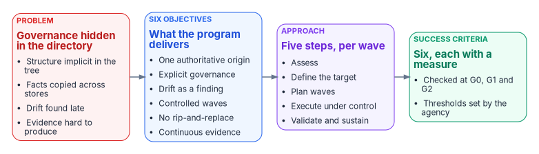
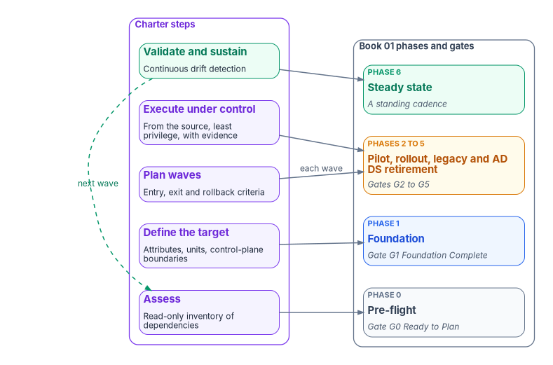

# Chapter 03 — The Program Charter

*A modernization program needs a charter for the same reason a migration needs a source of truth: someone has to be able to say what was agreed, and check it later.*

::: {.callout-note}
## In this chapter
The charter of the Federal Modernization Program: why it exists, the problem it solves, its six objectives and its scope. It sets out the guiding principles in short form, turns each success criterion into something a sponsor can measure at a named gate, and describes the five-step approach, the main risks and assumptions, who decides what, and the first steps.
:::

## What the charter is for

[Chapter 01](01-why-modernize-now.md) made the case for modernizing now. This chapter writes that case down as a commitment. A charter is short on purpose. It doesn't replace the plan ([Chapter 05](05-the-program-plan.md)), the principles ([Chapter 04](04-the-principles.md)) or the decision rights ([Chapter 07](07-who-runs-the-program.md)). It is the page the sponsor signs, and the page every later decision is checked against: is this inside the scope we chartered, does it serve one of the objectives, and does it move a success criterion?

The charter makes no reference to internal decision records or document identifiers. An adopting agency can use it as written, put its own names in the governance section, and set its own thresholds where the criteria below give illustrative ones.

{#fig-ch03-charter-on-a-page fig-alt="Four boxes left to right. A red box, the problem: governance hidden in the directory, facts copied across many stores, drift found late, and evidence hard to produce. An arrow leads to a blue box, six objectives: one authoritative origin, explicit governance, drift as a finding, controlled waves, domain transformations without rip-and-replace, and continuous evidence. An arrow leads to a violet box, the approach: assess, define the target, plan waves, execute under control, validate and sustain. An arrow leads to a green box, six success criteria, each measured at a gate from G0 to G2."}

## Purpose

The program moves an organization from fragmented, legacy-dependent identity, policy and addressing systems to a governed, attribute-driven hybrid-cloud operating model. It does three things on the way:

- It restores a single authoritative origin for organizational structure and the key claims that depend on it.
- It makes drift between intended and actual state explicit and detectable.
- It lets the organization change in controlled steps, without rip-and-replace disruption.

## The problem

Hierarchical directories, Active Directory above all, have accumulated decades of implicit governance. Organizational structure, delegation boundaries, policy inheritance, service dependencies and authority chains are encoded in the directory itself rather than stated anywhere. Group Policy shows the pattern: on-premises policy applies in local, site, domain and organizational-unit order, each layer overwriting the one before, so an object's position in the tree is its policy.[^c03-gpo-order] The tree is the governance model, and nobody wrote it down. [Book 01, Chapter 02](../b01-transformation-arc/02-the-problem.md) tells that story in full.

When the organization moves to a cloud identity platform, that structure is flattened, and the governance model doesn't come with it automatically. Microsoft Intune applies policy to groups with no hierarchy at all; where two policies set the same value differently, the result is a conflict to resolve, not an inheritance rule.[^c03-gpo-order] Microsoft Entra ID's administrative units, the nearest thing to a delegation boundary, can't be nested.[^c03-au] Every rule the tree expressed by position has to be re-expressed on purpose, or it is lost.

Much of what depends on the directory doesn't announce the dependency. Network Policy Server, the Windows RADIUS server, uses the Active Directory domain as its user account database when it is a domain member, so wireless, VPN and switch authentication ride on the directory.[^c03-nps] Certificate auto-enrollment is configured through Group Policy and depends on an enterprise certification authority integrated with Active Directory.[^c03-autoenroll] Retire the directory without mapping these and they stop, often without an error anyone sees.

At the same time, data and configuration have spread across many systems. Several stores hold competing copies of the same facts, and a basic question, "which value is authoritative?", has no reliable answer. The result is four costs the charter sets out to remove:

1. **Migration risk concentrated in hidden dependencies:** policy, addressing, service accounts, certificates and naming.
2. **Ongoing drift** between intended and actual state.
3. **Weak evidence.** It is hard to produce reliable proof of change and compliance.
4. **High reconciliation cost** across fragmented stores.

## Objectives

1. **One authoritative origin.** Establish a single authoritative origin for organizational structure, identity attributes and key operational claims. Every other representation is derived and subordinate.
2. **Explicit governance.** Rebuild organizational governance explicitly, through attribute-driven structure, dynamic membership and scoped policy, instead of inheriting it from a hierarchical directory.
3. **Drift as a finding.** Make drift between desired and observed state a first-class, classified finding, not an exception or a surprise.
4. **Controlled waves.** Carry out modernization in controlled waves of change that originate from the authoritative source, run under least privilege, and close with provenance and evidence.
5. **Domain transformations without rip-and-replace.** Deliver transformations for identity, policy, services and addressing, compute and devices, and the access plane, each able to proceed on its own schedule.
6. **Continuous evidence.** Produce continuous, machine-usable evidence of state and change for operations and compliance.

The objectives line up with federal policy without being dictated by it. OMB M-22-09 requires agencies to employ centralized identity management systems for agency users, and its vision is staff who use enterprise-managed identities to reach the applications they work in.[^c03-m2209] Objective 1 is the program's way of making that identity system authoritative for structure as well as for sign-in.

## Scope

### In scope

- Discovery and documentation of current-state governance surfaces and hidden dependencies.
- Definition of a target attribute-oriented structure and control-plane model.
- Phased transformation plans and execution approaches for identity, policy, addressing and services, compute, and access.
- Change-control discipline: wave-based moves, least-privilege execution and provenance closure.
- The drift-detection approach and the evidence expected from it.
- Program governance, gates and success measures.

### Out of scope for the initial phase

- Replacing existing compliance or audit frameworks. The program produces evidence those frameworks consume; it doesn't replace them.
- Vendor-specific implementation detail beyond worked examples. The books use Microsoft services as the worked example ([Assumptions](#assumptions)).
- Real-time inline enforcement and data-plane components. Identity providers, network fabrics and device managers stay the enforcers; the program governs them.
- Organization-specific data migration and cutover execution. The program defines the method; execution stays with the adopting organization.

## Guiding principles

The charter carries six principles. [Chapter 04](04-the-principles.md) sets out the full set of fifteen and names the book and chapter that carries each.

| Principle | What it commits the program to |
|---|---|
| Authoritative origin | Every important claim or structural fact has exactly one origin. Other systems hold derived pointers or subordinate copies. |
| Identity as the root namespace | Organizational structure, policy scope and addressing derive from identity attributes, not from independent hierarchies. |
| Drift is explicit | Differences between intended and observed state are classified, visible and actionable. |
| Evidence-driven change | Changes originate from the authoritative source, run under controlled privilege and close with provenance. |
| No rip-and-replace | Modernization maps, bridges and progressively replaces implicit functions while keeping operations running. |
| Least privilege and just-in-time access | Elevated rights exist only for the duration and scope of a governed change. |

: The charter's six guiding principles {.striped .hover}

The last principle has direct product support in the worked example. Microsoft Entra Privileged Identity Management makes a user eligible for a role rather than permanently assigned to it, and provides time-based and approval-based activation, so the right exists only while the change is being made.[^c03-pim] The first principle has a constraint that shapes the plan. For a user synchronized from Active Directory, the source of authority for the fifteen extension attributes is the on-premises directory, and the cloud copy is read-only.[^c03-extattr] While users are synced, the authoritative origin for organizational attributes is reached through Active Directory, and moving that origin to the cloud is a deliberate, scheduled change, not a side effect.

## Success criteria

The source charter states its criteria as outcomes ("an assessment exists," "a model is agreed"). A sponsor can't sign off an outcome with no test attached, so each criterion below has a measure, the evidence that shows it, and the [Book 01](../b01-transformation-arc/12-migration-roadmap.md) gate at which it is checked. Numeric thresholds are the program's illustrative defaults; the agency sets its own, records them, and doesn't change them silently afterwards.

| # | Criterion | Measure | Evidence | Checked at |
|---|---|---|---|---|
| 1 | A documented current-state assessment of the major governance surfaces and dependencies exists | The assessment covers every forest in scope and all eleven dependency object types ([Book 02, Chapter 04](../b02-identity/04-the-hidden-migration-surface.md)); zero open priority-one findings | Assessment output committed to the authoritative repository | G0 Ready to Plan |
| 2 | A target attribute-driven structure and control-plane model is defined and agreed | Every attribute that drives access has exactly one designated source (100%); the attribute schema and the administrative-unit registry are approved by their decider | Canonical attribute schema ([Book 03, Chapter 06](../b03-hr-identity/06-canonical-attribute-schema.md)) and unit registry ([Book 02, Chapter 05](../b02-identity/05-delegation-without-ous.md)) merged with the approver recorded | G1 Foundation Complete |
| 3 | At least one domain, identity or policy, has a complete transformation playbook with gates and evidence expectations | The playbook's entry and exit criteria are written as queries the engine can evaluate; the pilot division passes them | The pilot division clears G2: zero drift for a hold period (for example fourteen consecutive days, illustrative) and retrospective committed | G2 Pilot Clean |
| 4 | A change-control pattern (origination, authorization, least-privilege execution, provenance closure) is defined and in use | Share of pilot changes that carry all five clauses of the change lifecycle ([Chapter 04](04-the-principles.md#principle-2)): target 100%; every human-only closure logged as an exception | Closure records with verification payload, timestamp and checker identity; exception count reported weekly | G1, then every gate after |
| 5 | Drift classes and the detection approach are specified | Every drift class has a detection signal, a severity and a response expectation; detection runs at its set cadence with no missed run | Drift catalogue and scheduled-run history; a missed run is itself a halt condition in Book 01's rollback table | G1 Foundation Complete |
| 6 | Leadership can describe the path, the major risks and how success is measured without reference to internal decision records | The sponsor answers "yes" to each pre-start question in [Book 01, Chapter 09](../b01-transformation-arc/09-who-leads-the-transformation.md#how-a-sponsor-evaluates-the-program); the steering committee reviews the drift trend monthly | Signed charter; recorded steering-committee reviews | G0, then monthly |

: Success criteria, measures and the gate at which each is checked {.striped .hover}

The criteria deliberately stop at the pilot. They are the charter's criteria for the initial phase: method proven on one domain, one division and one change pattern. Program-level success, measured all the way to Active Directory's retirement and steady state, is the subject of [Chapter 10](10-retirement-steady-state-and-success.md).

## Approach

The program works in five steps. They repeat for each domain and each wave; they don't run once for the whole estate.

1. **Assess.** Inventory legacy dependencies and the governance model currently encoded in the directory and related systems. The assessment is read-only.
2. **Define the target.** Set the attribute-oriented structure, dynamic constructs and control-plane boundaries that replace implicit hierarchy.
3. **Plan waves.** Sequence domain transformations with clear entry and exit criteria and rollback conditions.
4. **Execute under control.** Run changes as governed operations that originate from the authoritative source and close with evidence.
5. **Validate and sustain.** Detect drift continuously, and treat the authoritative origin as the baseline for operations from then on.

{#fig-ch03-approach-and-gates fig-alt="Two columns. On the left, five charter steps stacked top to bottom: Assess, Define the target, Plan waves, Execute under control, Validate and sustain. On the right, the Book 01 phases and gates: Phase 0 Pre-flight to G0 Ready to Plan; Phase 1 Foundation to G1 Foundation Complete; Phases 2 to 5, pilot, rollout, legacy retirement and AD DS retirement, through G2 to G5; Phase 6 Steady state. Arrows connect Assess to Phase 0, Define the target to Phase 1, Plan waves and Execute under control to Phases 2 to 5, and Validate and sustain to Phase 6, with a dashed arrow from Validate and sustain back to Assess for the next wave."}

The steps map onto the roadmap as follows. Book 01 is canonical for phases and gates; [Chapter 05](05-the-program-plan.md) sets out the full plan.

| Charter step | Book 01 phase | Gate it feeds |
|---|---|---|
| Assess | Phase 0, Pre-flight | G0 Ready to Plan |
| Define the target | Phase 0 into Phase 1, Foundation | G1 Foundation Complete |
| Plan waves | Each of Phases 2 to 5, before each wave | G2 to G5, wave by wave |
| Execute under control | Phases 2 to 5: pilot division, general rollout, legacy retirement, AD DS retirement | G2 Pilot Clean, G3 Rollout Complete, G4 Legacy Quiet, G5 AD Retired |
| Validate and sustain | Every phase, and Phase 6, Steady state | No gate: a standing cadence |

: Charter steps mapped to the Book 01 phases and gates {.striped .hover}

Steps 3 and 4 are the engine of [Book 01, Chapter 11](../b01-transformation-arc/11-analysis-plan-delivery.md): analyze, plan, deliver, with a validation gate and an authorization gate between plan and delivery, and an actuation ceiling that keeps high-blast-radius changes under human approval.

## Risks and assumptions

### Key risks

| Risk | Why it matters | How the program responds |
|---|---|---|
| Discovery misses a hidden dependency | Unplanned outages, or drift that persists after cutover | Read-only assessment of all eleven dependency types before G0; a pilot division before rollout ([Chapter 08](08-pre-flight-and-assessment.md)) |
| The organization resists making implicit authority explicit | People who held authority by position in the tree lose it, or have to state it | Decision rights written down with one decider per row ([Chapter 07](07-who-runs-the-program.md)) |
| Tooling is bought before the governance model is normalized | Tools automate the old ambiguity faster | Define the target (step 2) before any wave; no tool selection is an objective |
| Physics and sovereignty limit centralization | A single logical source of truth can't always be one physical store | Separate logical from physical centralization ([Book 09, Chapter 04](../b09-network/04-logical-centralization-and-token-security.md)); model the cloud boundary ([Book 10](../b10-cloud-boundary/index.md)) |

: Key risks and the program's response {.striped .hover}

[Appendix A](appendix-a-risk-register-and-traceability.md) holds the full risk register.

### Assumptions

- **An authoritative lifecycle source exists or can be designated** for human and non-human identities. For employees that is normally the HR system; contractors usually need a source of their own ([Book 03](../b03-hr-identity/index.md)).
- **Microsoft cloud identity and device management services, or equivalents, are available as target platforms** for the worked examples: Microsoft Entra ID, Intune and Azure Arc. Which of their features are available depends on the cloud the agency uses; [Book 10](../b10-cloud-boundary/index.md) covers the boundary.
- **Stakeholders accept that modernization is a governance reconstruction problem** as much as a technical migration. If they don't, risk 2 above becomes the program's main risk.

## Governance and ownership

The source charter left the names blank, and so does this one: the agency fills them in. What the charter fixes is the shape.

| Charter role | Role in the program model | Decides |
|---|---|---|
| Project sponsor | Executive sponsor, with the CIO | Scope, funding and sequence; gates G3 and G5; when Active Directory components retire |
| Project lead | The steward, the program office's accountable lead | Target architecture and the authoritative repository; gates G0, G1 and G4; co-signs G2 with the sponsor |
| Domain leads | The five workstream leads: identity, policy, services and addressing, compute, access | Playbook content and execution readiness in their domain |

: Charter roles and their place in the program's decision model {.striped .hover}

Major scope, sequencing and target-model decisions rest with the sponsor and the steward; domain leads own their playbooks and say when their domain is ready. The gate authorities follow [Book 01, Chapter 09](../b01-transformation-arc/09-who-leads-the-transformation.md), and [Chapter 07](07-who-runs-the-program.md) sets out the full decision matrix, including the authorizing official, the CISO and HR.

Two federal requirements usually already name people who belong in these rows. OMB M-22-09 required each agency to designate a zero trust strategy implementation lead within 30 days, and says the whole agency leadership, the "C-suite," must be aligned and committed to the overhaul.[^c03-m2209] OMB M-19-17 requires each agency to designate an integrated, agency-wide ICAM office, team or other governance structure.[^c03-m1917] The program's steward and steering committee should be built from those, not alongside them.

## Next steps

1. **Name the program and its stakeholders.** Put names in the governance table above, starting with the sponsor and the steward.
2. **Scope the current-state assessment** and its data sources: which forests, which tenants, which read-only accounts.
3. **Draft the target architecture outline:** attribute schema, unit model and control-plane boundaries.
4. **Define the first wave.** The recommended first wave is identity structure and dynamic membership, because every later wave scopes itself with them.
5. **Set the evidence and provenance expectations** that every later change must meet, before the first change is made.

::: {.callout-tip}
## Continue the book
[← Previous: Chapter 02 — How to Use This Workbook](02-how-to-use-this-workbook.md) · [Book index](index.md) · [Next: Chapter 04 — The Modernization Principles →](04-the-principles.md)
:::

[^c03-gpo-order]: Microsoft Learn, "Walkthrough - Create an Intune settings catalog policy and compare with on-premises ADMX," section "Create groups, and add users" (on-premises policies apply in LSDOU order; in Intune there isn't a hierarchy, and conflicting settings show as conflicts), <https://learn.microsoft.com/intune/device-configuration/settings-catalog/tutorial-group-policy-migration> (accessed Oct 21, 2026).
[^c03-au]: Microsoft Learn, "Administrative units in Microsoft Entra ID," section "Constraints" (administrative units can't be nested), <https://learn.microsoft.com/entra/identity/role-based-access-control/administrative-units> (accessed Oct 21, 2026).
[^c03-nps]: Microsoft Learn, "Network Policy Server overview," section "RADIUS server and proxy" (NPS uses an AD DS domain or the local SAM database to authenticate connection attempts), <https://learn.microsoft.com/windows-server/networking/technologies/nps/nps-top> (accessed Oct 21, 2026).
[^c03-autoenroll]: Microsoft Learn, "Configure auto-enrollment of certificates for Network Policy Server" (prerequisite: AD CS with an Enterprise CA; auto-enrollment configured through Group Policy), <https://learn.microsoft.com/windows-server/networking/core-network-guide/cncg/server-certs/configure-server-certificate-auto-enrollment> (accessed Oct 21, 2026).
[^c03-m2209]: Office of Management and Budget, M-22-09, *Moving the U.S. Government Toward Zero Trust Cybersecurity Principles*, January 26, 2022, §III, opening text (agency leadership and the "C-suite"; designation of a zero trust strategy implementation lead within 30 days) and §III.A (Identity: enterprise-managed identities; centralized identity management systems), <https://www.whitehouse.gov/wp-content/uploads/2022/01/M-22-09.pdf> (accessed Oct 21, 2026).
[^c03-pim]: Microsoft Learn, "What is Microsoft Entra Privileged Identity Management?" (time-based and approval-based role activation; eligible versus active assignments; just-in-time access), <https://learn.microsoft.com/entra/id-governance/privileged-identity-management/pim-configure> (accessed Oct 21, 2026).
[^c03-extattr]: Microsoft Graph documentation, "onPremisesExtensionAttributes resource type" (for an onPremisesSyncEnabled user, the source of authority is on-premises Active Directory and the properties are read-only), <https://learn.microsoft.com/graph/api/resources/onpremisesextensionattributes?view=graph-rest-1.0> (accessed Oct 21, 2026).
[^c03-m1917]: Office of Management and Budget, M-19-17, *Enabling Mission Delivery through Improved Identity, Credential, and Access Management*, May 21, 2019, Governance, item 1 (an integrated agency-wide ICAM office, team or other governance structure), <https://www.whitehouse.gov/wp-content/uploads/2019/05/M-19-17.pdf> (accessed Oct 21, 2026).
