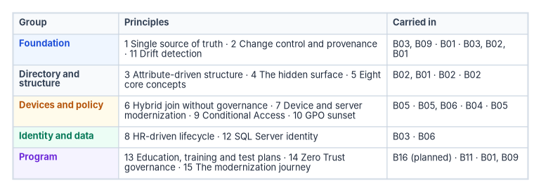
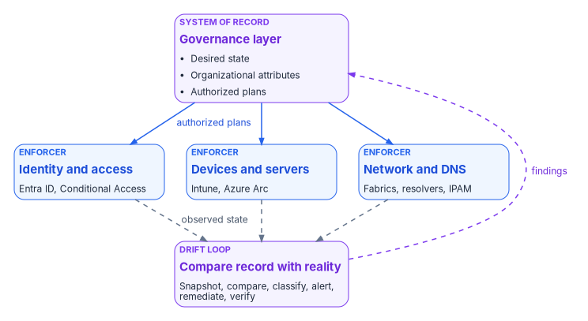

# Chapter 04 — The Modernization Principles

*Fifteen principles, one idea underneath them: keep the record of what should be true apart from the systems that enforce it, and make every change prove itself against that record.*

::: {.callout-note}
## In this chapter
The fifteen principles the program runs on, written for leaders, architects and operators who need the rules without the full narrative. Each principle is stated as a short set of rules, the product and policy facts behind it are checked and footnoted, and each one ends with the book and chapter that carries it in depth. Two source rules turned out to be wrong and are corrected here: Intune configuration conflicts and token lifetimes.
:::

## How to read the principles

The principles fall into five groups. **Foundation** principles (1, 2 and 11) apply to every change in every domain. **Directory and structure** (3, 4, 5) say what replaces the organizational-unit tree. **Devices and policy** (6, 7, 9, 10) govern endpoints, servers and access policy. **Identity and data** (8, 12) cover the HR feed and the database tier. **Program** principles (13, 14, 15) cover people, Zero Trust governance and the overall direction.

{#fig-ch04-principles-map fig-alt="A three-column table. Foundation, blue: principle 1 single source of truth, Book 03 and Book 09; principle 2 change control and provenance, Book 01; principle 11 drift detection, Books 03, 02 and 01. Directory and structure, slate: principle 3 attribute-driven structure, Book 02 and Book 01; principle 4 the hidden surface, Book 02; principle 5 eight core concepts, Book 02. Devices and policy, amber: principle 6 hybrid join without governance, Book 05; principle 7 device and server modernization, Books 05 and 06; principle 9 Conditional Access, Book 04; principle 10 Group Policy sunset, Book 05. Identity and data, green: principle 8 HR-driven lifecycle, Book 03; principle 12 SQL Server identity, Book 06. Program, violet: principle 13 education, training and test plans, Book 16; principle 14 Zero Trust governance, Book 11; principle 15 the modernization journey, Book 01 and Book 09."}

Rules marked as the program's design are design positions. They need no footnote, but they aren't presented as vendor or federal requirements. Where a rule rests on how a product or a policy actually works, the footnote says where that was checked.

## 1. Single source of truth {#principle-1}

Every important claim has exactly one authoritative origin. Every other representation is a provenance-anchored pointer, not an independent copy.

- Runtime systems read from the authoritative source. They write to it only through a governed change process.
- Every derived artifact cites the document and version it was derived from.
- Drift is evaluated against the single source of truth, and nothing else.

Without one, every system holds a slightly different copy of the same claim; over time the copies diverge, and nobody can say which is right. The principle has a hard edge in a hybrid estate. For a user synchronized from Active Directory, the fifteen extension attributes are mastered on premises and are read-only in Microsoft Entra ID.[^c04-extattr] The source of truth isn't wherever an administrator would like it to be; it is wherever the platform says writes are accepted, and the program moves it deliberately.

**Carried in depth by:** [Book 03, Chapter 04 — Attribute Authority](../b03-hr-identity/04-attribute-authority.md) (which system is authoritative for which fact), and [Book 09, Chapter 04 — Logical Centralization and Token-Based Security](../b09-network/04-logical-centralization-and-token-security.md) (one logical source, not necessarily one physical store).

## 2. Change control and provenance {#principle-2}

Every operational change, every move, add, change, deletion and reset (MACD-R), travels five clauses. An operation that skips one is unauthorized by construction.

1. **It originates with the source of truth.** Work is created by divergence between the source of truth and the estate, not by a request that bypasses it.
2. **It carries an authoritative authorization.** The approval resolves from the authority model, not from whoever is nearby.
3. **It executes under least privilege, elevated just in time.** The executing actor activates a time-boxed, scoped role and holds no standing privilege.
4. **It closes with provenance.** No closure counts unless it carries its proof: the verification payload, a timestamp and the identity of the checking mechanism.
5. **It emits verified, secured evidence automatically.** The closure record flows into the continuous-monitoring stream with no human assembly.

The closure rule is the strictest of the five, and it is the program's design. A task closed by a person clicking "complete" with no machine-readable verification is prose, not evidence. Human-only closure is an exception state to be logged, not a path. Reports are derived from the closure stream; they are never compilations of assertions. Clause 3 is supported directly in the worked example: Privileged Identity Management assigns roles as eligible rather than active and activates them for a limited, approved period.[^c04-pim]

**Carried in depth by:** [Book 01, Chapter 02 — The Problem](../b01-transformation-arc/02-the-problem.md#one-lifecycle-for-every-change) (the lifecycle and its per-class sources of truth) and [Book 01, Chapter 11 — Analysis, Plan, Delivery](../b01-transformation-arc/11-analysis-plan-delivery.md#evidence-packet) (the plan, the authorization gate and the evidence packet).

## 3. Attribute-driven structure {#principle-3}

Hierarchical governance (organizational units, Group Policy inheritance, delegation boundaries) is rebuilt inside a flat directory from organizational attributes.

- The attributes live in extension attributes on users and devices.
- Dynamic group membership, administrative-unit scoping, Conditional Access targeting and license assignment are all driven by them. Administrative units can hold users and devices by dynamic membership rule,[^c04-au] Conditional Access can target any group type, including dynamic groups,[^c04-ca-users] and Microsoft recommends dynamic groups for group-based licensing.[^c04-groups]
- Administrative units can't be nested.[^c04-au] An OU tree becomes a flat set of attribute-selected units, and the hierarchy lives in the attribute values, not in the containers.
- For synced users, the attributes that drive unit membership are mastered in Active Directory, not in the cloud.[^c04-extattr]

**Carried in depth by:** [Book 02, Chapter 05 — Delegation Without OUs](../b02-identity/05-delegation-without-ous.md) (the three-tier unit model, registry and drift checks) and [Book 01, Chapter 04 — Identity Transformation](../b01-transformation-arc/04-identity-transformation.md) (attributes, dynamic groups and units as the four mechanisms).

## 4. Directory migration: the hidden surface {#principle-4}

Active Directory was the implicit governance model for eleven categories of infrastructure object: users, computers, service accounts, security groups, Group Policy Objects, DNS and DHCP, PKI, RADIUS, LDAP, service principal names and trust relationships. When Active Directory goes away, every one of them loses its governance anchor, and most fail silently.

Three silent failures matter most:

- **PKI and certificate services.** Certificate auto-enrollment is configured through Group Policy against an enterprise CA integrated with Active Directory;[^c04-autoenroll] without it, certificates stop enrolling and renewing, and the failure shows up weeks later as expiry.
- **RADIUS, 802.1X and VPN.** Network Policy Server uses the Active Directory domain as its account database when it is a domain member;[^c04-nps] network access control stops authenticating.
- **LDAP.** Legacy applications that authenticate by LDAP bind stop working.

Each category migrates through the same six phases: **Discover, Normalize, Map, Migrate, Validate, Decommission**, each with its own governance gate.

**Carried in depth by:** [Book 02, Chapter 04 — The Hidden Migration Surface](../b02-identity/04-the-hidden-migration-surface.md) (the eleven types, the adapter matrix and the six phases), with the PKI, DNS and network categories in [Book 07, Chapter 02](../b07-pki/02-what-ad-cs-holds-up.md), [Book 08, Chapter 04](../b08-ddi/04-active-directory-dns-departure.md) and [Book 09, Chapter 07](../b09-network/07-network-access-control.md).

## 5. Eight core concepts {#principle-5}

Eight concepts carry the program's design vocabulary. They are design positions, not product features.

| # | Concept | Definition |
|---|---|---|
| 1 | Single source of truth | Every claim has one authoritative origin. |
| 2 | The conversation as the atomic unit | Every interaction binds identity, certificates, addressing, path, quality of service and telemetry. |
| 3 | Identity as the root namespace | Every address, certificate, subnet, policy and telemetry event derives from identity. |
| 4 | Deterministic addressing | Addressing is identity-derived and policy-driven. |
| 5 | Certificate-anchored overlay | Mutual TLS anchors tunnels, services and trust relationships. |
| 6 | Telemetry as control | Telemetry is a real-time control input, not passive reporting. |
| 7 | Embedded governance | Governance runs through orchestrated workflows, not manual tickets. |
| 8 | User experience first | If governance was done right, the migration is invisible to end users. |

: The eight core concepts {.striped .hover}

**Carried in depth by:** [Book 02, Chapter 03 — Active Directory and Entra ID, Side by Side](../b02-identity/03-ad-and-entra-side-by-side.md#the-eight-core-concepts-of-directory-migration) (the concepts and how they map to the migration adapters), with addressing in [Book 08](../b08-ddi/index.md) and certificates in [Book 07](../b07-pki/index.md). Telemetry as a control input is the subject of [Book 12, Security Operations & Telemetry](../b12-security-operations/index.md).

## 6. Hybrid join without governance {#principle-6}

Converting a large domain-joined fleet to Microsoft Entra hybrid join is close to a tenant-wide switch: publish a service connection point, or push its two registry values by Group Policy, and devices register themselves.[^c04-hybrid-control] That effortlessness is the hazard.

The **ungoverned path** keeps the connectivity benefit and spends the truth-and-accountability layer: ownership, one object per machine, scoped rollout, provenance, lifecycle and a single console of record. It also tends to make a waypoint permanent. Microsoft's own guidance is that hybrid join shouldn't be a long-term or end state, and that existing hybrid-joined devices must be reset to become Entra joined.[^c04-join-types]

The **governed path** reaches the same end state but routes the bulk change through an active reconciliation control plane:

1. Address before you actuate: organizational attributes on every device.
2. Cap the blast radius: high-blast-radius operation classes stay gated on human approval.
3. Execute through plan and apply, with a dry run.
4. Bake enforcement in report-only mode first.
5. Reconcile duplicates and lifecycle.
6. Emit evidence an authorizing official can sign.
7. Cover the whole denominator: non-Windows devices, personal devices, guests and servers.

Book 05 adds an eighth step that follows from Microsoft's guidance: give every hybrid-joined device an exit to Entra join and a trigger event, such as its refresh date.

**Carried in depth by:** [Book 05, Chapter 02 — The Hybrid Join Trap](../b05-devices/02-the-hybrid-join-trap.md#the-governed-path), with the governed, manual and retrofit paths in [Book 05, Chapter 05](../b05-devices/05-the-governed-manual-and-retrofit-paths.md).

## 7. Device and server modernization {#principle-7}

Observe before you change anything. The work runs in four phases:

1. **Observe:** NTLM audit, service principal name inventory, SQL Server audit, device-management posture.
2. **Onboard:** hybrid management onboarding for servers, device-management auto-enrollment for clients.
3. **Harden:** service principal name repair, NTLM restriction, the Conditional Access baseline.
4. **Watch:** Conditional Access drift and cross-domain status.

The key rules:

- **Audit before you restrict NTLM.** Windows provides audit-only settings that log the NTLM requests a block would deny, before anything is blocked.[^c04-ntlm-audit] Microsoft notes that reducing NTLM requires knowing which deployed applications need it, and that applications may still use it even where Kerberos is preferred.[^c04-ntlm] Premature blocking breaks legacy applications.
- **Never embed a service-principal secret in a Group Policy startup script.** It is readable by any domain user through SYSVOL.
- **Exclude break-glass accounts from Conditional Access before enforcing.** Microsoft recommends excluding emergency access accounts from policies to prevent lockout through misconfiguration.[^c04-ca-plan]
- **Domain unjoin is a separately sequenced decision.** Onboarding a server to Azure Arc doesn't imply removing its domain join.

**Carried in depth by:** [Book 05, Chapter 09 — Servers Under Azure Arc](../b05-devices/09-servers-under-azure-arc.md) (onboarding, the startup-script rule and the separate unjoin decision), [Book 05, Chapter 04 — Intune-First Onboarding](../b05-devices/04-intune-first-onboarding.md) and [Book 05, Chapter 10 — Operating and Evidencing the Fleet](../b05-devices/10-operating-and-evidencing-the-fleet.md) (the Watch phase). The NTLM audit and restriction sequence for the database tier is [Book 06, Chapter 15](../b06-data-platform/15-the-three-phases-of-ntlm-elimination.md).

## 8. HR-driven lifecycle {#principle-8}

The HR system is the system of truth for organizational placement. The directory is the system of record for identity.

- **Organizational attributes are derived, never hand-set.**
- **The match key must be populated before the first full sync.** The HR person identifier and the directory's employee identifier are joined before anything is provisioned. Microsoft's HR provisioning guidance is to match on `employeeId`; the fifteen extension attributes can't be used as a matching attribute.[^c04-hr-match]
- **Every event produces a provenance record.** No record, no closure.
- **One master per attribute.** Writeback carries only identity-plane-mastered values, such as username and work email, to HR for display.
- **Cutover from hybrid to cloud-native is a configuration change, not a rebuild.** While users are synced, the attributes are written to Active Directory and flow up; at cutover the HR feed writes to the cloud directory instead.

**Carried in depth by:** [Book 03, Chapter 04 — Attribute Authority](../b03-hr-identity/04-attribute-authority.md#operating-rules) (the operating rules), [Book 03, Chapter 05 — Provisioning Services](../b03-hr-identity/05-the-provisioning-pipeline.md) (matching, landing zones and writeback) and [Book 03, Chapter 08 — Joiner, Mover, Leaver](../b03-hr-identity/08-joiner-mover-leaver.md).

## 9. Conditional Access principles {#principle-9}

Conditional Access has no precedence order. Its rules are few, and each is documented:

- **All matching policies apply.** When several policies apply to a user, all of them must be satisfied; there is no priority number.[^c04-ca-policies]
- **Block overrides grant.** If any applicable policy blocks, enforcement stops and the user is blocked.[^c04-ca-policies]
- **Multiple grant controls combine as AND by default.** A policy can instead require one of the selected controls, but "require all" is the default.[^c04-ca-policies]
- **Session controls from every applicable policy apply.** They are applied once all grant controls are met.[^c04-ca-policies] Because every policy must be satisfied, the strictest setting is the one the user experiences.
- **Exclusions win within a policy.** A user both included and excluded is excluded.[^c04-ca-users] An exclusion removes one policy, not every policy: another policy can still apply.

The program's operating rules follow from those:

- Deploy in **report-only** first. Report-only policies are evaluated but not enforced,[^c04-ca-policies] so their impact can be read before promotion; promotion to enforcement is a separate change.
- Exclude a break-glass group before enforcing.[^c04-ca-plan]
- Target through dynamic groups built from organizational attributes.
- **Unpopulated attributes cause policy bypass.** A user with an empty attribute falls out of the dynamic group, and so out of every policy that targets it. Attribute completeness is a security control, not a data-quality nicety.

**Carried in depth by:** [Book 04, Chapter 03 — The Conditional Access Model](../b04-access/03-the-conditional-access-model.md#how-policies-combine) and [Book 04, Chapter 07 — The Conditional Access Policy Library](../b04-access/07-the-conditional-access-policy-library.md).

## 10. Group Policy Object sunset {#principle-10}

Three related but distinct programs:

- **Net-new device onboarding:** governance at procurement time.
- **Existing-fleet GPO sunset:** replacing Group Policy Objects on endpoints already deployed.
- **Regenerate, not copy:** the philosophy for authoring replacement policies, which are written from intent, not translated setting by setting.

### Assignment precedence, corrected

The source's precedence rules were partly wrong. The corrected rules, from Microsoft's documentation:

| Conflict | What happens | Source said |
|---|---|---|
| Compliance policy against compliance policy | The most restrictive setting applies.[^c04-intune-conflicts] | Most restrictive wins (correct) |
| Compliance policy against configuration policy | The compliance policy's setting takes precedence.[^c04-intune-conflicts] | Not stated |
| Configuration against configuration, including endpoint security policies and baselines | The conflict is flagged and must be resolved manually; the setting might fail to apply.[^c04-es-conflicts] | "Last write wins" for profiles, and endpoint security takes precedence over profiles (both incorrect) |
| Intune (MDM) against a Group Policy Object, settings in the Policy CSP | Group Policy wins unless `MDMWinsOverGP` is set to 1.[^c04-mdmwins] | Last writer wins |
| Intune against a GPO, settings in other CSPs | `MDMWinsOverGP` doesn't apply; Microsoft warns of a race condition with no guarantee which wins.[^c04-mdmwins] | Last writer wins |

: Policy conflict rules, corrected against Microsoft documentation {.striped .hover}

**The conflict rule.** Each setting is owned by exactly one policy. Where Intune and a GPO target the same setting, document the overlap, set `MDMWinsOverGP` where it applies, and retire the GPO copy as soon as Intune owns the setting. A conflict is a fault to fix, not a rule to rely on.

**Carried in depth by:** [Book 05, Chapter 07 — The GPO Sunset Program](../b05-devices/07-the-gpo-sunset-program.md#coexistence-who-wins) (which made the same correction) and [Book 05, Chapter 08 — GPO to Intune Policy Migration](../b05-devices/08-gpo-to-intune-policy-migration.md); why the two can't simply run side by side is [Book 05, Chapter 01](../b05-devices/01-why-group-policy-cant-come-to-the-cloud.md).

## 11. Drift detection {#principle-11}

The drift engine doesn't believe that the HR system and the directory still agree. It re-checks on a schedule and emits a structured finding when they don't.

{#fig-ch04-record-and-enforcer fig-alt="A violet box at the top, the governance layer, the system of record: desired state, organizational attributes and authorized plans. Arrows labelled authorized plans lead down to a row of three blue boxes, the enforcers: identity and access, devices and servers, network and DNS. Dashed arrows labelled observed state lead from the enforcers down to a second violet box at the bottom, the drift loop: snapshot, compare, classify, alert, remediate, verify. From the drift loop a dashed arrow labelled findings curves up the right side back to the governance layer."}

**The six-phase loop:** Snapshot, Compare, Classify, Alert, Remediate, Verify, and back to Snapshot.

**Four categories for attribute values:**

| Category | What it means | Severity | Response |
|---|---|---|---|
| Format | A typed value fails its expected pattern | Critical | No auto-fix; halts the remediation pass |
| Value | An enumerated value isn't in the enumeration | High | Sometimes auto-fixed |
| Orphan | An enumeration value has no matching principals | Medium | Flag only |
| Phantom | A principal carries a deprecated value | Medium | Reassign when a successor is defined |

: Drift categories for organizational attribute values {.striped .hover}

Critical findings halt the remediation pass. The severities are the program's defaults, not an external standard. The four categories govern the attribute values themselves. Each domain adds its own classes on top: HR-to-directory drift (missing identities, stale access, orphan accounts, unauthorized writes, credential drift) and administrative-unit drift (rule differences, paused rule processing, unexpected role assignments) are defined in the books below.

**Carried in depth by:** [Book 03, Chapter 11 — Drift, Metrics and Evidence](../b03-hr-identity/11-drift-metrics-and-evidence.md#drift-between-hr-and-the-directory), [Book 02, Chapter 05](../b02-identity/05-delegation-without-ous.md#drift-detection) for administrative units, and [Book 01, Chapter 04](../b01-transformation-arc/04-identity-transformation.md#drift-categories). [Book 13, Governance, Drift & Evidence](../b13-governance/index.md), consolidates them.

## 12. SQL Server identity transformation {#principle-12}

Windows Authentication was good engineering for its world. The destination is cloud identity authentication: tokens for applications, a managed identity for the engine, multifactor authentication for people. For SQL Server outside Azure, that destination is SQL Server enabled by Azure Arc, which supports Microsoft Entra authentication from SQL Server 2022 and removes self-managed secrets through managed identity.[^c04-arc-sql]

**The precondition most narratives skip:** you can't migrate the authentication of an estate you haven't first assessed and consolidated.

**Three states:**

- **Before.** The domain controller is the authentication authority, and NTLM is the silent fallback. When a client can't form or find a valid service principal name, Windows negotiation falls back from Kerberos to NTLM, and the sign-in usually succeeds, so nobody notices.[^c04-sspi]
- **During.** Both paths are live at once. That is a controlled risk, held for a defined period.
- **After.** No domain controller is in the path; the token carries identity and context.

**Carried in depth by:** [Book 06 — Data Platform: SQL Server Identity](../b06-data-platform/index.md), from the inventory and consolidation gate ([Chapter 04](../b06-data-platform/04-the-estate-inventory.md), [Chapter 06](../b06-data-platform/06-retain-consolidate-retire.md)) through the authentication audit ([Chapter 07](../b06-data-platform/07-the-authentication-audit.md)), Arc and the engine identity ([Chapter 09](../b06-data-platform/09-what-arc-provides-to-sql-server.md)) and the closure condition ([Chapter 20](../b06-data-platform/20-the-closure-condition.md)).

## 13. Education, training and test plans {#principle-13}

- **Education builds the mental model:** governance is a system, identity is the primitive, maps replace inventories, provenance is non-negotiable, modernization is a lifecycle, and drift is the feedback signal.
- **Training has two tracks.** Contributors learn to land a reviewed change. Operators learn to run the discovery and drift tools and interpret their output.
- **Test plans live in one catalog.** Every plan has a canonical entry, declares its pass signal, and stays in the catalog when retired.

These are the program's design. **Carried in depth by:** [Book 16, People: Training & Education](../b16-people/index.md). The books' own acceptance and validation material shows the test-plan pattern: [Book 03, Appendix C — Acceptance and Cutover](../b03-hr-identity/appendix-c-acceptance-and-cutover.md) and the validation test plan in [Book 04, Chapter 08](../b04-access/08-pim-self-request-with-approval.md#validation-test-plan).

## 14. Zero Trust governance {#principle-14}

CISA's Zero Trust Maturity Model, version 2.0 (April 2023), has five pillars (Identity, Devices, Networks, Applications and Workloads, and Data) and three cross-cutting capabilities (Visibility and Analytics, Automation and Orchestration, and Governance), with four stages from Traditional through Initial and Advanced to Optimal.[^c04-ztmm] Programs that read it as a five-pillar shopping list and buy a tool per pillar tend to stall at Initial or low in Advanced. That is the program's observation, not a CISA finding: maturity is the pillars operated through the cross-cutting capabilities, and Governance is the one programs fund least.

Five governance principles:

1. **Identity is a necessary anchor, not a sufficient one.** Identity has to be the addressing root the other pillars resolve against, and that root has to be defended as the highest-value target. It isn't self-authenticating once established. Phishing-resistant credentials are required; M-22-09 requires phishing-resistant MFA for agency staff, contractors and partners.[^c04-m2209] Access has to be re-evaluated continuously rather than trusted for a token's lifetime (see the correction under [principle 15](#principle-15)).
2. **Privileged and administrative identity needs controls of its own.** Administrative identity is the root of the root. Privileged access is time-boxed and just in time, not standing,[^c04-pim] and break-glass accounts are governed artifacts, not unwritten exceptions.
3. **Continuous evidence is a governance property, not a tool feature.** Evidence must be reproducible, machine-readable and regenerable from the closure stream. Per-tool evidence that can't be re-run is an assertion, not evidence.
4. **Governance must enforce, not only observe.** A program that names an owner and writes a policy but never wires in automated, preventive enforcement has built a reporting system, not a control.
5. **The cloud boundary must be modeled, not assumed away.** The network, every cloud provider and on-premises virtualization are assessed as one governed system. A provider's own tool sees only its own platform; only the organization can hold one Zero Trust posture across all of them.

Neither CISA's model nor M-22-09 requires an agency to reach a particular stage, so targets are the agency's choice ([Book 11, Chapter 03](../b11-zero-trust/03-what-the-mandates-require.md)).

**Carried in depth by:** [Book 11, Chapter 02 — Governance Principles for Zero Trust](../b11-zero-trust/02-governance-principles.md), with the boundary principle in [Book 11, Chapter 06](../b11-zero-trust/06-beyond-microsoft-365.md) and [Book 10, Chapter 02](../b10-cloud-boundary/02-the-invisible-boundary.md), and privileged identity in [Book 04, Chapters 02](../b04-access/02-why-standing-privilege-fails.md) and [04](../b04-access/04-privileged-roles-and-tiers.md).

## 15. The modernization journey {#principle-15}

The path from session-based, perimeter-era architecture to continuous verification rests on five principles:

1. **Single source of truth.** Every important claim has exactly one authoritative origin; other systems hold derived or subordinate copies.
2. **Application-aware networking.** Policy is written against named services and identities, not only packets and addresses.
3. **Token-based identity.** Continuously evaluated tokens replace long-lived, network-bound sessions.
4. **Continuous verification.** Continuous drift detection and evidence replace periodic assessment.
5. **Fewer synchronous round trips.** The architecture reduces how often an application must reach a distant authority.

### Token lifetimes, corrected

The source said "short-lived" tokens, and its Zero Trust principle called for "short token lifetimes." That isn't how the worked example's platform achieves continuous evaluation. Microsoft tried reduced token lifetimes and found they degrade user experience and reliability without eliminating risk. Its answer is continuous access evaluation: the resource and Entra ID exchange critical events, such as a disabled account, a password reset or a change of network location, and the session is revoked in near real time. In a CAE session, access tokens can be valid for up to 28 hours, because revocation is driven by events, not by expiry.[^c04-cae] The principle that survives is continuous evaluation, not a short clock.

### Separating the record from the enforcer

These principles separate the system of record from the in-path enforcer. Active Directory fused them: the directory that held the truth was also the domain controller in the path of every logon. Every era conflates the two; the destination keeps them apart. The federal reference architecture draws the same line. NIST SP 800-207 states that the data plane and the control plane are logically separate, with the policy components and enforcement points communicating on their own control network.[^c04-sp800207] The program treats that as alignment, not as a mandate.

Book 01 states the fourth principle in its operational form, "govern actively": the control plane reconciles toward intent, under an actuation ceiling for each class of operation.

**Carried in depth by:** [Book 01, Chapter 12 — The Migration Roadmap](../b01-transformation-arc/12-migration-roadmap.md#the-direction-of-travel) (the structural move and the five principles, each tied to a chapter) and [Book 09, Chapter 04](../b09-network/04-logical-centralization-and-token-security.md) (token security and logical centralization); application-aware networking and round-trip reduction are [Book 09](../b09-network/index.md).

## Where each principle lives

| # | Principle | Group | Primary home | Also |
|---|---|---|---|---|
| 1 | Single source of truth | Foundation | [B03 Ch04](../b03-hr-identity/04-attribute-authority.md) | [B09 Ch04](../b09-network/04-logical-centralization-and-token-security.md) |
| 2 | Change control and provenance | Foundation | [B01 Ch02](../b01-transformation-arc/02-the-problem.md) | [B01 Ch11](../b01-transformation-arc/11-analysis-plan-delivery.md) |
| 3 | Attribute-driven structure | Directory and structure | [B02 Ch05](../b02-identity/05-delegation-without-ous.md) | [B01 Ch04](../b01-transformation-arc/04-identity-transformation.md) |
| 4 | The hidden surface | Directory and structure | [B02 Ch04](../b02-identity/04-the-hidden-migration-surface.md) | [B07 Ch02](../b07-pki/02-what-ad-cs-holds-up.md), [B08 Ch04](../b08-ddi/04-active-directory-dns-departure.md), [B09 Ch07](../b09-network/07-network-access-control.md) |
| 5 | Eight core concepts | Directory and structure | [B02 Ch03](../b02-identity/03-ad-and-entra-side-by-side.md) | [B07](../b07-pki/index.md), [B08](../b08-ddi/index.md) |
| 6 | Hybrid join without governance | Devices and policy | [B05 Ch02](../b05-devices/02-the-hybrid-join-trap.md) | [B05 Ch05](../b05-devices/05-the-governed-manual-and-retrofit-paths.md) |
| 7 | Device and server modernization | Devices and policy | [B05 Ch09](../b05-devices/09-servers-under-azure-arc.md) | [B05 Ch04](../b05-devices/04-intune-first-onboarding.md), [B05 Ch10](../b05-devices/10-operating-and-evidencing-the-fleet.md), [B06 Ch15](../b06-data-platform/15-the-three-phases-of-ntlm-elimination.md) |
| 8 | HR-driven lifecycle | Identity and data | [B03 Ch04](../b03-hr-identity/04-attribute-authority.md) | [B03 Ch05](../b03-hr-identity/05-the-provisioning-pipeline.md), [B03 Ch08](../b03-hr-identity/08-joiner-mover-leaver.md) |
| 9 | Conditional Access | Devices and policy | [B04 Ch03](../b04-access/03-the-conditional-access-model.md) | [B04 Ch07](../b04-access/07-the-conditional-access-policy-library.md) |
| 10 | Group Policy Object sunset | Devices and policy | [B05 Ch07](../b05-devices/07-the-gpo-sunset-program.md) | [B05 Ch08](../b05-devices/08-gpo-to-intune-policy-migration.md) |
| 11 | Drift detection | Foundation | [B03 Ch11](../b03-hr-identity/11-drift-metrics-and-evidence.md) | [B02 Ch05](../b02-identity/05-delegation-without-ous.md), [B01 Ch04](../b01-transformation-arc/04-identity-transformation.md); [B13](../b13-governance/index.md) |
| 12 | SQL Server identity transformation | Identity and data | [B06](../b06-data-platform/index.md) | [B06 Ch07](../b06-data-platform/07-the-authentication-audit.md), [B06 Ch20](../b06-data-platform/20-the-closure-condition.md) |
| 13 | Education, training and test plans | Program | [B16](../b16-people/index.md) | [B03 App C](../b03-hr-identity/appendix-c-acceptance-and-cutover.md) |
| 14 | Zero Trust governance | Program | [B11 Ch02](../b11-zero-trust/02-governance-principles.md) | [B11 Ch06](../b11-zero-trust/06-beyond-microsoft-365.md), [B04 Ch02](../b04-access/02-why-standing-privilege-fails.md) |
| 15 | The modernization journey | Program | [B01 Ch12](../b01-transformation-arc/12-migration-roadmap.md) | [B09 Ch04](../b09-network/04-logical-centralization-and-token-security.md) |

: The fifteen principles and the chapters that carry them {.striped .hover}

::: {.callout-tip}
## Continue the book
[← Previous: Chapter 03 — The Program Charter](03-the-charter.md) · [Book index](index.md) · [Next: Chapter 05 — The Program Plan: Phases and Gates →](05-the-program-plan.md)
:::

[^c04-extattr]: Microsoft Graph documentation, "onPremisesExtensionAttributes resource type" (for an onPremisesSyncEnabled user, the source of authority is on-premises Active Directory and the properties are read-only), <https://learn.microsoft.com/graph/api/resources/onpremisesextensionattributes?view=graph-rest-1.0> (accessed Oct 21, 2026).
[^c04-pim]: Microsoft Learn, "What is Microsoft Entra Privileged Identity Management?" (time-based and approval-based role activation; eligible assignments; just-in-time access), <https://learn.microsoft.com/entra/id-governance/privileged-identity-management/pim-configure> (accessed Oct 21, 2026).
[^c04-au]: Microsoft Learn, "Administrative units in Microsoft Entra ID," sections "Constraints" (administrative units can't be nested) and "Administrative unit management" (users and devices can be added by dynamic membership rules; groups can't), <https://learn.microsoft.com/entra/identity/role-based-access-control/administrative-units> (accessed Oct 21, 2026).
[^c04-ca-users]: Microsoft Learn, "Conditional Access: Users, groups, agents, and workload identities," sections "Include users" (a group can be any type, including dynamic groups) and "Exclude users" (the exclude action overrides the include action in a policy), <https://learn.microsoft.com/entra/identity/conditional-access/concept-conditional-access-users-groups> (accessed Oct 21, 2026).
[^c04-groups]: Microsoft Learn, "Learn about group types, membership types, and access management," section "Best practices to manage groups in the cloud" (use group-based licensing with dynamic membership groups), <https://learn.microsoft.com/entra/fundamentals/concept-learn-about-groups> (accessed Oct 21, 2026).
[^c04-autoenroll]: Microsoft Learn, "Configure auto-enrollment of certificates for Network Policy Server" (prerequisite: AD CS with an Enterprise CA; auto-enrollment configured through Group Policy), <https://learn.microsoft.com/windows-server/networking/core-network-guide/cncg/server-certs/configure-server-certificate-auto-enrollment> (accessed Oct 21, 2026).
[^c04-nps]: Microsoft Learn, "Network Policy Server overview," section "RADIUS server and proxy" (a domain-member NPS uses the directory service as its user account database), <https://learn.microsoft.com/windows-server/networking/technologies/nps/nps-top> (accessed Oct 21, 2026).
[^c04-hybrid-control]: Microsoft Learn, "Microsoft Entra hybrid join targeted deployment" (clear the SCP and configure the client-side SCP registry setting with a GPO), <https://learn.microsoft.com/entra/identity/devices/hybrid-join-control> (accessed Oct 21, 2026).
[^c04-join-types]: Microsoft Learn, "Microsoft Entra joined vs. Hybrid Microsoft Entra joined in cloud-native endpoints," section "Which option is right for your organization" (hybrid join shouldn't be long term nor the end goal; no supported path to Entra join without a Windows reset), <https://learn.microsoft.com/intune/solutions/cloud-native-endpoints/entra-join-types> (accessed Oct 21, 2026).
[^c04-ntlm-audit]: Microsoft Learn, "Policy CSP - LocalPoliciesSecurityOptions," NetworkSecurity_RestrictNTLM_AuditIncomingNTLMTraffic (logs NTLM requests that would be blocked by the corresponding restriction setting), <https://learn.microsoft.com/windows/client-management/mdm/policy-csp-localpoliciessecurityoptions> (accessed Oct 21, 2026).
[^c04-ntlm]: Microsoft Learn, "NTLM overview," section "Current applications" (Kerberos is preferred, but applications might still use NTLM; reducing NTLM requires knowledge of deployed application requirements), <https://learn.microsoft.com/windows-server/security/kerberos/ntlm-overview> (accessed Oct 21, 2026).
[^c04-ca-plan]: Microsoft Learn, "Plan a Conditional Access deployment," section "User exclusions" (exclude emergency access or break-glass accounts to prevent lockout due to policy misconfiguration), <https://learn.microsoft.com/entra/identity/conditional-access/plan-conditional-access> (accessed Oct 21, 2026).
[^c04-hr-match]: Microsoft Learn, "Troubleshoot HR user update issues," section "User match with extensionAttribute not working" (extensionAttributes1-15 can't be used as a matching attribute; use employeeID), <https://learn.microsoft.com/entra/identity/app-provisioning/hr-user-update-issues> (accessed Oct 21, 2026).
[^c04-ca-policies]: Microsoft Learn, "Build a Conditional Access policy" (all applicable policies must be satisfied; a block ends enforcement; multiple grant controls require all by default; session controls applied after grant controls; report-only policies evaluated in phase 1 only), <https://learn.microsoft.com/entra/identity/conditional-access/concept-conditional-access-policies> (accessed Oct 21, 2026).
[^c04-intune-conflicts]: Microsoft Learn, "Common questions, answers, and scenarios with policies and profiles in Microsoft Intune," section "Compliance and device configuration policies that conflict," <https://learn.microsoft.com/intune/device-configuration/troubleshoot-device-profiles> (accessed Oct 21, 2026).
[^c04-es-conflicts]: Microsoft Learn, "Manage endpoint security in Microsoft Intune," section "How Intune resolves conflicts" (configuration policy conflicts, including endpoint security and baselines, require manual resolution and the setting might fail to apply), <https://learn.microsoft.com/intune/device-security/endpoint-security-policies> (accessed Oct 21, 2026).
[^c04-mdmwins]: Microsoft Learn, "Policy CSP - ControlPolicyConflict," MDMWinsOverGP (default 0; applies only to policies in the Policy CSP; other CSPs such as Defender risk a race condition), <https://learn.microsoft.com/windows/client-management/mdm/policy-csp-controlpolicyconflict> (accessed Oct 21, 2026).
[^c04-arc-sql]: Microsoft Learn, "SQL Server enabled by Azure Arc," section "Microsoft Entra authentication" (requires SQL Server 2022 or later; managed identity removes self-managed secrets), <https://learn.microsoft.com/sql/sql-server/azure-arc/overview> (accessed Oct 21, 2026).
[^c04-sspi]: Microsoft Learn, "'Cannot generate SSPI context' error when using Windows authentication to connect to SQL Server," section "Frequently asked questions" (negotiate tries Kerberos, and if the SPN isn't found the SSPI layer switches to NTLM and the sign-in typically succeeds), <https://learn.microsoft.com/troubleshoot/sql/database-engine/connect/cannot-generate-sspi-context-error> (accessed Oct 21, 2026).
[^c04-ztmm]: Cybersecurity and Infrastructure Security Agency, *Zero Trust Maturity Model*, Version 2.0, April 2023 (five pillars, three cross-cutting capabilities, stages Traditional, Initial, Advanced and Optimal), <https://www.cisa.gov/sites/default/files/2023-04/zero_trust_maturity_model_v2_508.pdf> (accessed Oct 21, 2026).
[^c04-m2209]: Office of Management and Budget, M-22-09, *Moving the U.S. Government Toward Zero Trust Cybersecurity Principles*, January 26, 2022, §III.A (Identity: phishing-resistant MFA is required for agency staff, contractors and partners), <https://www.whitehouse.gov/wp-content/uploads/2022/01/M-22-09.pdf> (accessed Oct 21, 2026).
[^c04-cae]: Microsoft Learn, "Continuous access evaluation," sections "Overview" (reduced token lifetimes degrade user experience and reliability without eliminating risks), "Critical event evaluation" and "Token lifetime" (up to 28 hours in CAE sessions), <https://learn.microsoft.com/entra/identity/conditional-access/concept-continuous-access-evaluation> (accessed Oct 21, 2026).
[^c04-sp800207]: NIST, SP 800-207, *Zero Trust Architecture*, August 2020, §3.4.1, item 5 (the data plane and control plane are logically separate), <https://csrc.nist.gov/pubs/sp/800/207/final> (accessed Oct 21, 2026).
