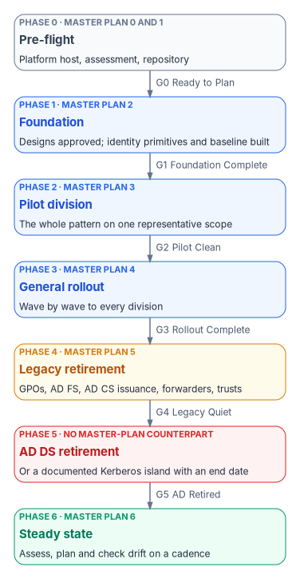
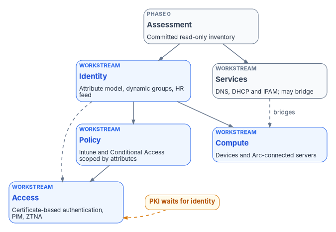

# Chapter 05 — The Program Plan: Phases and Gates

*A modernization plan earns its keep by saying what has to be true before the next step starts, not by putting dates on a chart.*

::: {.callout-note}
## In this chapter
The five constraints every phase of the program obeys, and the seven phases and six gates that [Book 01, Chapter 12](../b01-transformation-arc/12-migration-roadmap.md) sets for the whole workbook. One table maps the program's master project plan, which numbers its phases differently, onto those phases and gates. Then the five workstreams that run in parallel, the critical path through them, what the plan needs in licenses, infrastructure and people, the risks that shape it, and the success measures it is judged by.
:::

## One plan, three altitudes

The [charter](03-the-charter.md) sets the program's approach in five verbs: **assess** the estate, **define** the target, **plan** the waves, **execute** under control, and **validate and sustain**. The program plan turns those verbs into phases, and each phase into entry work, deliverables and an exit gate.

The program wrote its plan at three altitudes, and this chapter consolidates them. A short project plan states the phases in governance terms: charter and alignment, current-state assessment, target architecture, domain playbooks and wave planning, a pilot wave, then progressive rollout into steady-state governance. A one-page reference structure gives the same arc as a reusable template, with a typical gate per phase. And a detailed master project plan sequences the work week by week for one reference design: 48 milestones over an illustrative 52 weeks, every phase transition gated by a formal review, documented approval and a commit to the program's repository.

The three agree on the order of the work. They disagree on how to number it, and none of them retires Active Directory Domain Services (AD DS) itself. The workbook settles both questions the same way: [Book 01, Chapter 12](../b01-transformation-arc/12-migration-roadmap.md) is canonical. Its seven phases and six gates are the ones every book uses, and the master plan's phases are read through the mapping table below.

The master plan is also aspirational in a specific sense. It was written for one platform design, a Gitea repository on Windows Server 2025 behind an IIS reverse proxy, with AD and Microsoft Entra ID sign-in. The workbook treats that as the program's **reference design**, not the only option ([Book 01, Chapter 03](../b01-transformation-arc/03-platform-foundation.md) sets out what any platform host has to do). Its week numbers, milestone counts and thresholds are illustrative throughout.

{#fig-ch05-phase-mapping fig-alt="Seven stacked phase cards joined by arrows labeled with gates. Phase 0, Pre-flight, slate: platform host, assessment and repository; carries the master plan's Phase 0 platform build and Phase 1 assessment. Gate G0, Ready to Plan. Phase 1, Foundation, blue: designs approved, identity primitives and baseline built; carries the master plan's Phase 2 planning and design. Gate G1, Foundation Complete. Phase 2, Pilot division, blue: the whole pattern on one representative scope; carries the master plan's Phase 3 pilot. Gate G2, Pilot Clean. Phase 3, General rollout, blue: wave by wave; carries the master plan's Phase 4 scale. Gate G3, Rollout Complete. Phase 4, Legacy retirement, amber: GPOs, AD FS, AD CS issuance, forwarders, trusts; carries the master plan's Phase 5 cutover. Gate G4, Legacy Quiet. Phase 5, AD DS retirement, red: no master-plan counterpart. Gate G5, AD Retired. Phase 6, Steady state, green: carries the master plan's Phase 6 steady state."}

## The constraints every phase obeys

Five constraints apply to every phase, every workstream and every complementary project. They are the [principles](04-the-principles.md) stated as planning rules.

1. **Changes originate from a designated authoritative source and close with provenance.** A change that can't name its source and its record didn't happen under the program.
2. **Elevated privilege is time-bounded and scoped.** Every wave runs under just-in-time elevation, not standing administrative rights.
3. **Derived copies stay explicitly non-authoritative.** Subordinate systems may hold copies of a fact; only one system originates it.
4. **Drift between intended and observed state is classified and visible.** Drift is a tracked finding with an owner, not a surprise at audit time.
5. **No full rip-and-replace is required to make progress.** Every phase maps, bridges and then replaces, with the old path kept until the new one is proven.

A sixth rule follows from the master plan's core principle, **assessment before action**: no migration activity starts until the whole forest has been inventoried, classified and committed to the repository as machine-readable artifacts, and every modernization plan is generated from that data rather than designed in isolation. In Book 01's terms, that is gate G0.

## The seven phases and six gates

The table summarizes each phase. Chapters 08 to 10 of this book walk through them in order, and Book 01 Chapter 12 sets the gate criteria in full.

| Phase | Goal | Exit gate | Detailed in |
|---|---|---|---|
| 0 — Pre-flight | Charter accepted, owners named, platform host and repository stood up, read-only assessment committed | G0 — Ready to Plan | [Chapter 08](08-pre-flight-and-assessment.md) |
| 1 — Foundation | Designs approved from the assessment; enterprise groups, administrative units, the Conditional Access baseline and the HR feed in place | G1 — Foundation Complete | [Chapter 09](09-design-pilot-and-rollout.md) |
| 2 — Pilot division | The whole pattern proven on one representative scope, with rollback tested | G2 — Pilot Clean | [Chapter 09](09-design-pilot-and-rollout.md) |
| 3 — General rollout | The pattern scaled wave by wave to every remaining division | G3 — Rollout Complete | [Chapter 09](09-design-pilot-and-rollout.md) |
| 4 — Legacy retirement | Each legacy artifact retired through its own plan | G4 — Legacy Quiet | [Chapter 10](10-retirement-steady-state-and-success.md) |
| 5 — AD DS retirement | Domain controllers decommissioned, or a documented Kerberos island with an end date | G5 — AD Retired | [Chapter 10](10-retirement-steady-state-and-success.md) |
| 6 — Steady state | Assessment, planning and drift checks on a cadence, indefinitely | — | [Chapter 10](10-retirement-steady-state-and-success.md) |

The short project plan's first phase, charter and alignment, has no separate number here. It is the entry work of Phase 0: sponsor, project lead and domain leads named, scope and constraints confirmed, evidence and provenance expectations agreed, and a first risk register opened. Its exit test stays useful as Phase 0's first check: leadership can state the problem, the target outcome and how success will be measured.

Who clears each gate is settled in [Book 01, Chapter 09](../b01-transformation-arc/09-who-leads-the-transformation.md) and summarized in [Chapter 07](07-who-runs-the-program.md) of this book. In short, the steward clears G0, G1 and G4 and co-signs G2 with the executive sponsor; the sponsor and steering committee clear G3; the sponsor and the CIO clear G5.

## Mapping the master plan onto the gates

The master plan numbers seven phases from 0 to 6, the same count as Book 01, but it cuts the work at different points. It gives the platform build and the assessment a phase each, puts all design work in a phase of its own before the pilot, and ends its cutover phase with AD DS still running. The table reads each master-plan phase in Book 01's terms, with the short project plan's phase alongside.

| Master plan phase (illustrative weeks) | Short project plan phase | Book 01 phase | Gate it feeds | What changes in the mapping |
|---|---|---|---|---|
| 0 — Platform build (1–3): platform host, repository mirror, governance hooks, server connected through Azure Arc | 0 — Charter and alignment (entry work) | 0 — Pre-flight | — (inside Phase 0) | Book 01 adds the charter, named owners and least-privilege service principals to the same phase, and connects the platform host to Azure Arc in Phase 1 with the pilot servers |
| 1 — Assessment (4–9): twelve assessment domains, 23 deliverables, eight derived modernization plans, steering committee approval | 1 — Current-state assessment | 0 — Pre-flight | G0 — Ready to Plan | G0 needs the assessment committed and no open priority-one findings; plan generation and approval (master plan weeks 7–8) and pre-pilot readiness (week 9) are the first work after G0 |
| 2 — Planning and design (10–13): attribute taxonomy, dynamic groups, Intune and Conditional Access designs, sync, resolver and Cloud PKI designs | 2 — Target architecture; 3 — Domain playbooks and wave planning | 1 — Foundation | G1 — Foundation Complete | Book 01 builds the foundation, not just its design: G1 needs the Conditional Access baseline enforced, emergency access accounts tested and the HR feed running |
| 3 — Pilot (14–21): sync deployed, pilot devices and policies, Conditional Access enforced, PIM, hybrid DNS, Cloud PKI and certificate-based authentication, Arc pilot servers | 4 — Pilot / first wave | 2 — Pilot division | G2 — Pilot Clean | Book 01 adds a drift-clean hold period and requires every hybrid-joined pilot device to have a cut date |
| 4 — Scale (22–33): four waves of about a quarter of scope each, ordered region, site, department | 5 — Progressive rollout | 3 — General rollout | G3 — Rollout Complete | The master plan's last two scale milestones (GPO links off migrated OUs, attribute coverage at 100%) are G3 and G4 evidence |
| 5 — Cutover (34–41): AD FS, AD CS issuance, DNS forwarders, GPO links, trusts, legacy servers | 5 — Progressive rollout (residual scope) | 4 — Legacy retirement | G4 — Legacy Quiet | The master plan's cutover keeps AD for authentication; the AD domain's own DNS zones and domain controller certificates stay until Phase 5 |
| No counterpart | No counterpart | 5 — AD DS retirement | G5 — AD Retired | Added by Book 01: domain controllers demoted, or a dated Kerberos island |
| 6 — Steady state (42 on): weekly re-assessment, daily drift detection, monthly compliance report, quarterly access review, annual architecture review | 5 — Steady-state governance | 6 — Steady state | — | Same intent; Book 01's illustrative schedule reaches it at week 49 because it includes Phase 5 |

Two consequences matter for planning. First, the master plan's 52 weeks do not include retiring AD DS, so an estate that intends to get there should budget Book 01's extra phase on top. Book 01's own fifty-two-week sequence is a model for a mid-size, clean forest; large federal estates typically run multi-year. Second, the master plan's single design phase becomes, in Book 01, the first half of the Foundation phase: designs are approved from the assessment, then the same phase builds the enterprise primitives the designs describe.

## Five workstreams, run in parallel

Inside the phases, five domain workstreams carry the work. They run together rather than one after another; finishing one before starting the next roughly doubles the program and produces worse results ([Book 01, Chapter 12](../b01-transformation-arc/12-migration-roadmap.md#the-five-parallel-workstreams)). The master plan organized the same work as five technology pillars (identity, devices, DNS, PKI and server management). The table shows how the two line up and which complementary project ([Chapter 06](06-the-project-portfolio.md)) and book carry each.

| Workstream | Primary focus | Typical dependency | Suggested position | Master plan pillar | Carried by |
|---|---|---|---|---|---|
| Identity | Attribute model, dynamic membership, lifecycle origin | Assessment complete | Early (wave 1) | Identity | Identity Lifecycle project; [Book 02](../b02-identity/index.md), [Book 03](../b03-hr-identity/index.md) |
| Policy | Existing policy mapped to attribute-driven scope | Identity structure | After identity | Split between devices (GPO to Intune) and security (Conditional Access) | Endpoint project; [Book 05](../b05-devices/index.md), [Book 04](../b04-access/index.md) |
| Services | Naming, IP address management and their dependencies | Assessment; may bridge | Parallel or mid | DNS | Network & Access project; [Book 08](../b08-ddi/index.md) |
| Compute | Device and server identity and management | Identity structure | Mid to late | Devices; server management | Endpoint project; [Book 05](../b05-devices/index.md), [Book 06](../b06-data-platform/index.md) |
| Access | Token-based, application-aware access | Identity and policy | Later | PKI (certificate-based authentication); no ZTNA pillar | Network & Access and Privileged Access projects; [Book 04](../b04-access/index.md), [Book 07](../b07-pki/index.md), [Book 09](../b09-network/index.md) |

The pillar view leaves two gaps that the workstream view closes. Policy has no pillar of its own, so nobody owns the question of which policy surface (Group Policy, Intune, Conditional Access or machine configuration) owns a setting; Book 01 gives it a security-engineering lead. And the access plane, identity-aware access to applications instead of network location, has no pillar at all; Book 01 gives it a joint identity and security lead.

{#fig-ch05-workstreams fig-alt="A top-to-bottom flow. A slate assessment card at the top, the committed read-only assessment, leads to a blue identity card: attribute model, dynamic groups, HR feed. Identity leads to a blue policy card, Intune and Conditional Access scoped by attributes, and to a blue compute card, devices and Arc-connected servers. Policy and identity both lead to a blue access card: certificate-based authentication, PIM and ZTNA. A slate services card, DNS, DHCP and IPAM, runs from the assessment in parallel and connects to the compute card with a dashed arrow labeled bridges. A dashed arrow also runs from identity directly to access, and an amber pill beside the access card, with a dashed arrow into it, reads PKI waits for identity."}

## The critical path

The master plan traced one critical path through its milestones. Restated in Book 01's phases, it runs:

1. Platform host built, repository mirrored and governance hooks in place (Phase 0).
2. Read-only assessment, then the full assessment, committed; modernization plans generated and approved (Phase 0 into Phase 1).
3. Attribute taxonomy, then dynamic group design, then Intune policy design (Phase 1).
4. Pilot devices joined and pilot policies assigned; pilot success criteria met (Phase 2).
5. Each rollout wave in turn (Phase 3).
6. Cutover validation (Phase 4).

Everything else can run alongside. Conditional Access design and hybrid DNS design run in parallel with the identity and device track; PIM, hybrid DNS, Cloud PKI and Azure Arc work run in parallel inside the pilot once their designs are approved; and the retirement actions (AD FS, AD CS issuance, DNS forwarders, Group Policy links and trusts) can all run together after the last wave. One dependency never relaxes: **PKI waits for identity**. Certificate-based authentication can't be validated until the user and device objects it maps certificates to are synced and mapped ([Book 07, Chapter 07](../b07-pki/07-coexistence-and-migration.md)).

The path shows where schedule risk sits. Every week lost in assessment or attribute design moves every later gate. A week lost in, say, resolver design moves nothing, as long as it finishes before the pilot needs it.

## What the plan needs

### Licenses

The program needs no license of its own, but the services it orchestrates do. The master plan listed the licenses below; the table states each as of October 2026, with the corrections noted. Plan by license tier, not price, and check availability in the agency's own cloud: feature sets in the Microsoft government clouds lag the commercial cloud ([Book 10, Chapter 04](../b10-cloud-boundary/04-gcc-and-the-feature-gap.md)).

| Service | What the program uses it for | License it needs | Needed by |
|---|---|---|---|
| Microsoft Entra ID | Conditional Access, dynamic groups, HR-driven provisioning | Entra ID P1[^c05-entra] | Phase 1 |
| Microsoft Entra ID | PIM and risk-based Conditional Access (ID Protection) | Entra ID P2 or Entra ID Governance for PIM; P2 for ID Protection[^c05-entra] | Phase 1 (PIM for Tier 0), Phase 2 at scale |
| Microsoft Entra ID Governance | Access reviews for member users, Lifecycle Workflows | Entra ID Governance; the master plan's "P2 for access reviews" is now only partly true, since some review capabilities still run on P2[^c05-entra] | Phase 2 |
| Microsoft Intune | Device enrollment, compliance, configuration profiles | Intune Plan 1 | Phase 1 |
| Microsoft Cloud PKI | Certificate issuance to Intune-managed devices | A subscription in addition to Intune Plan 1 or 2: the Intune Suite or the standalone add-on;[^c05-cloudpki] from July 2026 it is also included in Microsoft 365 E5 and E7[^c05-intune] | Phase 2 |
| Microsoft Defender for Identity | AD security posture and lateral-movement findings during assessment | Microsoft 365 E5 or G5, EMS E5, or a standalone license[^c05-mdi] | Phase 0 |
| Azure Arc-enabled servers | Server inventory, policy and machine configuration for on-premises servers | Management services at no extra cost for servers with Windows Server Software Assurance or pay-as-you-go licensing; other servers pay as they go[^c05-arc] | Phase 1 (platform host and pilot servers) |
| Azure DNS Private Resolver | Hybrid DNS resolution | Azure consumption; an inbound and an outbound endpoint, each in its own dedicated subnet[^c05-dnspr] | Phase 2 |

The master plan priced several items in dollars per month. The workbook doesn't carry those figures; they change, and they depend on the agreement the agency buys under.

### Infrastructure

The reference design's infrastructure is small: one hardened platform host for the repository and the transformation engine (illustratively 4 vCPU, 8 GB of memory and 100 GB of SSD), a temporary privileged access workstation for the assessment that is sanitized under NIST SP 800-88 Rev. 2 after it,[^c05-sp80088] a sync server sized to Microsoft's guidance, a Log Analytics workspace for Entra, Intune and Arc telemetry, and backup storage for the repository. The platform host is a Tier 0 system and a single point of failure until it is replicated; the master plan's mitigation was a daily backup plus a mirror of the repository, and its follow-on list included an active-passive replication guide ([Chapter 08](08-pre-flight-and-assessment.md) and [Book 01, Chapter 03](../b01-transformation-arc/03-platform-foundation.md)).

### People

The master plan estimated 5.5 full-time equivalents across eight roles for the program office and workstreams. That estimate, and the people it leaves out, are in [Chapter 07](07-who-runs-the-program.md).

## Risks that shape the plan

The plan is built around five risks. The full register, with likelihood, impact, owner and status, is [Appendix A](appendix-a-risk-register-and-traceability.md).

| Risk | How the plan answers it |
|---|---|
| Hidden dependencies are missed in discovery | A structured assessment, and a pilot designed to surface unknowns early |
| Competing sources of truth persist | An authoritative origin designated per object class, and contention on the authoritative source tracked as its own drift class |
| The organization resists making authority explicit | Early stakeholder alignment in Phase 0, and a pilot that shows controlled rather than disruptive change |
| Tooling leads the design | Target architecture and change-control pattern defined before any tool is selected or configured |
| Physics or data residency limits centralization | Truth centralized logically; only subordinate copies distributed physically ([Book 09](../b09-network/index.md)) |

## External clocks

The plan's dates are the agency's to set, but some clocks are set outside it. FedRAMP's Consolidated Rules for 2026 take mandatory effect for all stakeholders on January 1, 2027, with some areas carrying their own applicability and effective dates; over the following year every cloud service provider must follow them to keep its certification. FedRAMP stops accepting applications for new Rev5 certifications on June 11, 2027.[^c05-fedramp] Those dates govern how the program's cloud providers are certified, not the agency's own authorization of its systems. OMB's logging requirements, CISA's cloud-configuration baselines and the end-of-support dates of what the estate runs bind the agency directly. [Book 01, Chapter 12](../b01-transformation-arc/12-migration-roadmap.md#the-clocks-the-roadmap-runs-against) lays them side by side, and [Chapter 01](01-why-modernize-now.md) of this book makes the case for why they make now the time to start.

## How success is measured

The program-level success measures are deliberately few and checkable:

1. The current-state assessment is complete and accepted.
2. The target architecture is documented and understood by the domain leads.
3. The first wave has run with full provenance and evidence.
4. Drift detection is operational for the domains in scope.
5. Residual risks are documented and each has an owner.
6. Leadership can describe the modernization path and its outcomes without reference to internal technical decision records.

Each maps to a gate. Measures 1 and 2 are G0 and G1 evidence, measure 3 is G2, measure 4 is a G2 and G3 condition, and measure 5 is checked at every gate and closed at G5. Measure 6 is the plainest test of all, and the one most often failed: a program whose leaders can only explain it by citing document numbers hasn't made its governance explicit. The plan closes when the charter's success criteria are met or explicitly deferred with a reason, and when ownership of the authoritative source and of drift detection has passed to steady-state operations. [Chapter 10](10-retirement-steady-state-and-success.md) sets the operational measures that follow.

## The first five actions

The plan's own next steps are short, and they match Book 01's "an inventory, an owner and a date":

1. Review and accept the plan against the charter.
2. Confirm the Phase 0 stakeholders and decision rights ([Chapter 07](07-who-runs-the-program.md)).
3. Scope the assessment: data sources, read access and timeline ([Chapter 08](08-pre-flight-and-assessment.md)).
4. Identify the candidate authoritative source for human identity lifecycle events ([Book 03](../b03-hr-identity/index.md)).
5. Draft the outline of the target attribute model.

## Key takeaways

1. Book 01's seven phases and six gates are canonical; the master plan's phases map onto them, and its cutover stops short of retiring AD DS.
2. Five constraints bind every phase: authoritative origin with provenance, time-bound privilege, non-authoritative copies, visible drift, and no rip-and-replace.
3. Five workstreams run in parallel; the critical path runs through assessment, attribute design, the pilot and the rollout waves, and PKI always waits for identity.
4. License by tier and check availability in the agency's cloud; access reviews now sit in Entra ID Governance, and Cloud PKI has moved into Microsoft 365 E5.
5. Week numbers are illustrative. The gates, not the calendar, decide when the next phase starts.

::: {.callout-tip}
## Continue the book
[← Previous: Chapter 04 — The Modernization Principles](04-the-principles.md) · [Book index](index.md) · [Next: Chapter 06 — The Complementary Projects →](06-the-project-portfolio.md)
:::

[^c05-entra]: Microsoft Learn, "Microsoft Entra licensing," sections "Microsoft Entra Conditional Access," "Microsoft Entra ID Governance" (access reviews and Lifecycle Workflows), "Microsoft Entra ID Protection" and "Microsoft Entra Privileged Identity Management," <https://learn.microsoft.com/entra/fundamentals/licensing> (accessed Oct 21, 2026).
[^c05-cloudpki]: Microsoft Learn, "Overview of Microsoft Cloud PKI for Microsoft Intune," Prerequisites (licensing requirements), <https://learn.microsoft.com/intune/cloud-pki/>; and "Use Microsoft Intune Suite add-on capabilities," Available add-ons, <https://learn.microsoft.com/intune/fundamentals/add-ons> (both accessed Oct 21, 2026).
[^c05-intune]: Microsoft Learn, "Microsoft Intune planning guide," Step 3, "Determine costs and licensing" (from July 2026, Microsoft 365 E5 and E7 include Endpoint Privilege Management, Microsoft Cloud PKI and Enterprise Application Management), <https://learn.microsoft.com/intune/fundamentals/planning-guide> (accessed Oct 21, 2026).
[^c05-mdi]: Microsoft Learn, "Microsoft Defender service description," section "Microsoft Defender for Identity," <https://learn.microsoft.com/office365/servicedescriptions/microsoft-365-service-descriptions/microsoft-365-tenantlevel-services-licensing-guidance/microsoft-defender-service-description>; and "Microsoft Defender for Identity for US Government offerings," Licensing requirements, <https://learn.microsoft.com/defender-for-identity/us-govt-gcc-high> (both accessed Oct 21, 2026).
[^c05-arc]: Microsoft Learn, "Modernize server management from Configuration Manager to Azure Arc," Benefits (pricing), <https://learn.microsoft.com/azure/azure-arc/servers/modernize-server-management> (accessed Oct 21, 2026).
[^c05-dnspr]: Microsoft Learn, "What is Azure DNS Private Resolver?," sections "Inbound endpoints," "Outbound endpoints" and "Subnet restrictions," <https://learn.microsoft.com/azure/dns/dns-private-resolver-overview> (accessed Oct 21, 2026).
[^c05-sp80088]: NIST, SP 800-88 Rev. 2, *Guidelines for Media Sanitization*, September 2025 (final September 26, 2025; supersedes Rev. 1, December 2014), <https://csrc.nist.gov/pubs/sp/800/88/r2/final> (accessed Oct 21, 2026).
[^c05-fedramp]: FedRAMP, "Important Dates for the Consolidated Rules for 2026," entries "Mandatory Adoption" (January 1, 2027: the rules "take mandatory effect for all stakeholders, subject to specific overall applicability and effective dates within certain areas"; over the next year all cloud service providers must follow them to maintain FedRAMP Certification) and "End of New Rev5 Certifications" (June 11, 2027), <https://www.fedramp.gov/2026/timeline/> (accessed Oct 21, 2026).
