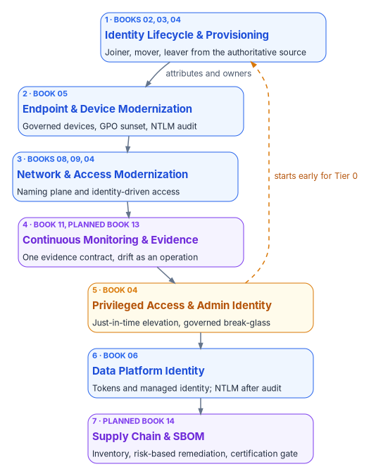

# Chapter 06 — The Complementary Projects

*The program sets the direction and the gates; the projects are where a sponsor, a lead and a pilot population turn one gap into finished work.*

::: {.callout-note}
## In this chapter
What a complementary project is and the shape every project charter shares. The seven projects in their suggested order, why that order holds and where it bends, and how the projects sit inside the program's workstreams and gates. For each project: what it delivers, how its success is judged at pilot scale, what it leaves out, and which book carries it in depth.
:::

## Why the program has projects

The Federal Modernization Workbook supplies the principles, the architecture and the governance framing. A program that stopped there would be a reading list. The complementary projects take the gaps the program finds most often and charter each one as executable work, with its own sponsor, lead, domain leads, pilot scope and success criteria.

Each project has two documents. The **charter** states the purpose, the problem, the objectives, what is in and out of scope, the guiding principles, the success criteria, a high-level approach, the risks and assumptions, governance and next steps. The **plan** sequences that approach into work. Both are written to be adopted as they stand: they carry no internal decision-record numbers, and every named role is "to be named" until the adopting agency fills it. The charters link to their plans, and this chapter links to the charters in the [workbook's repository](https://github.com/WhalerMike/modernization-workbook/tree/main/docs/projects).

All seven projects share one change path, the one the identity project states as five clauses: a change **originates** from an authoritative source, carries an **authorization**, **executes under least privilege**, **closes with provenance**, and **emits evidence**. They also share a deliberately modest definition of success. Every charter asks for a working pilot, not a finished estate: one engine migrated, one role class under just-in-time elevation, one object class under drift detection. The program's rollout phase is where pilots become coverage.

{#fig-ch06-project-portfolio fig-alt="Seven numbered project cards in a top-to-bottom sequence. One, Identity Lifecycle and Provisioning, blue, carried by Books 02, 03 and 04. Two, Endpoint and Device Modernization, blue, Book 05. Three, Network and Access Modernization, blue, Books 08, 09 and 04. Four, Continuous Monitoring and Evidence Fabric, violet, Book 11 and the planned Book 13. Five, Privileged Access and Administrative Identity, amber, Book 04, with a dashed amber arrow back to project one labeled starts early for Tier 0. Six, Data Platform Identity Transformation, blue, Book 06. Seven, Supply Chain and Software Bill of Materials, violet, the planned Book 14. The arrow from project one to project two is labeled attributes and owners."}

## The seven projects at a glance

| # | Project | What it delivers | Program workstream | Carried in depth by |
|---|---|---|---|---|
| 1 | [Identity Lifecycle & Provisioning](https://github.com/WhalerMike/modernization-workbook/blob/main/docs/projects/identity-lifecycle-charter.md) | Joiner, mover and leaver flows from an authoritative source; attribute-driven access; owners for non-human identities | Identity | [Book 03](../b03-hr-identity/index.md), [Book 02](../b02-identity/index.md), [Book 04](../b04-access/index.md) |
| 2 | [Endpoint & Device Modernization](https://github.com/WhalerMike/modernization-workbook/blob/main/docs/projects/endpoint-device-charter.md) | Governed device lifecycle; Group Policy sunset; Conditional Access baseline; NTLM restriction plan | Compute, Policy | [Book 05](../b05-devices/index.md) |
| 3 | [Network & Access Modernization](https://github.com/WhalerMike/modernization-workbook/blob/main/docs/projects/network-access-charter.md) | Authoritative naming and addressing plane; identity-driven remote access; customer-edge enforcement | Services, Access | [Book 08](../b08-ddi/index.md), [Book 09](../b09-network/index.md), [Book 04](../b04-access/index.md) |
| 4 | [Continuous Monitoring & Evidence Fabric](https://github.com/WhalerMike/modernization-workbook/blob/main/docs/projects/continuous-monitoring-charter.md) | One evidence contract; aggregated, reconciled evidence; operational drift detection; authorization artifacts from the evidence stream | All (steady state) | [Book 11](../b11-zero-trust/index.md); planned Book 13 ([book list](../index.md)) |
| 5 | [Privileged Access & Administrative Identity](https://github.com/WhalerMike/modernization-workbook/blob/main/docs/projects/privileged-access-charter.md) | Standing privilege inventoried and reduced; just-in-time elevation; governed break-glass; separation of duties | Access | [Book 04](../b04-access/index.md) |
| 6 | [Data Platform Identity Transformation](https://github.com/WhalerMike/modernization-workbook/blob/main/docs/projects/data-platform-charter.md) | Token-based or managed-identity database authentication; NTLM eliminated after audit; continuous authentication evidence | Compute | [Book 06](../b06-data-platform/index.md) |
| 7 | [Supply Chain & Software Bill of Materials](https://github.com/WhalerMike/modernization-workbook/blob/main/docs/projects/supply-chain-charter.md) | Software bill of materials pipeline; risk-based remediation; cloud-service certification status as a provisioning gate | Cross-cutting | Planned Book 14 ([book list](../index.md)); [Book 10](../b10-cloud-boundary/index.md) for cloud certification |

## Why this order

The suggested sequence is a starting order, not a waterfall. Projects overlap, and the program's workstreams run in parallel regardless ([Chapter 05](05-the-program-plan.md#five-workstreams-run-in-parallel)). The order says which project has to be far enough along before the next can show results.

1. **Identity first**, because everything else keys off it. Device scoping, access policy, network decisions and data-platform logins all consume the organizational attributes and owners this project establishes. A device project started on unreliable attributes produces policy bypass, which is exactly the risk the endpoint charter names.
2. **Endpoints second**, because device identity depends on user identity and attribute scoping, and because the Conditional Access baseline that protects every later project lands here.
3. **Network and access third**, because identity-driven access needs identity claims and device posture to consume, and the naming and addressing plane becomes the join key every inventory reconciles to.
4. **Continuous monitoring fourth**, because an evidence fabric needs at least two sources already emitting records. By this point identity, endpoint and network sources exist.
5. **Privileged access fifth** as a chartered project, but not fifth in practice. The identity project already introduces just-in-time elevation for one privileged role class, and the program's Foundation gate requires emergency access accounts vaulted and tested and Tier 0 administrators registered for phishing-resistant sign-in ([Book 01, Chapter 12](../b01-transformation-arc/12-migration-roadmap.md)). The fifth slot is where the remaining standing privilege, non-human privileged identities and separation of duties are taken on as a program of their own.
6. **Data platform sixth**, because database authentication depends on cloud identity, managed identities and the network path to the data, and because its NTLM audit needs the endpoint project's observation work.
7. **Supply chain last**, because it is the most independent of the identity chain and draws on the evidence fabric to report component and remediation status.

## How the projects fit the program

The projects don't replace the program's phases. They run inside them. A project's observation or inventory step belongs to the program's Pre-flight phase and feeds gate G0; its pilot runs in the program's pilot phase or a later wave; its scale-out is rollout work; and its evidence joins the steady-state cadence. Each project's charter names a sponsor, a lead and domain leads, and each reports into the program's governance ([Chapter 07](07-who-runs-the-program.md)). No project clears a program gate on its own. The gate owner does, using the evidence the projects produce.

Two rules keep the portfolio coherent. First, a project never designates a second authoritative source for something another project already owns: the identity project owns organizational attributes, the network project owns asset naming and addressing, and every other project consumes them. Second, every project emits evidence in the shape the continuous monitoring project defines, so the fourth project's contract applies to the first three retroactively.

## The projects one by one

### 1. Identity Lifecycle & Provisioning

**Purpose.** Every human and non-human identity originates from an authoritative source, receives only the access its attributes justify, and produces continuous evidence of its state and changes.

**The problem.** Joiner, mover and leaver events still arrive through tickets, spreadsheets and local directory changes; service accounts, application registrations and devices lack a clear origin; access accumulates and is rarely reviewed. Nobody can reliably answer who authorized an access and when it expires.

**Success at pilot scale.** An authoritative origin designated for human lifecycle events (typically the HR system) and for each non-human identity class in scope; joiner, mover and leaver flows working for a pilot population with provenance records; access for that population driven by attributes, with residual manual group membership inventoried and falling; just-in-time elevation for at least one privileged role class; a first access-review cycle complete for high-risk entitlements; drift between the source and the directory detected and classified.

**Out of scope at first.** Replacing the directory or identity provider, authorization logic inside business applications, physical access control, and configuring the agency's HR system: the project defines the contract, and the agency owns the source.

**Where it lives.** [Book 03](../b03-hr-identity/index.md) carries the HR-driven lifecycle, including the canonical attribute map in [Chapter 06](../b03-hr-identity/06-canonical-attribute-schema.md); [Book 02](../b02-identity/index.md) the directory migration; [Book 04](../b04-access/index.md) access reviews and elevation. The project's principle that HR, not the directory, is the source of organizational truth is the workbook's position throughout. Contractors usually need an authoritative source of their own, because HR usually doesn't hold them.

### 2. Endpoint & Device Modernization

**Purpose.** Move endpoints from Group Policy and domain join to a governed, attribute-driven device lifecycle that produces continuous evidence and reduces NTLM and standing-privilege risk.

**The problem.** Hybrid join was adopted for connectivity without the governance to match; overlapping Group Policy and Intune settings produce unpredictable results; NTLM remains a silent fallback; Conditional Access is deployed unevenly. Devices that are governed only through domain controllers can't be inventoried or governed once the domain controllers leave the path.

**The principles that make it work.** Observe before changing anything. Regenerate policy against the target model rather than copying Group Policy settings. Treat overlapping Group Policy and Intune settings as conflicts to resolve and retire: Intune flags conflicting settings for an administrator to resolve rather than applying whichever was written last ([Chapter 04](04-the-principles.md#principle-10)). Deploy Conditional Access in report-only mode first. Keep break-glass exclusions documented. And treat onboarding and domain-unjoin as separate decisions.

**Success at pilot scale.** NTLM usage, service principal names and Group Policy overlap inventoried; a pilot population under governed management with attribute-driven scoping; at least one class of Group Policy setting regenerated and retired; the Conditional Access baseline in report-only for the pilot with an enforcement plan; an NTLM restriction plan with the legacy dependencies identified.

**Why the NTLM work can't wait.** Microsoft deprecated every version of NTLM in June 2024, removed NTLMv1 from Windows 11 version 24H2 and Windows Server 2025, and recommends replacing NTLM calls with Negotiate, which tries Kerberos first.[^c06-ntlm] Deprecated isn't removed: NTLMv2 still works. But an estate that hasn't audited its NTLM dependencies can neither restrict them safely nor plan for their removal, which is why the charter makes audit the first step and restriction a later one.

**Where it lives.** [Book 05](../b05-devices/index.md), including the Group Policy sunset program in [Chapter 07](../b05-devices/07-the-gpo-sunset-program.md) and servers under Azure Arc in [Chapter 09](../b05-devices/09-servers-under-azure-arc.md).

### 3. Network & Access Modernization

**Purpose.** Replace perimeter-and-VPN remote access and static wide-area networking with identity-driven, application-aware access and an authoritative naming and addressing plane that every other control reconciles to.

**The problem.** Access decisions don't consume identity as authoritative input; DNS, DHCP and IP address management are fragmented or per-cloud, so there is no single join key for asset identity; encrypted transport exists only inside a provider's boundary or not at all; enforcement at the customer edge is ungoverned.

**The principles.** Identity is the root namespace. The naming plane is a truth plane. Access decision points consume identity rather than keeping a parallel identity store. Overlay trust is anchored in identity-plane certificates where feasible. And the customer-owned half of boundary and encryption controls, the half no provider's authorization covers, is in scope.

**Success at pilot scale.** The naming and addressing plane designated and operating for the pilot; an identity-driven access path for a pilot population, with the VPN path documented as residual; at least one access or path decision emitted as a claim with provenance; an approach for edge enforcement (802.1X or equivalent) with an accreditation path; a boundary disposition declared for every network service in scope.

**Where it lives.** [Book 08](../b08-ddi/index.md) for DNS, DHCP and IPAM; [Book 09](../b09-network/index.md) for transport, TIC 3.0 posture and network access control; [Book 04](../b04-access/index.md) for Conditional Access; [Book 10](../b10-cloud-boundary/index.md) for the boundary.

### 4. Continuous Monitoring & Evidence Fabric

**Purpose.** Turn continuous monitoring from a periodic reporting exercise into a fabric that aggregates evidence from many sources, detects drift, and assembles authorization artifacts from the record of closed changes rather than from after-the-fact assertions.

**The problem.** Evidence is still assembled for assessments. Several management stacks produce inventories that can't be reconciled, drift surfaces at audit time, the same findings recur every cycle, and authorization packages describe controls an assessor can't exercise.

**The design.** One evidence contract: every deployed mechanism emits a normalized record that can be bound to a control. Records join on the authoritative asset identity from the naming plane. Drift detection runs as an operation (snapshot, compare, classify, alert, remediate, verify), with findings classified as schema, semantic, provenance, authorization, identity or contention drift. Actuation stays platform-native; only the evidence is unified. And coverage is labeled honestly, proven or asserted.

**The federal context.** NIST defines the purpose of an information security continuous monitoring program as visibility into assets, awareness of threats and vulnerabilities, and visibility into the effectiveness of deployed controls.[^c06-iscm] FedRAMP's 2026 rules move cloud providers the same way: under FedRAMP 20x, Key Security Indicators are meant to provide measurable validation that protections are working, with evidence collected continuously.[^c06-ksi] The charter keeps full Key Security Indicator coverage for every control out of its first phase. It aims at the contract and a pilot, so that the agency's own evidence and its providers' line up later.

**Success at pilot scale.** The evidence contract documented and at least two sources emitting normalized records; one reconciled picture for a limited scope; drift detection operating for one object class (identity attributes or device posture); authorization artifacts generated from the stream for the pilot; a coverage report that separates proven from asserted claims.

**Where it lives.** [Book 11, Chapter 10](../b11-zero-trust/10-evidence-not-verdicts.md) for evidence rather than verdicts; [Book 01, Chapter 11](../b01-transformation-arc/11-analysis-plan-delivery.md) for drift and the evidence packet; the planned Book 13, Governance, Drift & Evidence, will carry it in full.

### 5. Privileged Access & Administrative Identity

**Purpose.** Treat administrative identity as the root of the root: time-box privileged access, remove standing administrative privilege where feasible, and make every privileged action authorized, least-privilege and evidenced.

**The problem.** Privileged roles are granted permanently; service accounts and application registrations hold broad permissions; break-glass accounts are undocumented; separation of duties is procedural rather than enforced. A compromised administrative identity grants persistent access, and nobody can say who elevated, for what, and for how long.

**Success at pilot scale.** Standing privilege inventoried and classified by blast radius; just-in-time elevation in use for at least one high-risk role class and that class's standing privilege measurably reduced; break-glass accounts identified, excluded from standard policy and tested; named owners for the non-human privileged identities in scope; requester and approver kept distinct for at least one high-risk change class; evidence for every elevation in the pilot.

**Two facts that shape it.** Privileged Identity Management needs Microsoft Entra ID P2 or Entra ID Governance licenses for every user with an eligible or time-bound assignment and every approver.[^c06-pim] And "no standing privilege" has one deliberate exception: Microsoft's guidance is at least two cloud-only emergency access accounts holding Global Administrator as a permanent active assignment, not an eligible one, protected by phishing-resistant methods, excluded from blocking Conditional Access policies, monitored on every use and validated at least every 90 days.[^c06-breakglass] A target of "zero permanent Global Administrators" has to carve out those accounts by name, or it locks the agency out of its own tenant in exactly the emergency they exist for.

**Where it lives.** [Book 04](../b04-access/index.md), especially [Chapter 04](../b04-access/04-privileged-roles-and-tiers.md) on roles and tiers and [Chapter 08](../b04-access/08-pim-self-request-with-approval.md) on self-request with approval.

### 6. Data Platform Identity Transformation

**Purpose.** Extend identity modernization to the data platform: remove stored credentials, remove NTLM fallback, and produce continuous evidence of database and application-tier authentication.

**The problem.** Crown-jewel systems are authenticated by long-lived secrets; credential rotation is manual and unverifiable; application-tier service principals hold broad standing permissions; nobody can say continuously who or what authenticated to the data tier.

**The principles.** Assess before migrating. Short-lived tokens or managed identities replace stored passwords. NTLM is removed only after audit, because blocking it early breaks legacy clients. Authentication events flow into the evidence stream. And physics constrains consolidation: speed-of-light and consistency limits are stated, not discovered.

**Success at pilot scale.** The estate inventoried by engine, authentication method, stored credential and NTLM use; at least one engine migrated to token-based or managed-identity authentication for a pilot; NTLM use for that scope audited with a restriction plan; the pilot's application tier on managed identity or scoped credentials; network-physics constraints documented for any consolidation under consideration.

**Where it lives.** [Book 06](../b06-data-platform/index.md) carries SQL Server in full, from the authentication audit to [the closure condition](../b06-data-platform/20-the-closure-condition.md); [Book 09](../b09-network/index.md) carries the physics.

### 7. Supply Chain & Software Bill of Materials

**Purpose.** Govern the software supply chain: produce and consume software bills of materials (SBOMs), apply risk-based remediation timelines, and track the authorization status of vendors and cloud services so that third-party components don't become ungoverned residual risk.

**The problem.** Software enters through procurement, open source and cloud services with uneven visibility; vulnerability intake is manual; remediation is best-effort; cloud services are adopted without a recorded authorization status.

**The federal context has changed.** OMB rescinded M-22-18 and its companion M-23-16 on January 23, 2026, ending the requirement to collect standardized secure-development attestations. Its replacement, M-26-05, still requires agencies to maintain a complete inventory of software and hardware and to set assurance policies that match their risk determinations. It leaves agencies free to use the attestation form, and to require a current SBOM from a producer on request, citing CISA's 2025 draft minimum elements for an SBOM.[^c06-m2605] That fits the charter's principles closely: inventory before remediation, risk-based rather than uniform timelines, and a named owner for supply-chain risk acceptance. An SBOM is now an agency choice backed by contract terms, not a government-wide mandate, and the project should say so.

**Cloud services: certification, not authorization.** Under FedRAMP's 2026 rules, FedRAMP certifies a cloud service offering, and the agency's authorizing official authorizes the agency's own system that uses it. FedRAMP is explicit that an agency should not issue an authorization to operate for the cloud service itself.[^c06-fedramp-use] The project's provisioning gate therefore checks two things: the service's FedRAMP certification status, and the agency authorization of the system that will use it.

**Success at pilot scale.** An SBOM for at least one pilot system or service; vulnerability intake working, with at least one finding tracked to closure on a risk-based timeline; certification status inventoried for in-scope cloud services; new SaaS provisioning gated on a recorded status for the pilot; a named owner for supply-chain risk acceptance.

**Where it lives.** No published book carries it in depth yet. The planned Book 14, Federal Compliance & Authorization, is its nearest home ([book list](../index.md)); [Book 10, Chapter 03](../b10-cloud-boundary/03-what-changed-at-fedramp.md) covers the FedRAMP changes.

## What the charters leave to the agency

Every charter ends the same way: a sponsor and a lead "to be named," four domain leads by function, and five next steps that begin with an inventory. That is deliberate. The charters define the method and the contract, and the adopting agency supplies the people, the source systems and the risk decisions. Only the identity charter states decision rights, giving source-of-truth designation and the attribute model to the project lead and sponsor. In the program's model the meaning of those attributes is HR's decision and the flow is identity engineering's ([Chapter 07](07-who-runs-the-program.md)). Filling in the names is the first act of each project, and Chapter 07 says who they answer to.

## Key takeaways

1. Seven chartered projects turn the program's most common gaps into executable work, each with its own sponsor, lead and pilot-scale success criteria.
2. Start identity first; everything else consumes its attributes and owners. Privileged access is chartered fifth but starts in Phase 1 for Tier 0 and emergency access.
3. Projects run inside the program's phases and feed its gates; they never create a second authoritative source.
4. Two source claims have moved: OMB's attestation mandate is rescinded, so SBOMs are an agency choice; and FedRAMP certifies services while the agency authorizes its own systems.
5. "Zero permanent Global Administrators" must exempt the emergency access accounts by name.

::: {.callout-tip}
## Continue the book
[← Previous: Chapter 05 — The Program Plan: Phases and Gates](05-the-program-plan.md) · [Book index](index.md) · [Next: Chapter 07 — Who Runs the Program →](07-who-runs-the-program.md)
:::

[^c06-ntlm]: Microsoft Learn, "Deprecated features for Windows client," entry "NTLM" (deprecation announced June 2024; NTLMv1 removed starting in Windows 11, version 24H2 and Windows Server 2025), <https://learn.microsoft.com/windows/whats-new/deprecated-features>; and "Features removed or no longer developed in Windows Server," Windows Server 2025, entry "NTLM," <https://learn.microsoft.com/windows-server/get-started/removed-deprecated-features-windows-server> (both accessed Oct 21, 2026).
[^c06-iscm]: National Institute of Standards and Technology, SP 800-137, *Information Security Continuous Monitoring (ISCM) for Federal Information Systems and Organizations*, September 2011, abstract, <https://csrc.nist.gov/pubs/sp/800/137/final> (accessed Oct 21, 2026).
[^c06-ksi]: FedRAMP, "Key Security Indicators," FedRAMP 20x Certification Rules, *Consolidated Rules for 2026*, <https://www.fedramp.gov/2026/providers/20x/key-security-indicators/> (accessed Oct 21, 2026).
[^c06-pim]: Microsoft Learn, "Microsoft Entra licensing," section "Microsoft Entra Privileged Identity Management," <https://learn.microsoft.com/entra/fundamentals/licensing> (accessed Oct 21, 2026).
[^c06-breakglass]: Microsoft Learn, "Manage emergency access accounts in Microsoft Entra ID," sections "Create emergency access accounts" and "Security guardrails summary," <https://learn.microsoft.com/entra/identity/role-based-access-control/security-emergency-access> (accessed Oct 21, 2026).
[^c06-m2605]: Office of Management and Budget, M-26-05, *Adopting a Risk-based Approach to Software and Hardware Security*, January 23, 2026, <https://www.whitehouse.gov/wp-content/uploads/2026/01/M-26-05-Adopting-a-Risk-based-Approach-to-Software-and-Hardware-Security.pdf> (accessed Oct 21, 2026).
[^c06-fedramp-use]: FedRAMP, "Using a FedRAMP Certified Cloud Service," *Consolidated Rules for 2026*, <https://www.fedramp.gov/2026/agencies/use/> (accessed Oct 21, 2026).
