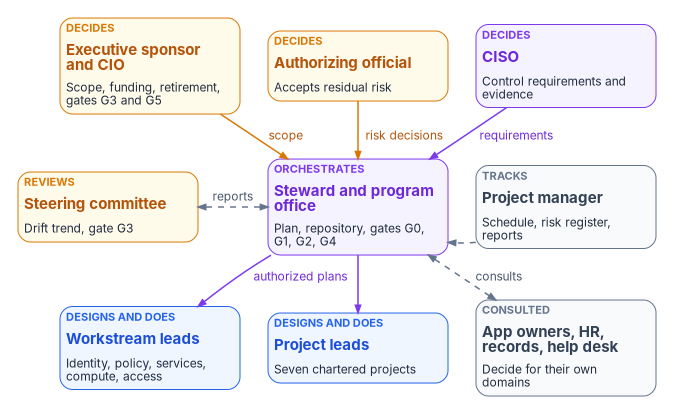

# Chapter 07 — Who Runs the Program

*A program is run by the people who are allowed to say no: name them, give each decision one of them, and make the repository remember who said yes.*

::: {.callout-note}
## In this chapter
[Book 01, Chapter 09](../b01-transformation-arc/09-who-leads-the-transformation.md) sets who leads, decides and does the work across the whole program, and this chapter doesn't repeat it. It maps the roles named in the program's charter and plans onto that model, corrects the places where the plans gave a decision to the wrong person, and covers the running mechanics: the workstream-level RACI, the meeting rhythm, the gate review, artifact management in the repository, the people estimate, and the separation of roles the program depends on.
:::

## Three vocabularies, one model

The program's documents name its people three ways. The charter and the short project plan speak of a **project sponsor**, a **project lead** and five **domain leads** (identity, policy, services and addressing, compute, access). The master project plan, written for a reference design, names a **canon steward**, six technology leads (infrastructure, identity, endpoint, DNS, PKI and security) and a **project manager**. And Book 01 sets the program-wide model, with the executive sponsor and CIO, the CISO and authorizing official, a program office led by a **steward**, platform teams, application owners, the help desk, HR, and records and privacy.

This book uses Book 01's model. The table reads the other two vocabularies into it.

| Role in this workbook | Charter and short plan | Master plan | What the role does |
|---|---|---|---|
| Executive sponsor (with the CIO) | Project sponsor | "Organizational leadership," for budget only | Owns scope, funding and sequence; breaks ties; decides when AD components retire; clears G3 with the steering committee and G5 with the CIO |
| Steering committee | — | Biweekly steering committee | Reviews the drift trend and gate readiness; clears G3 with the sponsor |
| Authorizing official | — | Not named | The only official who can accept security and privacy risk for the agency |
| CISO | — | Partly the security lead | Sets the control requirements every target surface must meet |
| Steward, leading the program office | Project lead | Canon steward | Owns the plan, wave sequencing, cross-domain dependencies and the repository; clears G0, G1 and G4; co-signs G2 |
| Project manager | — | Project manager | Timeline, milestone tracking, the risk register, status reporting, steering committee logistics |
| Workstream leads | Domain leads | Infrastructure, identity, endpoint, DNS, PKI and security leads | Own playbook content, execution readiness and domain evidence inside the CISO's requirements |
| Application owners, help desk, HR, records and privacy | — | Not named | Decide for their applications, attributes and records; support users ([Book 01, Chapter 09](../b01-transformation-arc/09-who-leads-the-transformation.md#who-leads-decides-and-does-the-work)) |

Two gaps stand out. The master plan names no authorizing official, application owners, HR or records officer, so decisions that belong to them land on the steward or the security lead by default. And it treats the steward as the final authority on nearly everything, which Book 01 deliberately does not. The rest of this chapter closes both gaps.

{#fig-ch07-governance-structure fig-alt="Three rows of cards. Top row, deciders: the executive sponsor and CIO in amber, scope, funding, retirement, gates G3 and G5; the authorizing official in amber, accepts residual risk; the CISO in violet, control requirements and evidence. Middle row: the steering committee in amber, drift trend and gate G3; the steward and program office in violet, plan, repository and gates G0, G1, G2 and G4; the project manager in slate, schedule, risk register and reports, with a dashed arrow to the steward. The three deciders send arrows labeled scope, risk decisions and requirements to the steward. The steward and steering committee are joined by a line labeled reports. Bottom row: workstream leads in blue, identity, policy, services, compute and access; complementary project leads in blue, seven chartered projects; and application owners, HR, records and help desk in slate, consulted on their decisions. The steward sends authorized plans to the workstream leads and project leads, and consults the slate card with a dashed two-way arrow."}

## Who decides what

The charter put major scope, sequencing and target-model decisions with the project lead and sponsor, and gave domain leads playbook content and execution readiness. The short plan added that the sponsor approves scope changes, major sequencing shifts and acceptance of residual risk, and that any material change to the target architecture or to the rules for authoritative origin needs both the project lead and the sponsor. The master plan's decision framework set an authority and a recording process for five decision types.

Most of that holds. Three items don't. **Residual risk** can't be accepted by the sponsor, the steward or the security lead: under the Risk Management Framework, the authorizing official is the only organizational official who can accept security and privacy risk to the organization's operations, assets and individuals, and the authorizing official's designated representative can do everything except make that authorization decision.[^c07-sp80037] **Budget and licenses** belong to the sponsor and CIO, who own funding in the program-wide matrix; the steward prepares the case. And **gate decisions** are not the steward's alone: the master plan made the steward the review chair and sole signatory at every gate, but Book 01 spreads the gates across the steward, the sponsor, the steering committee and the CIO in proportion to what each gate ends.

| Decision | Master plan said | Program model | How it is recorded |
|---|---|---|---|
| Governance artifacts: status, naming, schema | Steward alone | Steward | Pull request with the steward's review required |
| Technical design inside a workstream | Pillar lead, with steward review | Workstream lead, inside the CISO's requirements, with steward review | A decision record committed to the repository with a fixed review period (the master plan used 48 hours) |
| Changes to the target architecture or authoritative-origin rules | — | Steward and sponsor concurrence | Decision record plus the sponsor's recorded concurrence |
| Control requirements: authentication strength, Conditional Access baseline, logging | Security lead designs | CISO decides; security lead designs to them | Requirement committed as policy; designs reference it |
| Risk acceptance | Security lead and steward jointly | Authorizing official; security lead and steward prepare and recommend | Risk acceptance with justification, compensating controls and an end date, cross-referenced to the plan of action and milestones |
| Milestone date changes | Project manager and steward | Project manager and steward; the sponsor for major sequencing shifts and gate dates | Schedule change request with impact analysis |
| Budget and licenses | Steward and organizational leadership | Sponsor and CIO; steward prepares | Business case committed to the repository |
| Gate decisions | Steward signs every gate | Steward: G0, G1, G4; steward and sponsor: G2; sponsor and steering committee: G3; sponsor and CIO: G5 | The pull request that merges the gate decision records who made it |

The gate assignments are Book 01's, set out with their backups in [Book 01, Chapter 12](../b01-transformation-arc/12-migration-roadmap.md#gates-rollback-and-authority); the program-wide decision matrix, with application cutovers, legacy-authentication end dates, records retention and the rest, is in [Book 01, Chapter 09](../b01-transformation-arc/09-who-leads-the-transformation.md#decision-rights-across-the-program). Where a book's own Who chapter goes deeper for its domain, it governs.

## The workstream RACI

Below the program-wide matrix, the master plan assigned every major activity across its eight working roles. The table keeps that assignment, relabels the activities with Book 01's phases, and adds a column for the decider above the workstream wherever the program model puts the decision there. R = responsible (does the work), A = accountable (owns the outcome), C = consulted, I = informed.

| Activity (phase) | Steward | Infra | Identity | Endpoint | DNS | PKI | Security | PM | Decided above the workstream by |
|---|---|---|---|---|---|---|---|---|---|
| Platform host provisioning (0) | I | R/A | C | I | I | I | C | I | — |
| Repository service and reverse proxy (0) | A | R | C | I | I | I | I | I | — |
| Directory and Entra ID sign-in to the repository (0) | A | C | R | I | I | I | C | I | CISO sets the authentication requirement |
| Governance hooks (0) | R/A | C | I | I | I | I | C | I | — |
| Read-only assessment (0) | A | C | R | C | C | C | C | I | — |
| Full delegated assessment (0) | A | C | R | C | R | R | C | I | — |
| Security assessment (0) | A | I | C | I | I | C | R | I | CISO sets which findings are priority one for G0 |
| Modernization plan generation (0–1) | A | I | R | R | R | R | R | I | — |
| Plan review and approval (1) | R/A | C | C | C | C | C | C | C | Steering committee approves |
| Attribute taxonomy (1) | A | I | R | C | I | I | I | I | HR decides what each attribute means |
| Intune policy design (1) | A | I | C | R | I | I | C | I | CISO's control requirements |
| Conditional Access design (1) | A | I | C | C | I | I | R | I | CISO decides the baseline |
| Sync deployment (2) | A | C | R | I | I | I | C | I | — |
| Hybrid DNS resolver deployment (2) | A | C | I | I | R | I | I | I | — |
| Cloud PKI deployment (2) | A | C | C | C | I | R | C | I | — |
| Pilot execution (2) | A | R | R | R | R | R | R | R | G2: steward and sponsor |
| Wave-based rollout (3) | A | R | R | R | R | R | C | R | G3: sponsor and steering committee |
| Legacy decommissioning (4–5) | R/A | R | R | R | R | R | C | I | Sponsor and CIO decide retirement; records officer consulted first |
| Cutover validation (4) | R/A | C | C | C | C | C | C | R | G4: steward |
| Drift detection (6) | A | C | C | C | C | C | R | I | CISO decides on evidence and drift findings |
| Quarterly access reviews (6) | A | I | R | I | I | I | C | I | — |
| Risk register maintenance (all) | C | C | C | C | C | C | C | R/A | Authorizing official accepts residual risk |
| Milestone tracking and reporting (all) | I | I | I | I | I | I | I | R/A | — |

Read the last column as the limit on the steward's "A". The steward is accountable for delivering each activity; the person in the last column decides the question the activity serves. A Conditional Access design the steward approves but the CISO hasn't accepted isn't ready, and a domain controller the workstreams are ready to demote doesn't go until the sponsor and CIO decide and the records officer has been consulted about the logs it holds ([Book 01, Chapter 09](../b01-transformation-arc/09-who-leads-the-transformation.md#records-management-and-privacy)).

## The rhythm

The master plan and Book 01 set meeting rhythms at different grains. They fit together.

| Forum | Frequency | Who | Output |
|---|---|---|---|
| Standup | Daily, 15 minutes | Workstream leads | Blockers and the day's priorities |
| Status, dependency sync, plan reviews, deliveries, evidence review | Weekly: status Monday, cross-workstream dependency sync Tuesday, plan reviews merged Wednesday, off-peak deliveries Thursday, evidence and drift review Friday | Program office and workstream leads | A written weekly status report committed to the repository, with a green, yellow or red rating per workstream |
| Steering committee | Every two weeks | Steward, workstream leads, sponsor's delegate | Decision log and action items committed to the repository |
| Gate schedule review | Monthly | Steward, sponsor | Gate readiness against the schedule |
| Gate review | At each gate, 90 minutes | All roles and the gate's deciders | Go, no-go or conditional go, recorded in the gate pull request |

One escalation rule cuts across the table: two consecutive red weeks for any workstream go to the sponsor ([Book 01, Chapter 12](../b01-transformation-arc/12-migration-roadmap.md#cadence-and-finish-line)). The monthly questions a steering committee should ask, from the drift trend to the count of open risk acceptances, are in [Book 01, Chapter 09](../b01-transformation-arc/09-who-leads-the-transformation.md#how-a-sponsor-evaluates-the-program).

## The gate review

Every gate uses one template, committed to the repository with the decision. The master plan's agenda runs 90 minutes:

1. Phase objective review (5 minutes).
2. Milestone completion status (15 minutes).
3. Deliverable checklist walkthrough (20 minutes).
4. Risk register updates (10 minutes).
5. Open issues and blockers (15 minutes).
6. Go/no-go discussion (15 minutes).
7. Decision and action items (10 minutes).

The template records each deliverable's status (complete, partial or blocked), its repository path and who verified it. Five go/no-go criteria are all required: every mandatory milestone complete; every critical or high risk mitigated or accepted; every deliverable committed with approved status; no unresolved blocker; stakeholder sign-off obtained. The decision is one of three: **go**, **no-go**, or **conditional go** with conditions and a deadline. Open action items carry an owner and a due date.

Two corrections make the template fit the program. The decision authority is the gate's owner from the table above, not the steward for every gate. And "accepted" in the risk criterion means accepted by the authorizing official in writing. The rest of the review is a check on data, not a debate: in Book 01's model each gate criterion is a query against the repository and the drift reports, the engine reports green, the gate owner concurs, and a criterion the engine can't evaluate needs rewriting ([Book 01, Chapter 12](../b01-transformation-arc/12-migration-roadmap.md#gates-rollback-and-authority)).

## The repository as the program's memory

Every program artifact lives in the authoritative repository, and the repository's own controls carry part of the governance. The master plan's reference design used three kinds of branch: **main**, the canonical branch, protected so that only a reviewed pull request approved by the steward can change it; **feature/** branches for work in progress; and **release/** branches frozen at each gate approval as a snapshot of what the gate saw. Artifacts are named `FMP_NNN_Short_Title_vMajor.Minor.md` and move through five states.

| Status | Meaning | Who moves it there |
|---|---|---|
| DRAFT | Being written; may be incomplete | The author creates it |
| IN_REVIEW | Pull request open, awaiting review | The author submits the pull request |
| APPROVED | Approved and merged to main | The steward merges |
| CURRENT | The active, governing version | Automatic on merge |
| DEPRECATED | Superseded; kept for history | The steward marks it |

These are program conventions, and any Git service with protected branches can enforce them. The reference design's Gitea, for example, can require a number of approvals before merge, restrict who may push or merge to an allowlist, require named status checks to pass, block a merge while an official reviewer has requested changes, and stop repository administrators from bypassing the rules.[^c07-gitea] That last setting matters most: a protection the steward can quietly override is a convention, not a control.

## The people the program needs

The master plan estimated the program office and workstreams at about 5.5 full-time equivalents for an illustrative 52-week program. The figures are a planning model for a mid-size estate, not a staffing standard.

| Role | Estimate | Engaged |
|---|---|---|
| Steward | 0.5 FTE | Throughout, and ongoing |
| Infrastructure lead | 1.0 FTE | Pre-flight through legacy retirement |
| Identity lead | 1.0 FTE | Assessment through legacy retirement |
| Endpoint lead | 1.0 FTE | Foundation through legacy retirement |
| DNS lead | 0.5 FTE | Assessment through legacy retirement |
| PKI lead | 0.5 FTE | Assessment through legacy retirement |
| Security lead | 0.5 FTE | Assessment onward, into steady state |
| Project manager | 0.5 FTE | Throughout |

The estimate counts only the program's own core. It leaves out the people Book 01 shows the program can't run without: application owners for every application that moves, help desk capacity for every wave, the HR and contractor-source owners who define the attributes, the records officer and privacy office, and the CISO's and authorizing official's staff time for requirements and risk decisions. Budget for them explicitly. The master plan's own mitigation for key-person risk also applies: cross-train two people per workstream and keep every procedure in the repository, so that no step depends on one person.

## Keeping the roles apart

The program's governance only works if the people in it can't mark their own homework. Four separations follow.

1. **The authorizing official is a government official and stays outside the program office.** For federal agencies the role is an inherently governmental function assigned only to government personnel, and the authorization decision can't be delegated.[^c07-sp80037] A program office staffed largely by contractors can prepare every risk acceptance, but can't sign one.
2. **No one holds two roles that check each other.** The Risk Management Framework asks organizations to make sure there are no conflicts of interest when one person is given several risk-management roles.[^c07-sp80037] The steward should not also be the authorizing official, and the security lead who designs Conditional Access should not be the CISO who accepts the design.
3. **Requesters don't approve their own changes.** Every high-risk change has a distinct requester and approver, which the repository's protected branches enforce mechanically and the Privileged Access project ([Chapter 06](06-the-project-portfolio.md)) extends to role elevation.
4. **The component that decides isn't the one that acts.** The governance layer reconciles toward intent and a human approves corrective changes before they run, so nothing can both decide and cover its tracks ([Book 01, Chapter 11](../b01-transformation-arc/11-analysis-plan-delivery.md)).

## Where the federal roles fit

Two federal requirements already name people the program should use rather than duplicate. OMB M-22-09 required each agency to designate a zero trust strategy implementation lead within 30 days and said agency leadership and "the entire C-suite" must be aligned behind the change.[^c07-m2209] OMB M-19-17 requires each agency to designate an integrated, agency-wide ICAM office, team or other governance structure to govern and enforce ICAM efforts.[^c07-m1917] Many agencies will make the zero trust lead the steward or the sponsor's delegate, and run the program's steering committee as, or alongside, the ICAM governance body. Neither memo says who decides when a forest retires; that is the program's model, set out above and in Book 01.

## The complementary projects

Each of the seven projects in [Chapter 06](06-the-project-portfolio.md) has its own sponsor, project lead and four domain leads, all "to be named." They don't form a second governance structure. Each project lead reports to the steward, each project's milestones sit in the program's schedule, and each project's risks enter the program's register. Project decisions follow the same table as program decisions: the identity project's charter, for example, gives source-of-truth designation and the attribute model to its lead and sponsor, while the meaning of each attribute stays with HR and the way it flows stays with identity engineering ([Book 03, Chapter 07](../b03-hr-identity/07-who-owns-workforce-identity.md)).

## Key takeaways

1. Use Book 01's model: the sponsor and CIO own scope, funding and retirement; the CISO owns requirements; the authorizing official owns risk; the steward owns the plan and the repository.
2. The plans misplaced three decisions: residual risk belongs to the authorizing official, budget to the sponsor and CIO, and gates to the owners Book 01 names.
3. The steward is accountable for delivering every activity, but the decider above the workstream answers the question each activity serves.
4. Make the repository enforce the governance: protected main branch, required approvals, no administrator bypass, and every gate decision recorded in its pull request.
5. Staff more than the 5.5-FTE core: application owners, help desk, HR, records and the authorizing official's time are part of the program.

::: {.callout-tip}
## Continue the book
[← Previous: Chapter 06 — The Complementary Projects](06-the-project-portfolio.md) · [Book index](index.md) · [Next: Chapter 08 — Pre-Flight: Platform and Assessment →](08-pre-flight-and-assessment.md)
:::

[^c07-sp80037]: National Institute of Standards and Technology, SP 800-37 Rev. 2, *Risk Management Framework for Information Systems and Organizations: A System Life Cycle Approach for Security and Privacy*, December 2018, Appendix D, "Authorizing Official" and "Authorizing Official Designated Representative," and footnote 113 (conflicts of interest across multiple roles), <https://nvlpubs.nist.gov/nistpubs/SpecialPublications/NIST.SP.800-37r2.pdf> (accessed Oct 21, 2026).
[^c07-gitea]: Gitea, "Protected Branches," Gitea documentation, <https://docs.gitea.com/usage/access-control/protected-branches> (accessed Oct 21, 2026).
[^c07-m2209]: Office of Management and Budget, M-22-09, *Moving the U.S. Government Toward Zero Trust Cybersecurity Principles*, January 26, 2022, §III (introduction, before §III.A), <https://www.whitehouse.gov/wp-content/uploads/2022/01/M-22-09.pdf> (accessed Oct 21, 2026).
[^c07-m1917]: Office of Management and Budget, M-19-17, *Enabling Mission Delivery through Improved Identity, Credential, and Access Management*, May 21, 2019, "Governance," item 1, <https://www.whitehouse.gov/wp-content/uploads/2019/05/M-19-17.pdf> (accessed Oct 21, 2026).
