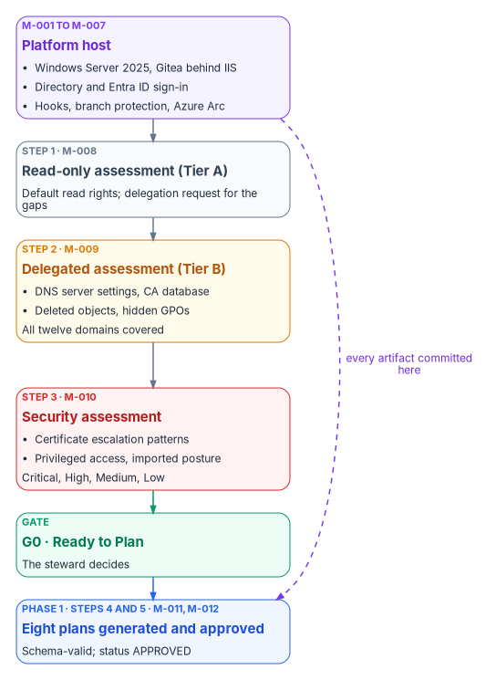
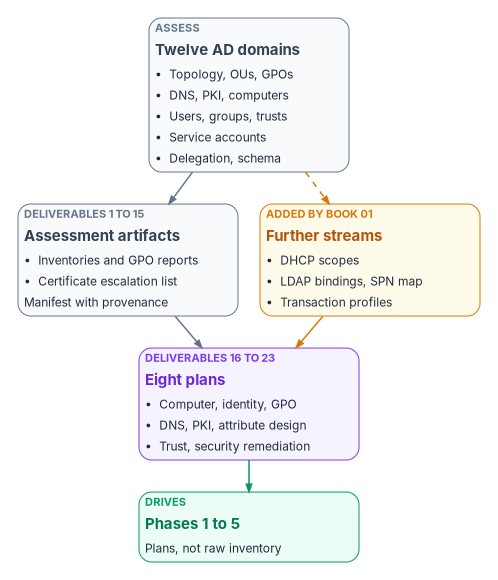

# Chapter 08 — Pre-Flight: Platform and Assessment

*Before the program changes anything, it builds the place where every decision will be written down, then reads the whole estate into it.*

::: {.callout-note}
## In this chapter
Phase 0 of the roadmap, Pre-flight, seen from the program office: what has to exist, who signs for it, and what evidence clears gate G0, Ready to Plan. The platform host is the program's reference design, and the chapter sets out its seven build milestones and the repository conventions that every later artifact follows. Then the read-only assessment: twelve Active Directory domains, twenty-three deliverables and the eight modernization plans they feed, run as a five-step sequence from default read to approved plans, of which the first three clear G0 and the last two are the first work after it. The chapter ends with the G0 go/no-go checklist. The engineering detail lives in [Book 01](../b01-transformation-arc/index.md), [Book 02](../b02-identity/index.md) and [Book 10](../b10-cloud-boundary/index.md); this chapter links to it rather than repeating it.
:::

## Where pre-flight sits in the program

[Book 01, Chapter 12](../b01-transformation-arc/12-migration-roadmap.md) sets the roadmap: seven phases and six gates. Phase 0, Pre-flight, has one goal, to produce the planning artifacts and stand up the platform host, and one exit, gate G0, Ready to Plan: the platform host is operational, the assessment is committed, and no priority-one findings are open. Everything in this chapter serves those three conditions.

The program's master plan covers the same ground in more detail and numbers it differently. Its Phase 0, Platform Build, and most of its Phase 1, Assessment, fall inside Book 01's Phase 0. The tail of that assessment phase, generating and approving the plans and preparing the pilot, is the first work after G0, because G0 is the gate that makes the program ready to plan; [Chapter 05](05-the-program-plan.md) gives the full mapping. Two calendars follow from that. Book 01's illustrative calendar gives pre-flight four weeks. The master plan spends about nine weeks on the same work: three to build the host, then six to assess, generate plans, review them and prepare for the pilot. Neither figure is a commitment, and large estates run longer. Plan from the milestone list, not the week count, and expect the assessment to take as long as the forest needs.

The master plan rests on one rule, and this book adopts it unchanged: **assessment before action.** No migration work starts until the whole forest has been inventoried, classified and committed to the program's repository as machine-readable artifacts, and every modernization plan is generated from that assessment rather than designed on its own. A plan without an assessment is a guess.

{#fig-ch08-pre-flight-sequence fig-alt="A vertical flow of six boxes. First, a violet box: the platform host, milestones M-001 to M-007, a Windows Server 2025 server running Gitea behind IIS, with directory and Entra ID sign-in, governance hooks and Azure Arc. Second, a slate box: read-only assessment at Tier A, milestone M-008, default read rights, with a delegation request for the gaps. Third, an amber box: the delegated Tier B assessment, milestone M-009, narrow read-only additions for DNS server settings, the CA database, deleted objects and hidden GPOs, covering all twelve domains. Fourth, a red box: the security assessment, milestone M-010, certificate-template escalation patterns, privileged access and imported posture findings, classified Critical, High, Medium or Low. Fifth, a green box: gate G0, Ready to Plan, which the steward clears. Sixth, a blue box: Phase 1's first work, eight plans generated and approved, milestones M-011 and M-012, schema-valid and with status APPROVED. Arrows join each box to the next, and a dashed arrow from the platform host to the plans is labeled every artifact committed here."}

## The platform host: the program's reference design

[Book 01, Chapter 03](../b01-transformation-arc/03-platform-foundation.md) describes the platform host in full: one governed server, with a standby, that holds the authoritative repository and runs every analysis, plan, delivery and evidence step. The property that matters is a single authoritative writer. The master plan builds that host one particular way, Gitea on Windows Server 2025 behind IIS, joined to Active Directory and signed into through Microsoft Entra ID, and that build is the program's **reference design**. It is one well-understood way to meet the requirement, not the only one; [Book 10, Appendix B](../b10-cloud-boundary/appendix-b-platform-host-interfaces.md) compares the repository options and documents every interface the reference build exposes.

The reference components are all current, supported products. Windows Server 2025 is the current Long-Term Servicing Channel release, available since November 1, 2024, with mainstream support to November 13, 2029 and extended support to November 14, 2034.[^c08-ws2025] Gitea documents running as a Windows service, registered with `sc.exe` and started with its `web` command and an `app.ini` file,[^c08-gitea-winsvc] and documents IIS as a reverse proxy using the URL Rewrite and Application Request Routing modules, forwarding to Gitea on `127.0.0.1:3000`.[^c08-gitea-proxy] Gitea's database can be PostgreSQL, MySQL, Microsoft SQL Server or SQLite;[^c08-gitea-cheat] the master plan's choice of a separate PostgreSQL host is the full-production profile in Book 10's interface reference.

### Seven build milestones

The master plan builds the host in seven milestones over about three weeks. The table keeps its milestones, owners and gate criteria, folds each milestone's task list into one column, and marks where this chapter corrects the source.

| ID | Milestone | Key tasks | Gate criteria | Owner |
|---|---|---|---|---|
| M-001 | Server provisioned | Provision a VM or server (the master plan sizes it at 4 vCPU, 8 GB RAM, 100 GB SSD, Windows Server 2025 Standard); join the domain in a designated OU; apply a hardening baseline; patch; create the data directory with NTFS permissions for the Gitea service account | Online, domain-joined, hardened, updates current | Infrastructure lead |
| M-002 | IIS and Gitea operational | Install IIS with URL Rewrite and ARR; bind an enterprise-CA TLS certificate on 443; install Gitea as a Windows service with its PostgreSQL backend; write the reverse-proxy rule; test from a workstation | Clone, push and pull over HTTPS verified from a workstation | Infrastructure lead |
| M-003 | Directory sign-in configured | Create a read-only LDAP bind account; add Gitea's LDAP source over LDAPS (636), with base DN and user filter; map the stewards group to Gitea administrators; test with an administrator, a contributor and a read-only account | Directory users can sign in; the stewards group holds the administrator role | Identity lead |
| M-004 | Entra ID sign-in configured | Register Gitea as an application in Entra ID with its redirect URI; add Gitea's OpenID Connect source; add a Conditional Access policy requiring MFA for the app; test sign-in, the MFA prompt and account linking | Entra sign-in verified; MFA enforced for every Gitea session | Identity lead |
| M-005 | Upstream repository mirrored | Create the program organization with stewards, contributors and readers teams; configure a scheduled pull mirror of the public upstream; verify branches, tags and commit count | All branches, tags and full history verified | Steward |
| M-006 | Governance hooks deployed | Deploy the receive hooks and branch protection; test each with known-good and known-bad pushes; commit the test results | Marking rejection and branch protection verified, with evidence committed | Steward |
| M-007 | Azure Arc connected (may finish in Phase 1) | Install the Connected Machine agent; tag the resource (Region, Site, Department, Role = GitServer); assign Azure Policy machine configuration for Windows Server 2025; check heartbeat and compliance | Agent heartbeat confirmed; policies assigned and compliant | Infrastructure lead |

: Phase 0 platform milestones (master plan M-001 to M-007) {.striped .hover}

M-003 and M-004 can run in parallel once Gitea is up, and M-007 can run alongside M-002 to M-006, since it depends only on the server existing. Book 01 schedules the host's Arc connection in Phase 1, together with the pilot servers, so M-007 isn't a G0 condition; it must be done by G1. The critical path runs M-001, M-002, M-005, M-006.

Five corrections to the source apply to this table:

- **Hardening baseline.** The master plan names CIS Level 1. CIS publishes a Windows Server 2025 benchmark, revised to version 2.1.0 in September 2026, with separate Level 1 profiles for member servers and domain controllers.[^c08-cis] Use the Level 1 member-server profile or the baseline the agency already mandates, and record which one in the decision log.
- **Who registers the application.** The master plan required Entra ID Global Administrator access to register Gitea. Microsoft's least-privileged role for creating an enterprise application is Cloud Application Administrator, and an Application Developer can create the registration when registration is restricted.[^c08-entra-roles] Use the narrowest role that does the job.
- **Report-only versus enforced MFA.** The tasks start the MFA policy in report-only mode while the exit criterion says MFA is enforced. Both are right in sequence: Microsoft recommends running each Conditional Access policy in report-only mode for at least a week before enforcing it.[^c08-ca-plan] The policy is enforced before G0, which in the master plan's own schedule means the platform build's third week can't be its last.
- **Guest Configuration is now machine configuration.** Azure Policy's Guest Configuration was renamed Azure machine configuration. On Arc-enabled servers it needs no separate extension, because the agent is built into the Connected Machine agent.[^c08-arc-mc]
- **The engine's PowerShell.** The source said PowerShell 7.x. Use PowerShell 7.6, the current Long-Term Servicing release, supported to November 14, 2028; PowerShell 7.4 reaches end of support on November 10, 2026.[^c08-ps]

Gitea supports both sign-in paths the master plan uses, an LDAP source bound with a service account and an OpenID Connect source with an auto-discovery URL, and it requires the redirect URI `{ROOT_URL}/user/oauth2/{source name}/callback` to be registered with the provider.[^c08-gitea-auth] Book 10's interface reference corrects three details of the Entra ID side (the groups claim, overage, and when team mapping happens) that matter for who keeps access after they leave ([Appendix B, B.2](../b10-cloud-boundary/appendix-b-platform-host-interfaces.md#b.2-entra-id-over-openid-connect)).

## Repository conventions

Every artifact the program produces, from an assessment run to a gate decision, is a file in the repository, changed only through a reviewed commit. Three conventions from the master plan make that workable, and the hooks enforce them.

**Branches.** `main` is canonical: only approved artifacts live there, and it is protected so that changes arrive through a pull request the steward approves. `feature/*` branches hold work in progress, such as `feature/phase1-assessment`. `release/*` branches freeze a snapshot when a gate is approved, such as `release/phase-1-assessment`. Book 10's hook table adds `develop`, `bugfix/*`, `hotfix/*` and `canon/*` to the allowed names.

**Names.** Governed documents follow `FMP_NNN_Short_Title_vMajor.Minor.md`. Assessment runs follow Book 01's run identifier instead, `assessments/<run-id>/`, with the identifier in the form `YYYY-MM-DD-HHmm-<host>-<tier>` ([Book 01, Chapter 10](../b01-transformation-arc/10-analyzing-the-estate.md#one-artifact-set-per-run)). Gate records live under `reports/phase-gates/`, weekly reports under `reports/weekly/YYYY-WNN.md`.

**Status.** Every governed document carries one of five states:

| Status | Meaning | Transition authority |
|---|---|---|
| DRAFT | Under active authoring; may be incomplete | Author creates |
| IN_REVIEW | Pull request submitted; awaiting review | Author submits the pull request |
| APPROVED | The steward has approved; merged to `main` | Steward merges |
| CURRENT | The active, governing version | Automatic on merge to `main` |
| DEPRECATED | Superseded by a newer version; kept for history | Steward marks |

: Document status lifecycle {.striped .hover}

**Hooks and protection.** The master plan specified three server-side hooks: a `pre-receive` hook that rejects commits carrying controlled-information markings and enforces the commit-message format, an `update` hook that enforces branch protection, and a `post-receive` hook that sends notifications and updates the assessment manifest. Git runs all three from `git-receive-pack`, so they fire on pushes.[^c08-githooks] Gitea ships with custom Git hooks disabled (`DISABLE_GIT_HOOKS` defaults to `true`), so server-side hooks are an explicit, administrator-controlled change.[^c08-gitea-cheat] Its protected-branch settings already cover most of what the `update` hook was for: push allowlists by user or team, required approvals, required status checks, signed commits and a ban on force pushes.[^c08-gitea-protected] Use the native protections where they fit and keep the hooks for what they can't express, such as content checks. Book 10 lists the full rule set ([Appendix B, D.1](../b10-cloud-boundary/appendix-b-platform-host-interfaces.md#d.1-server-side-git-hooks)).

Two corrections apply. First, the source's hook rejects "FOUO" markings. FOUO is a legacy marking: the National Archives' CUI program says that once agencies implement it, legacy markings such as FOUO and SBU are no longer used, though some information once marked FOUO is now marked CUI.[^c08-cui] The rejection rule should match the agency's CUI banner and category markings and keep matching the legacy ones, because old documents still carry them. Second, the mirror. A pull mirror is updated by fetching from the upstream, and the receive hooks run only on pushes, so mirrored commits never pass through them. Gitea syncs a pull mirror on a schedule, every eight hours by default and no more often than every ten minutes,[^c08-gitea-cheat] and it can only create one as a new repository.[^c08-gitea-mirror] So the mirror is a quarantine copy. Content becomes canon only when a reviewed push or pull request moves it into the authoritative repository, which runs the hooks and the protections ([Book 10, Appendix B, F.1](../b10-cloud-boundary/appendix-b-platform-host-interfaces.md#f.1-github-upstream-pull-mirror)). For the same reason, the master plan's control for a stale mirror (a `post-receive` hook that checks the sync timestamp) can't work as written; the drift reporter checks the mirror's last sync instead.

### Platform checklist

The master plan's Phase 0 go/no-go checklist becomes the platform half of G0. Every item needs evidence in the repository:

- [ ] Gitea web interface reachable at the program's internal HTTPS name (for example `https://git.example.internal`).
- [ ] Directory (LDAPS) and Entra ID (OpenID Connect) sign-in both working and tested, with MFA enforced for the Gitea application.
- [ ] The upstream repository mirrored with full commit history, and the promotion path into the authoritative repository tested.
- [ ] Hooks and branch protection rejecting controlled-information markings and unauthorized pushes to `main`, with test evidence committed.
- [ ] Azure Arc connected, resource tags applied, and machine configuration policies compliant, or scheduled to finish in Phase 1 (required by G1).
- [ ] Every deliverable in M-001 to M-007 verified and signed off by its owner.
- [ ] Platform completion report committed at `reports/phase-gates/phase-0-completion.md`.

## The read-only assessment

The assessment discipline itself is set out in [Book 01, Chapter 10](../b01-transformation-arc/10-analyzing-the-estate.md): read-only by policy, least privilege in two tiers, and provenance on every run. Forest-level depth, the delegation request and the assessment module are in [Book 02, Chapters 07 and 08](../b02-identity/index.md). This section is the program's schedule for it and the list of what it must deliver.

### Twelve domains

The master plan organizes the assessment into twelve Active Directory domains, each with a planned assessment function, an output and the stream in Book 01 that carries the method. The functions are the program's planned `FMP` module set; the master plan lists them as work to build, so treat the names as specifications rather than shipped tools.

| Domain | Planned function | Output | Book 01 Chapter 10 stream |
|---|---|---|---|
| Forest topology | `Export-FMPForestTopology` | ForestTopology.json | 1, Forest and domain topology |
| OU hierarchy | `Export-FMPOUHierarchy` | OUHierarchy.json, OUTree.txt | 2, OU hierarchy |
| GPO inventory | `Export-FMPGPOInventory` | GPOInventory.json, XML reports | 7, Group Policy Objects |
| DNS infrastructure | `Export-FMPDNSAssessment` | DNSInventory.json | 8, DNS zones and records |
| PKI and AD CS | `Export-FMPPKIInventory` | PKIInventory.json, ESCVulnerabilities.csv | 10, Certificate services |
| Computer objects | `Export-FMPComputerInventory` | ComputerInventory.json | 4, Computers |
| User objects | `Export-FMPUserInventory` | UserInventory.json, PrivilegedUsers.csv | 3, Users |
| Group memberships | `Export-FMPGroupInventory` | GroupInventory.json | 6, Security and distribution groups |
| Trust relationships | `Export-FMPTrustMap` | TrustMap.json | 1 (trusts are collected with the topology) |
| Service accounts | `Export-FMPServiceAccountInventory` | ServiceAccounts.csv | 5, Service accounts and SPNs |
| ACL and delegation | `Export-FMPACLReport` | OUDelegation.json | 2 (delegation ACLs are part of the OU stream) |
| Schema extensions | `Export-FMPSchemaExtensions` | SchemaExtensions.json | 1 (schema version); also feeds the attribute design |

: The twelve assessment domains and the Book 01 streams that carry them {.striped .hover}

The twelve domains and Book 01's eleven streams don't match one to one, and the program needs the union of both. The master plan has no domain for DHCP scopes and reservations (Book 01 stream 9) or for LDAP bindings and the Kerberos SPN map (stream 11), and it doesn't call for the transaction profiles that decide whether an application may move away from its data. Book 01's G0 requires all of them, so they are added to the assessment rather than left to a later phase.

### Five steps from default read to approved plans

The master plan runs the assessment as a week-by-week sequence. Each step ends in a milestone, and each milestone is a committed, reviewed artifact. Steps 1 to 3 produce what G0 needs; steps 4 and 5 run immediately after G0, as Phase 1's first work, and are described here because they finish the assessment's deliverables.

**Step 1, read-only assessment (M-008).** Build a dedicated assessment workstation: a privileged access workstation or a hardened, domain-joined Windows 11 VM with restricted network access, PowerShell and Git. On Windows 11 the Remote Server Administration Tools install as Features on Demand, for example `Rsat.ActiveDirectory.DS-LDS.Tools`, with separate capabilities for Group Policy, DNS and AD CS tools.[^c08-rsat] Run the permission pre-flight (`Test-FMPReadAccess`) to record what this forest lets a default account read, then the read-only orchestrator, commit the output on the assessment feature branch and open a pull request for the steward. From the recorded gaps, write the delegation request. The master plan estimated that default read captures about 87 percent of the assessment's value. Treat that as the program's estimate, not a measured fact: Book 01 shows that default read is broader than most teams expect, covering most GPO settings, certificate templates and often the AD-integrated DNS zones, and the pre-flight is what measures it in a given forest. *Milestone check:* the steward has reviewed the read-only run and the delegation request has gone to the directory team.

**Step 2, delegated assessment (M-009).** With the narrow Tier B additions granted, finish the parts default read couldn't see: DNS server settings such as aging, scavenging and forwarders; the CA's issued-certificate database and CA configuration; a full GPO backup; and the Deleted Objects container. Each needs care in how it is requested:

- **Group Policy.** `Backup-GPO -All` backs up every GPO in a domain to an existing directory,[^c08-backup-gpo] and the XML reports feed a per-setting classification. Most GPOs are already readable at default rights, so request extra read only where security filtering hides a GPO.
- **Deleted objects.** By default only System and the Administrators group can view the Deleted Objects container. Microsoft documents delegating read with `dsacls`, granting List Children and Read Property, which matches the Administrators group's default access and allows no changes.[^c08-deleted] Objects stay in the container for the tombstone lifetime, plus the deleted-object lifetime when the Recycle Bin is on.[^c08-deleted] (The source called it the "recycled objects container"; it is the Deleted Objects container.)
- **Certificate services.** Ask for read-only access to the CA, or an administrator-run export of the database, never the CA administrator role. Rights that expose secrets are never requested.

Commit the delta under the same run and update the assessment manifest. *Milestone check:* the full assessment is reviewed, all twelve domains (and the added streams) are covered, and no critical gaps remain.

**Step 3, security assessment (M-010).** Run the certificate-template analysis, the privileged access audit and the imports, then merge them into one findings set:

- **Certificate escalation.** The master plan looked for ESC1 to ESC8. The named patterns now go further. Microsoft Defender for Identity reports, among others, ESC1 (a template that lets the requester supply the subject name and allows authentication), ESC4 (a template owned or editable by an unprivileged group), ESC8 (web enrollment open to NTLM relay) and ESC15 (CVE-2024-49019, arbitrary application policies).[^c08-mdi-certs] Scan for the current list, not a fixed range.
- **Privileged access.** Accounts with `AdminCount=1`, Kerberoastable service principal names, unconstrained delegation, accounts without Kerberos pre-authentication (AS-REP roastable), passwords that never expire, and privileged accounts inactive for more than 90 days.
- **Imported posture.** Where Defender for Identity is deployed, its security posture assessments appear in Microsoft Secure Score, grouped into hybrid security, identity infrastructure, certificates, Group Policy, accounts and cloud identities. Certificate-template assessments need only a Defender for Identity license; certificate-authority assessments need a sensor on the AD CS server.[^c08-mdi-posture] Results from third-party Active Directory assessment tools, where the agency already runs one, are imported and de-duplicated the same way.

Then classify every finding. The master plan's four classes map onto the roadmap's gates:

| Class | Master plan meaning | Must be closed by |
|---|---|---|
| Critical | Blocks migration | G0: Book 01's "no open priority-one findings" |
| High | Must be remediated before the pilot | G1, before Phase 2 opens |
| Medium | Remediated during rollout | G3 |
| Low | Accepted or tracked | Tracked; reviewed at each gate |

: Finding classes and the gates that close them {.striped .hover}

This is stricter than the source in one place. The master plan let Critical findings carry a drafted remediation plan into planning and required them fixed only before the pilot. Book 01's G0 says no priority-one findings may be open, so a Critical finding is either remediated before G0 or formally accepted by the authorizing official, who holds risk acceptance ([Book 01, Chapter 09](../b01-transformation-arc/09-who-leads-the-transformation.md#decision-rights-across-the-program)). *Milestone check:* every finding classified, every Critical finding closed or accepted, and every High finding scheduled before G1.

**Step 4, plan generation (M-011), the first work after G0.** The planning step takes the committed assessment, and only the committed assessment, and generates eight machine-readable plans. This is Book 01's plan stage ([Chapter 11](../b01-transformation-arc/11-analysis-plan-delivery.md)): the plans are produced by generators from data, not drawn up by hand.

| Plan | What it classifies | Inputs | Corrections and links |
|---|---|---|---|
| ComputerModernizationPlan.json | Every computer object into Entra join, hybrid join, Azure Arc, retain or decommission, with OS version, last logon, attribute values and target policy group | ComputerInventory.json | Hybrid join is a waypoint with a cut date, never an end state; servers go to Arc, since Intune doesn't manage Windows Server ([Book 05, Chapters 02](../b05-devices/02-the-hybrid-join-trap.md) and [09](../b05-devices/09-servers-under-azure-arc.md)) |
| IdentityModernizationPlan.json | Every user, group and service account into cloud-only, synced, managed service account, workload identity or retain; privileged accounts mapped to PIM roles | UserInventory.json, GroupInventory.json, ServiceAccounts.csv | Windows Server 2025 adds delegated managed service accounts as a path for existing service accounts ([Book 01, Chapter 10](../b01-transformation-arc/10-analyzing-the-estate.md)); matrix in [Book 02, Chapter 09](../b02-identity/09-building-the-entra-target.md) |
| GPOMigrationPlan.json | Every GPO decomposed into configuration intents, each mapped to settings catalog, endpoint security, imported ADMX, custom OMA-URI or no equivalent, with per-intent status | GPOInventory.json | Method and crosswalk in [Book 05, Chapter 07](../b05-devices/07-the-gpo-sunset-program.md) and [Appendix A](../b05-devices/appendix-a-gpo-to-intune-crosswalk.md) |
| DNSModernizationPlan.json | Every zone and record into Azure private zone, Azure public zone, Private Resolver forwarding, retain AD-integrated, or decommission | DNSInventory.json | The domain's own locator zones stay AD-integrated until the last domain controller goes ([Book 08, Chapter 10](../b08-ddi/10-migration-sequence.md)) |
| PKIModernizationPlan.json | Every certificate template into migrate (Cloud PKI), bridge, retain or retire, with escalation-remediation status | PKIInventory.json | Cloud PKI issues only to Intune-enrolled devices; domain controller and LDAPS certificates stay on AD CS until AD retires ([Book 07, Appendix B](../b07-pki/appendix-b-template-migration-matrix.md)) |
| AttributeDesign.json | The attribute dimensions (Region, Site, Department, Role, Environment), their value lists and assignments | OUHierarchy.json, SchemaExtensions.json | The OU tree seeds the crosswalk; authority for each value comes from HR or the named writer, and the slots come from the program attribute map ([Book 03, Chapter 06](../b03-hr-identity/06-canonical-attribute-schema.md#program-attribute-map)) |
| TrustDecommissionPlan.json | Every trust as essential or non-essential, with decommission prerequisites and validation | TrustMap.json | Trust-to-cross-tenant mapping in [Book 02, Chapter 10](../b02-identity/10-migrating-and-governing.md) |
| SecurityRemediationPlan.json | Every finding with owner, severity-based deadline and verification | SecurityFindings.json | Deadlines follow the class table above |

: The eight modernization plans {.striped .hover}

*Milestone check:* all eight plans committed under `plans/` and passing schema validation.

**Step 5, review and approval (M-012).** The steward reviews all eight for completeness, consistency and cross-references. Each workstream lead reviews their own: identity and trust plans by the identity lead, computer and GPO plans by the endpoint lead, the DNS plan by the DNS lead, the PKI plan by the PKI lead. The security lead validates severities, deadlines and owners. Conflicts between plans (the PKI plan depending on the identity plan's timing, for example) are resolved and recommitted, and the steering committee reviews the combined result. *Milestone check:* every plan has status APPROVED. The designs in [Chapter 09](09-design-pilot-and-rollout.md) start from these approved plans, and G1 requires them.

{#fig-ch08-deliverables-to-plans fig-alt="A top-to-bottom flow in four rows. At the top, a slate box: twelve Active Directory domains, from forest topology and OUs to trusts, service accounts, delegation and schema extensions. In the second row, a slate box: fifteen assessment deliverables, the inventories, GPO XML reports, the certificate escalation list and the assessment manifest, committed with provenance. Beside it, an amber box: added by Book 01, DHCP scopes, LDAP bindings and the Kerberos SPN map, and transaction profiles. In the third row, a violet box: eight plans, computer, identity, GPO, DNS, PKI, attribute design, trust decommission and security remediation, each generated and approved. Arrows run from domains to deliverables, from both second-row boxes to the plans, and from the plans down to a green box at the bottom labeled Phases 1 to 5."}

## The twenty-three deliverables

The assessment phase produces twenty-three deliverables: fifteen assessment artifacts, committed before G0, and the eight plans, approved just after it. The table keeps the master plan's list, with the file name Book 01's committed layout uses where it differs, and adds what each one feeds. Three working files the sequence also produces, SecurityFindings.json, PrivilegedUsers.csv and OUTree.txt, are committed with the run but aren't counted.

| # | Deliverable | Book 01 layout | Produced by | Consumed by |
|---|---|---|---|---|
| 1 | ForestTopology.json | `forest-topology.json` | Assessment orchestrator | All plans |
| 2 | OUHierarchy.json | `ou-hierarchy.json` | `Export-FMPOUHierarchy` | Attribute design, GPO plan |
| 3 | GPOInventory.json | `gpos/gpo-index.json` | `Export-FMPGPOInventory` | GPO plan |
| 4 | GPO XML reports | `gpos/{guid}.xml` | `Get-GPOReport` | GPO plan |
| 5 | DNSInventory.json | `dns-zones.json`, `dns-records.jsonl` | `Export-FMPDNSAssessment` | DNS plan |
| 6 | PKIInventory.json | `adcs/` | `Export-FMPPKIInventory` | PKI plan |
| 7 | ESCVulnerabilities.csv | `adcs/` | `Test-FMPESCVulnerabilities` | Security remediation plan |
| 8 | ComputerInventory.json | `computers.jsonl` | `Export-FMPComputerInventory` | Computer plan |
| 9 | UserInventory.json | `users.jsonl` | `Export-FMPUserInventory` | Identity plan |
| 10 | GroupInventory.json | `groups.jsonl` | `Export-FMPGroupInventory` | Identity plan |
| 11 | ServiceAccounts.csv | `spn-inventory.json` | `Export-FMPServiceAccountInventory` | Identity plan |
| 12 | TrustMap.json | `forest-topology.json` | `Export-FMPTrustMap` | Trust decommission plan |
| 13 | OUDelegation.json | `ou-hierarchy.json` | `Export-FMPACLReport` | Identity plan |
| 14 | SchemaExtensions.json | `forest-topology.json` | `Export-FMPSchemaExtensions` | Attribute design |
| 15 | AssessmentManifest.json | `provenance.yaml` | Assessment orchestrator | Governance tracking |
| 16 | ComputerModernizationPlan.json | `plans/` | Plan generator | Phases 1 to 4 |
| 17 | IdentityModernizationPlan.json | `plans/` | Plan generator | Phases 1 to 4 |
| 18 | GPOMigrationPlan.json | `plans/` | Plan generator | Phases 1 to 4 |
| 19 | DNSModernizationPlan.json | `plans/` | Plan generator | Phases 1 to 4 |
| 20 | PKIModernizationPlan.json | `plans/` | Plan generator | Phases 1 to 4 |
| 21 | AttributeDesign.json | `plans/` | Plan generator | Phases 1 to 6 |
| 22 | SecurityRemediationPlan.json | `plans/` | Plan generator | Phases 0 to 4 |
| 23 | TrustDecommissionPlan.json | `plans/` | Plan generator | Phases 4 and 5 |

: The twenty-three assessment-phase deliverables {.striped .hover}

The "Consumed by" phases are Book 01's. The master plan said "Phases 3 to 5" for most plans, meaning its own pilot, scale and cutover phases, which are Book 01's Phases 2, 3 and 4; the table widens them to include Phase 1, because the foundation work in [Chapter 09](09-design-pilot-and-rollout.md) is designed from these plans.

The set is sensitive. It maps privileged groups, service accounts and certificate-template permissions, so it is stored encrypted and handled under the agency's data classification policy. The master plan's matching risk entry, a compromised assessment workstation, is met with a privileged access workstation, restricted network access and encrypted output, and the workstation is rebuilt or retired once the initial assessment is committed. Continuous re-assessment then runs from the platform host at default read ([Book 01, Chapter 10](../b01-transformation-arc/10-analyzing-the-estate.md#least-privilege-delegation-in-two-tiers)).

## Gate G0: the go/no-go checklist

G0 combines the platform checklist above with assessment milestones M-008 to M-010 and Book 01's three conditions. The steward decides it, with the executive sponsor as backup ([Book 01, Chapter 12](../b01-transformation-arc/12-migration-roadmap.md#gates-rollback-and-authority)); the steering committee's review is an input to that decision, not a second signature. Each item is answered from the repository, and the gate record is committed under `reports/phase-gates/` using the program's gate review template ([Chapter 05](05-the-program-plan.md)).

**Platform host operational**

- [ ] Every item in the platform checklist above is met, with evidence committed.
- [ ] Least-privilege service principals exist for Entra ID, Intune and Azure Arc ([Book 01, Chapter 12](../b01-transformation-arc/12-migration-roadmap.md#the-seven-phases)).
- [ ] The host is protected as a Tier 0 asset and its logs reach central logging ([Book 01, Chapter 03](../b01-transformation-arc/03-platform-foundation.md#operational-properties)).

**Assessment committed**

- [ ] The read-only run is reviewed and the delegation request recorded (M-008).
- [ ] The delegated run covers all twelve domains plus DHCP, LDAP bindings and the SPN map, with provenance on every file (M-009).
- [ ] Transaction profiles are committed for every application proposed to move away from its data.
- [ ] The fifteen assessment deliverables are committed under one run identifier.

**Findings**

- [ ] Every security finding is classified; no Critical (priority-one) finding is open, and any accepted one carries the authorizing official's acceptance (M-010).
- [ ] Every High finding has an owner and a remediation date before G1.
- [ ] The workstream leads and the steering committee have reviewed the assessment and the classified findings.

**Gate record**

- [ ] The G0 decision (go, no-go or conditional go, with any conditions and their dates) is merged by pull request, and the merge records who decided.
- [ ] The approved state is frozen on a `release/` branch.

Three pieces of the master plan's assessment phase come after G0, in Book 01's Phase 1: plan generation and approval (steps 4 and 5 above), and the pre-pilot week (milestone M-013: pilot selection, attribute-based groups, High-finding remediation, report-only Conditional Access, Cloud PKI and the DNS Private Resolver), which builds things in the target tenant. All three are G1 evidence, in [Chapter 09](09-design-pilot-and-rollout.md).

## Key takeaways

1. Pre-flight has one exit: the platform host works, the assessment is committed, and no priority-one finding is open. The plans come right after, because G0 is the gate that makes the program ready to plan.
2. Gitea on Windows Server 2025 behind IIS is the reference design, not the only option; the requirement is one authoritative, protected writer.
3. Every artifact is a reviewed commit with a status, and canon enters only through a push the hooks and protections can see, never through the mirror.
4. The assessment runs in five steps from default read to approved plans, and it covers the master plan's twelve domains plus the DHCP, LDAP and transaction-profile streams Book 01 adds.
5. The assessment phase delivers twenty-three artifacts: fifteen committed before G0 and eight plans approved just after it, which drive everything that follows.

::: {.callout-tip}
## Continue the book
[← Previous: Chapter 07 — Who Runs the Program](07-who-runs-the-program.md) · [Book index](index.md) · [Next: Chapter 09 — Design, Pilot and Rollout →](09-design-pilot-and-rollout.md)
:::

[^c08-ws2025]: Microsoft Learn, "Windows Server release information," Windows Server 2025 row (LTSC; availability 2024-11-01; mainstream support to 2029-11-13; extended support to 2034-11-14), <https://learn.microsoft.com/windows/release-health/windows-server-release-info> (accessed Oct 21, 2026).
[^c08-gitea-winsvc]: Gitea Documentation, "Register as a Windows Service," <https://docs.gitea.com/installation/windows-service> (accessed Oct 21, 2026).
[^c08-gitea-proxy]: Gitea Documentation, "Reverse Proxies," IIS section (URL Rewrite, Application Request Routing, WebSocket Protocol; backend `127.0.0.1:3000`), <https://docs.gitea.com/administration/reverse-proxies> (accessed Oct 21, 2026).
[^c08-gitea-cheat]: Gitea Documentation, "Configuration Cheat Sheet" (`[database]` `DB_TYPE` values; `[security]` `DISABLE_GIT_HOOKS`, default `true`; `[mirror]` `DEFAULT_INTERVAL` 8h and `MIN_INTERVAL` 10m), <https://docs.gitea.com/administration/config-cheat-sheet> (accessed Oct 21, 2026).
[^c08-cis]: Center for Internet Security, "CIS Microsoft Windows Server Benchmarks," <https://www.cisecurity.org/benchmark/microsoft_windows_server>, and "CIS Benchmarks September 2026 Update" (CIS Microsoft Windows Server 2025 Benchmark v2.1.0), <https://www.cisecurity.org/insights/blog/cis-benchmarks-september-2026-update> (both from search results, accessed Oct 21, 2026). The Level 1 member-server and domain-controller profiles are listed for the v1.0.0 release; confirm the profile names against the version you download.
[^c08-entra-roles]: Microsoft Learn, "Least privileged roles by task in Microsoft Entra ID," enterprise applications (create enterprise application: Cloud Application Administrator) and application registration when registration is disabled for users (Application Developer), <https://learn.microsoft.com/entra/identity/role-based-access-control/delegate-by-task> (accessed Oct 21, 2026).
[^c08-ca-plan]: Microsoft Learn, "Plan a Conditional Access deployment," Deploy Conditional Access policies ("Enable each policy in report-only mode for at least one week before enforcement"), <https://learn.microsoft.com/entra/identity/conditional-access/plan-conditional-access#deploy-conditional-access-policies> (accessed Oct 21, 2026).
[^c08-arc-mc]: Microsoft Learn, "Cloud-native governance and policy with Azure Arc-enabled servers," Azure machine configuration ("previously called Azure Policy Guest Configuration"), <https://learn.microsoft.com/azure/azure-arc/servers/cloud-native/governance-policy#azure-machine-configuration>, and "Azure Machine Configuration prerequisites" (the extension isn't required for Arc-enabled servers because it is included in the Connected Machine agent), <https://learn.microsoft.com/azure/governance/machine-configuration/overview/02-setup-prerequisites> (both accessed Oct 21, 2026).
[^c08-ps]: Microsoft Learn, "PowerShell Support Lifecycle," end-of-support dates (PowerShell 7.6 LTS to 14-Nov-2028; PowerShell 7.4 LTS to 10-Nov-2026), <https://learn.microsoft.com/powershell/scripting/install/powershell-support-lifecycle> (accessed Oct 21, 2026).
[^c08-gitea-auth]: Gitea Documentation, "Authentication" (LDAP via BindDN; OAuth2 and OpenID Connect with auto-discovery; redirect URI `{ROOT_URL}/user/oauth2/{Authentication Name}/callback`), <https://docs.gitea.com/usage/authentication> (accessed Oct 21, 2026).
[^c08-githooks]: Git documentation, "githooks" (`pre-receive`, `update` and `post-receive` are invoked by `git-receive-pack`), <https://git-scm.com/docs/githooks> (accessed Oct 21, 2026).
[^c08-gitea-protected]: Gitea Documentation, "Protected branches," <https://docs.gitea.com/usage/access-control/protected-branches/> (accessed Oct 21, 2026).
[^c08-cui]: National Archives and Records Administration, "Controlled Unclassified Information (CUI)," frequently asked questions ("Once agencies implement the CUI program, legacy markings such as FOUO or SBU will no longer be used"), <https://www.archives.gov/cui/faqs.html> (accessed Oct 21, 2026).
[^c08-gitea-mirror]: Gitea Documentation, "Repository Mirror" (pull mirrors are created through a new migration and synced periodically; an existing repository can't be converted into a pull mirror), <https://docs.gitea.com/usage/repo-mirror> (accessed Oct 21, 2026).
[^c08-rsat]: Microsoft Learn, "Install and manage Remote Server Administration Tools in Windows" (install RSAT as Features on Demand; `Rsat.ActiveDirectory.DS-LDS.Tools~~~~0.0.1.0`), <https://learn.microsoft.com/windows-server/administration/install-remote-server-administration-tools> (accessed Oct 21, 2026).
[^c08-backup-gpo]: Microsoft Learn, "Backup-GPO" (GroupPolicy module; backs up one GPO or all the GPOs in a domain; the backup directory must already exist), <https://learn.microsoft.com/powershell/module/grouppolicy/backup-gpo?view=windowsserver2025-ps> (accessed Oct 21, 2026).
[^c08-deleted]: Microsoft Learn, "Let nonadministrators view the contents of the Active Directory deleted objects container" (default visibility; `dsacls ... /g ...:LCRP`; retention for the tombstone lifetime, plus the deleted-object lifetime with the Recycle Bin), <https://learn.microsoft.com/troubleshoot/windows-server/active-directory/non-administrators-view-deleted-object-container> (accessed Oct 21, 2026).
[^c08-mdi-certs]: Microsoft Learn, "Security assessment: Certificates" (ESC1, ESC4, ESC8 and ESC15 assessments), <https://learn.microsoft.com/defender-for-identity/security-posture-assessments/certificates> (accessed Oct 21, 2026).
[^c08-mdi-posture]: Microsoft Learn, "Microsoft Defender for Identity's security posture assessments" (available in Microsoft Secure Score; six categories; license and sensor prerequisites), <https://learn.microsoft.com/defender-for-identity/security-assessment> (accessed Oct 21, 2026).
