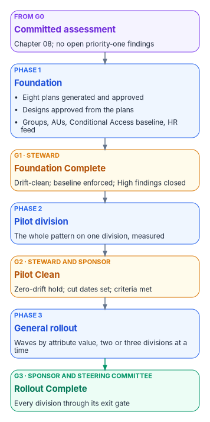
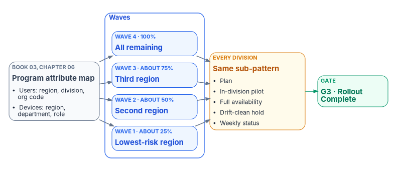

# Chapter 09 — Design, Pilot and Rollout

*Design from the plans, prove the design on people who can tolerate a bad day, then repeat what worked until there is no one left to move.*

::: {.callout-note}
## In this chapter
Book 01's Phases 1 to 3 as the program office runs them. Phase 1, Foundation, turns the approved plans into designs and blueprints and builds the shared foundation they need, ending at gate G1. Phase 2, the pilot, proves the full pattern on one division against measured success criteria, with a rollback for every surface, ending at G2. Phase 3, general rollout, scales it in waves defined by attribute values rather than by OUs, ending at G3. For each phase: the milestones, the corrections this book makes to the master plan, and the gate checklist. The working detail stays in the domain books, which are linked throughout.
:::

## From approved plans to a moving estate

Pre-flight ends with a committed assessment and no open priority-one findings ([Chapter 08](08-pre-flight-and-assessment.md)). Phase 1 opens by generating the eight modernization plans from it and approving them, the last two steps of that chapter's assessment sequence. The next three phases of [Book 01's roadmap](../b01-transformation-arc/12-migration-roadmap.md) are where the estate starts to move:

| Book 01 phase and gate | Master plan source | What the phase delivers |
|---|---|---|
| Phase 1, Foundation → G1 Foundation Complete | The end of Phase 1, Assessment (plan generation and approval, M-011 and M-012, and pre-pilot preparation, M-013), and Phase 2, Planning and Design (M-014 to M-021) | Approved plans and designs; enterprise groups, administrative units and the Conditional Access baseline; the HR feed; Cloud PKI, the DNS resolver and Arc ready for the pilot |
| Phase 2, Pilot division → G2 Pilot Clean | Phase 3, Pilot (M-022 to M-031) | The whole pattern working on one division, measured against success criteria |
| Phase 3, General rollout → G3 Rollout Complete | Phase 4, Scale (M-032 to M-037) | Every remaining division moved, in waves |

: Phases 1 to 3 and their master plan sources {.striped .hover}

Book 01's illustrative calendar gives these phases weeks 5 to 36; the master plan's runs from week 9 to week 33. Both are sequencing models. The five workstreams (identity, policy, services, compute and access) run in parallel through all three phases, and the gates follow the dependency chain ([Book 01, Chapter 12](../b01-transformation-arc/12-migration-roadmap.md#the-five-parallel-workstreams)).

{#fig-ch09-phases-and-gates fig-alt="A vertical flow of six boxes. A violet box at the top: the committed assessment, from gate G0. A blue box: Phase 1, Foundation, plans generated and approved, designs approved, groups, administrative units, the Conditional Access baseline and the HR feed. An amber gate box: G1, Foundation Complete, decided by the steward, foundation drift-clean, baseline Conditional Access enforced, High findings closed. A blue box: Phase 2, Pilot division, the whole pattern on one division, measured against success criteria. An amber gate box: G2, Pilot Clean, co-signed by the steward and the executive sponsor, a zero-drift hold, no hybrid-joined device without a cut date, success criteria met. A blue box: Phase 3, General rollout, waves by attribute value, two or three divisions at a time. A green gate box: G3, Rollout Complete, decided by the executive sponsor with the steering committee, every division through its exit gate. Arrows join each box to the next."}

## Phase 1 — Foundation

Phase 1 opens with the eight plans: generated from the committed assessment, reviewed by the workstream leads and the security lead, and approved by the steward, with the steering committee reviewing the combined set ([Chapter 08](08-pre-flight-and-assessment.md#five-steps-from-default-read-to-approved-plans), steps 4 and 5). Then it has two halves that run together: designing every surface from the approved plans, and building the shared primitives the pilot needs. The master plan treated the second half as the last week of assessment, but it creates objects in the target tenant, so it belongs here.

### Design milestones

| ID | Milestone | Deliverable | Owner |
|---|---|---|---|
| M-014 | Attribute taxonomy finalized | Attribute dimensions mapped to slots, canonical value lists, validation and governance rules, committed as AttributeTaxonomy.json with status APPROVED | Identity lead |
| M-015 | Dynamic group design complete | Rules for every dimension combination the waves use, tested in a non-production tenant, with a naming convention and lifecycle | Endpoint lead |
| M-016 | Intune policy design complete | Every GPO intent mapped to settings catalog, endpoint security or imported ADMX; intents with no equivalent decided and recorded; profiles and compliance policies exported under `plans/intune/` | Endpoint lead |
| M-017 | Conditional Access design | The policy set designed and running in report-only mode for at least seven days, with impact analysis, exceptions and emergency access accounts documented | Security lead |
| M-018 | Sync design | Scope filtering, attribute flow (including the extension attributes), sign-in method and a safe first-sync plan documented | Identity lead |
| M-019 | DNS Private Resolver design | Hub-and-spoke topology, forwarding rulesets, split-brain patterns and resolution-failure monitoring documented | DNS lead |
| M-020 | Cloud PKI design complete | Root of trust decided (Cloud PKI root or bring-your-own CA) and recorded as a decision; template migration matrix; SCEP profile and certificate-based authentication binding designs; lifecycle procedures | PKI lead |
| M-021 | Design review approved | Every design approved by the steward and reviewed by the steering committee | Steward |

: Phase 1 design milestones (master plan M-014 to M-021) {.striped .hover}

M-017 (Conditional Access) and M-019 (DNS) run in parallel with the attribute, group and Intune track (M-014 to M-016), which is the critical path. M-020 runs in parallel too, but needs the security assessment's escalation findings, and PKI always follows identity: certificate-based authentication can't be validated until the user and device objects it binds to are synced and mapped.

### The attribute taxonomy

Everything the waves do is scoped by attributes, so M-014 comes first. The master plan names five dimensions, Region, Site, Department, Role and Environment, and maps them onto `extensionAttribute1` to `15`. The workbook already has one assignment of those slots for the whole site, the program attribute map in [Book 03, Chapter 06](../b03-hr-identity/06-canonical-attribute-schema.md#program-attribute-map), and the taxonomy uses it rather than choosing slots locally:

| Master plan dimension | User object | Device object |
|---|---|---|
| Region | `extensionAttribute4`, region code | `extensionAttribute1`, region |
| Department | `extensionAttribute6`, division code, and `extensionAttribute10`, organization code | `extensionAttribute3`, department or function |
| Role | `extensionAttribute12`, position category | `extensionAttribute12`, device role |
| Environment | — | `extensionAttribute13`, environment |
| Site | No slot assigned | No slot assigned |

: The master plan's dimensions in the program attribute map {.striped .hover}

Two things follow. **Site has no slot.** A program that waves by site either uses a native location property that membership rules can already read, or asks the map's owner for a reserved slot; it doesn't take one locally. **The OU tree isn't the authority.** The master plan derived dimension values from the OU hierarchy. The OU analysis is a good seed for the crosswalk and for the transition, but each user value has one designated source, normally HR through the provisioning feed, and each slot has one writer ([Book 03, Chapter 06](../b03-hr-identity/06-canonical-attribute-schema.md#writers)). Microsoft's own guidance points the same way: a dynamic group is only as secure as the write permissions on the attributes its rule reads, in Entra ID and in any source directory.[^c09-dyn-rules]

The two object types are written differently. For synced users, `extensionAttribute1` to `15` flow from Active Directory, and both Microsoft sync engines carry them.[^c09-sync] Device extension attributes are set on the Entra ID device object through Microsoft Graph, and a device rule can use them only once they are written there.[^c09-dyn-rules][^c09-device-update]

### Dynamic groups, policy and access

**Dynamic groups (M-015).** Dynamic membership groups need Microsoft Entra ID P1 for each unique user who is a member of one; device-based groups need no license.[^c09-dyn-rules] The master plan required group processing to finish within fifteen minutes. Microsoft doesn't offer that: membership changes are usually processed within a few hours and can take more than 24, depending on the number of groups, the number of changes and the complexity of the rules.[^c09-dyn-processing] So the design measures processing time in the non-production tenant and plans each wave around hours, not minutes. Rules that use `-match`, `-contains` or `memberOf` are slower and are kept out of wave groups where possible.[^c09-dyn-processing]

**Intune policy (M-016).** The GPO plan's intents become Intune profiles. Intune's Group Policy analytics imports GPO reports, shows which settings have an MDM equivalent and can create a settings catalog policy from the supported ones.[^c09-gp-analytics] The intents with no equivalent get a recorded decision (a custom OMA-URI, an accepted gap, or a different control) in the GPO sunset program ([Book 05, Chapter 07](../b05-devices/07-the-gpo-sunset-program.md)), and the working policy set is [Book 05, Chapter 08](../b05-devices/08-gpo-to-intune-policy-migration.md).

**Conditional Access (M-017).** The master plan called for "15+" policies. The program's library is now one numbered set in [Book 04, Chapter 07](../b04-access/07-the-conditional-access-policy-library.md), enforced in five waves, and Phase 1 enforces its foundation wave and the baseline. Report-only mode evaluates a policy and logs the result without enforcing it,[^c09-report-only] and Microsoft recommends at least a week in report-only before enforcement,[^c09-ca-plan] which matches the master plan's seven days. Emergency access accounts are designed here too: at least two cloud-only accounts with phishing-resistant methods, excluded from every policy that blocks or restricts sign-in, monitored on every use and validated at least every 90 days.[^c09-breakglass]

**Sync (M-018).** The master plan assumed Microsoft Entra Connect Sync with staging mode. Microsoft now describes Cloud Sync as its strategic direction and the recommended path for most organizations,[^c09-sync] and [Book 02, Chapter 09](../b02-identity/09-building-the-entra-target.md#choosing-and-configuring-the-sync-engine) sets the program's rule: Cloud Sync unless a forest needs something only Connect Sync does. Password hash sync is the program's sign-in method either way. Staging mode is a Connect Sync feature; Cloud Sync gets its resilience from multiple active agents, so the first-sync plan names which engine it is written for.

**DNS (M-019).** Azure DNS Private Resolver has an inbound endpoint that on-premises conditional forwarders target to resolve Azure private zones, and an outbound endpoint whose forwarding rulesets send Azure queries for on-premises names to the domain's DNS servers. Each endpoint needs its own dedicated subnet, and a ruleset holds up to 1,000 rules.[^c09-dnspr] The coexistence design and split-brain rules are [Book 08, Chapters 02](../b08-ddi/02-split-brain-dns.md) and [10](../b08-ddi/10-migration-sequence.md).

**Cloud PKI (M-020).** Cloud PKI offers two models: a root and issuing CAs in the cloud, or an issuing CA in the cloud anchored to your own private root (bring your own CA).[^c09-cpki-models] Three facts bound the design: it issues leaf certificates only through SCEP to Intune-enrolled devices, a tenant can hold at most three CAs, counting roots, issuing CAs and BYOCA issuing CAs together, and CRLs are valid for seven days.[^c09-cpki] Server certificates, including domain controller and LDAPS certificates, stay on AD CS ([Book 07, Chapters 04](../b07-pki/04-the-target-pki.md) and [07](../b07-pki/07-coexistence-and-migration.md)).

### Foundation build and pre-pilot readiness

While the designs are reviewed, the shared foundation is built. Book 01 sets the content: enterprise dynamic groups, administrative units for Tier 1 and selected Tier 2 scopes, the HR-to-cloud provisioning feed for the foundation scope ([Book 03, Chapter 12](../b03-hr-identity/12-execution-plan.md)), the enterprise Conditional Access baseline, IP address management for Tier 0 infrastructure, Arc for the platform host and the pilot servers, and single sign-on with FIDO2 security keys and passkeys open to Tier 0 administrators. The master plan's pre-pilot week (M-013) adds the pilot-specific readiness:

- **Pilot selection.** Pilot scope defined (see Phase 2) and attribute-based dynamic groups built and validated for it.
- **High findings.** Remediation of every High finding from the security assessment, verified by re-scan. This is the master plan's "before Phase 3" deadline, which is Book 01's pilot.
- **Intune staged.** Pilot configuration profiles and compliance policies created from the GPO plan and held back from enforcement until the pilot opens.
- **Conditional Access.** The pilot policies running in report-only mode against pilot users, with sign-in logs reviewed.
- **Cloud PKI.** The root or BYOCA issuing CA created and the first SCEP profile drafted for the pilot certificate.
- **DNS.** The Private Resolver deployed in the hub network with forwarding rulesets for the AD zones, and no conditional-forwarder changes on-premises yet.

### Gate G1 — Foundation Complete

The steward decides G1 ([Book 01, Chapter 09](../b01-transformation-arc/09-who-leads-the-transformation.md#decision-rights-across-the-program)). The checklist combines Book 01's criteria with the master plan's design and pre-pilot milestones:

- [ ] All eight modernization plans have status APPROVED (M-011, M-012).
- [ ] Every design in M-014 to M-020 has status APPROVED, and the design review (M-021) is merged.
- [ ] Enterprise groups and administrative units are drift-clean.
- [ ] The baseline Conditional Access policies are enforced, after at least seven days in report-only with no unexpected impact, and no user sits outside the MFA requirement except the documented emergency access accounts.
- [ ] Emergency access accounts are vaulted, monitored and tested.
- [ ] Tier 0 infrastructure is covered by IPAM.
- [ ] The platform host and the pilot servers are connected through Azure Arc, with machine configuration compliant (M-007).
- [ ] HR-to-cloud provisioning is operational for the foundation scope, and the attribute slots in use are confirmed free and single-writer.
- [ ] Every High finding is remediated and verified by re-scan.
- [ ] Pilot scope, pilot groups, staged Intune policies, the Cloud PKI CA and the Private Resolver are in place (M-013).
- [ ] Zero drift across the foundation.

## Phase 2 — The pilot

The pilot proves the complete pattern, identity, devices, DNS, PKI and server management, on real people before anything scales.

### Scope

Book 01 sets the pilot's scope as **one division**, typically IT, which tolerates disruption best. The master plan sized its pilot by surface instead:

| Surface | Pilot scope | Selection criteria |
|---|---|---|
| Devices | 50 to 100 devices across 2 or 3 sites | Laptops and desktops on supported Windows, with representative attribute values |
| Identity | 20 to 50 users across 3 or 4 departments | Standard users, power users and 2 or 3 pilot administrators |
| Servers | 2 or 3 servers for Arc | Non-critical tier, representative OS versions |
| PKI | 1 or 2 certificate use cases | Wi-Fi authentication and VPN certificates |
| DNS | Pilot sites only | Sites with both on-premises and Azure workloads |

: The master plan's pilot sizes, used as a floor {.striped .hover}

The two fit together: the division is the scope, and the master plan's sizes are a floor for what the pilot must exercise. If the pilot division can't supply them (it sits at one site, say, or has no non-IT users), add a small group of willing volunteers from other departments so that the pilot covers representative attribute values. The source's device mix included Windows 10, which reached end of support on October 14, 2025.[^c09-win10] Intune now treats Windows 10 as an "allowed" version whose functionality isn't guaranteed,[^c09-intune-platforms] so the pilot targets Windows 11, and any Windows 10 device in it is a documented exception.

### Milestones

| ID | Milestone | Deliverable | Owner |
|---|---|---|---|
| M-022 | Sync deployed | Sync running with password hash sync; the first sync validated; pilot users synced | Identity lead |
| M-023 | Pilot devices joined | Pilot devices registered with attributes populated in Entra ID: new devices Entra joined, existing ones reset and re-enrolled, or hybrid joined with a cut date | Endpoint lead |
| M-024 | Intune policies assigned | GPO-equivalent policies deployed through attribute-based dynamic groups | Endpoint lead |
| M-025 | Conditional Access enforced for the pilot | MFA, device compliance and authentication strength policies active | Security lead |
| M-026 | PIM for privileged roles | Every pilot administrator eligible, not permanent; no permanent Global Administrator except the emergency access accounts | Identity lead |
| M-027 | Hybrid DNS validated | On-premises to Azure and Azure to on-premises resolution confirmed at pilot sites | DNS lead |
| M-028 | Cloud PKI certificates issued | SCEP profiles deployed; Wi-Fi and VPN authentication verified with Cloud PKI certificates | PKI lead |
| M-029 | Certificate-based authentication validated | Certificate sign-in working for pilot users through staged rollout | PKI lead |
| M-030 | Pilot servers under Arc | Machine configuration applied; Azure Policy compliance confirmed | Infrastructure lead |
| M-031 | Pilot success criteria met | Every criterion in the table below at or above target | Project manager |

: Phase 2 pilot milestones (master plan M-022 to M-031) {.striped .hover}

Three corrections apply. **Permanent Global Administrators.** The master plan wanted "zero permanent Global Admins." Microsoft's guidance is the opposite for one case: emergency access accounts hold Global Administrator as a permanent active assignment, not an eligible one.[^c09-breakglass] Every other privileged assignment is eligible through PIM. **Staged rollout is temporary.** Microsoft supports staged rollout for certificate-based authentication to test a few groups before converting a federated domain to managed authentication, but it isn't meant to be a permanent mixed state, and the domain cutover is still a separate step.[^c09-staged] **Hybrid join is a waypoint.** Every hybrid-joined pilot device carries a cut date ([Book 05, Chapter 02](../b05-devices/02-the-hybrid-join-trap.md)).

### Pilot success criteria

The master plan measured the pilot against eight criteria, each with a target and a failure threshold. The values are illustrative; set them in the program's decision log before the pilot opens, and evaluate them from the systems named, not from opinion.

| Criterion | Target | Measurement | Fails below or above |
|---|---|---|---|
| Device enrollment success rate | Above 98% | Intune enrollment report | Below 95% |
| Policy compliance rate | Above 95% | Intune compliance dashboard | Below 90% |
| Authentication success rate | Above 99% | Entra sign-in logs | Below 97% |
| Certificate issuance success | Above 95% | Intune certificate report | Below 90% |
| DNS resolution success | Above 99.5% | Synthetic and organic monitoring queries | Below 99% |
| User satisfaction (survey) | Above 80% positive | Pilot user survey | Below 70% |
| Help desk ticket volume | Below 5% of pilot users | Ticket tracking system | Above 10% |
| Mean time to compliance | Under 4 hours | Intune reporting | Over 24 hours |

: Pilot success criteria {.striped .hover}

The source's summary milestone said "zero auth failures," which contradicts its own 99 percent target; the table governs. A mid-pilot check-in, the master plan's mitigation for a poor survey result, comes halfway through so that concerns are fixed before the final survey.

### Rollback, surface by surface

Every surface in the pilot has a rollback trigger and a procedure, and Book 01's program-level triggers (drift above threshold, Conditional Access blocking legitimate sign-ins, drift detection going silent) sit above them ([Book 01, Chapter 12](../b01-transformation-arc/12-migration-roadmap.md#gates-rollback-and-authority)).

| Surface | Rollback trigger | Procedure | Recovery time |
|---|---|---|---|
| Identity (sync) | Sync corruption, duplicate objects, authentication failures | Stop the sync schedule; for Connect Sync, promote the staging-mode server; for Cloud Sync, revert the configuration change; keep directory sign-in to the platform host available | Under 2 hours |
| Devices (Intune) | Policy conflict locks devices out, or compliance failures above 10% | Unassign the profiles from the pilot group; for domain-joined and hybrid-joined devices, re-enable the GPO links on the pilot OUs | Under 4 hours |
| Conditional Access | Legitimate users blocked; emergency access needed repeatedly | Switch the pilot policies back to report-only; never delete them | Under 30 minutes |
| DNS | Resolution failures above 1%; SRV lookup failures | Revert the conditional-forwarder changes on-premises; disable the resolver's forwarding rules; check for records a rollback can delete in Azure private zones ([Book 08, Chapter 10](../b08-ddi/10-migration-sequence.md)) | Under 1 hour |
| PKI (Cloud PKI) | Issuance failures, or authentication failures with the new certificates | Remove the SCEP profiles from the pilot group; for domain-joined devices, re-enable AD CS autoenrollment for the pilot templates | Under 4 hours |
| Servers (Arc) | Agent degrades performance or conflicts with policy | Disconnect the server, which deletes its Arc resource; the Connected Machine agent can stay installed[^c09-arc-disconnect] | Under 1 hour |

: Pilot rollback procedures {.striped .hover}

### Gate G2 — Pilot Clean

G2 is signed jointly by the steward and the executive sponsor, one of three joint gates with G3 and G5 ([Book 01, Chapter 09](../b01-transformation-arc/09-who-leads-the-transformation.md#decision-rights-across-the-program)).

- [ ] Milestones M-022 to M-030 complete, with evidence in the repository.
- [ ] Every pilot success criterion met (M-031).
- [ ] Zero drift for the agreed hold period, for example fourteen consecutive days (illustrative).
- [ ] No AD-only users in the pilot division, and no hybrid-joined PC without a cut date.
- [ ] No rollback trigger fired and left unresolved.
- [ ] Retrospective, runbook updates and any changed thresholds committed.

## Phase 3 — General rollout

Phase 3 repeats the proven pattern until every division has moved. It is the longest phase.

### Waves defined by attribute values

The master plan scaled in **four waves**, each about a quarter of the estate and three weeks long, organized by the attribute dimensions Region, then Site, then Department. Book 01 rolls out **division by division**, two or three at a time, two or three weeks each. The two are the same method seen from different heights. A wave is a set of divisions chosen by attribute value, usually by region, and inside a wave each division follows the same sub-pattern: plan, in-division pilot, full availability, drift-clean hold, and a weekly green, yellow or red report. Because waves are defined by attribute values rather than by OUs, the scope of each wave is a query on the authoritative source, and the dynamic groups that target it already exist from Phase 1.

{#fig-ch09-waves-by-attribute fig-alt="A left-to-right flow. A slate box on the left: the program attribute map, with region, division and organization codes on users and region, department and role on devices. It feeds four stacked blue wave boxes: wave 1, the lowest-risk region, about a quarter of the estate; wave 2, the second region, about half cumulatively; wave 3, the third region, about three quarters; wave 4, all remaining, all of the estate. Each wave points to an amber box listing the per-division sub-pattern: plan, in-division pilot, full availability, drift-clean hold, weekly status. That box points to a green box: G3, Rollout Complete."}

The master plan's scaling rules carry over unchanged:

- Waves start with the lowest-risk region and move toward more complex environments.
- Every wave passes the same validation the pilot did, against the same success criteria.
- Drift detection runs daily against the migrated scope from the first wave.
- GPO links stay in place during a wave and are removed from a migrated OU only after seven days of clean compliance; the GPO objects themselves are retired in Phase 4 ([Book 05, Chapter 07](../b05-devices/07-the-gpo-sunset-program.md)).

### Milestones

| ID | Milestone | Scope | Owner |
|---|---|---|---|
| M-032 | Wave 1 complete (first region) | About 25% of devices, users and servers | All leads |
| M-033 | Wave 2 complete (second region) | About 50% cumulative | All leads |
| M-034 | Wave 3 complete (third region) | About 75% cumulative | All leads |
| M-035 | Wave 4 complete (all remaining) | 100% moved, or recorded as a documented exception | All leads |
| M-036 | GPO links removed from migrated OUs | No GPO links remain on migrated OUs | Endpoint lead |
| M-037 | Dynamic groups populated and validated | Attribute coverage at 100% for every in-scope object | Identity lead |

: Phase 3 rollout milestones (master plan M-032 to M-037) {.striped .hover}

### Scaling risks

Scale exposes what a pilot can't. The master plan's risk table for this phase, with its mitigations and contingencies:

| Risk | Impact | Mitigation | Contingency |
|---|---|---|---|
| A wave exposes applications the pilot didn't see | Authentication failures, business disruption | Application discovery before each wave; Conditional Access in report-only for at least a week before enforcement, as for the pilot[^c09-ca-plan] | Exclude the application through a governed exception policy |
| GPO-to-Intune gaps appear at scale | Configuration drift, compliance failures | Keep GPO links during the wave; unlink only after seven days of clean compliance | Re-enable GPO for the affected OUs; record the gap |
| Dynamic group processing slows at high user counts | Policy assignment delays, enrollment gaps | Stagger attribute writes; monitor processing time; plan in hours | Convert critical policies to assigned groups for the wave |
| Mass certificate issuance strains Cloud PKI | Issuance failures, Wi-Fi and VPN disruption | Stagger SCEP profile deployment across the wave; monitor issuance | Throttle enrollment; extend the wave |
| Split-brain DNS inconsistencies across many sites | Name resolution failures for hybrid resources | Monitoring probes at each site; forward and reverse tests | Revert specific forwarding rules; keep AD DNS for affected zones |
| User resistance grows with scale | Help desk spikes, negative sentiment | Communications before each wave, training, department champions | Pause the wave; add training and support |
| Key people unavailable during a wave | Delay, knowledge gaps | Cross-train two people per workstream; every procedure in the repository | Shift the wave; activate backups |

: Phase 3 scaling risks {.striped .hover}

Two of these rest on facts worth checking before the wave, not after. Dynamic group processing can take more than 24 hours under a large volume of attribute changes,[^c09-dyn-processing] so staggering attribute writes is a schedule input, not a nicety. Microsoft doesn't publish a Cloud PKI issuance rate limit that the program could plan against, so the certificate risk is the program's own judgment; measure issuance in the pilot and size the stagger from that.

### Gate G3 — Rollout Complete

The executive sponsor decides G3 with the steering committee ([Book 01, Chapter 09](../b01-transformation-arc/09-who-leads-the-transformation.md#decision-rights-across-the-program)).

- [ ] Every division has passed its own exit gate, signed by the division lead and the steward.
- [ ] Every HR-listed employee has valid attributes (M-037).
- [ ] Every user PC is cloud-joined and every server Arc-connected, or recorded in a documented exception with an owner and an end date (M-035).
- [ ] No GPO links remain on migrated OUs (M-036).
- [ ] Every Medium finding is remediated or accepted.
- [ ] Zero cross-division drift.

After G3 the estate runs on the target, and what remains is retiring what it ran on before: Phases 4 and 5, Legacy retirement and AD DS retirement, in [Chapter 10](10-retirement-steady-state-and-success.md).

## Key takeaways

1. Phase 1 designs every surface from the approved plans and builds the shared foundation; G1 needs the baseline enforced, the HR feed live and every High finding closed.
2. Attribute dimensions come from the program attribute map, with authority from HR and one writer per slot, not from the OU tree.
3. The pilot is one division, topped up to the master plan's sizes where needed, measured against eight numeric criteria with a rollback for every surface.
4. Rollout waves are sets of divisions chosen by attribute value, and dynamic groups are planned in hours, not minutes.
5. The steward alone clears G0, G1 and G4. G2, G3 and G5 are joint: steward and executive sponsor; sponsor and steering committee; sponsor and CIO.

::: {.callout-tip}
## Continue the book
[← Previous: Chapter 08 — Pre-Flight: Platform and Assessment](08-pre-flight-and-assessment.md) · [Book index](index.md) · [Next: Chapter 10 — Retirement, Steady State and Measuring Success →](10-retirement-steady-state-and-success.md)
:::

[^c09-dyn-rules]: Microsoft Learn, "Manage rules for dynamic membership groups in Microsoft Entra ID" (extension attributes 1 to 15 in rules; device extension attributes must be set on the device; security consideration on attribute write permissions; license requirements), <https://learn.microsoft.com/entra/identity/users/groups-dynamic-membership> (accessed Oct 21, 2026).
[^c09-sync]: Microsoft Learn, "Migrate from Microsoft Entra Connect to Cloud Sync: Decision Guide" (Cloud Sync as the strategic direction and recommended path for most organizations; directory extensions 1 to 15 supported by both engines), <https://learn.microsoft.com/entra/identity/hybrid/cloud-sync/connect-to-cloud-sync-decision-guide> (accessed Oct 21, 2026).
[^c09-device-update]: Microsoft Graph, "Update device," Example 2, "Write extensionAttributes on a device," <https://learn.microsoft.com/graph/api/device-update?view=graph-rest-1.0> (accessed Oct 21, 2026).
[^c09-dyn-processing]: Microsoft Learn, "Understand and manage dynamic group processing in Microsoft Entra ID" (typically within a few hours; can take more than 24 hours; factors include the number of groups, the number of object changes and rule operators such as `Match`, `Contains` and `memberOf`), <https://learn.microsoft.com/entra/identity/users/manage-dynamic-group> (accessed Oct 21, 2026).
[^c09-gp-analytics]: Microsoft Learn, "Create a Settings Catalog policy using your imported GPOs in Microsoft Intune," <https://learn.microsoft.com/intune/device-configuration/migrate-group-policy>, and "Import and analyze your on-premises GPOs using Group Policy analytics in Microsoft Intune," <https://learn.microsoft.com/intune/device-configuration/import-group-policy-analytics> (both accessed Oct 21, 2026).
[^c09-report-only]: Microsoft Learn, "Analyze Conditional Access policy impact" (report-only mode evaluates policies without enforcing them; results are logged in the sign-in logs), <https://learn.microsoft.com/entra/identity/conditional-access/concept-conditional-access-report-only> (accessed Oct 21, 2026).
[^c09-ca-plan]: Microsoft Learn, "Plan a Conditional Access deployment" ("Enable each policy in report-only mode for at least one week before enforcement"), <https://learn.microsoft.com/entra/identity/conditional-access/plan-conditional-access#deploy-conditional-access-policies> (accessed Oct 21, 2026).
[^c09-breakglass]: Microsoft Learn, "Manage emergency access accounts in Microsoft Entra ID," Security guardrails summary (at least two cloud-only accounts; phishing-resistant methods; Global Administrator as permanent active, not eligible; excluded from policies that block or restrict sign-in; validated at least every 90 days), <https://learn.microsoft.com/entra/identity/role-based-access-control/security-emergency-access> (accessed Oct 21, 2026).
[^c09-dnspr]: Microsoft Learn, "What is Azure DNS Private Resolver?" (inbound and outbound endpoints, each on a dedicated delegated subnet; DNS forwarding rulesets of up to 1,000 rules), <https://learn.microsoft.com/azure/dns/dns-private-resolver-overview> (accessed Oct 21, 2026).
[^c09-cpki-models]: Microsoft Learn, "Microsoft Cloud PKI deployment for Microsoft Intune" (Cloud PKI root CA or bring your own CA), <https://learn.microsoft.com/intune/cloud-pki/deployment-models> (accessed Oct 21, 2026).
[^c09-cpki]: Microsoft Learn, "Overview of Microsoft Cloud PKI for Microsoft Intune," Overview of features (SCEP leaf issuance to Intune MDM-enrolled devices; CRL valid seven days) and Known issues and limitations (up to three CAs per tenant, counting root, issuing and BYOCA issuing CAs), <https://learn.microsoft.com/intune/cloud-pki/> (accessed Oct 21, 2026).
[^c09-win10]: Microsoft Learn, "Windows 10 reaching end of support" (October 14, 2025), <https://learn.microsoft.com/lifecycle/announcements/windows-10-end-of-support> (accessed Oct 21, 2026).
[^c09-intune-platforms]: Microsoft Learn, "Supported operating systems and browsers in Intune" (Windows 10 is an allowed version after end of support; Windows client editions listed, no Windows Server), <https://learn.microsoft.com/intune/fundamentals/ref-supported-platforms> (accessed Oct 21, 2026).
[^c09-staged]: Microsoft Learn, "Migrate to cloud authentication using Staged Rollout" (certificate-based authentication is a staged rollout option; staged rollout isn't designed to be permanent; the domain cutover is separate), <https://learn.microsoft.com/entra/identity/hybrid/connect/how-to-connect-staged-rollout> (accessed Oct 21, 2026).
[^c09-arc-disconnect]: Microsoft Learn, "How to rename Azure Arc-enabled servers and migrate across regions," Disconnect from Azure Arc (`azcmagent disconnect` deletes the machine resource and doesn't remove the Connected Machine agent), <https://learn.microsoft.com/azure/azure-arc/servers/manage-howto-migrate> (accessed Oct 21, 2026).
