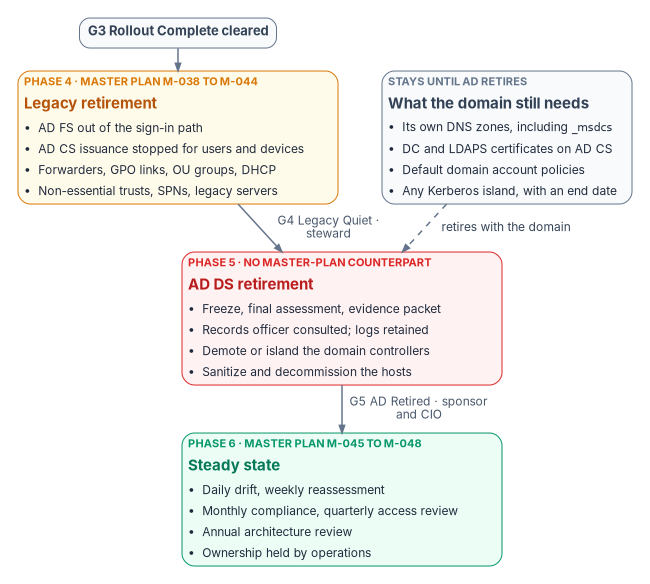
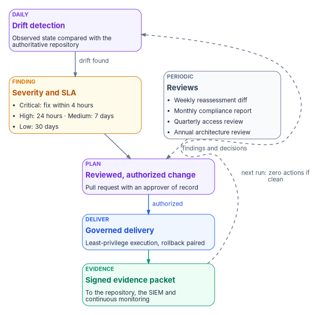

# Chapter 10 — Retirement, Steady State and Measuring Success

*Retire each legacy dependency only when the data shows nothing uses it, keep the way back open until the gate is green, and then measure the program by what it keeps true, not by what it switched off.*

::: {.callout-note}
## In this chapter
The program's last three phases in Book 01's terms: Phase 4 legacy retirement (where the master plan's cutover milestones land) and its gate G4, Phase 5 AD DS retirement (which the master plan doesn't reach) and its gate G5, and Phase 6 steady state. For each, what is done, what has to stay running until the domain itself retires, how to check it and how to back out. The chapter closes with the program scorecard: the charter's and the plan's success criteria, joined to the outcome measures that steady state keeps green.
:::

The program reaches this chapter when gate G3, Rollout Complete, has cleared: every division has passed its exit gate, every user PC is cloud-joined and every server Arc-connected or recorded as an exception ([Chapter 09](09-design-pilot-and-rollout.md)). From here on, the work changes character. The earlier phases built new things alongside old ones; these phases take old things away. That is where the program's rule that every change carries its own rollback matters most, because some of these steps have no cheap way back.

{#fig-ch10-retirement-to-steady-state fig-alt="A top-to-bottom flow. A slate pill, G3 Rollout Complete cleared, leads to an amber card: Phase 4, legacy retirement, master plan milestones M-038 to M-044. It lists AD FS out of the sign-in path; AD CS issuance stopped for users and devices; forwarders, GPO links, OU groups and DHCP; non-essential trusts, SPNs and legacy servers. Beside it a slate card, what the domain still needs, stays until AD retires: its own DNS zones including underscore msdcs, domain controller and LDAPS certificates on AD CS, the default domain account policies, and any Kerberos island with an end date. An arrow labeled G4 Legacy Quiet, steward, leads to a red card: Phase 5, AD DS retirement, no master-plan counterpart: freeze, final assessment and evidence packet; records officer consulted and logs retained; demote or island the domain controllers; sanitize and decommission the hosts. A dashed slate arrow from the stays-until card, labeled retires with the domain, also points to Phase 5. An arrow labeled G5 AD Retired, sponsor and CIO, leads to a green card: Phase 6, steady state, master plan milestones M-045 to M-048: daily drift and weekly reassessment, monthly compliance and quarterly access review, annual architecture review, ownership held by operations."}

## Where the master plan's last phases land

The master plan calls its last two phases Cutover (weeks 34 to 41) and Steady State (week 42 on). In Book 01's terms they are Phase 4 and Phase 6. The full mapping is in [Chapter 05](05-the-program-plan.md#mapping-the-master-plan-onto-the-gates); the part that matters here is short:

| Master plan | Milestones | Book 01 phase | Exit gate | Gate owner |
|---|---|---|---|---|
| 5 — Cutover | M-038 to M-044 | 4 — Legacy retirement | G4 — Legacy Quiet | Steward, with the executive sponsor as backup |
| No counterpart | — | 5 — AD DS retirement | G5 — AD Retired | Executive sponsor and CIO |
| 6 — Steady state | M-045 to M-048 | 6 — Steady state | — (runs indefinitely) | Program office, handing over to operations |

Gate owners are Book 01's ([Book 01, Chapter 09](../b01-transformation-arc/09-who-leads-the-transformation.md#decision-rights-across-the-program)). The master plan's cutover ends with Active Directory still running "for auth": its own validation checklist requires the AD service-location records to keep resolving. That is a sound place to stop a cutover, but it isn't the end of the modernization. Book 01 adds a Phase 5 to take AD DS itself out, or to reduce it to documented Kerberos islands with end dates, and this chapter covers it from Book 01 because the master plan doesn't.

## Phase 4 — Legacy retirement {#phase-4-legacy-retirement}

Phase 4 retires the legacy components the rollout has made redundant, each through its own plan with steward approval. The master plan opened its cutover phase by calling every action "irreversible," then listed a rollback for each, most of them reversible. The second statement is the accurate one, and it's the one the program runs on: an action is retired only while its rollback still works, and the rollback stays available until the next gate.

### The retirement actions

The master plan's seven cutover milestones can run in parallel after the last rollout wave, with the legacy server decommission waiting on three of them. Each is shown with the correction the published books make to it.

| Milestone | Action | Owner | What the program does differently |
|---|---|---|---|
| M-038 — AD FS out of the path (if present) | Convert federated domains to managed authentication; take the AD FS farm out of the sign-in path | Identity lead | Convert with the Microsoft Graph PowerShell cmdlets; conversion can take up to 60 minutes per domain.[^c10-fed-migrate] Before decommissioning, Microsoft says to test cloud authentication for at least a week and confirm with Connect Health and the sign-in logs that no relying party still uses the farm.[^c10-adfs-decom] Procedure: [Book 02, Chapter 10](../b02-identity/10-migrating-and-governing.md) and [Book 07, Chapter 07](../b07-pki/07-coexistence-and-migration.md) |
| M-039 — AD CS issuance stopped | Disable auto-enrollment and lock templates | PKI lead | Stop issuance for user and device templates that have moved to Cloud PKI; keep domain controller and LDAPS templates enrolling, because those certificates stay on AD CS until AD retires ([Book 07, Chapter 07](../b07-pki/07-coexistence-and-migration.md#what-stays-on-ad-cs-until-active-directory-retires)) |
| M-040 — DNS forwarders migrated | Hybrid forwarding through Azure DNS Private Resolver; remove on-premises forwarders | DNS lead | Remove forwarders only for zones that have moved; the AD domain's own zones, including `_msdcs`, stay on a DNS service that accepts secure dynamic registration from domain controllers and move last ([Book 08, Chapter 10](../b08-ddi/10-migration-sequence.md)) |
| M-041 — GPO links removed | Unlink GPOs from every OU; keep the objects for audit | Endpoint lead | Not every link can go while domain controllers run: domain controllers take their password, lockout and Kerberos policy only from a GPO linked at the domain root.[^c10-dc-gpo] What remains is the minimum set the running domain and any Kerberos island need |
| M-042 — Trusts reduced | Remove non-essential trusts per the trust decommission plan | Identity lead | Unchanged; each removal is a recorded plan with its recreation procedure |
| M-043 — Legacy servers decommissioned | NDES, secondary issuing CAs, secondary DNS servers | Infrastructure lead | An issuing CA retires only when its certificates have expired or been superseded, and its final CRL stays published for as long as any certificate it issued could still be validated.[^c10-ca-decom][^c10-crl] DNS servers that are also domain controllers wait for Phase 5 |
| M-044 — Cutover validation | All modernization plans at 100% in the repository; no legacy dependencies | Steward | Becomes the G4 evidence; "no legacy dependencies" is read as Book 01's G4 criteria below |

Book 01's G4 also covers three things the master plan's cutover leaves out: OU-based security groups superseded by dynamic groups, AD-authorized DHCP, and the service principal names still bound to AD, each migrated, retired or islanded application by application ([Book 01, Chapter 12](../b01-transformation-arc/12-migration-roadmap.md)). They belong to the same phase and the same evidence packet.

### The cutover validation checklist

The master plan's twenty-five-item checklist is the most useful single artifact for this phase, because each item names its check and its owner. It is kept here, with the items that would fail a correctly built estate corrected.

| # | Validation item | Method | Owner |
|---|---|---|---|
| 1 | Every user account synced to Entra ID with correct organizational attributes | Entra ID export compared with the identity modernization plan | Identity lead |
| 2 | No permanent Global Administrator assignments except the emergency access accounts | PIM role assignment report. Microsoft says emergency access accounts should hold Global Administrator as permanent active, not eligible, so "zero permanent assignments" as written would remove them[^c10-breakglass] | Identity lead |
| 3 | Every baseline Conditional Access policy enforced; any policy left in report-only mode has a recorded decision | Conditional Access policy status report | Security lead |
| 4 | Every user device enrolled in Intune and compliant | Intune compliance report (servers are covered by item 14, not by Intune) | Endpoint lead |
| 5 | No GPO linked to any OU beyond the minimum set the running domain needs | `Get-GPInheritance` for the domain root and every OU (the source named a `Get-GPLink` cmdlet, which doesn't exist)[^c10-gpinheritance] | Endpoint lead |
| 6 | No migrated device receiving GPO-delivered settings | `gpresult /r` on sample devices | Endpoint lead |
| 7 | Every user and device certificate issued by Cloud PKI | Intune certificate report; no AD CS issuance from migrated templates in the last 30 days | PKI lead |
| 8 | AD CS auto-enrollment disabled on every migrated template | Template audit with `certutil -template`; domain controller and LDAPS templates excepted | PKI lead |
| 9 | Every AD CS misconfiguration finding remediated or accepted with documentation | Security remediation plan: all items closed ([Book 07, Chapter 03](../b07-pki/03-hardening-what-stays.md)) | Security lead |
| 10 | CRL distribution points still reachable for existing certificates | `certutil -verify` against issued certificates | PKI lead |
| 11 | Name resolution working for every zone through the hybrid resolver | Resolution tests from every site | DNS lead |
| 12 | No conditional forwarders left on on-premises DNS for zones that have moved | DNS server configuration audit | DNS lead |
| 13 | AD service-location records still resolvable while AD runs | `nslookup -type=SRV _ldap._tcp.dc._msdcs.<domain>` | DNS lead |
| 14 | Every in-scope server Arc-connected | Arc inventory compared with the computer modernization plan | Infrastructure lead |
| 15 | Machine configuration (formerly Guest Configuration) compliant on every Arc server | Azure Policy compliance view[^c10-machine-config] | Infrastructure lead |
| 16 | Every trust marked for removal removed | Trust decommission plan: all non-essential trusts gone | Identity lead |
| 17 | AD FS farm out of the sign-in path (if present) | No federated domains remain; no AD FS sign-in activity | Identity lead |
| 18 | Service accounts migrated to group managed service accounts or workload identities, or documented as exceptions | Service account inventory | Identity lead |
| 19 | Drift detection running and producing weekly reports | Repository history shows weekly assessment diffs | Steward |
| 20 | Every planning document at its current, approved status | Repository status audit | Steward |
| 21 | Decommissioned servers removed from AD computer objects | Re-scan of the computer inventory | Infrastructure lead |
| 22 | Monitoring and alerting configured for every modernized service | Alert test for each workstream | All leads |
| 23 | Emergency access accounts tested and documented | Successful test sign-in; Microsoft's minimum is a validation at least every 90 days[^c10-breakglass] | Security lead |
| 24 | Operational runbooks drafted for steady state | Runbooks committed to the repository | All leads |
| 25 | Phase completion report committed | Gate review report in the repository | Project manager |

Item 5 is easy to script. The example below lists every container that still has a GPO linked directly to it. On a correctly retired estate the output is short and expected: the domain root with the default domain policy, the Domain Controllers OU with its default policy, and any OU that holds a Kerberos island.

::: {.callout-warning}
## Illustrative, not tested against a production forest
The script below is an illustrative read-only check. It hasn't been tested against a production forest. Review it before running it, and run it with an account that has only read access.
:::

```powershell
# List the domain root and every OU that still has a GPO linked directly to it.
Import-Module ActiveDirectory, GroupPolicy

$targets = @((Get-ADDomain).DistinguishedName) +
           (Get-ADOrganizationalUnit -Filter * |
                Select-Object -ExpandProperty DistinguishedName)

foreach ($target in $targets) {
    $links = (Get-GPInheritance -Target $target).GpoLinks
    if ($links) {
        [pscustomobject]@{
            Target     = $target
            LinkedGpos = ($links.DisplayName -join '; ')
        }
    }
}
```

### Rollback for each retirement action

| Action | Can it be undone? | How | Window |
|---|---|---|---|
| AD FS out of the path | Yes, while the farm is restorable | Re-federate the domain with `New-MgDomainFederationConfiguration` from the recorded configuration and restore the claim rules[^c10-fed-migrate] | The master plan allowed 72 hours, shorter than Microsoft's one-week observation before decommissioning. The program uses the windows in [Book 07, Chapter 07](../b07-pki/07-coexistence-and-migration.md) (30 days out of the path) and [Book 02, Chapter 10](../b02-identity/10-migrating-and-governing.md) (restorable for 90 days after decommission) |
| AD CS issuance stopped | Yes | Re-enable the templates and restart issuance; the CRL must stay valid | While the CA is online |
| DNS forwarders migrated | Yes | Recreate the on-premises forwarders; disable the resolver rules | Indefinite, but see the record-deletion warning in [Book 08, Chapter 10](../b08-ddi/10-migration-sequence.md) |
| GPO links removed | Yes | Re-link the retained GPO objects | Until the GPO objects are deleted |
| Trust removed | By recreation | Recreate the trust; needs administrative rights on both sides | Hours |
| Legacy server decommissioned | Only by rebuild | Restore from backup or rebuild from the documented procedure; the program plans 8 to 12 hours to restore a CA ([Book 07, Chapter 07](../b07-pki/07-coexistence-and-migration.md)) | The point of no easy return |

### Gate G4 — Legacy Quiet

The steward clears G4, with the executive sponsor as backup. The criteria are Book 01's, evaluated from the repository and the drift reports rather than by signature: no active GPOs beyond the minimum the running domain and any Kerberos island need; no AD security groups in active use; every DNS zone moved or retired except the AD domain's own; user and device certificate issuance off AD CS; every service principal name migrated, retired or islanded; and AD authentication volume below an agreed threshold ([Book 01, Chapter 12](../b01-transformation-arc/12-migration-roadmap.md)). The cutover checklist above is the evidence; the gate review records the decision in the repository, using the program's gate review template.

## Phase 5 — AD DS retirement {#phase-5-ad-ds-retirement}

Phase 5 is the shortest phase because the earlier ones did the work. Book 01 sets its steps: freeze AD changes and run a final assessment and evidence packet; demote the domain controllers that hold no operations master roles; transfer those roles to a survivor if a Kerberos island is kept; demote or isolate the rest, with the domain's DNS zones moving or retiring with them; then decommission the hosts, archive the final state and commit the retirement record ([Book 01, Chapter 12](../b01-transformation-arc/12-migration-roadmap.md)). Two facts from Book 01 shape the plan. Demoting the last domain controller in a domain removes the domain itself, and a backup can restore Active Directory only within the tombstone lifetime, so the archive is a records copy, not an indefinite rollback. The real rollback point is the last moment a domain controller still runs.

Two steps are easy to forget because no technical check fails without them:

- **Records before hardware.** Domain controllers, AD FS farms, sync servers and SIEM connectors hold years of access records with retention rules of their own. The program consults the agency records officer before any of them is decommissioned, and archives what the schedule requires first ([Book 01, Chapter 09](../b01-transformation-arc/09-who-leads-the-transformation.md#records-management-and-privacy)).
- **Sanitize what you retire.** Domain controllers store the password hashes of every account in the domain,[^c10-dc-hashes] so a retired domain controller's disks hold them until they're sanitized. The program sanitizes retired hosts and their storage under the agency's media sanitization procedure; NIST's current guidance is SP 800-88 Rev. 2, *Guidelines for Media Sanitization*, published in September 2025.[^c10-sp80088]

### Gate G5 — AD Retired

The executive sponsor and the CIO clear G5 together. The criteria: domain controllers decommissioned, or kept as a documented Kerberos island with an end-of-life date; the final evidence packet in the repository and the SIEM; no live production dependency on AD authentication. G5 is also where the last open item of the success scorecard closes: every residual risk documented, with an owner.

## Phase 6 — Steady state {#phase-6-steady-state}

Steady state has no exit gate. The master plan's objective for it holds: operate the modernized environment under continuous governance, with automated drift detection, scheduled reassessment and periodic access reviews, all tracked in the repository. Book 01 adds the finish line: zero drift findings, zero actions from the nightly plan run, signed evidence flowing to the SIEM and to continuous monitoring, and only routine tickets ([Book 01, Chapter 12](../b01-transformation-arc/12-migration-roadmap.md#cadence-and-finish-line)). That is the operating form of the continuous monitoring that SP 800-53 control CA-7 asks for: metrics, monitoring frequencies, ongoing assessment, analysis and response, and status reporting.[^c10-53]

{#fig-ch10-steady-state-loop fig-alt="A loop of five cards. A violet card, daily drift detection: observed state compared with the authoritative repository. An arrow labeled drift found leads to an amber card, finding with severity and SLA: Critical fixed within 4 hours, High 24 hours, Medium 7 days, Low 30 days. That leads to a violet card, plan: a reviewed, authorized change, a pull request with an approver of record. An arrow labeled authorized leads to a blue card, governed delivery: least-privilege execution with a paired rollback. That leads to a green card, signed evidence packet, sent to the repository, the SIEM and continuous monitoring. A dashed arrow from the evidence card back to drift detection is labeled next run: zero actions if clean. Beside the finding card, a slate card of periodic reviews (weekly reassessment diff, monthly compliance report, quarterly access review, annual architecture review) has a dashed arrow to the plan card labeled findings and decisions."}

### The operating cadence

| Operation | Cadence | How | Output |
|---|---|---|---|
| Reassessment | Weekly | The assessment runs on a schedule and commits its diff to the repository. While AD runs it reads the forest; afterward it reads the cloud surfaces (Entra ID, Intune, Arc, DNS and PKI) | A weekly delta in the repository |
| Drift detection | Daily | Current state compared with the approved plans | A tracked finding per drift, with an owner and a severity SLA |
| Compliance monitoring | Continuous | Intune compliance, Azure Policy and machine configuration compliance, Entra sign-in health | A monthly compliance report committed to the repository |
| Certificate lifecycle | Daily | Cloud PKI renewal monitoring; certificate-based authentication binding checks | Expiry alerts at 30, 14 and 7 days |
| DNS health | Continuous | Service-location record probes, resolver health checks, query analytics | Alert when the resolution failure rate exceeds 0.1% |
| Access reviews | Quarterly | Privileged role reviews, group attestation, application consent reviews | Review results committed to the repository |

Two licensing notes apply. Access reviews for member users now need Microsoft Entra ID Governance (or the Entra Suite), with some capabilities still running on Entra ID P2; PIM itself needs P2 or ID Governance.[^c10-access-reviews] And any surface the agency's cloud doesn't offer has to be planned around, not assumed ([Book 10, Chapter 04](../b10-cloud-boundary/04-gcc-and-the-feature-gap.md)).

The master plan made four of these into standing milestones, each committed to the repository when it runs:

| Milestone | Cadence | Owner |
|---|---|---|
| M-045 — Drift assessment | Weekly, automated | Automation, reviewed by the steward |
| M-046 — Compliance report | Monthly | Security lead |
| M-047 — Access review | Quarterly | Identity lead |
| M-048 — Architecture review | Annual | Steward |

### Drift remediation SLAs

Every finding gets a severity, and every severity a clock. These are the program's default values from the master plan; the agency sets its own, and they become part of its continuous monitoring strategy. (The engagement archetype in [Appendix B](appendix-b-engagement-archetype.md) uses a different set of tiers; the values matter less than having one set, written down and measured.)

| Severity | Detect within | Remediate within | Escalation |
|---|---|---|---|
| Critical | 1 hour | 4 hours | Steward and security lead notified immediately |
| High | 4 hours | 24 hours | Workstream lead notified within 4 hours |
| Medium | 24 hours | 7 days | Workstream lead notified within 24 hours |
| Low | 7 days | 30 days | Tracked as an issue; reviewed at the weekly status meeting |

### Handing over to operations

The project plan's last phase ends when two things are true: the charter's success criteria are met or explicitly deferred with a reason, and ownership of the authoritative source and of drift detection has passed from the project to steady-state operations. The handover is a decision like any other, recorded in the repository: who owns the repository and its branch protections, who owns each drift class, who answers each severity, and who runs the periodic reviews. Without that record, steady state decays into the implicit governance the program set out to remove. The ongoing evidence work belongs to the continuous monitoring project in the portfolio ([Chapter 06](06-the-project-portfolio.md)).

## Measuring success: the program scorecard

The charter and the project plan each list success criteria, and they overlap. The charter's are method measures, because the charter's scope is the method and leaves execution with the adopting organization; the plan's add execution. Read together, and joined to the steady-state outcomes above, they make one scorecard. Each measure says where its evidence lives and at which gate it should turn green, consistent with [Chapter 05](05-the-program-plan.md#how-success-is-measured).

### Delivery measures

| # | Measure | From | Evidence | Green by | Owner |
|---|---|---|---|---|---|
| 1 | A current-state assessment of the major governance surfaces and dependencies exists and is accepted | Charter; plan | The committed assessment and its approval record ([Chapter 08](08-pre-flight-and-assessment.md)) | G0 | Program office |
| 2 | The target attribute-driven structure and control-plane model is defined, agreed and understood by the domain leads | Charter; plan | Approved target architecture; each domain lead can explain how an organizational fact is expressed, how policy attaches to it and how drift is detected | G1 | Program office with platform teams |
| 3 | At least one domain has a complete playbook with gates and evidence expectations | Charter | The first wave's playbook in the repository | G2 Pilot Clean | Domain lead |
| 4 | The change-control pattern (origination, authorization, least-privilege execution, provenance closure) is defined and in use | Charter | The plan, review and delivery pipeline ([Book 01, Chapter 11](../b01-transformation-arc/11-analysis-plan-delivery.md)) | G1 | Program office |
| 5 | The first wave has run with full provenance and evidence | Plan | Pilot evidence packets | G2 | Steward |
| 6 | Drift classes and the detection approach are specified, then operational for every domain in scope | Charter; plan | Drift taxonomy; daily detection results | Specified by G1; operational by G2 and G3 | Program office |
| 7 | Residual risks are documented and each has an owner | Plan | The risk register ([Appendix A](appendix-a-risk-register-and-traceability.md)) | Checked at every gate; closed at G5 | Project manager; the authorizing official accepts residual risk |
| 8 | Leadership can describe the modernization path, its major risks and how success is measured, without citing internal decision records | Charter; plan | A sponsor briefing given without document numbers | G0, then monthly | Executive sponsor |

### Outcome measures

These are the program's own design measures, read from the repository and the drift reports. They are what the steady state keeps green.

| Measure | Target at steady state | Source |
|---|---|---|
| Open drift findings past their SLA | Zero; trend reported monthly by severity | Drift reports |
| Nightly plan runs with zero actions | The normal case; any action traces to an authorized change | Plan run logs |
| AD authentication volume | Below the agreed G4 threshold, then zero or confined to dated Kerberos islands | Domain controller logs, then none |
| Evidence packets | Every delivery emits one; every packet signed and forwarded to the SIEM | Repository and SIEM |
| Access reviews | Completed on schedule, with decisions applied | Review results in the repository |
| Certificate expiries | None missed; every alert answered before the 7-day mark | Cloud PKI monitoring |
| Gate decisions | Every criterion evaluated from data; every decision recorded with its maker | Gate review records |
| Ownership | Every drift class, severity and periodic review has a named operational owner | Handover record |

A program can meet every delivery measure and still fail if the outcome measures drift after the project team leaves. That is why the handover is part of the scorecard, not an afterthought, and why the architecture review is annual and owned by the steward.

## Key takeaways

1. The master plan's cutover is Book 01's Phase 4 and gate G4; AD DS retirement (Phase 5, G5) is the step the master plan didn't take, and the program does.
2. Retire only what the data shows is unused, and keep each rollback working until the next gate. The domain's own DNS zones, domain controller certificates and default account policies stay until the domain retires.
3. Before any domain controller goes, retain its records and plan to sanitize its storage.
4. Steady state is a loop: drift becomes a finding with an SLA, the finding an authorized plan, the plan evidence. The agency sets the SLA values; the program sets that there are some.
5. Measure success twice: delivery measures that turn green gate by gate, and outcome measures that operations keeps green after the project ends.

::: {.callout-tip}
## Continue the book
[← Previous: Chapter 09 — Design, Pilot and Rollout](09-design-pilot-and-rollout.md) · [Book index](index.md) · [Next: Appendix A — Risk Register and Control Traceability →](appendix-a-risk-register-and-traceability.md)
:::

[^c10-fed-migrate]: Microsoft Learn, "Migrate from federation to cloud authentication" (plan the maintenance window: conversion may take up to 60 minutes; plan for rollback with `New-MgDomainFederationConfiguration`; convert with `Update-MgDomain -AuthenticationType "Managed"`), <https://learn.microsoft.com/entra/identity/hybrid/connect/migrate-from-federation-to-cloud-authentication> (accessed Oct 21, 2026).
[^c10-adfs-decom]: Microsoft Learn, "Active Directory Federation Services (AD FS) decommission guide" (run Connect Health for at least one week; test cloud authentication for at least one week before decommissioning), <https://learn.microsoft.com/windows-server/identity/ad-fs/decommission/adfs-decommission-guide> (accessed Oct 21, 2026).
[^c10-dc-gpo]: Microsoft Learn, "Group Policy application rules for domain controllers" (account policies, including password, lockout and Kerberos policy, apply to domain controllers only from a GPO linked to the domain container), <https://learn.microsoft.com/troubleshoot/windows-server/active-directory/group-policy-application-rules-for-domain-controller> (accessed Oct 21, 2026).
[^c10-ca-decom]: Microsoft Learn, "How to decommission a Windows enterprise certification authority and remove all related objects" (the CRL's lifetime should be longer than the remaining lifetime of revoked certificates; AIA and CDP objects are retained while issued certificates are outstanding), <https://learn.microsoft.com/troubleshoot/windows-server/certificates-and-public-key-infrastructure-pki/decommission-enterprise-certification-authority-and-remove-objects> (accessed Oct 21, 2026).
[^c10-crl]: Microsoft Learn, "Operate certificate revocation, CRL publication, and CDP changes in AD CS" (keep a CDP endpoint and current CRL content available until no unexpired certificate or CA certificate in scope references it), <https://learn.microsoft.com/windows-server/identity/ad-cs/operate-certificate-revocation-crl-cdp> (accessed Oct 21, 2026).
[^c10-breakglass]: Microsoft Learn, "Manage emergency access accounts in Microsoft Entra ID," Configuration requirements and Security guardrails summary (Global Administrator assigned as permanent active, not eligible; validate at least every 90 days), <https://learn.microsoft.com/entra/identity/role-based-access-control/security-emergency-access> (accessed Oct 21, 2026).
[^c10-gpinheritance]: Microsoft Learn, "Get-GPInheritance" (GroupPolicy module; the `GpoLinks` property lists the GPOs linked directly to a domain or OU), <https://learn.microsoft.com/powershell/module/grouppolicy/get-gpinheritance> (accessed Oct 21, 2026).
[^c10-machine-config]: Microsoft Learn, "Cloud-native governance and policy with Azure Arc-enabled servers," Azure machine configuration ("previously called Azure Policy Guest Configuration"), <https://learn.microsoft.com/azure/azure-arc/servers/cloud-native/governance-policy> (accessed Oct 21, 2026).
[^c10-sp80088]: NIST, SP 800-88 Rev. 2, *Guidelines for Media Sanitization*, September 2025 (supersedes Rev. 1, December 2014), <https://csrc.nist.gov/pubs/sp/800/88/r2/final> (accessed Oct 21, 2026).
[^c10-53]: NIST, SP 800-53 Rev. 5, *Security and Privacy Controls for Information Systems and Organizations*, release 5.2.0 (August 27, 2025), control CA-7, Continuous Monitoring, <https://csrc.nist.gov/pubs/sp/800/53/r5/upd1/final>; control text read from NIST's OSCAL Rev. 5 catalog, <https://github.com/usnistgov/oscal-content/tree/main/nist.gov/SP800-53/rev5> (both accessed Oct 21, 2026).
[^c10-access-reviews]: Microsoft Learn, "What are access reviews?," License requirements, <https://learn.microsoft.com/entra/id-governance/access-reviews-overview>, and "Microsoft Entra ID Governance licensing fundamentals," Privileged Identity Management, <https://learn.microsoft.com/entra/id-governance/licensing-fundamentals> (both accessed Oct 21, 2026).
[^c10-dc-hashes]: Microsoft Learn, "Active Directory accounts," Secure and manage domain controllers ("domain controllers store credential password hashes of all accounts in the domain"), <https://learn.microsoft.com/windows-server/identity/ad-ds/manage/understand-default-user-accounts> (accessed Oct 21, 2026).
