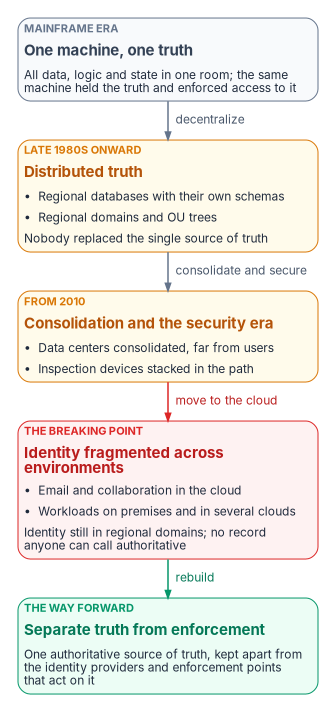
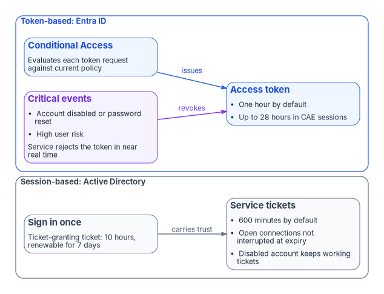
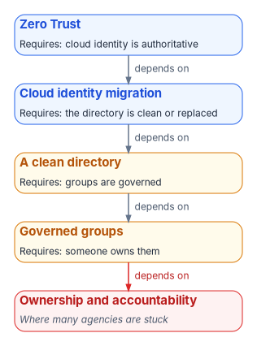

# Chapter 01 — Why Modernization Is Hard

*Every new mandate assumes a foundation the estate never built, so "just move it to the cloud" turns into a governance rebuild.*

::: {.callout-note}
## In this chapter
How federal IT moved from one mainframe holding one truth to a dozen regional directories and three clouds, and why nobody replaced the single source of truth along the way. What the shift from sessions to tokens really changes, and what distance does and doesn't cost. Why Active Directory carries risk nobody owns, why each modernization step waits on the one before it, and the five prerequisites the rest of the workbook turns into work. No technical background is needed; the later chapters and books carry the detail.
:::

This chapter is for agency leadership, IT managers, budget committees and anyone who has sat in a meeting wondering why "just move it to the cloud" keeps turning into a multi-year effort. It makes the argument. [Chapter 02](02-the-problem.md) states the problem precisely, and the rest of the book, with Books 02 to 09 behind it, turns the argument into work.

{#fig-ch01-four-eras fig-alt="A vertical sequence of five cards. The first, slate, is the mainframe era: one machine holds all the data and also enforces access, so there is one source of truth and the room is the perimeter. An arrow labeled decentralize leads to the second, amber, the distributed era: regional databases and regional directories, each with its own schema and rules, so truth is distributed. An arrow labeled consolidate and secure leads to the third, amber, the security era: data centers consolidated and inspection devices stacked in the path, far from the users. An arrow labeled move to the cloud leads to the fourth, red, the breaking point: email and collaboration in the cloud, workloads in several environments, identity still in regional domains, and no record anyone can call authoritative. An arrow labeled rebuild leads to the fifth, green, the way forward: an authoritative source of truth kept separate from the identity providers and enforcement points that act on it."}

## How the estate got here

Federal IT reached its current shape in four eras. Each one solved a real problem. None of them replaced the thing the first era had and every later era lost: one authoritative answer.

### One machine, one truth

For decades an agency's operation ran on a mainframe. One large computer in a locked room held all the data, all the logic and all the state. Users had terminals that sent keystrokes and received screens. When someone asked how many people a program served this month, there was one answer, and it came from one place.

Security was largely physical. If you weren't at a terminal wired to that room, you couldn't reach anything, so the network was the perimeter. And the machine that held the truth was the same machine that enforced access to it. Truth and enforcement lived in one box. That detail matters later, because the modern architecture has to pull them apart deliberately.

### Distributed systems, distributed truth

By the late 1980s the economics had changed. Minicomputers, then PCs and faster networks, made it practical to put a database server in every region and applications in every office, and to let local teams build for local problems they understood better than headquarters did. The vision was good, and much of it worked.

The cost was **distributed truth**. One database became a dozen. Regional systems grew their own schemas, their own business rules and sometimes their own definitions of the same term. Regional directories followed the same pattern: offices built their own domains and their own organizational structures. Nobody replaced the single source of truth the mainframe had provided, and variations that looked like flexibility in the 1990s hardened into incompatible silos.

### Consolidation and the security era

From 2010 the direction reversed. OMB launched the Federal Data Center Consolidation Initiative in February 2010, noting that the reported number of federal data centers had grown from 432 in 1998 to more than 1,100 in 2009,[^c01-fdcci] and the December 2010 IT reform plan set a target of closing at least 800 data centers by 2015 alongside a "Cloud First" policy.[^c01-25pt] Regional offices that had their own servers were connected back to central facilities, sometimes hundreds or thousands of miles away. The directory stayed, but it was now far from many of the people who used it.

At the same time cybersecurity became a leadership priority, and agencies added protection layer by layer: firewalls, network address translation, intrusion detection, inspecting proxies and data-loss tools, many of them inline. Each solved a real problem. Most were designed for a world where users, servers and the network path were local and long-lived, and every one of them sat between a field office and the systems it depended on.

### The breaking point

Then email, documents and meetings moved to Microsoft 365, and workloads spread across an on-premises virtualization estate and one or more commercial clouds, with the government-wide HR platform the next boundary to arrive ([Book 03, Chapter 03](../b03-hr-identity/03-federal-hr-2-0.md)). Identity, in many agencies, still lives in regional Active Directory domains and OU trees designed for the era when compute sat in each region.

The result is the situation many agencies now recognize. The same person can appear as several records across the directory, the cloud tenant, a cloud provider's identity service and the HR system, and no one can say which record is authoritative. The infrastructure can *do* things across those boundaries but can't *verify* them. The fragmentation that once made regional systems agile has become the place where errors hide: duplicate records, accounts that should have been closed years ago, and reconciliations nobody can complete. Book 03 traces how this fragmentation produces orphaned accounts ([Book 03, Chapter 02](../b03-hr-identity/02-why-hr-is-the-source-of-authority.md)).

The workbook's position is that this is an architecture gap, not a technology gap. Commercial sectors made most of these transitions earlier and without the federal mandates that now govern them; the path is known, and the delay has a cost.

## The session problem

**The old world ran on long-lived sessions. The new world decides each request against current policy.**

In Active Directory a user proves who they are once, at sign-in, and receives a Kerberos ticket-granting ticket. By default that ticket lasts 10 hours and can be renewed for 7 days,[^c01-maxticket][^c01-maxrenew] and the service tickets it obtains last 600 minutes.[^c01-svcticket] A service ticket authenticates new connections only; a connection that is already open isn't interrupted when its ticket expires, and an account disabled during the day can keep reaching services with tickets issued before it was disabled.[^c01-svcticket] Much of traditional IT works this way, like a phone call: identity is established at the start and carried until someone hangs up.

Zero Trust, the strategy OMB M-22-09 directs agencies to adopt, works differently.[^c01-m2209] NIST SP 800-207 grants no implicit trust based on network location, grants access to each resource per session, and decides it by dynamic policy.[^c01-sp800207] In Microsoft Entra ID that shows up as tokens checked against Conditional Access. An access token is valid for one hour by default. With continuous access evaluation, supporting services can instead hold longer-lived tokens of up to 28 hours, because they subscribe to critical events such as an account being disabled, a password reset or high user risk, and stop honoring the token in near real time; Microsoft notes that event propagation can take up to 15 minutes.[^c01-cae] The better analogy isn't a stream of text messages that each re-prove identity. It's a badge checked at every door against a central list that can revoke it.

{#fig-ch01-session-vs-token fig-alt="Two side-by-side panels. The slate panel, session-based Active Directory, shows a user signing in once to a domain controller, receiving a ticket-granting ticket valid 10 hours and renewable for 7 days, and using service tickets valid 600 minutes; a note says open connections aren't interrupted when a ticket expires and a disabled account keeps working tickets until they lapse. The blue panel, token-based Entra ID, shows Conditional Access evaluating each token request against policy and issuing a one-hour access token, or up to 28 hours in continuous access evaluation sessions; a violet card shows critical events such as account disabled, password reset or high user risk causing the service to reject the token in near real time."}

**Why this matters.** When frequent re-evaluation and inline inspection are placed in front of applications built for long-lived sessions, those applications can see broken connections and users see failures that are hard to diagnose. That is a common pattern, not a universal one, and it is why the book treats compute and the access plane together ([Chapter 07](07-compute-transformation.md) and [Chapter 08](08-access-plane.md)).

## What distance does and doesn't cost

The argument above is often overstated in ways that weaken it. Two corrections make it stronger.

First, Kerberos tickets aren't broken by network address translation or by a changed source address. RFC 4120 makes client addresses in a ticket optional, says a ticket without addresses can be used from any location, and recommends that policy allow such tickets because of NAT; where addresses are present, the check belongs to the application server, which returns `KRB_AP_ERR_BADADDR`.[^c01-rfc4120] Windows doesn't put client addresses in tickets by default: the `ClientIpAddresses` setting is 0, and Microsoft attributes that default to DHCP and NAT.[^c01-kdc-keys] Nor is there a millisecond latency budget. The five-minute figure that circulates is clock-skew tolerance (`SkewTime`), and the Windows client waits 10 seconds for a KDC reply and retries three times.[^c01-kdc-keys]

Second, what distance does cost is narrower and real: the operations that need a domain controller. Microsoft states that hybrid joined devices need line of sight to a domain controller for initial sign-in and password changes, and that without it users may be blocked from signing in and may not receive policy updates.[^c01-join-types] Those devices also need periodic line of sight afterward; Microsoft lists device password change, user password change with cached credentials and TPM reset as scenarios that break without it.[^c01-hybrid-plan] Stack enough inline inspection and distance in front of those operations and sign-in crawls, policy processing stalls and password changes fail, without a single ticket being invalidated.

::: {.callout-important}
## The physics that can't be negotiated
Light in optical fiber covers about 5 microseconds per kilometer, the planning value in ITU-T Recommendation G.114.[^c01-g114] Portland, Oregon, to Washington, D.C., is about 3,780 km on a great circle. Assume real fiber routes run about 20% longer, roughly 4,530 km, and the propagation floor is about 23 ms one way and 45 ms round trip, before any queueing, inspection or application processing. Bandwidth doesn't change that number; bandwidth is volume, latency is distance. [Book 09](../b09-network/index.md) develops the physics, the transport options and the protocols that genuinely need a domain controller on a re-routed path ([Book 09, Chapter 01](../b09-network/01-why-physics-decides-the-architecture.md); [Book 09, Chapter 06](../b09-network/06-legacy-protocols-on-re-routed-paths.md)).
:::

The durable answer to the domain controller dependency is to remove it. Microsoft's own guidance, where line of sight is a concern, is to Microsoft Entra join devices instead,[^c01-hybrid-concept] and the workbook treats hybrid join as a waypoint, not the end state ([Book 05, Chapter 02](../b05-devices/02-the-hybrid-join-trap.md)).

## The directory problem nobody talks about

Meanwhile Active Directory, the address book everything depends on, has accumulated risk. In many agencies:

- **It was never set up cleanly.** Regional offices built their own structures, and naming and policy grew to solve immediate problems.
- **Consolidation stacked structures rather than rationalizing them.**
- **Nobody owns it.** Everyone depends on it, nobody champions it, and symptoms get fixed while causes stay.
- **Groups became hard to govern.** Nested groups created by people who left years ago grant access nobody remembers approving: a group whose owner left in 2018, nested in a group that also contains a group of unknown purpose, can be the path to a critical system.

Microsoft hasn't retired Active Directory. It states that it continues to support and enhance Windows Server Active Directory for on-premises identity,[^c01-new-name] and Windows Server 2025 introduced new forest and domain functional levels.[^c01-ws2025] But Microsoft's guidance now points toward a cloud-first model in which Entra ID is where identity is managed and Active Directory is minimized, moved there in phases rather than in one cutover,[^c01-soa] and it describes the journey as five states, from cloud attached to 100% cloud, that typically take large organizations several years.[^c01-road-posture] Federal policy points the same way: M-22-09 requires centralized identity management for agency users and phishing-resistant multifactor authentication for staff, contractors and partners.[^c01-m2209] [Book 02, Chapter 01](../b02-identity/01-why-identity-matters.md) sets out exactly what is doing the forcing.

Entra ID suits cloud applications better, but it has no OU tree. The delegation and policy targeting that Active Directory's tree encoded, however imperfectly, have to be rebuilt deliberately ([Chapter 02](02-the-problem.md); [Book 02, Chapter 05](../b02-identity/05-delegation-without-ous.md)). Agencies with a well-governed directory will find the transition demanding; agencies without one will find it much harder. Microsoft makes the same point about ownership: it says the transformation isn't only the identity team's responsibility and names device, network, security, application, HR, procurement and operations teams that have to take part.[^c01-road-posture]

## The cascade: each fix assumes the last one is done

This is why modernization stalls. Each step assumes the previous one is finished.

{#fig-ch01-cascade fig-alt="A vertical chain of five cards, each pointing down to the one it requires. The top card, blue, is Zero Trust, which requires cloud identity to be authoritative. The second, blue, is cloud identity migration, which requires the directory to be clean or replaced. The third, amber, is a clean directory, which requires governed groups. The fourth, amber, is governed groups, which require an owner. The bottom card, red, is ownership and accountability, labeled where many agencies are stuck."}

Mandates arrive with dates attached. M-22-09 set Zero Trust goals for the end of fiscal year 2024.[^c01-m2209] BOD 25-01 required agencies to implement CISA's mandatory secure configuration baselines for Microsoft 365 cloud tenants by June 20, 2025, and to assess and report against them continuously.[^c01-bod2501] M-26-14, issued May 22, 2026, rescinded M-21-31 and reset the logging expectations agencies must meet.[^c01-m2614] Each of those mandates assumes foundations that many agencies never built.

## What has to be true

The workbook reads federal Zero Trust guidance as requiring five things before the target state can hold. They aren't a list any single document publishes; they are the program's synthesis of NIST SP 800-207, M-22-09, CISA's Zero Trust Maturity Model and M-26-14.

| # | What must exist | Why it matters | Where federal guidance points |
|---|---|---|---|
| 1 | **A single authoritative source of identity** | Every user, device and service account needs exactly one authoritative record | M-22-09's centralized, agency-managed identity systems[^c01-m2209] |
| 2 | **A governed directory before migration** | Groups, permissions and ownership should be rationalized before moving to a flat cloud directory, not after | The ZTMM Identity pillar, where identity is a set of attributes that must be accurate[^c01-ztmm] |
| 3 | **Continuous verification, not one-time sign-in** | Access is re-evaluated as conditions change, not only at the start of a session | SP 800-207's per-session, dynamic-policy access[^c01-sp800207] |
| 4 | **Telemetry used for management, not just stored** | Sign-in and access events feed back into governance, not only incident response | The ZTMM's Visibility and Analytics capability and M-26-14's continuous event monitoring[^c01-ztmm][^c01-m2614] |
| 5 | **Governance that runs automatically** | Manual review alone can't keep up with a hybrid estate; checks need to run continuously | The ZTMM's Automation and Orchestration and Governance capabilities[^c01-ztmm] |

The CISA model organizes Zero Trust into five pillars (Identity, Devices, Networks, Applications and Workloads, and Data) and three cross-cutting capabilities (Visibility and Analytics, Automation and Orchestration, and Governance), with four maturity stages from Traditional to Optimal.[^c01-ztmm] Prerequisites 4 and 5 are the cross-cutting capabilities in operational form.

## What the book does about it

The chapters that follow turn each prerequisite into specific work, and each points to the book that carries the depth.

| Prerequisite | What the program does | Book 01 chapters | Depth |
|---|---|---|---|
| 1. Single authoritative identity | Makes the HR system and Entra ID the source of identity and access data, and retires Active Directory as the source of authority | [04](04-identity-transformation.md), [12](12-migration-roadmap.md) | [Book 02](../b02-identity/index.md), [Book 03](../b03-hr-identity/index.md) |
| 2. Governed directory first | Runs a read-only inventory of the whole Active Directory estate across eleven dependency categories, then rationalizes before anything moves | [02](02-the-problem.md), [10](10-analyzing-the-estate.md) | [Book 02, Chapter 07](../b02-identity/07-read-only-discovery.md) |
| 3. Continuous verification | Replaces network location with Conditional Access, device compliance, phishing-resistant MFA and continuous access evaluation | [05](05-policy-transformation.md), [08](08-access-plane.md) | [Book 04](../b04-access/index.md), [Book 05](../b05-devices/index.md) |
| 4. Telemetry for management | Compares the live tenant against the intended state every night and opens a tracked item for every difference | [11](11-analysis-plan-delivery.md), [12](12-migration-roadmap.md) | [Book 03, Chapter 11](../b03-hr-identity/11-drift-metrics-and-evidence.md) |
| 5. Governance that runs automatically | Delivers every change as a reviewed, signed plan with a rollback and an evidence record | [03](03-platform-foundation.md), [11](11-analysis-plan-delivery.md) | [Book 04, Chapter 10](../b04-access/10-access-as-code-and-evidence.md) |

For budget readers, the cost drivers are licensing, a small platform build ([Chapter 03](03-platform-foundation.md)) and, above all, staff time for the inventory and rollout, phased as in [Chapter 12](12-migration-roadmap.md). Licensing is mostly tiers the agency may already hold: features such as dynamic membership groups require Microsoft Entra ID P1, governance features sit in Microsoft Entra ID Governance, and device management needs Intune.[^c01-licensing] [Chapter 09](09-who-leads-the-transformation.md) sets out who leads, decides and does the work, and the questions a sponsor should ask each month.

## The bottom line

The technology exists. Modernization is hard because **each new requirement assumes a foundation that was never built.** Zero Trust assumes governed identity, governed identity assumes a clean directory, and a clean directory assumes someone owns it.

So start with the foundation, not the mandate: *what do we actually know about our own identity environment, right now, with certainty?* [Chapter 02](02-the-problem.md) begins there.

::: {.callout-tip}
## Continue the book
[← Previous: Book index](index.md) · [Next: Chapter 02 — The Problem: Governance Hidden in the Directory →](02-the-problem.md)
:::

[^c01-fdcci]: Office of Management and Budget, Vivek Kundra, Federal Chief Information Officer, memorandum *Federal Data Center Consolidation Initiative*, February 26, 2010, <https://trumpwhitehouse.archives.gov/sites/whitehouse.gov/files/omb/assets/egov_docs/federal_data_center_consolidation_initiative_02-26-2010.pdf> (accessed Oct 21, 2026).
[^c01-25pt]: Vivek Kundra, U.S. Chief Information Officer, *25 Point Implementation Plan to Reform Federal Information Technology Management*, December 9, 2010 (items 1 and 3: consolidate at least 800 data centers by 2015; shift to a "Cloud First" policy), <https://trumpwhitehouse.archives.gov/sites/whitehouse.gov/files/omb/assets/egov_docs/25-point-implementation-plan-to-reform-federal-it.pdf> (accessed Oct 21, 2026).
[^c01-maxticket]: Microsoft Learn, "Max-Ticket-Age attribute" (10 hours in the Default Domain Policy), <https://learn.microsoft.com/windows/win32/adschema/a-maxticketage> (accessed Oct 21, 2026).
[^c01-maxrenew]: Microsoft Learn, "Max-Renew-Age attribute" (7 days in the Default Domain Policy), <https://learn.microsoft.com/windows/win32/adschema/a-maxrenewage> (accessed Oct 21, 2026).
[^c01-svcticket]: Microsoft Learn, "Maximum lifetime for service ticket" (Default Domain Policy 600 minutes; tickets authenticate only new connections; disabled accounts can keep using tickets issued earlier), <https://learn.microsoft.com/en-us/previous-versions/windows/it-pro/windows-10/security/threat-protection/security-policy-settings/maximum-lifetime-for-service-ticket> (accessed Oct 21, 2026).
[^c01-m2209]: Office of Management and Budget, M-22-09, *Moving the U.S. Government Toward Zero Trust Cybersecurity Principles*, January 26, 2022 (goals by the end of FY2024; centralized identity management; phishing-resistant MFA for staff, contractors and partners), <https://www.whitehouse.gov/wp-content/uploads/2022/01/M-22-09.pdf> (accessed Oct 21, 2026).
[^c01-sp800207]: National Institute of Standards and Technology, SP 800-207, *Zero Trust Architecture*, August 2020, <https://csrc.nist.gov/pubs/sp/800/207/final> (accessed Oct 21, 2026).
[^c01-cae]: Microsoft Learn, "Continuous access evaluation" (one-hour default access token; up to 28 hours in CAE sessions; critical events; up to 15 minutes event propagation), <https://learn.microsoft.com/en-us/entra/identity/conditional-access/concept-continuous-access-evaluation> (accessed Oct 21, 2026).
[^c01-rfc4120]: C. Neuman, T. Yu, S. Hartman and K. Raeburn, RFC 4120, *The Kerberos Network Authentication Service (V5)*, July 2005, sections 3.2.3 (`KRB_AP_ERR_BADADDR`) and 5.3 (`caddr` optional; addressless tickets usable from any location and recommended because of NAT), <https://www.rfc-editor.org/rfc/rfc4120.txt> (accessed Oct 21, 2026).
[^c01-kdc-keys]: Microsoft Learn, "Kerberos protocol registry entries and KDC configuration keys in Windows" (`ClientIpAddresses` default 0 because of DHCP and NAT; `SkewTime` 5 minutes; `KdcWaitTime` 10 seconds; `KdcSendRetries` 3), <https://learn.microsoft.com/troubleshoot/windows-server/windows-security/kerberos-protocol-registry-kdc-configuration-keys> (accessed Oct 21, 2026).
[^c01-hybrid-plan]: Microsoft Learn, "Plan your Microsoft Entra hybrid join implementation," Prerequisites (periodic line of sight to domain controllers; device password change, user password change with cached credentials and TPM reset break without it), <https://learn.microsoft.com/entra/identity/devices/hybrid-join-plan> (accessed Oct 21, 2026).
[^c01-join-types]: Microsoft Learn, "Microsoft Entra joined vs. Hybrid Microsoft Entra joined in cloud-native endpoints" (hybrid joined endpoints need line of sight to a domain controller for initial sign-in, password change and policy updates), <https://learn.microsoft.com/intune/solutions/cloud-native-endpoints/entra-join-types> (accessed Oct 21, 2026).
[^c01-g114]: International Telecommunication Union, Recommendation ITU-T G.114 (05/2003), *One-way transmission time*, Table A.1 (optical fibre cable system, 5 µs/km), <https://www.itu.int/rec/T-REC-G.114-200305-I/en> (accessed Oct 21, 2026). The great-circle distance is computed from city-center coordinates; the 20% route allowance is an assumption.
[^c01-hybrid-concept]: Microsoft Learn, "Microsoft Entra hybrid joined devices" (periodic line of sight required; consider Microsoft Entra join if that is a concern), <https://learn.microsoft.com/entra/identity/devices/concept-hybrid-join> (accessed Oct 21, 2026).
[^c01-new-name]: Microsoft Learn, "New name for Azure Active Directory" (FAQ: "Does Microsoft still support on-premises identity management?"), <https://learn.microsoft.com/entra/fundamentals/new-name> (accessed Oct 21, 2026).
[^c01-ws2025]: Microsoft Learn, "What's new in Windows Server 2025," Active Directory Domain Services (new forest and domain functional levels), <https://learn.microsoft.com/windows-server/get-started/whats-new-windows-server-2025> (accessed Oct 21, 2026).
[^c01-soa]: Microsoft Learn, "Microsoft Entra cloud-first identity guidance for IT architects" (hybrid to cloud-first and AD-minimized states; phased source-of-authority transfer instead of a big-bang cutover), <https://learn.microsoft.com/en-us/entra/identity/hybrid/guidance-it-architects-source-of-authority> (accessed Oct 21, 2026).
[^c01-road-posture]: Microsoft Learn, "Cloud transformation posture" (five states; typically a multi-year effort; transformation isn't only the identity team's responsibility), <https://learn.microsoft.com/entra/architecture/road-to-the-cloud-posture> (accessed Oct 21, 2026).
[^c01-bod2501]: Cybersecurity and Infrastructure Security Agency, BOD 25-01, *Implementing Secure Practices for Cloud Services*, December 17, 2024, <https://www.cisa.gov/news-events/directives/bod-25-01-implementing-secure-practices-cloud-services> (accessed Oct 21, 2026).
[^c01-m2614]: Office of Management and Budget, M-26-14, *Ensuring Effective and Efficient Agency Logging and Network Visibility to Defend Against Evolving Cyber Threats*, May 22, 2026 (rescinds M-21-31; prioritizes continuous event monitoring and threat hunting, investigation, response and forensics), <https://www.whitehouse.gov/wp-content/uploads/2026/05/M-26-14-Ensuring-Effective-and-Efficient-Agency-Logging-and-Network-Visibility-to-Defend-Against-Evolving-Cyber-Threats.pdf> (accessed Oct 21, 2026).
[^c01-ztmm]: Cybersecurity and Infrastructure Security Agency, *Zero Trust Maturity Model*, Version 2.0, April 2023 (five pillars; three cross-cutting capabilities; four maturity stages), <https://www.cisa.gov/sites/default/files/2023-04/CISA_Zero_Trust_Maturity_Model_Version_2_508c.pdf> (accessed Oct 21, 2026).
[^c01-licensing]: Microsoft Learn, "Microsoft Entra licensing," <https://learn.microsoft.com/entra/fundamentals/licensing> (accessed Oct 21, 2026); Microsoft Learn, "Manage rules for dynamic membership groups in Microsoft Entra ID" (P1 license requirement), <https://learn.microsoft.com/entra/identity/users/groups-dynamic-membership> (accessed Oct 21, 2026).
