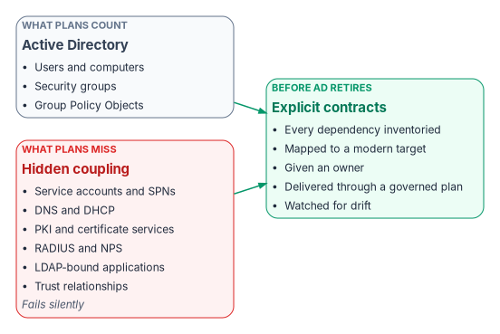
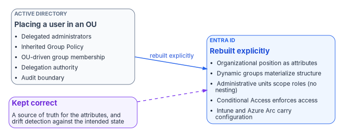
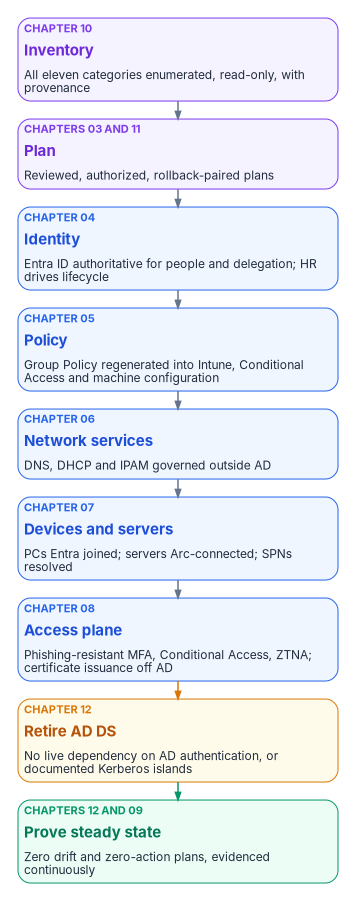

# Chapter 02 — The Problem: Governance Hidden in the Directory

*Active Directory was never just an identity store; it was the governance model nobody wrote down, and retiring it without rebuilding that model breaks things quietly.*

::: {.callout-note}
## In this chapter
How Active Directory became the implicit governance model for every Windows-era service, and the eleven categories of object it governs that most migration plans never count. Why the OU tree was a delegation and policy engine, not a folder system, and what has to replace it. Why naive migrations fail, what the Federal Modernization Program provides, and the dependency chain, from inventory to proven steady state, that orders the rest of the book. [Chapter 01](01-why-modernization-is-hard.md) makes the plain-language case; this chapter takes it as given.
:::

## The thesis

Active Directory was the **implicit governance model** for every network service an organization ran. Teams that treat "AD to Entra ID" as a users-and-groups project retire the directory and silently break the governance, and most of the failures take months to surface. This book is about avoiding that.

{#fig-ch02-silent-dependencies fig-alt="Left to right. A slate card, Active Directory, lists the visible objects most plans count: users, computers, security groups and Group Policy Objects. Below it a red card, hidden coupling, lists what plans miss: service accounts and SPNs, DNS and DHCP, PKI and certificate services, RADIUS and NPS, LDAP-bound applications and trust relationships, with a note that these fail silently. Both arrows lead to a green card, explicit contracts: every dependency inventoried, mapped to a modern target, given an owner, delivered through a governed plan and watched for drift."}

## What shipped with Windows 2000

Active Directory shipped with Windows 2000 as an identity directory: a replicated directory database, with Kerberos as the default authentication protocol, replacing Windows NT domains.[^c02-ws2025][^c02-kerberos-default] That description was true but incomplete. Over the following twenty-five years every Windows-era infrastructure service wired itself into Active Directory, not by grand design but because it was the only enterprise-wide, governed, authenticated, replicated namespace available. What a server was called, where it sat in the organization, who could manage it, which certificates it trusted, which DHCP scope and policies applied to it, which service principal names its accounts held: Active Directory answered all of it. A ten-year-old forest was the most load-bearing governance infrastructure the organization owned, and nobody had written it down as such.

## What breaks when AD goes away

Microsoft hasn't deprecated Active Directory Domain Services. It states that it continues to support and enhance Windows Server Active Directory,[^c02-new-name] and Windows Server 2025 added new forest and domain functional levels.[^c02-ws2025] What has changed is where Microsoft invests and what it recommends: a cloud-first model in which identity is managed in Entra ID and on-premises Active Directory is minimized, reached in phases rather than in one cutover.[^c02-soa] Retiring Active Directory is therefore an organizational decision, not a vendor deadline.

In that model each Active Directory function has a cloud counterpart, though few are one-to-one:

| Active Directory function | Cloud counterpart | What to know | Depth |
|---|---|---|---|
| AD DS as the directory | Microsoft Entra ID | Entra ID has no domain or forest trusts and no like-for-like features[^c02-road-posture] | [Book 02](../b02-identity/index.md) |
| Group Policy for client devices | Microsoft Intune | Intune manages Windows client editions; Windows Server isn't among its supported operating systems[^c02-intune-os] | [Book 05](../b05-devices/index.md) |
| Group Policy and tools for servers | Azure Arc-enabled servers | Arc manages Windows and Linux servers outside Azure as Azure resources, with machine configuration to audit settings inside each machine[^c02-arc] | [Book 05, Chapter 09](../b05-devices/09-servers-under-azure-arc.md) |
| The network perimeter as the access decision | Conditional Access | Microsoft calls Conditional Access its Zero Trust policy engine[^c02-ca] | [Book 04](../b04-access/index.md) |
| Smart-card sign-in through the domain or AD FS | Microsoft Entra certificate-based authentication | CBA authenticates X.509 certificates directly in Entra ID without federated AD FS; it still relies on a PKI, whose CAs are uploaded to Entra ID[^c02-cba] | [Book 07](../b07-pki/index.md) |
| AD-integrated DNS zones | Azure private DNS zones, with DNS Private Resolver for hybrid forwarding | Private Resolver is a recursive resolver and conditional forwarder, not an authoritative name server[^c02-dns-resolver] | [Book 08, Chapter 04](../b08-ddi/04-active-directory-dns-departure.md) |

Each substitution is a valid target, but the tools arrived without a framework. When users are migrated into a flat directory and victory is declared, eleven categories of object that Active Directory silently governed are left behind. The eleven are the program's inventory taxonomy; [Book 02, Chapter 04](../b02-identity/04-the-hidden-migration-surface.md) treats each in depth.

| # | Object type | What AD was doing | What breaks without governance |
|---|---|---|---|
| 1 | Users | Identity lifecycle, OU placement, attribute authority | Orphaned accounts, privilege drift, compliance gaps |
| 2 | Computers | Domain join, Group Policy targeting, machine certificates | Unmanaged endpoints, missed patches, security exposure |
| 3 | Service accounts | Service principal names, Kerberos delegation, password management | Application authentication failures, silent service outages |
| 4 | Security groups | Access control, policy scoping, resource permissions | Permission sprawl, ungoverned access, audit findings |
| 5 | Group Policy Objects | Device configuration, security baselines, software deployment | Configuration drift, inconsistent baselines |
| 6 | DNS and DHCP | Name resolution, IP allocation, AD-integrated zones | Resolution failures, IP conflicts, split-brain DNS |
| 7 | PKI and certificate services | Certificate issuance, auto-enrollment, CRL distribution | Silent certificate expiration, authentication failures, broken mutual TLS |
| 8 | RADIUS and NPS | 802.1X network access, VPN and Wi-Fi authentication | Network access failures, VPN outages |
| 9 | LDAP | Application authentication, directory queries, legacy integrations | Application sign-in failures, broken integrations |
| 10 | SPNs and app registrations | Kerberos service principal names, application identity | Single sign-on breaks, delegation failures |
| 11 | Trust relationships | Cross-domain and forest trusts, selective authentication | Cross-domain access failures between organizations |

### Silent failure is the real enemy

These failures rarely throw clear errors. A certificate doesn't renew because enrollment was never re-pointed. A new device fails network access because a group lookup returns empty. An LDAP application stops working because its bind account was deleted with the domain. No log line says "governance has failed"; there is only a long tail of untraceable outages and an audit the organization can't pass.

## The OU tree was the governance tree

Active Directory's OU tree was not a folder system. It was a **delegation graph, a policy inheritance engine, an operational boundary and a security scope in one structure**. Microsoft's own design guidance says OUs exist to group objects for the application of Group Policy and the delegation of authority, that delegated permissions can be made inheritable down the subtree, and that GPOs linked high in the OU structure are inherited by default below.[^c02-ou-delegation][^c02-gp-ou]

So when an administrator placed a user in `OU=IT,OU=Baltimore,OU=East,DC=example,DC=gov`, that one action:

- Handed the account to the administrators delegated over that branch.
- Applied every GPO linked along the path, East to Baltimore to IT.
- Fed any scripts or tools that built group membership from OU position.
- Bound the account to the delegation authority of that branch.
- Drew an audit boundary of operational responsibility.

{#fig-ch02-ou-governance-tree fig-alt="Left, a slate card: placing a user in an OU, such as IT under Baltimore under East, does five things at once: delegated administrators, inherited Group Policy, OU-driven group membership, delegation authority and an audit boundary. An arrow labeled rebuilt explicitly leads right to a blue card: Entra ID constructs. Organizational position becomes attributes; dynamic groups materialize structure from those attributes; administrative units scope delegated roles and cannot be nested; Conditional Access enforces access policy; Intune and Azure Arc carry device and server configuration. A violet note under the blue card says the rebuild needs a source of truth for the attributes and drift detection to keep it correct."}

A flat cloud directory does none of this by default. Entra ID has dynamic membership groups, whose members are added and removed automatically as user or device attributes change,[^c02-dyn-groups] and administrative units, which restrict a role's permissions to a defined part of the organization but can't be nested.[^c02-au] Neither rebuilds the tree on its own. The reconstruction has to be explicit: organizational position expressed as attributes, dynamic groups materializing structure from them, administrative units scoping delegation, and Conditional Access enforcing policy. The program's position is that, done well, the result is equivalent to what Active Directory provided and in several ways cleaner, because every rule is written down. [Chapter 04](04-identity-transformation.md) describes the rebuild at the arc level, and [Book 02, Chapter 05](../b02-identity/05-delegation-without-ous.md) works through delegation without OUs in detail.

## Why naive migrations fail

Most "AD to Entra ID" projects are scoped around users, groups and mailboxes, the visible part. The larger, invisible part is the eleven categories above. A successful modernization has to:

1. **Enumerate the hidden dependencies** before anything retires.
2. **Map each to a modern target**, which is not always one-to-one.
3. **Preserve governance continuity**, with no gap in who owns delegation during the transition.
4. **Deliver changes through a deterministic, governed pipeline**, not a series of one-off admin actions.
5. **Detect drift** between what the plan said should exist and what actually exists, continuously.

Organizations rarely fail because they can't list objects. They fail at the conceptual level: nobody treats these five steps as a discipline, and the project is framed as users and groups.

## What the program provides

The Federal Modernization Program treats all eleven categories as one governed surface, with one transformation approach, one authoritative source of intended state, one evidence pipeline and one drift detector. It moves a legacy estate forward without rip-and-replace. Nothing in it substitutes for a Microsoft or third-party product; it sits above those tools and orchestrates them. Its core is vendor-neutral: adapter interfaces for the directory, devices, PKI, RADIUS, DNS, DHCP and IP address management, driven by an assessment engine, a defined target surface and change-controlled program management. Active Directory to Entra ID is the leading worked path, but the same pattern governs other stacks; [Book 06](../b06-data-platform/index.md) applies it end to end to a twenty-year SQL Server estate moving off Windows Authentication.

It runs from a platform host with version control for governance artifacts, an HTTPS reverse proxy, Kerberos and PKI bridges to the legacy forest, and automation that reads the estate, computes and validates plans, and delivers them ([Chapter 03](03-platform-foundation.md)). The target surface spans Entra ID, administrative units, Intune, Azure Arc, IP address management, DNS, DHCP, the access plane, phishing-resistant MFA and certificate-based authentication.

### One lifecycle for every change

Every operational change the program touches, every move, add, change, deletion and reset (MACD-R), travels the same authorized path. It originates with the source of truth, carries an authoritative authorization, executes under least privilege with just-in-time elevation, closes with provenance, and emits verified evidence automatically to continuous monitoring. A migration applies that rule at scale: a wave is a batch of moves originated by the plan's source of truth, each run under a just-in-time role and each emitting its own closure evidence. That is how a migration stays an audited operation instead of a weekend of standing administrator rights.

The non-human objects a migration moves have designated sources of truth of their own. Devices originate in the asset-lifecycle registry, because MDM enrollment is enforcement, not truth. Declared infrastructure originates in the infrastructure-as-code repository. Every migrated item must have a human owner who can be resolved in the HR source of truth, and an item with no owner is an orphan finding before it is a migration candidate. The full doctrine, including the per-class source-of-truth registry, is in the [MACD-R lifecycle doctrine](../../compliance/Vol_0_Book_00_Executive_Summary.md#macdr-lifecycle).

## What this book covers

| Chapter | Part | Covers |
|---|---|---|
| [01](01-why-modernization-is-hard.md) | Why | Why modernization is hard: the plain-language argument |
| [02](02-the-problem.md) | Why | This chapter: governance hidden in the directory |
| [03](03-platform-foundation.md) | What | The platform host: what runs on it and why |
| [04](04-identity-transformation.md) | What | Identity: attribute-driven structure, dynamic groups, administrative units; the OU-tree replacement |
| [05](05-policy-transformation.md) | What | Policy: Group Policy retirement, Intune compliance, Conditional Access |
| [06](06-network-services.md) | What | Network services: DNS, DHCP and IP address management in the hybrid model |
| [07](07-compute-transformation.md) | What | Compute: domain-joined devices to cloud identity and device management; servers under Azure Arc |
| [08](08-access-plane.md) | What | The access plane: MFA, Zero Trust, SASE, certificate-based authentication |
| [09](09-who-leads-the-transformation.md) | Who | Who leads, decides and does the work; instruments versus orchestra |
| [10](10-analyzing-the-estate.md) | How | Analyzing the legacy estate: forest discovery, GPO inventory, DNS and DHCP, Kerberos, certificate services |
| [11](11-analysis-plan-delivery.md) | How | Analysis, plan, delivery: turning analysis into a plan and a plan into delivered state |
| [12](12-migration-roadmap.md) | How | The roadmap: phased plan, gates, rollback, cutover |
| [Appendix A](appendix-a-requirements-mapping.md) | — | Federal requirements mapping (M-22-09, CISA ZTMM v2.0, NIST SP 800-207, SP 800-53) |
| [Appendix B](appendix-b-applicability.md) | — | Applicability and scope: which clouds and environments the target state assumes |

## The dependency chain

Every chapter places itself on one chain. The arrows are dependencies, not a calendar: workstreams overlap ([Chapter 12](12-migration-roadmap.md)), but nothing on the right can finish before what is on its left.

{#fig-ch02-dependency-chain fig-alt="A vertical chain of nine steps. Inventory, violet: all eleven categories enumerated read-only, with provenance (Chapter 10). Plan, violet: changes expressed as reviewed, authorized, rollback-paired plans (Chapters 03 and 11). Identity, blue: Entra ID authoritative for people and delegation, HR drives lifecycle (Chapter 04). Policy, blue: Group Policy regenerated into Intune, Conditional Access and machine configuration (Chapter 05). Network services, blue: DNS, DHCP and IPAM governed outside AD (Chapter 06). Devices and servers, blue: PCs Entra joined, servers Arc-connected, SPNs resolved (Chapter 07). Access plane, blue: phishing-resistant MFA, Conditional Access, ZTNA, certificate issuance off AD (Chapter 08). Retire AD DS, amber: no live dependency on AD authentication, or documented Kerberos islands (Chapter 12). Prove steady state, green: zero drift and zero-action plans, evidenced continuously (Chapters 12 and 09)."}

| Step | What must be true before moving on | Chapter |
|---|---|---|
| **Inventory** | All eleven categories enumerated, read-only, with provenance | [10](10-analyzing-the-estate.md) |
| **Plan** | Changes expressed as reviewed, authorized, rollback-paired plans | [03](03-platform-foundation.md), [11](11-analysis-plan-delivery.md) |
| **Identity** | Entra ID authoritative for people and delegation; HR drives lifecycle | [04](04-identity-transformation.md) |
| **Policy** | Group Policy regenerated into Intune, Conditional Access and machine configuration | [05](05-policy-transformation.md) |
| **Network services** | DNS, DHCP and IPAM governed outside Active Directory | [06](06-network-services.md) |
| **Devices and servers** | PCs Entra joined; servers Arc-connected; SPNs resolved | [07](07-compute-transformation.md) |
| **Access plane** | Phishing-resistant MFA, Conditional Access, ZTNA; certificate issuance off Active Directory | [08](08-access-plane.md) |
| **Retire AD DS** | No live dependency on AD authentication, or documented Kerberos islands | [12](12-migration-roadmap.md) |
| **Prove steady state** | Zero drift and zero-action plans, evidenced continuously | [12](12-migration-roadmap.md), [09](09-who-leads-the-transformation.md) |

Hybrid join appears on this chain only as a waypoint. Microsoft's guidance is that an organization moving away from an on-premises domain must also move away from hybrid join for its devices.[^c02-join-types]

## The bottom line

Active Directory retirement is a **governance transformation**, not a migration project. The hard part isn't the API calls; it's deciding the target state, proving it is right and keeping it right. This book describes how, and Books 02 to 09 carry each part in depth.

The argument in brief:

1. Active Directory governs eleven categories of infrastructure, not just users and groups, and each must be mapped before it retires.
2. Retiring Active Directory is an agency decision supported by Microsoft's cloud-first guidance, not a vendor deadline.
3. The OU tree did delegation, policy and audit scoping at once; in Entra ID each has to be rebuilt explicitly.
4. The work follows one dependency chain, from inventory to proven steady state, and every change travels the same authorized path.

::: {.callout-tip}
## Continue the book
[← Previous: Chapter 01 — Why Modernization Is Hard](01-why-modernization-is-hard.md) · [Book index](index.md) · [Next: Chapter 03 — The Platform Foundation →](03-platform-foundation.md)
:::

[^c02-ws2025]: Microsoft Learn, "What's new in Windows Server 2025," Active Directory Domain Services (Active Directory has used the ESE database since its introduction in Windows 2000; new forest and domain functional levels), <https://learn.microsoft.com/windows-server/get-started/whats-new-windows-server-2025> (accessed Oct 21, 2026).
[^c02-kerberos-default]: Microsoft Learn, "Security Support Provider Interface Architecture" (Kerberos has been the default authentication protocol since Windows 2000), <https://learn.microsoft.com/windows-server/security/windows-authentication/security-support-provider-interface-architecture> (accessed Oct 21, 2026).
[^c02-new-name]: Microsoft Learn, "New name for Azure Active Directory" (FAQ: "Does Microsoft still support on-premises identity management?"), <https://learn.microsoft.com/entra/fundamentals/new-name> (accessed Oct 21, 2026).
[^c02-soa]: Microsoft Learn, "Microsoft Entra cloud-first identity guidance for IT architects," <https://learn.microsoft.com/en-us/entra/identity/hybrid/guidance-it-architects-source-of-authority> (accessed Oct 21, 2026).
[^c02-road-posture]: Microsoft Learn, "Cloud transformation posture" (Active Directory and Entra ID don't have like-for-like features; Entra ID has no notion of domain and forest trusts), <https://learn.microsoft.com/entra/architecture/road-to-the-cloud-posture> (accessed Oct 21, 2026).
[^c02-intune-os]: Microsoft Learn, "Supported operating systems and browsers in Intune," <https://learn.microsoft.com/intune/fundamentals/ref-supported-platforms> (accessed Oct 21, 2026).
[^c02-arc]: Microsoft Learn, "What is Azure Arc-enabled servers?," <https://learn.microsoft.com/azure/azure-arc/servers/overview> (accessed Oct 21, 2026).
[^c02-ca]: Microsoft Learn, "What is Conditional Access?," <https://learn.microsoft.com/entra/identity/conditional-access/overview> (accessed Oct 21, 2026).
[^c02-cba]: Microsoft Learn, "What is Microsoft Entra certificate-based authentication?," <https://learn.microsoft.com/entra/identity/authentication/concept-certificate-based-authentication> (accessed Oct 21, 2026); Microsoft Learn, "Set up Microsoft Entra certificate-based authentication" (CAs configured in Entra ID; internet-facing CRL), <https://learn.microsoft.com/entra/identity/authentication/how-to-certificate-based-authentication> (accessed Oct 21, 2026).
[^c02-dns-resolver]: Microsoft Learn, Azure Architecture Center, "Azure DNS Private Resolver" (recursive resolver and conditional forwarding service, not an authoritative name server), <https://learn.microsoft.com/azure/architecture/networking/architecture/azure-dns-private-resolver> (accessed Oct 21, 2026).
[^c02-ou-delegation]: Microsoft Learn, "Delegating Administration by Using OU Objects" (inheritable delegated permissions), <https://learn.microsoft.com/windows-server/identity/ad-ds/plan/delegating-administration-by-using-ou-objects> (accessed Oct 21, 2026); Microsoft Learn, "Understanding the Active Directory Logical Model" (OUs group objects for Group Policy and delegation of authority), <https://learn.microsoft.com/windows-server/identity/ad-ds/plan/understanding-the-active-directory-logical-model> (accessed Oct 21, 2026).
[^c02-gp-ou]: Microsoft Learn, "Group Policy overview for Windows Server" (the OU is the lowest-level container for Group Policy; GPOs linked higher are inherited below), <https://learn.microsoft.com/windows-server/identity/ad-ds/manage/group-policy/group-policy-overview> (accessed Oct 21, 2026).
[^c02-dyn-groups]: Microsoft Learn, "Manage rules for dynamic membership groups in Microsoft Entra ID," <https://learn.microsoft.com/entra/identity/users/groups-dynamic-membership> (accessed Oct 21, 2026).
[^c02-au]: Microsoft Learn, "Administrative units in Microsoft Entra ID" (restrict role permissions to a portion of the organization; can't be nested), <https://learn.microsoft.com/entra/identity/role-based-access-control/administrative-units> (accessed Oct 21, 2026).
[^c02-join-types]: Microsoft Learn, "Microsoft Entra joined vs. Hybrid Microsoft Entra joined in cloud-native endpoints," <https://learn.microsoft.com/intune/solutions/cloud-native-endpoints/entra-join-types> (accessed Oct 21, 2026).
