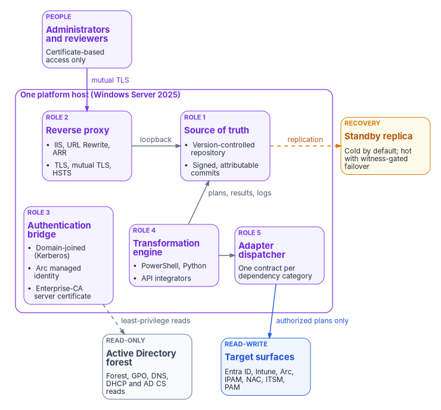
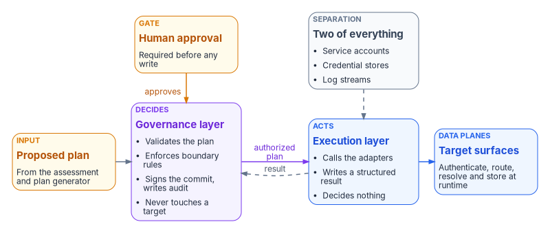

# Chapter 03 — The Platform Foundation

*Before anything in the estate changes, the program needs one place where every decision is written down, signed and replayable.*

::: {.callout-note}
## In this chapter
The reference platform host: one Windows Server 2025 server with a standby, built from standard components, that holds the authoritative repository and runs the transformation engine. The chapter covers why one authoritative writer matters, the host's five roles, the separation of governance from execution, the control-plane posture it supports, its integration surface and operating properties, and the things it deliberately is not.
:::

> **Dependency chain:** Inventory → **Plan** → Identity → Policy → Network services → Devices and servers → Access plane → Retire AD DS → Prove steady state. This chapter builds the platform that runs every step.

## The architectural claim

Every analysis, plan, delivery and evidence artifact the program produces can run on one Windows Server 2025 host, with a standby for recovery: not a cluster, and not a cloud-native control plane. The property that matters is a *single authoritative writer*, and one host is the simplest way to get it. This is a reference architecture to build from standard components, not an existing product. Windows Server 2025 is the current Long-Term Servicing Channel release, generally available since November 2024 with extended support to November 2034.[^c03-ws2025]

{#fig-ch03-platform-host fig-alt="A violet frame labeled one platform host, Windows Server 2025, holds five role cards in two rows. Top row: Role 2, reverse proxy, IIS with URL Rewrite and ARR terminating TLS, mutual TLS and HSTS; Role 1, source of truth, a version-controlled repository with signed, attributable commits. An amber standby replica card sits beside the repository, cold by default and hot with witness-gated failover, joined by a dashed replication arrow. Bottom row: Role 3, authentication bridge, domain-joined for Kerberos, holding an Arc managed identity and an enterprise-CA server certificate; Role 4, transformation engine, PowerShell, Python and API integrators, which writes plans, results and logs to the repository; Role 5, adapter dispatcher, one contract per dependency category. Administrators and reviewers reach the reverse proxy over mutual TLS, and the proxy forwards to the repository on loopback. A dashed arrow labeled least-privilege reads runs from the authentication bridge to a grey Active Directory forest card marked read-only. An arrow labeled authorized plans only runs from the dispatcher to a blue target surfaces card marked read-write: Entra ID, Intune, Arc, IPAM, NAC, ITSM and PAM."}

## Why one host

The host is a governance substrate, not an application server, and that brings four properties:

- **Single source of truth.** One repository holds the authoritative artifacts; two writers would diverge. Replication serves recovery, not load-sharing. Where high availability is required, a hot standby with automatic, witness-gated failover keeps one authority available without creating a second writer.
- **Deterministic provenance.** Every plan, delivery and drift report traces to a commit on the canonical repository. Distribution dilutes provenance; one host concentrates it.
- **Bounded attack surface.** One hardened host is a simpler security story than a fleet of services, though it is also a concentrated, high-value target and must be protected as one (see Operational properties).
- **Operational simplicity.** One patch cadence, backup policy, recovery playbook and compliance scope. Every extra moving part is another source of drift.

When scale is needed, it comes from the target surface (Entra ID, Intune and vendor APIs scale on their own), not from fanning out the substrate.

## The five roles

### 1. Canonical source of truth

**Version control (for example, Gitea).** Every governance artifact is a versioned file: group rules, delegation matrices, plans, policy libraries, adapter manifests and drift reports. Every change is a signed, attributable commit; nothing is a portal click or a verbal assurance. Gitea, the example used here, verifies GPG and SSH commit signatures against the keys it holds and marks commits it can't verify.[^c03-gitea-signing]

The repository sits behind the reverse proxy, uses enterprise PKI for HTTPS and client certificates, and replicates to a standby. The baseline is a cold standby with manual failover and stated recovery point and recovery time objectives (RPO and RTO). Where high availability is required, the program's design is a hot standby with automatic, witness-gated failover, aiming for near-zero RPO and an RTO measured in minutes. Off-premises backup covers total-site loss.

### 2. HTTPS reverse proxy and client-certificate terminator

**IIS with URL Rewrite and Application Request Routing (ARR).** Together, the URL Rewrite module and ARR turn IIS into a reverse proxy for back-end applications.[^c03-iis-arr] IIS terminates TLS, requires client certificates for administrative access through its SSL settings,[^c03-iis-clientcert] adds HSTS (native since IIS 10.0 version 1709)[^c03-iis-hsts] and serves HTTP/2 over TLS (supported since IIS 10.0 on Windows Server 2016),[^c03-iis-http2] then forwards to version control on loopback. Gitea's own IIS example forwards to `127.0.0.1:3000`.[^c03-gitea-proxy] The repository stays off the network while still supporting certificate-based administrative access. The program chose a full repository server behind the proxy over IIS serving Git directly, for authentication integration and operational reasons; record that choice in the project's decision log.

### 3. Legacy-to-modern authentication bridge

**Kerberos and enterprise PKI.** The host holds three memberships at once:

- It is **domain-joined** to the legacy Active Directory forest, for Kerberos-anchored reads of the forest, Group Policy, DNS zones and certificate services.
- It is **Azure Arc-connected**. Arc gives the server a system-assigned managed identity: Azure Resource Manager creates a service principal for it, and local processes request tokens from a localhost endpoint to call Azure Resource Manager and other services that accept Microsoft Entra authentication.[^c03-arc-mi] Microsoft Graph calls use a workload identity granted only the permissions it needs.
- It holds an **enterprise-CA-issued server certificate** for TLS.

Arc onboarding is a separate, one-time credential. The agent accepts interactive or device-code sign-in, a service principal with a secret or a certificate, an access token, or existing Azure CLI credentials.[^c03-arc-connect] Microsoft recommends the certificate form of service principal, scoped to the Azure Connected Machine Onboarding role, and the credential isn't needed after the server connects.[^c03-arc-onboard-sec] (An earlier version of this chapter said Arc onboarding doesn't use a certificate; a service principal certificate is a supported, and preferred, onboarding credential.)

The AD side is read-only by policy, using a least-privilege forest-reader account. The cloud side is read-write, because plans land there.

### 4. Transformation engine host

Assessment, planning and delivery run here:

- **PowerShell** for AD-side reads (the ActiveDirectory, GroupPolicy, DnsServer and DhcpServer modules), repository API calls, provenance writes and tests. Use PowerShell 7.6, the current Long-Term Servicing release (supported to November 14, 2028); PowerShell 7.4, which earlier versions of this chapter named, reaches end of support on November 10, 2026.[^c03-ps-lifecycle] On Windows Server 2025 the ActiveDirectory and DnsServer modules are natively compatible with PowerShell 7, but GroupPolicy and DhcpServer are listed as untested with its compatibility layer, so run those reads in Windows PowerShell 5.1.[^c03-ps-modcompat]
- **Python** (a supported Python 3 release) for graph analysis of OU trees and dependencies, and for schema validation.
- **API integrators** that wrap Microsoft Graph, Azure Resource Manager, Intune, IPAM, ITSM, PAM and posture-assessment output behind uniform contracts.

Every script lives in the repository, every run writes a signed log entry, and every API call carries a correlation ID tied to a plan and a commit. The reads themselves are ordinary, documented cmdlets; the engine adds normalization, provenance and the commit. [Chapter 10](10-analyzing-the-estate.md) describes the eleven ingestion streams, and Book 02 carries the full assessment ([Chapter 08](../b02-identity/08-assessing-the-forest.md) and its [assessment module](../b02-identity/appendix-b-forest-assessment-module.md)).

::: {.callout-warning}
## Illustrative code
The PowerShell in this chapter is illustrative and hasn't been tested against a production forest. Review it, and run it first in a test forest with the narrow, read-only rights described in [Book 02, Chapter 07](../b02-identity/07-read-only-discovery.md).
:::

```powershell
# Illustrative, read-only: the kinds of forest reads the engine runs (PowerShell 7.6)
Import-Module ActiveDirectory, DnsServer

$forest  = Get-ADForest
$domains = $forest.Domains | ForEach-Object { Get-ADDomain -Identity $_ }
$trusts  = Get-ADTrust -Filter *
$links   = Get-ADReplicationSiteLink -Filter *
$ous     = Get-ADOrganizationalUnit -Filter * -Properties gPLink
$spnUsers = Get-ADUser -Filter 'servicePrincipalName -like "*"' -Properties servicePrincipalName
$msas    = Get-ADServiceAccount -Filter *

$dc    = (Get-ADDomainController -Discover).HostName | Select-Object -First 1
$zones = Get-DnsServerZone -ComputerName $dc
```

```powershell
# Illustrative, read-only: run in Windows PowerShell 5.1
# (GroupPolicy and DhcpServer aren't tested with the PowerShell 7 compatibility layer)
Import-Module GroupPolicy, DhcpServer

Get-GPOReport -All -ReportType Xml -Path .\gpo-report.xml
$dhcpServers = Get-DhcpServerInDC
```

### 5. Adapter dispatcher

Each AD dependency category (PKI, RADIUS, LDAP, DHCP and so on) is reached through a defined adapter interface. Vendor implementations plug in behind it, so a new IPAM, CA or NAC vendor needs no engine change. Book 02 describes the dependency surface the adapters cover ([Chapter 04](../b02-identity/04-the-hidden-migration-surface.md)).

## Separation of governance and execution

**Governance and execution never mix on the host.** The governance layer validates plans, signs commits, enforces boundary rules and writes audit entries, but never touches the target. The execution layer takes an authorized plan, calls the adapters and writes back a structured result, but decides nothing. They run under separate service accounts, credential stores and log streams. Revoking either stops the system safely without leaving the other able to act alone. A component that both decides and acts can cover its tracks; separating them keeps every change auditable and reversible. This is the program's design; [Chapter 11](11-analysis-plan-delivery.md) describes the plan, authorization and delivery pipeline that runs across it.

{#fig-ch03-decide-and-act fig-alt="A left-to-right flow. An amber proposed plan card, from the assessment and plan generator, feeds a violet governance layer card that validates the plan, enforces boundary rules, signs the commit, writes audit and never touches a target. An amber human approval gate, required before any write, points into the governance layer with the label approves. An arrow labeled authorized plan runs to a blue execution layer card that calls the adapters, writes a structured result and decides nothing; a dashed arrow labeled result returns from execution to governance. The execution layer points to a blue target surfaces card, the data planes that authenticate, route, resolve and store at runtime. A grey card labeled two of everything, service accounts, credential stores and log streams, is linked to the execution layer by a dashed line."}

## The control plane over the data planes

The flagship whitepaper put the structural move in one sentence: Active Directory conflated the directory, which held the truth, with the domain controller, which enforced access in the path of every request. The modern estate keeps them apart. NIST SP 800-207 describes zero trust as moving defenses from network perimeters to users, assets and resources,[^c03-sp800207] and it separates the components that decide (the policy engine and policy administrator) from the one that enforces (the policy enforcement point), with the identity management system as one of several inputs to the decision.[^c03-sp800207-pdf] The platform host sits on the decision side of that line. It holds desired state, observes actual state, classifies drift and proposes corrections. Entra ID, Intune, the network fabric, DDI and the SIEM remain the data planes that authenticate, route, resolve and store at runtime.

That makes the host an active reconciliation control plane, not a passive registry, and raises the question of how much it may do on its own. The program answers with an actuation ladder. CISA's Zero Trust Maturity Model names four stages (Traditional, Initial, Advanced and Optimal);[^c03-ztmm] the mapping of governance postures to those stages below is the program's own design, not CISA's:

| Stage | Governance posture | What it means in practice |
|---|---|---|
| Traditional | Record and observe | Desired state is documented; actual state is collected by hand. Nothing detects or corrects drift automatically. |
| Initial | Observe and advise | Drift from policy is detected automatically, and corrective actions are generated and shown to operators. No automated writes. |
| Advanced | Gated actuation | The host generates a corrective action; a person approves it before it runs, and a dry run comes first in production. |
| Optimal | Autonomous within guardrails | The host closes the loop without a person for a named list of low-blast-radius operation classes. High-blast-radius operations stay gated permanently. |

The program's target for federal production is **Advanced**: gated actuation is the posture an authorizing official can sign, and some operations, such as tenant-wide role changes or network policy that touches thousands of endpoints, stay gated at every stage. (The whitepaper said FedRAMP continuous monitoring and OMB M-22-09 expect agencies to run at Advanced maturity. Neither document sets that expectation, so it is stated here as the program's position.)

## Integration surface

Each integration has an adapter specification and a validation approach:

| Integration | Direction | Purpose |
|-------------|-----------|---------|
| Active Directory forest (legacy) | Read-only | Forest, domain and OU discovery; GPO inventory; DNS and DHCP reads; Kerberos SPN audit |
| Certificate services (legacy PKI) | Read-only | Template analysis, privilege-escalation path check, certificate inventory |
| Cloud identity | Read-write | User, group, device, administrative-unit and policy provisioning |
| Device management | Read-write | Compliance policies, configuration profiles, enrollment |
| Hybrid management (Arc) | Read-write | Hybrid server enrollment, tag management, policy assignment |
| IP address management | Read-write | IPAM records, DHCP scope governance |
| Network access control | Read-write | RADIUS policy, 802.1X, device posture |
| IT service management | Read-write | Change and incident integration |
| Privileged access management | Read-write | Vault and safe integration |

Drift detection re-validates every integration on a schedule. The books that own each target carry the detail: identity in [Book 02](../b02-identity/index.md) and [Book 03](../b03-hr-identity/index.md), devices and Arc in [Book 05](../b05-devices/index.md), PKI in [Book 07](../b07-pki/index.md), and DNS, DHCP and IPAM in [Book 08](../b08-ddi/index.md).

## Operational properties

- **A control-plane asset.** The host reads the forest and writes to cloud identity, so treat it as Tier 0. Microsoft's AD DS tier model puts identity services such as Microsoft Entra Connect and AD CS in Tier 0, and its enterprise access model widens Tier 0 into the control plane.[^c03-tier-model][^c03-eam] Harden it accordingly: a security baseline, application control (App Control for Business, formerly Windows Defender Application Control, which Microsoft prefers to AppLocker),[^c03-appcontrol] code integrity, endpoint protection, and administration only from a privileged access workstation of the same tier.
- **Logged centrally.** Forward its logs to the agency's central logging. OMB M-26-14 requires logs that identify the identity behind each operation and every change to privilege levels, held in a central location or with federated access.[^c03-m2614]
- **Provenance-bound.** Configuration changes are commits; portal changes are prohibited by procedure and caught by drift monitoring.
- **Attribute-governed.** Its organizational tags live in Azure Resource Manager, where Azure Policy definitions can target resources by tag[^c03-arc-policy] and machine configuration audits or applies operating-system settings to Arc-enabled servers.[^c03-mc] (An earlier version targeted the server with an Intune compliance policy; Intune doesn't manage Windows Server, so servers are governed through Arc, as [Book 05, Chapter 09](../b05-devices/09-servers-under-azure-arc.md) describes.)
- **Drift-monitored.** Attributes, administrative-unit membership, repository team mapping and Arc heartbeat are reported on a schedule.
- **Recoverable.** Nightly backup plus the standby described above, with documented recovery objectives.

## What the platform host is not

- **Not a domain controller.** It is domain-joined, not domain-hosting. When the forest retires, the host is rebuilt as a workgroup, Arc-managed server.
- **Not part of the target surface.** It governs Entra ID, Intune and Arc from outside them, on-premises or Arc-projected, so it survives tenant-level events.
- **Not a product.** It is well-known components configured in a specific way, with no proprietary binary.
- **Not a replacement for human review.** People still review and authorize; the host runs execution and holds the repository.

## Build and decision records

Build procedures belong in a separate, PowerShell-first runbook. Record the reverse-proxy choice, the standby model and the actuation stage in the project's own decision log.

## Key takeaways

1. One authoritative repository and writer; the host is the simplest way to get that, with a standby for recovery.
2. Governance (decide) and execution (act) run under separate identities, credentials and logs, with a person approving before anything writes.
3. The host reads AD read-only, writes to the cloud only through authorized plans, and is protected as a control-plane asset.

::: {.callout-tip}
## Continue the book
[← Previous: Chapter 02 — The Problem: Governance Hidden in the Directory](02-the-problem.md) · [Book index](index.md) · [Next: Chapter 04 — Identity Transformation →](04-identity-transformation.md)
:::

[^c03-ws2025]: Microsoft Learn, "Windows Server release information," Windows Server 2025 row (LTSC, available 2024-11-01, extended support to 2034-11-14), <https://learn.microsoft.com/windows/release-health/windows-server-release-info> (accessed Oct 21, 2026).
[^c03-gitea-signing]: Gitea Documentation, "GPG/SSH Commit Signatures," <https://docs.gitea.com/administration/signing> (accessed Oct 21, 2026).
[^c03-iis-arr]: Microsoft Learn, "Reverse Proxy with URL Rewrite v2 and Application Request Routing," <https://learn.microsoft.com/iis/extensions/url-rewrite-module/reverse-proxy-with-url-rewrite-v2-and-application-request-routing> (accessed Oct 21, 2026).
[^c03-iis-clientcert]: Microsoft Learn, "Access Security `<access>`" (`sslFlags` values `Ssl` and `SslRequireCert`), <https://learn.microsoft.com/iis/configuration/system.webserver/security/access> (accessed Oct 21, 2026).
[^c03-iis-hsts]: Microsoft Learn, "IIS 10.0 Version 1709 HTTP Strict Transport Security (HSTS) Support," <https://learn.microsoft.com/iis/get-started/whats-new-in-iis-10-version-1709/iis-10-version-1709-hsts> (accessed Oct 21, 2026).
[^c03-iis-http2]: Microsoft Learn, "HTTP/2 on IIS," <https://learn.microsoft.com/iis/get-started/whats-new-in-iis-10/http2-on-iis> (accessed Oct 21, 2026).
[^c03-gitea-proxy]: Gitea Documentation, "Reverse Proxies," IIS section, <https://docs.gitea.com/administration/reverse-proxies> (accessed Oct 21, 2026).
[^c03-arc-mi]: Microsoft Learn, "Access Azure resources by using managed identity on Azure Arc-enabled servers," <https://learn.microsoft.com/azure/azure-arc/servers/managed-identity-authentication> (accessed Oct 21, 2026).
[^c03-arc-connect]: Microsoft Learn, "`azcmagent connect`," section "Authentication options," <https://learn.microsoft.com/azure/azure-arc/servers/azcmagent-connect> (accessed Oct 21, 2026).
[^c03-arc-onboard-sec]: Microsoft Learn, "Planning and deployment guidance," section "Onboarding credential," <https://learn.microsoft.com/azure/azure-arc/servers/security-onboarding> (accessed Oct 21, 2026).
[^c03-ps-lifecycle]: Microsoft Learn, "PowerShell Support Lifecycle," end-of-support dates table, <https://learn.microsoft.com/powershell/scripting/install/powershell-support-lifecycle> (accessed Oct 21, 2026).
[^c03-ps-modcompat]: Microsoft Learn, "PowerShell 7 module compatibility in Windows Server 2025," <https://learn.microsoft.com/powershell/windows/module-compatibility?view=windowsserver2025-ps> (accessed Oct 21, 2026).
[^c03-sp800207]: National Institute of Standards and Technology, SP 800-207, *Zero Trust Architecture*, August 2020, abstract, <https://csrc.nist.gov/pubs/sp/800/207/final> (accessed Oct 21, 2026).
[^c03-sp800207-pdf]: National Institute of Standards and Technology, SP 800-207, *Zero Trust Architecture*, August 2020, Section 3.1, "ZTA Logical Components," <https://nvlpubs.nist.gov/nistpubs/SpecialPublications/NIST.SP.800-207.pdf> (accessed Oct 21, 2026).
[^c03-ztmm]: Cybersecurity and Infrastructure Security Agency, *Zero Trust Maturity Model*, Version 2.0, April 2023, <https://www.cisa.gov/sites/default/files/2023-04/zero_trust_maturity_model_v2_508.pdf> (accessed Oct 21, 2026).
[^c03-tier-model]: Microsoft Learn, "Tier model for Active Directory Domain Services," section "Tier 0 - Identity control plane," <https://learn.microsoft.com/windows-server/identity/ad-ds/tier-model> (accessed Oct 21, 2026).
[^c03-eam]: Microsoft Learn, "Enterprise access model," section "Evolution from the AD tier model," <https://learn.microsoft.com/security/privileged-access-workstations/privileged-access-access-model> (accessed Oct 21, 2026).
[^c03-appcontrol]: Microsoft Learn, "Application Control for Windows," <https://learn.microsoft.com/windows/security/application-security/application-control/app-control-for-business/appcontrol> (accessed Oct 21, 2026).
[^c03-m2614]: Office of Management and Budget, M-26-14, *Ensuring Effective and Efficient Agency Logging and Network Visibility to Defend Against Evolving Cyber Threats*, May 22, 2026, Appendix B (Minimum Logging Baseline Requirements, items 2 and 5), <https://www.whitehouse.gov/wp-content/uploads/2026/05/M-26-14-Ensuring-Effective-and-Efficient-Agency-Logging-and-Network-Visibility-to-Defend-Against-Evolving-Cyber-Threats.pdf> (accessed Oct 21, 2026).
[^c03-arc-policy]: Microsoft Learn, "Azure Policy built-in definitions for Azure Arc-enabled servers" (for example, the definitions that enable or disable Defender for Servers on resources with a selected tag), <https://learn.microsoft.com/azure/azure-arc/servers/policy-reference> (accessed Oct 21, 2026).
[^c03-mc]: Microsoft Learn, "What is Azure Machine Configuration?," <https://learn.microsoft.com/azure/governance/machine-configuration/overview/01-overview-concepts> (accessed Oct 21, 2026).
