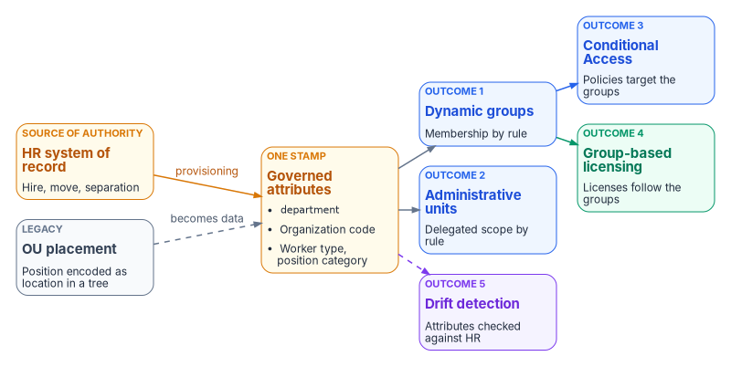
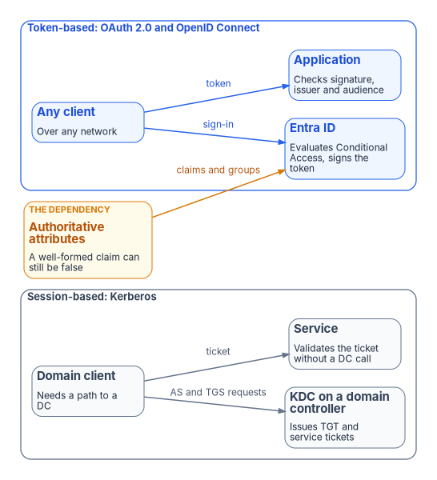

# Chapter 04 — Identity Transformation

*The OU tree carried delegation, policy scope and accountability in one structure; a flat directory has none of that until the program writes it down as attributes and rules.*

::: {.callout-note}
## In this chapter
Why the attributes have to be true before anything else works, and the four mechanisms (attributes, dynamic groups, administrative units, Conditional Access) that rebuild what the OU tree did. The move from session-based Kerberos to token-based identity, including at the mainframe boundary. The HR-driven joiner-mover-leaver lifecycle, the drift categories, and the phased migration with its pass criteria. Book 02 and Book 03 carry the depth; this chapter is the arc.
:::

> **Dependency chain:** Inventory → Plan → **Identity** → Policy → Network services → Devices and servers → Access plane → Retire AD DS → Prove steady state

## The identity claim

The Active Directory organizational-unit tree was never just a folder structure. It encoded delegation, policy inheritance, operational accountability and security scope in a single hierarchical graph. Microsoft Entra ID has no OUs; its directory is flat, and it has none of that structure by default.

The attribute-driven model rebuilds those governance properties inside the flat directory with four governed mechanisms (**organizational attributes**, **dynamic groups**, **administrative units** and **Conditional Access targeting**) bound into one deterministic model. One act, setting a user's organizational attributes from the HR record, produces every downstream effect.

{#fig-ch04-one-attribute-five-outcomes fig-alt="A left-to-right flow. An amber HR system of record card, the source of authority for hire, move and separation, feeds an amber governed attributes card through an arrow labeled provisioning; the attributes are department, an organization code, worker type and position category. A grey legacy card, OU placement, position encoded as location in a tree, joins the attributes card with a dashed arrow labeled becomes data. From the attributes card three arrows fan out: to a blue dynamic groups card, outcome 1, membership by rule; to a blue administrative units card, outcome 2, delegated scope by rule; and with a dashed violet arrow to a violet drift detection card, outcome 5, attributes checked against HR. The dynamic groups card feeds two more outcomes: a blue Conditional Access card, outcome 3, policies target the groups, and a green group-based licensing card, outcome 4, licenses follow the groups."}

## Why the attributes must be true first

Every later control reads these attributes, so the first principle is a single source of truth: each kind of fact the estate depends on has one authoritative source, and every copy traces back to it. Where regional systems define a fact differently, the difference is documented and traceable to policy rather than hidden in schema variation.

Federal zero trust policy points the same way. OMB M-22-09 requires agencies to use centralized identity management systems for agency users and to give staff enterprise-managed identities, consolidating identity systems so that protections and monitoring apply consistently.[^c04-m2209] NIST SP 800-207 separates the components that decide access (the policy engine and policy administrator) from the one that enforces it (the policy enforcement point), and treats the identity management system as an input to the decision.[^c04-sp800207] The governance layer holds and reconciles authoritative state; the identity provider and enforcement points stay the runtime data planes ([Chapter 03](03-platform-foundation.md)). For the workforce, the authoritative source is the HR system of record, which [Book 03](../b03-hr-identity/index.md) develops in full: HR is authoritative for who works for the agency, where they sit and who they report to, while identity services remain authoritative for credentials, sessions and policy enforcement.

## The four mechanisms

Cloud identity platforms provide individually powerful tools. The program uses them together to replace what the OU tree did.

| Mechanism | What it replaces |
|-----------|------------------|
| **Organizational attributes** | OU placement |
| **Dynamic groups** | OU-derived security groups |
| **Administrative units** | OU-level delegation |
| **Conditional Access targeting** | Group Policy-based policy inheritance |

Each mechanism is documented by Microsoft; the program's contribution is **the contract that binds them together**, so that setting a user's organizational attributes produces consistent downstream effects: group membership, administrative-unit scope, policy targeting, license assignment and drift-detector visibility.

## Organizational attributes

Organizational position is carried in attributes on every governed user object (and, where applicable, device and group objects).

### Where the attributes live

Use a native Entra attribute wherever one exists (`department`, `jobTitle`, `employeeId`, `employeeType`, `employeeHireDate`, `employeeLeaveDateTime`, `employeeOrgData` and `manager`), and add an extension attribute only where a dynamic membership rule needs a value it can't read natively. Rules can read `department`, `jobTitle`, `employeeId` and `extensionAttribute1` through `15`, among others, plus directory extension properties; they can't read `employeeType`, `employeeOrgData` or `manager` (direct-reports groups use a separate rule form).[^c04-dyn-rules] [Book 03, Chapter 06](../b03-hr-identity/06-canonical-attribute-schema.md) fixes the carriers: coded organization, worker-type and position-category attributes for access targeting, and the date attributes that drive the lifecycle. The examples below follow it. Book 03 reserves `extensionAttribute2` and `extensionAttribute3` for hire and termination dates on AD-landed users, so don't use them for department or division.

`extensionAttribute1` through `15` exist in both landing zones. For synced users AD is the source and the Entra values are read-only; for cloud-only users they can be set directly.[^c04-onprem-ext] Once AD is no longer the source, HR-driven inbound provisioning writes the same values straight to Entra ID, so the attribute source has to be planned before AD retires. API-driven and HR-driven inbound provisioning are included with Microsoft Entra ID P1 and above, and need a P1 or higher license for every user they provision.[^c04-api-prov][^c04-hr]

### Protect the write path

A dynamic rule is only as trustworthy as the controls on who can write the attributes it reads, in Entra ID and in any source directory. Microsoft warns specifically about synced AD attributes that users can modify themselves.[^c04-dyn-rules] Remove help-desk, self-service and mail-administration write paths to the access attributes; HR provisioning is the only writer.

### What the attributes drive

One stamped set of attributes drives five downstream outcomes:

1. **Dynamic group membership**: every user whose attributes match a rule is in that group.
2. **Administrative-unit scope**: administrative units use the same attributes; delegated administrators of a unit manage only its members.
3. **Conditional Access targeting**: policies include or exclude groups keyed to attribute values.
4. **License assignment**: group-based licensing flows from attribute-scoped dynamic groups. Members joining a licensed group receive its licenses, and members leaving lose them.[^c04-gbl]
5. **Drift detection**: every user's attributes are validated against the HR source of truth.

One stamp, five governance outcomes, no administrative-portal clicks to assign any of them.

## Dynamic groups: materializing every subtree

Active Directory computed "who is in the Finance branch?" by walking the OU tree. Entra ID computes it by evaluating a dynamic-group rule against user attributes. Dynamic membership needs a Microsoft Entra ID P1 license for each unique member of one or more dynamic groups.[^c04-dyn-rules]

### The two query patterns

Every attribute-governed dynamic group uses one of two patterns. Rules join expressions with `-and`, `-or` and `-not`, and comparison operators work with or without the hyphen.[^c04-dyn-rules] The codes below are placeholders for the agency's own code lists.

**Pattern 1: node query (exact).** Captures users at one place in the organization and nowhere else, by organization code. A roll-up over several codes uses `-in` rather than a chain of `-or`.

```text
(user.accountEnabled -eq true) -and (user.extensionAttribute10 -eq "FIN-GRC")
(user.accountEnabled -eq true) -and (user.extensionAttribute10 -in ["FIN-GRC","FIN-LED"])
```

**Pattern 2: functional query (cross-cutting).** Combines an organizational attribute with another attribute for a question that isn't about position at all.

```text
(user.department -eq "IT") -and (user.extensionAttribute12 -eq "SECURITY")
```

The second produces every IT user in the security position category, in every region. Book 03 shows the full rule set ([Chapter 10](../b03-hr-identity/10-from-attributes-to-access.md)). Prefer `-eq` and `-in` to `-contains` and `-match`: Microsoft recommends minimizing `-contains` and `-match` because they slow processing.[^c04-dyn-efficient]

Membership is not instantaneous. Changes are usually processed within a few hours but can take more than 24 hours, depending on tenant size, the number of dynamic groups, the volume of attribute changes and rule complexity.[^c04-dyn-processing] Design the mover workflow and its evidence around that window.

### Naming convention

Every governed dynamic group follows one pattern, for example `Structure-[SCOPE]-[PURPOSE]`:

- `Structure-FIN-Users`: Finance users
- `Structure-IT-SEC-SOC-Users`: SOC analysts
- `Structure-HR-Licensed`: HR users targeted for specific licenses
- `Structure-EXEC-CA`: executive users targeted by specific Conditional Access policies

Groups that don't match the pattern are orphan drift. The drift engine finds them, and cleanup is escalated.

## Administrative units: the delegation replacement

Active Directory delegated OU-level rights through access-control lists on the OU object. Entra ID delegates through administrative units: containers of users, groups or devices against which roles can be assigned, so that the role applies only to the unit's members.[^c04-au] Three properties shape the design:

- **Units don't nest.** A department unit and its division units are siblings; "division under department" is a naming convention, not containment.[^c04-au]
- **Units scope management, not visibility.** They don't stop administrators or users from browsing objects outside the unit with their default permissions.[^c04-au] Treat a unit as a write boundary, not a confidentiality boundary.
- **Only some roles can be unit-scoped.** User Administrator, Groups Administrator, Helpdesk Administrator, Password Administrator, Authentication Administrator and a few others can; Global Reader and Security Reader can't.[^c04-au-roles]

[Book 02, Chapter 05](../b02-identity/05-delegation-without-ous.md) carries the full registry, role matrix and drift checks.

### The three-tier model

| Tier | Scope | Pattern | Typical roles |
|------|-------|---------|---------------|
| **Tier 1: Enterprise** | All governed users | `AU-ORG-Enterprise` defines the governed population; reader roles are assigned at tenant scope | Global Reader, Security Reader (tenant scope) |
| **Tier 2: Department** | All users in one department, in one region | `AU-[REGION]-[DEPT]` | User Administrator, Groups Administrator |
| **Tier 3: Division** | Users in one division of that department | `AU-[REGION]-[DEPT]-[DIV]` | Helpdesk Administrator, Password Administrator |

Assign the Tier 1 reader roles at tenant scope, not at the enterprise unit. Those roles can't be scoped to an administrative unit, and because units don't restrict reading anyway, a tenant-scoped reader role delivers the same visibility.[^c04-au-roles]

Each unit uses a dynamic membership rule that mirrors the corresponding dynamic-group rule, so it holds the same users. Dynamic units have limits of their own: one object type per unit (users or devices), a Microsoft Entra ID P1 license count covering every unique user in one or more dynamic units, and availability only in the global Azure cloud, not in specialized clouds such as Azure Government.[^c04-dynau] Microsoft 365 GCC pairs with Microsoft Entra ID in the global cloud, so a GCC Moderate tenant can use dynamic units; GCC High and DoD tenants, which pair with Entra ID in Azure Government, can't, and must maintain membership another way.[^c04-gov-pairing]

### Restricted management

Two controls protect unit scope. **Dynamic membership** means no administrator can hand-add a user; the only way in is an attribute change through the governed workflow. **Restricted management**, applied to units that hold sensitive objects, goes further: only administrators assigned at the unit's scope can change the Entra properties of its members, and tenant-scoped administrators can't.[^c04-rmau]

Restriction is narrower than it sounds and costs more than it appears, so the program decides it per unit, with a default of no. A Global Administrator or Privileged Role Administrator still can't edit a protected object directly, but can add or remove the unit's members and assign themselves a role over it; restriction makes that bypass deliberate and audited, not impossible. Users and groups in a restricted unit also can't be managed by Microsoft Entra ID Governance features (Privileged Identity Management, entitlement management, lifecycle workflows and access reviews), the setting can only be chosen when the unit is created, and a tenant can hold at most 100 such units.[^c04-rmau] Use restriction for executives, break-glass accounts and groups that gate sensitive applications, not for the broad HR-driven populations that lifecycle workflows must manage. Dynamic membership and restriction together don't recreate what OU access-control lists provided.

### Role assignments

Roles are scoped to administrative units, never granted tenant-wide except for break-glass accounts and the Tier 1 readers. The assignment pattern:

```text
role:        User Administrator
principal:   Structure-NCR-Finance-Admins    ← a role-assignable group (assigned membership, PIM-eligible)
scope:       /administrativeUnits/AU-NCR-Finance
```

A member of the administrators group can reset passwords and manage users and groups, but only for the unit's members, and AU-scoped password resets apply only to users who don't hold administrator roles.[^c04-au-roles] Groups used as role principals must be role-assignable. A role-assignable group's membership must be assigned, never dynamic, it can't contain other groups, the property can only be set at creation, and a tenant can have at most 500 of them.[^c04-rag] Manage their membership as eligible assignments in Privileged Identity Management; every user eligible for membership in a PIM-managed group needs a Microsoft Entra ID P2 or Microsoft Entra ID Governance license.[^c04-pim-groups] [Book 04](../b04-access/04-privileged-roles-and-tiers.md) covers privileged roles in depth.

The full role matrix is stored in the authoritative repository. Changes require review, and validation checks that new assignments respect least-privilege and tier-boundary rules.

## Conditional Access: the policy-inheritance replacement

Group Policy Objects inherited down the OU tree. Conditional Access policies target users and groups; a targeted group can be any type, dynamic or assigned, and policy applies to nested members.[^c04-ca-users] The bridge is attribute-scoped dynamic groups that match the old inheritance pattern.

Example: a GPO linked at a regional OU required smart-card logon for everyone in that region. The Conditional Access equivalent targets a region-scoped dynamic group, whose rule is the region code alone (`extensionAttribute4` in the [program attribute map](../b03-hr-identity/06-canonical-attribute-schema.md#program-attribute-map)), and requires the built-in **Phishing-resistant MFA** authentication strength, which allows Windows Hello for Business or platform credentials, FIDO2 security keys and Microsoft Entra certificate-based authentication.[^c04-authstrength] Users in that region get the policy; everyone else doesn't. Settings such as account lockout aren't Conditional Access controls. Cloud sign-ins are protected by Entra smart lockout, which is always on (customizing its thresholds needs P1), and for hybrid users with password hash sync or pass-through authentication its threshold should sit below the AD lockout threshold.[^c04-smartlock] Local accounts move to Intune device policy ([Chapter 05](05-policy-transformation.md)).

Two cautions. Conditional Access doesn't inherit through administrative units the way Group Policy inherited through OUs; the model makes up the difference by having the branch group include everyone the ancestor policy would have targeted. And a policy that targets administrators by directory role doesn't apply to roles scoped to an administrative unit;[^c04-ca-users] target the role-assignable administrator groups instead. [Book 04, Chapter 03](../b04-access/03-the-conditional-access-model.md) covers the policy model.

## From sessions to tokens

Active Directory's Kerberos assumes the client can reach a domain controller. A Kerberos client contacts the Key Distribution Center, which runs on every domain controller, to obtain a ticket-granting ticket and then a service ticket for each service; the service validates the ticket without calling a domain controller on each connection.[^c04-kerberos] The dependency is the path to the KDC, not the service's own check. A token works the other way round: Microsoft Entra ID issues a signed token after Conditional Access has evaluated the request, and the application validates its signature, issuer and audience against keys the identity provider publishes.[^c04-tokens] No domain controller, and no trusted network, is in the path. [Chapter 01](01-why-modernization-is-hard.md) explains what distance and inline inspection do to the session model.

{#fig-ch04-session-vs-token fig-alt="Two framed groups. The grey frame, session-based Kerberos, holds a domain client card that needs a path to a DC, an arrow labeled AS and TGS requests to a KDC on a domain controller card that issues TGT and service tickets, and an arrow labeled ticket from the client to a service card that validates the ticket without a DC call. The blue frame, token-based OAuth 2.0 and OpenID Connect, holds an any client card that works over any network, an arrow labeled sign-in to an Entra ID card that evaluates Conditional Access and signs the token, and an arrow labeled token from the client to an application card that checks signature, issuer and audience. An amber card, authoritative attributes, the dependency, a well-formed claim can still be false, points to Entra ID with the label claims and groups."}

Federal policy requires what the move delivers rather than the move itself. OMB M-22-09 requires phishing-resistant MFA for agency staff, contractors and partners, and an option of it for public users.[^c04-m2209] CISA BOD 25-01 requires agencies to implement the SCuBA secure configuration baselines for Microsoft 365, deploy CISA's assessment tools and remediate deviations,[^c04-bod2501] and its required Entra ID policies include "Legacy authentication SHALL be blocked" and "Phishing-resistant MFA SHALL be enforced for all users."[^c04-scuba-required] CISA's Zero Trust Maturity Model puts phishing-resistant MFA at the Advanced stage of the Identity pillar's authentication function and continuous validation with it at Optimal.[^c04-ztmm] Certificate-based authentication is one way to meet that bar, not a separate requirement: Microsoft Entra's built-in phishing-resistant MFA strength accepts multifactor certificate-based authentication alongside Windows Hello for Business and FIDO2 security keys.[^c04-authstrength] NTLM is on the way out: all versions are deprecated, NTLMv1 is removed in Windows Server 2025 and Windows 11 version 24H2, and Microsoft directs applications to Negotiate, which tries Kerberos first.[^c04-ntlm] Windows can audit NTLM use, and that audit is how the remaining dependencies are found.[^c04-ntlm]

**Tokens only work if the authoritative identity model is correct.** If what a user is allowed to do is still encoded in regional OU trees with no HR-derived source, tokens won't help: the estate will sign broken authorizations efficiently. That is why this chapter starts with the attributes. A token must assert an authorization that is *true*, not merely well-formed.

### At the mainframe boundary

The same move applies where agencies run z/OS. Mainframe access is governed by RACF through the System Authorization Facility, and interactive access is typically session-bound (3270 emulation, or z/OS's own Kerberos), with CICS and IMS transactions expecting a resolved RACF identity for the unit of work. Token-based access is a translation at the boundary, and the pieces exist today:

- **The gateway validates the token.** IBM z/OS Connect supports third-party authentication with a JSON Web Token and can map a distributed identity claim in the token to a SAF user ID through a RACF distributed identity filter, created with the `RACMAP` command in the `IDIDMAP` class.[^c04-zosconnect-map]
- **RACF can audit the real user.** Distributed identity filters let RACF record both the RACF user ID and the original distributed identity in its SMF audit records, so a transaction is logged against the person, not a shared service ID.[^c04-racf-did]
- **PassTickets avoid stored passwords.** Where a downstream sign-on still needs a RACF credential, a PassTicket substitutes for the password: it can be used once, must be used within 10 minutes of generation, and is validated with Secure Signon keys shared between the systems, so applications don't store or transmit passwords.[^c04-passticket]

What doesn't change is the inside. CICS and IMS don't natively understand OAuth tokens; the transaction engine remains region- and session-bound. Pseudo-conversational transactions that hold state across screens are the hard case: converting them to stateless, per-request calls is a refactoring exercise, and the same work that reduces an application's synchronous round trips to its data. The program's recommendation is to treat token-fronted mainframe access as a by-product of that interface consolidation, not as a separate initiative, and to validate against the actual z/OS subsystem versions and RACF configuration as the first implementation step.

## HR-driven lifecycle: joiner, mover, leaver

Organizational attributes aren't something administrators maintain. The HR system drives them. Book 03 sets out the full design ([Chapter 05](../b03-hr-identity/05-the-provisioning-pipeline.md) for provisioning, [Chapter 08](../b03-hr-identity/08-joiner-mover-leaver.md) for the lifecycle), including the Federal HR 2.0 context ([Chapter 03](../b03-hr-identity/03-federal-hr-2-0.md)) and the fact that contractors need their own authoritative source. The arc is:

### Joiner

1. The HR system creates the worker record with organization, department, location and manager.
2. HR-to-cloud provisioning populates the standard attributes.[^c04-hr]
3. A governed workflow computes the organizational codes from HR attributes according to the mapping rules and writes them.
4. Dynamic groups and units recompute membership within the platform's processing window.[^c04-dyn-processing]
5. The user is now an administrative-unit member, Conditional-Access-scoped, group-licensed and visible to the drift engine, all automatically.

### Mover

The worker's HR record moves them from one division to another. The same workflow runs; the organization code updates; every downstream group, administrative unit, Conditional Access scope and license assignment follows. No hand edits, no ticket. The drift window is the dynamic-processing window, and the evidence records when the change converged.

### Leaver

Separation in the HR system triggers the leaver workflow (for example, Microsoft Entra Lifecycle Workflows, which require Microsoft Entra ID Governance or Microsoft Entra Suite licenses);[^c04-lcw] the account is disabled, the organizational attributes are cleared, and dynamic groups, administrative-unit membership, Conditional Access scope and licenses drop with them. Provenance points to the HR event that triggered it. [Book 03, Chapter 09](../b03-hr-identity/09-credentials-and-certificates.md) covers the credential and certificate steps.

Every lifecycle workflow (joiner, mover, leaver, rehire, contractor onboarding, executive provisioning, emergency deprovisioning, name change, reorganization) is enumerated with its triggers, inputs, outputs and exception paths. There are no undocumented identity workflows.

## Drift categories

The drift engine classifies identity findings into categories such as:

| Category | Example |
|----------|---------|
| **Value drift** | HR says the user's organization code is `FIN-GRC`; the user's attribute says `FIN-LED` |
| **Orphan drift** | A security group exists that isn't in the governed library |
| **Processing drift** | A dynamic group's or unit's rule processing is paused, so membership is frozen while every other check passes |

Every finding opens a tracked item with defined response expectations. [Book 03, Chapter 11](../b03-hr-identity/11-drift-metrics-and-evidence.md) defines the metrics and evidence, and [Book 02, Chapter 05](../b02-identity/05-delegation-without-ous.md) the administrative-unit checks.

## Migration phases

Moving an existing forest into the attribute-driven model is a phased runbook, not a flag-day cutover. They are the identity workstream's own phases, numbered within the workstream; [Chapter 12](12-migration-roadmap.md) places them in the program roadmap, whose phases are numbered separately (identity steady state arrives with the program's Phase 6), and [Book 02, Chapter 10](../b02-identity/10-migrating-and-governing.md) carries the identity migration in detail.

### Phase 0: assessment

The read-only assessment run in [Chapter 10](10-analyzing-the-estate.md).

### Phase 1: authoring

Dynamic-group rules and administrative units are authored, reviewed and committed.

### Phase 2: pilot division

Pick one division, compute its attribute mappings, stage the transformation plan, authorize, deliver and validate. Any drift is fixed before moving on.

### Phase 3: division-by-division rollout

Each division gets its own plan, review and delivery, and no division reaches full availability until its own in-division pilot is drift-clean. Two or three divisions can run in parallel ([Chapter 12](12-migration-roadmap.md)).

### Phase 4: legacy retirement

Once every user has organizational attributes and every OU has a dynamic-group equivalent, the OU-based security groups and the legacy GPOs that remain are retired in a governed deprecation pass; GPOs already migrated for a division retire as that division moves ([Chapter 05](05-policy-transformation.md)). This is the only destructive phase, and it requires explicit approval per item.

### Phase 5: steady state

The daily assessment produces zero-action plans and the drift engine reports green. The forest may remain for a while (for DNS, DHCP, Kerberos-bound legacy applications, and as the source of synchronized attributes until HR-to-Entra provisioning writes them directly), but it is no longer the governance model. Chapters [06](06-network-services.md) and [07](07-compute-transformation.md) remove those remaining dependencies.

## Verification

Migration passes when:

- Every HR-listed worker has valid organizational attributes.
- Every dynamic group matches one of the two patterns.
- Every administrative unit's membership rule mirrors its dynamic group's rule, and no rule's processing is paused.
- Every Conditional Access policy targets only governed groups.
- Drift detection reports zero findings.
- The nightly assessment-to-plan run produces a zero-action plan.

Only when every box is ticked is the tenant in steady state.

## Key takeaways

1. The attributes come first: they must come from HR and be protected from every other writer, because every later control reads them.
2. Delegation moves from OU access-control lists to administrative units and PIM-managed, role-assignable groups; restriction is a per-unit decision, not a default.
3. Tokens replace sessions, but a token is only as true as the attributes behind it; identity is first in the chain because policy, devices and access all target identity groups.

::: {.callout-tip}
## Continue the book
[← Previous: Chapter 03 — The Platform Foundation](03-platform-foundation.md) · [Book index](index.md) · [Next: Chapter 05 — Policy Transformation →](05-policy-transformation.md)
:::

[^c04-m2209]: Office of Management and Budget, M-22-09, *Moving the U.S. Government Toward Zero Trust Cybersecurity Principles*, January 26, 2022, "Identity" (centralized identity management, enterprise-managed identities, phishing-resistant MFA), <https://www.whitehouse.gov/wp-content/uploads/2022/01/M-22-09.pdf> (accessed Oct 21, 2026).
[^c04-sp800207]: National Institute of Standards and Technology, SP 800-207, *Zero Trust Architecture*, August 2020, Section 3.1, "ZTA Logical Components," <https://nvlpubs.nist.gov/nistpubs/SpecialPublications/NIST.SP.800-207.pdf> (accessed Oct 21, 2026).
[^c04-dyn-rules]: Microsoft Learn, "Manage rules for dynamic membership groups in Microsoft Entra ID" (supported properties and operators; extension attributes; security consideration on attribute write permissions; license requirements), <https://learn.microsoft.com/entra/identity/users/groups-dynamic-membership> (accessed Oct 21, 2026).
[^c04-onprem-ext]: Microsoft Graph, "onPremisesExtensionAttributes resource type," <https://learn.microsoft.com/graph/api/resources/onpremisesextensionattributes?view=graph-rest-1.0> (accessed Oct 21, 2026).
[^c04-api-prov]: Microsoft Learn, "Microsoft Entra ID Governance licensing fundamentals," section "API-driven provisioning" and the Provisioning rows of the features table, <https://learn.microsoft.com/entra/id-governance/licensing-fundamentals> (accessed Oct 21, 2026).
[^c04-gbl]: Microsoft Learn, "What is enterprise user management?," section "Assign licenses to groups," <https://learn.microsoft.com/entra/identity/users/directory-overview-user-model> (accessed Oct 21, 2026).
[^c04-dyn-efficient]: Microsoft Learn, "Create simpler, more efficient rules for dynamic membership groups in Microsoft Entra ID," <https://learn.microsoft.com/entra/identity/users/groups-dynamic-rule-more-efficient> (accessed Oct 21, 2026).
[^c04-dyn-processing]: Microsoft Learn, "Understand and manage dynamic group processing in Microsoft Entra ID," <https://learn.microsoft.com/entra/identity/users/manage-dynamic-group> (accessed Oct 21, 2026).
[^c04-au]: Microsoft Learn, "Administrative units in Microsoft Entra ID," <https://learn.microsoft.com/entra/identity/role-based-access-control/administrative-units> (accessed Oct 21, 2026).
[^c04-au-roles]: Microsoft Learn, "Assign Microsoft Entra roles," section "Assign roles with administrative unit scope," <https://learn.microsoft.com/entra/identity/role-based-access-control/manage-roles-portal> (accessed Oct 21, 2026).
[^c04-dynau]: Microsoft Learn, "Manage users or devices for an administrative unit with rules for dynamic membership groups," Prerequisites, <https://learn.microsoft.com/entra/identity/role-based-access-control/admin-units-members-dynamic> (accessed Oct 21, 2026).
[^c04-gov-pairing]: Microsoft Learn, "Cloud feature availability for US Government customers," section "Microsoft 365 integration," <https://learn.microsoft.com/azure/security/fundamentals/feature-availability> (accessed Oct 21, 2026).
[^c04-rmau]: Microsoft Learn, "Restricted management administrative units in Microsoft Entra ID" (who can modify objects, who can manage the units, limitations), <https://learn.microsoft.com/entra/identity/role-based-access-control/admin-units-restricted-management> (accessed Oct 21, 2026).
[^c04-rag]: Microsoft Learn, "Use Microsoft Entra groups to manage role assignments," <https://learn.microsoft.com/entra/identity/role-based-access-control/groups-concept> (accessed Oct 21, 2026).
[^c04-pim-groups]: Microsoft Learn, "Assign eligibility for a group in Privileged Identity Management," <https://learn.microsoft.com/entra/id-governance/privileged-identity-management/groups-assign-member-owner> (accessed Oct 21, 2026).
[^c04-ca-users]: Microsoft Learn, "Conditional Access: Users, groups, agents, and workload identities," <https://learn.microsoft.com/entra/identity/conditional-access/concept-conditional-access-users-groups> (accessed Oct 21, 2026).
[^c04-authstrength]: Microsoft Learn, "Conditional Access authentication strengths," section "Built-in and custom authentication strengths," <https://learn.microsoft.com/entra/identity/authentication/concept-authentication-strengths> (accessed Oct 21, 2026).
[^c04-smartlock]: Microsoft Learn, "Protect user accounts from attacks with Microsoft Entra smart lockout," <https://learn.microsoft.com/entra/identity/authentication/howto-password-smart-lockout> (accessed Oct 21, 2026).
[^c04-kerberos]: Microsoft Learn, "Kerberos authentication overview in Windows Server," section "How Kerberos authentication works," <https://learn.microsoft.com/windows-server/security/kerberos/kerberos-authentication-overview> (accessed Oct 21, 2026).
[^c04-tokens]: Microsoft Learn, "Access tokens in the Microsoft identity platform," section "Validate tokens," <https://learn.microsoft.com/entra/identity-platform/access-tokens> (accessed Oct 21, 2026).
[^c04-bod2501]: Cybersecurity and Infrastructure Security Agency, BOD 25-01, *Implementing Secure Practices for Cloud Services*, December 17, 2024, <https://www.cisa.gov/news-events/directives/bod-25-01-implementing-secure-practices-cloud-services> (accessed Oct 21, 2026).
[^c04-scuba-required]: Cybersecurity and Infrastructure Security Agency, "BOD 25-01: Implementing Secure Practices for Cloud Services Required Configurations," Microsoft Entra ID policies MS.AAD.1.1v1 and MS.AAD.3.1v1, <https://www.cisa.gov/resources-tools/services/bod-25-01-implementing-secure-practices-cloud-services-required-configurations> (accessed Oct 21, 2026).
[^c04-ztmm]: Cybersecurity and Infrastructure Security Agency, *Zero Trust Maturity Model*, Version 2.0, April 2023, Table 2, "Identity Pillar," Authentication function, <https://www.cisa.gov/sites/default/files/2023-04/zero_trust_maturity_model_v2_508.pdf> (accessed Oct 21, 2026).
[^c04-ntlm]: Microsoft Learn, "Features removed or no longer developed in Windows Server," Windows Server 2025 (NTLM; NTLMv1 removed), <https://learn.microsoft.com/windows-server/get-started/removed-deprecated-features-windows-server> (accessed Oct 21, 2026); and "Resources for deprecated features," NTLM (auditing), <https://learn.microsoft.com/windows/whats-new/deprecated-features-resources> (accessed Oct 21, 2026).
[^c04-zosconnect-map]: IBM Documentation, *IBM z/OS Connect 3.0*, "Mapping a distributed identity claim to a SAF user ID," <https://ibm.com/docs/en/zos-connect/zosconnect/3.0?topic=authentication-mapping-distributed-identity-claim-saf-user-id> (accessed Oct 21, 2026).
[^c04-racf-did]: IBM Documentation, *z/OS Security Server RACF Security Administrator's Guide*, "Overview of distributed identity filters," SA23-2289-00, <https://www.ibm.com/support/knowledgecenter/SSLTBW_2.1.0/com.ibm.zos.v2r1.icha700/didover.htm> (accessed Oct 21, 2026).
[^c04-passticket]: IBM Documentation, *CICS Transaction Server 5.4*, "Generating and using PassTickets for secure sign-on," <https://www.ibm.com/docs/en/SSGMCP_5.4.0/security/cics/dfht516.html> (accessed Oct 21, 2026).
[^c04-hr]: Microsoft Learn, "Plan cloud HR application to Microsoft Entra user provisioning," <https://learn.microsoft.com/entra/identity/app-provisioning/plan-cloud-hr-provision> (accessed Oct 21, 2026).
[^c04-lcw]: Microsoft Learn, "What are lifecycle workflows?," section "License requirements," <https://learn.microsoft.com/entra/id-governance/what-are-lifecycle-workflows> (accessed Oct 21, 2026).
