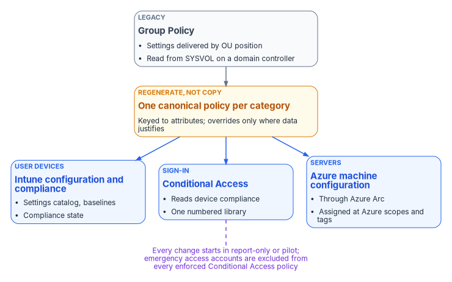
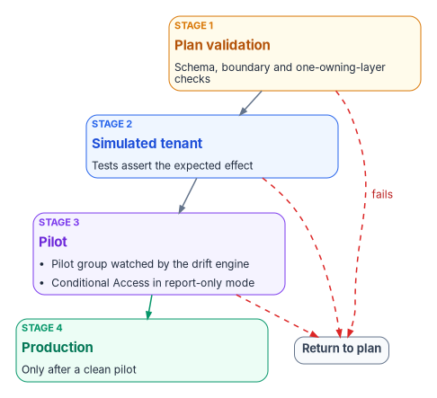

# Chapter 05 — Policy Transformation

*Group Policy delivered configuration through the shape of the directory; its replacement has to state every setting, its target and its owner on purpose.*

::: {.callout-note}
## In this chapter
How each Group Policy category maps to a modern surface, and why a setting-by-setting port fails. How configuration profiles, compliance policies and Conditional Access are written as versioned manifests, and how servers come under Azure machine configuration. The conflict rules, the emergency access exclusion and the four test stages every change passes, and the order in which the last GPOs retire. [Book 05](../b05-devices/index.md) carries the device-level detail and [Book 04](../b04-access/index.md) the Conditional Access policy library.
:::

> **Dependency chain:** Inventory → Plan → Identity → **Policy** → Network services → Devices and servers → Access plane → Retire AD DS → Prove steady state

## The policy claim

Group Policy was Active Directory's most ambitious delivery system: configuration, security, software, scripts and drive mappings, inherited down the OU tree and filtered by security groups. Its replacement is several surfaces: Intune for configuration and compliance, Conditional Access for access control, Azure machine configuration for servers, and tenant settings. The Federal Modernization Program maps every Group Policy category to its modern target, versions the mapping in the repository, and delivers policy through the same pipeline it uses for identity.

{#fig-ch05-policy-surfaces fig-alt="Top, a slate card for Group Policy: settings delivered by OU position, read from SYSVOL on a domain controller. An amber card below it reads regenerate, not copy: one canonical policy per category, keyed to attributes. Three blue cards follow in a row: Intune configuration and compliance policies for user devices; Conditional Access for sign-in decisions, reading device compliance; Azure machine configuration through Azure Arc for servers. A violet note at the bottom reads: every change starts in report-only or pilot, and emergency access accounts are excluded from enforced Conditional Access policies."}

Group Policy is also the most network-bound part of the old estate. A client applies it only when it can reach a domain controller over Kerberos, LDAP, SMB and RPC; if any of those is blocked, policy doesn't apply or update.[^c05-gp-ports] Each GPO's template lives in the SYSVOL folder on every domain controller, so every refresh is a trip to a domain controller.[^c05-gp-overview] A field office behind a long or heavily inspected WAN path feels that as slow logons and stalled policy processing, without any ticket ever being invalidated. A cloud-native Windows endpoint, Microsoft Entra joined and enrolled in Intune, has no dependency on domain controllers or Group Policy at all; its configuration comes from the cloud.[^c05-cloud-native] Moving policy off Group Policy removes the distance-to-a-domain-controller problem from the policy plane.

In the program's model, Conditional Access and device compliance are the token-era successors to the access decisions Active Directory used to make implicitly. A signed token says who the user is and what state the device is in, and the resource checks the signature instead of calling back to a domain controller. That only works if the attributes behind the token are true, which is why policy follows identity in the dependency chain ([Chapter 04](04-identity-transformation.md)).

## The target surfaces

| Group Policy category | Modern target | Attribute-scoped? |
|-----------------------|---------------|-------------------|
| Device configuration (lock screen, power, Wi-Fi, certificates) | Intune configuration profiles and the settings catalog | Yes |
| Security baselines (local password and lockout, audit, UAC) | Intune security baselines and settings catalog for devices and local accounts; Entra authentication methods and smart lockout for cloud accounts | Yes |
| Software deployment (.msi, scripts) | Intune application deployment, with Autopilot enrollment | Yes |
| Scripts and mappings (startup and logon scripts, drive-letter mapping, printers) | Intune platform scripts and Remediations;[^c05-scripts][^c05-remediations] OneDrive, SharePoint and Teams in place of mapped drives; Universal Print for printers[^c05-cloud-native] | Yes |
| Access control (user rights, logon restrictions) | Conditional Access and session controls; Intune user-rights policy | Yes |
| Server configuration (roles, features, registry hardening) | Azure machine configuration and Azure Policy on Arc-enabled servers | Yes |
| Browser and productivity-suite configuration | Settings catalog and Microsoft 365 Apps policies | Yes |

The assessment ([Chapter 10](10-analyzing-the-estate.md)) classifies every GPO into exactly one category, and the Plan stage proposes its modern equivalent. Cloud-native endpoints have no built-in replacement for mapped network drives; Microsoft recommends moving the content to Teams, SharePoint and OneDrive and using scripts only where that isn't possible.[^c05-cloud-native] The setting-level crosswalk is in [Book 05, Appendix A](../b05-devices/appendix-a-gpo-to-intune-crosswalk.md).

## Why one-to-one mapping fails (and what to do instead)

Porting a fifty-setting GPO as fifty modern settings fails three ways. **Dead weight:** a decades-old GPO almost always holds settings no current requirement explains. **Old conflicts:** a faithful port reproduces conflicts born of Group Policy's merge-versus-replace semantics. **Wrong targeting:** copying an OU-plus-security-group filter keeps manually curated groups that drift, instead of attribute-scoped dynamic groups. Intune doesn't apply policy in site, domain, OU order at all; it applies by assignment to users and groups.[^c05-known-issues]

Microsoft's own planning guidance points the same way. Its recommended option is to start new rather than migrate, because starting fresh removes legacy, forgotten and harmful policies, and it warns against moving GPOs to Intune until you know what they do.[^c05-planning] The program's pattern is **regenerate, not copy**: one canonical modern policy per category, keyed to attribute branches, with per-branch overrides only where assessment data justifies them. [Book 05, Chapter 01](../b05-devices/01-why-group-policy-cant-come-to-the-cloud.md) explains why the work can't be a literal migration, and [Chapter 07](../b05-devices/07-the-gpo-sunset-program.md) of that book runs it as a program.

## Configuration profiles — the workhorse

Intune Group Policy analytics imports GPO exports and reports, for each one, the percentage of its settings that have a matching setting in Intune.[^c05-gpa] Microsoft publishes no typical figure; the share depends entirely on what is in a given estate, so the program treats it as a measurement, not a planning assumption. The readiness report shows that an equivalent exists, never that a setting is still needed.

Each profile is a versioned manifest in the repository, targeting user or device dynamic groups:

```yaml
policy_id: CONF-ENDPOINT-BASELINE-v1
display_name: Endpoint Baseline (v1)
platform: windows-11
profile_type: settings-catalog
scope:
  include_groups:
    - Structure-Enterprise-Devices
  exclude_groups:
    - Structure-Enterprise-BreakGlass-Devices
settings:
  # Policy CSP paths; values are illustrative.
  - path: LocalPoliciesSecurityOptions/InteractiveLogon_MachineInactivityLimit
    value: 900            # seconds before the session locks
  - path: LocalPoliciesSecurityOptions/InteractiveLogon_MessageTitleForUsersAttemptingToLogOn
    value: "Authorized use only"
  - path: LocalPoliciesSecurityOptions/InteractiveLogon_MessageTextForUsersAttemptingToLogOn
    value: "This system is for authorized use only. Activity may be monitored."
  # Settings catalog: Microsoft Edge > SmartScreen settings
  - catalog: "Microsoft Edge\\SmartScreen settings\\Configure Microsoft Defender SmartScreen"
    value: enabled
provenance:
  derives_from_gpos:
    - { guid: "{8d1a7fc9-...}", gpo_name: "Enterprise Endpoint Baseline" }
    - { guid: "{2f6e4c7a-...}", gpo_name: "Global Browser Hardening" }
```

The three Policy CSP settings above are the MDM equivalents of the Security Options a GPO would set.[^c05-csp] The logon message settings carry a caveat worth recording in the manifest: Windows Autopilot pre-provisioning doesn't work while they're enabled.[^c05-csp] The SmartScreen setting is the settings catalog's Microsoft Edge policy.[^c05-edge]

A new version supersedes the old one. Both stay in the repository for audit, but only the newest enabled manifest is assigned.

Profiles target attribute-scoped dynamic groups at enterprise, division, department or role scope (for example, high-risk devices). Only the enterprise baseline targets every device; narrower scopes keep the blast radius small.

**Compliance policies** are separate. They evaluate device state (minimum OS version, disk encryption, firewall, real-time protection, health attestation, required and prohibited apps) and report compliant or noncompliant on a schedule. Where a compliance policy and a configuration profile touch the same setting, the compliance policy's value takes precedence, and among compliance policies the most restrictive value applies.[^c05-conflicts] Conditional Access reads compliance directly through the "Require device to be marked as compliant" grant control; no separate compliant-devices group is needed, but the control does nothing until an Intune compliance policy exists.[^c05-cacomp]

## Conditional Access — the access gate

Conditional Access replaces the perimeter-based authority Group Policy inherited from network segmentation. Policies target attribute-scoped groups, evaluate signals (compliance, risk, location, session age) and enforce controls (MFA, block, session limits). The program writes the library as versioned manifests. This is the catch-all MFA policy from the program's library:

```yaml
policy_id: CA018-AllUsers-RequireMFA
display_name: "CA018-AllUsers-RequireMFA"
state: enabledForReportingButNotEnforced   # report-only until the pilot gate passes
conditions:
  users:
    include: all-users
    exclude_groups: [CA-Exclude-EmergencyAccess]
  applications:
    include: all-resources                 # no resource exclusions
grant:
  controls: [require_mfa]
  operator: OR
```

The program numbers its Conditional Access policies once, in a single library: CA001 to CA017 are the baseline that [Book 02](../b02-identity/09-building-the-entra-target.md) builds during the migration, and [Book 04, Chapter 07](../b04-access/07-the-conditional-access-policy-library.md) adds CA018 to CA038 and the report-only instrument CA090. Each display name starts with its number, then the population, then the control. A new policy takes the next open number in that library. The workbook uses this one numbering scheme, not scope bands by enterprise, division, department or role.

### Prefer "require" to "block"

A bad block rule locks users out; a bad require rule adds a step that can be fixed. Microsoft describes block access as a powerful control to apply only when you understand its impact, and to test in report-only mode first.[^c05-ca-plan] The program therefore uses a require wherever a require achieves the goal: MFA, a compliant device, a session lifetime.

Blocks remain where a requirement can't be met by a stronger sign-in or where federal configuration baselines demand one. Under BOD 25-01, federal civilian agencies must implement CISA's mandatory SCuBA policies for their Microsoft 365 tenants,[^c05-bod2501] and the Entra ID baseline says legacy authentication shall be blocked, users detected as high risk shall be blocked, and sign-ins detected as high-risk shall be blocked.[^c05-scuba] Book 04's library also blocks device code flow and pairs grant policies with blocks so that an application is closed to everyone the grant doesn't name. Those are the sanctioned blocks; any other block needs a recorded reason.

## Server configuration

Intune's supported platforms don't include Windows Server,[^c05-intune-platforms] so server policy doesn't follow the device path. Registry settings, service states and features on Arc-connected servers move to Azure machine configuration, which extends Azure Policy inside the operating system and can audit a setting or set it, using Desired State Configuration under the hood.[^c05-mc] The machine configuration extension is built into the Arc Connected Machine agent, and machine configuration policy assignments include Arc-enabled servers in their scope automatically.[^c05-mc-prereq]

Azure Policy is assigned at Azure scopes (management group, subscription, resource group or machine), not at OUs.[^c05-mc] The program assigns at resource groups that mirror the organizational structure and filters on resource tags kept in sync with each server's organizational attributes; a tag that drifts opens a tracked item. [Book 05, Chapter 09](../b05-devices/09-servers-under-azure-arc.md) covers onboarding and the day-one server baseline.

## The policy-delivery pipeline

Policy uses the pipeline described in [Chapter 11](11-analysis-plan-delivery.md). **Analyze** diffs the repository against live Intune, Conditional Access and Arc state; **Plan** proposes one action per policy (create, update or retire); **Deliver** calls the APIs, verifies the after-state and records it. A typical run has tens to hundreds of actions, and the evidence packet snapshots every policy after delivery.

## Conflict resolution

When two Intune configuration policies set the same setting to different values on the same device, Intune doesn't merge them by scope. It shows the conflict, and it has to be resolved manually.[^c05-conflicts] The program therefore uses this order as an **authoring rule**, so each setting is owned by exactly one layer:

1. Enterprise baseline profiles
2. Division profiles
3. Department profiles
4. Role-scoped profiles
5. Device-specific profiles (emergency patches)

A plan that sets one setting in two layers for the same device fails validation.

The coexistence period adds a second source. On a hybrid device that receives both a GPO and an Intune policy for the same setting, Group Policy wins by default. The MDMWinsOverGP setting reverses that, but only for settings in the Policy CSP; for settings defined in other CSPs Microsoft warns there is a race and no guarantee which one wins, so the same setting shouldn't be configured in both.[^c05-mdmwins] The program records every overlapping setting before Intune enforces it and retires the GPO side in the next wave ([Book 05, Chapter 05](../b05-devices/05-the-governed-manual-and-retrofit-paths.md)).

Conditional Access has no layers to lean on. Every policy that applies to a sign-in must be satisfied, and if any applicable policy blocks, evaluation stops and the user is blocked.[^c05-ca-eval] So the program never uses a block to correct the scope of a grant policy. A scoping mistake is fixed in the grant policy's assignment, because a narrow block layered under a broad requirement produces lockouts that are hard to trace.

## Break-glass exclusions and testing

Every library excludes the emergency access accounts. Microsoft recommends two or more cloud-only emergency accounts, protected by a phishing-resistant method, excluded from every Conditional Access policy that blocks or restricts sign-in, and tested on a schedule (for example, every quarter). Report-only policies don't block and don't need the exclusion.[^c05-emergency] The program puts the accounts in one group, `CA-Exclude-EmergencyAccess`, which every enforced policy excludes ([Book 02, Chapter 09](../b02-identity/09-building-the-entra-target.md)). The accounts are vaulted, used only in documented emergencies, and every use opens an incident ticket.

Every policy change passes four stages, and the pipeline rejects any change that skips one:

1. **Plan validation:** schema and boundary checks, including the one-owning-layer rule.
2. **Simulated tenant:** tests assert the expected effect.
3. **Pilot:** a pilot group, watched by the drift engine for a set period. Conditional Access policies run in report-only mode here, which evaluates them at sign-in and logs the result without enforcing it.[^c05-report-only]
4. **Production:** only after a clean pilot.

{#fig-ch05-change-gates fig-alt="Four cards in a vertical chain. Stage 1, amber, plan validation: schema, boundary and one-owning-layer checks. Stage 2, blue, simulated tenant: tests assert the expected effect. Stage 3, violet, pilot: a pilot group watched by the drift engine, with Conditional Access in report-only mode. Stage 4, green, production after a clean pilot. A dashed red arrow from each of the first three stages loops back to a slate pill labeled return to plan."}

## Retiring legacy Group Policy Objects

GPOs retire population by population, starting with the pilot ([Chapter 12](12-migration-roadmap.md)). Once a population's devices are in Intune, its servers are Arc-connected and its Conditional Access policies are attribute-scoped, the GPOs migrated for it retire in three steps: unlink each migrated GPO from its OU; keep unlinked GPOs for a rollback window (for example, ninety days, illustrative); then delete them through a governed change once the modern surface shows zero drift.

The last GPO is typically the Default Domain Policy, because domain account policies (password and lockout) can be defined in only one GPO linked to the domain.[^c05-pwpolicy] Exceptions for specific users and groups live in fine-grained password policies, which are directory objects rather than GPOs and retire with the domain.[^c05-fgpp] Those policies still govern the remaining AD accounts, including Kerberos-application service accounts, so they retire only when compute migration is complete and no AD accounts remain in use ([Chapter 07](07-compute-transformation.md)). The Default Domain Controllers Policy goes with the last domain controller.

## Verification

Policy migration passes when every Intune profile, compliance policy, Conditional Access policy and machine configuration assignment derives from a repository manifest that targets attribute-scoped dynamic groups or tagged Azure scopes, and the forest has no linked GPOs except those inside their rollback window, the two default domain policies, and the minimum set a remaining Kerberos island needs.

## Key takeaways

1. Group Policy is regenerated into Intune, Conditional Access and machine configuration, not copied setting by setting, and the move also ends the policy plane's dependency on reaching a domain controller.
2. Each setting has exactly one owning layer, enforced at plan validation; Group Policy and Intune never set the same setting during coexistence.
3. Conditional Access follows one numbered library, prefers require to block, and blocks only where a requirement can't help or a federal baseline demands it.
4. The last GPO retires only when no AD accounts remain in use.

::: {.callout-tip}
## Continue the book
[← Previous: Chapter 04 — Identity Transformation](04-identity-transformation.md) · [Book index](index.md) · [Next: Chapter 06 — Network Services: DNS, DHCP and IPAM →](06-network-services.md)
:::

[^c05-gp-ports]: Microsoft Learn, "Service overview and network port requirements for Windows," section "Group Policy," <https://learn.microsoft.com/troubleshoot/windows-server/networking/service-overview-and-network-port-requirements> (accessed Oct 21, 2026).
[^c05-gp-overview]: Microsoft Learn, "Group Policy overview for Windows Server," section "What is a Group Policy," <https://learn.microsoft.com/windows-server/identity/ad-ds/manage/group-policy/group-policy-overview> (accessed Oct 21, 2026).
[^c05-cloud-native]: Microsoft Learn, "Tutorial: Set up cloud-native Windows endpoints with Microsoft Intune," sections "Frequently asked questions" and "Phase 4 – Apply customizations and review your on-premises configuration" (mapped network drives and printers), <https://learn.microsoft.com/intune/solutions/cloud-native-endpoints/tutorial-cloud-native-setup> (accessed Oct 21, 2026).
[^c05-scripts]: Microsoft Learn, "Understand Microsoft Intune Management Extension," <https://learn.microsoft.com/intune/device-management/tools/management-extension-windows> (accessed Oct 21, 2026).
[^c05-remediations]: Microsoft Learn, "Remediations," sections "Prerequisites" and "Licensing" (Windows Enterprise E3 or E5, Education A3 or A5, or VDA per user), <https://learn.microsoft.com/intune/device-management/tools/deploy-remediations> (accessed Oct 21, 2026).
[^c05-known-issues]: Microsoft Learn, "Known issues and limitations with cloud-native endpoints," section "Group Policy Objects might not apply," <https://learn.microsoft.com/intune/solutions/cloud-native-endpoints/troubleshoot> (accessed Oct 21, 2026).
[^c05-planning]: Microsoft Learn, "High level planning guide to move to cloud-native endpoints," section "Move from Group Policy Objects (GPOs)," <https://learn.microsoft.com/intune/solutions/cloud-native-endpoints/planning-guide> (accessed Oct 21, 2026).
[^c05-gpa]: Microsoft Learn, "Import and analyze your on-premises GPOs using Group Policy analytics in Microsoft Intune," section "Import GPOs and run analytics," <https://learn.microsoft.com/intune/device-configuration/import-group-policy-analytics> (accessed Oct 21, 2026).
[^c05-csp]: Microsoft Learn, "Policy CSP - LocalPoliciesSecurityOptions," entries InteractiveLogon_MachineInactivityLimit, InteractiveLogon_MessageTitleForUsersAttemptingToLogOn and InteractiveLogon_MessageTextForUsersAttemptingToLogOn, <https://learn.microsoft.com/windows/client-management/mdm/policy-csp-localpoliciessecurityoptions> (accessed Oct 21, 2026).
[^c05-edge]: Microsoft Learn, "Step 5: Settings Catalog for Microsoft Edge for Business," section "Settings Catalog for Windows," <https://learn.microsoft.com/intune/solutions/edge-data-security/settings-catalog-step-5> (accessed Oct 21, 2026).
[^c05-conflicts]: Microsoft Learn, "Common questions, answers, and scenarios with policies and profiles in Microsoft Intune," section "Conflicts," <https://learn.microsoft.com/intune/device-configuration/troubleshoot-device-profiles#conflicts> (accessed Oct 21, 2026).
[^c05-cacomp]: Microsoft Learn, "Require device compliance with Conditional Access," <https://learn.microsoft.com/entra/identity/conditional-access/policy-all-users-device-compliance> (accessed Oct 21, 2026).
[^c05-ca-plan]: Microsoft Learn, "Plan a Conditional Access deployment," section "Block or grant controls," <https://learn.microsoft.com/entra/identity/conditional-access/plan-conditional-access> (accessed Oct 21, 2026).
[^c05-bod2501]: Cybersecurity and Infrastructure Security Agency, BOD 25-01, *Implementing Secure Practices for Cloud Services*, December 17, 2024, <https://www.cisa.gov/news-events/directives/bod-25-01-implementing-secure-practices-cloud-services> (accessed Oct 21, 2026).
[^c05-scuba]: Cybersecurity and Infrastructure Security Agency, *CISA M365 Secure Configuration Baseline for Microsoft Entra ID*, policies MS.AAD.1.1v1, MS.AAD.2.1v1 and MS.AAD.2.3v1, <https://raw.githubusercontent.com/cisagov/ScubaGear/main/PowerShell/ScubaGear/baselines/aad.md> (accessed Oct 21, 2026).
[^c05-intune-platforms]: Microsoft Learn, "Supported operating systems and browsers in Intune," <https://learn.microsoft.com/intune/fundamentals/ref-supported-platforms> (accessed Oct 21, 2026).
[^c05-mc]: Microsoft Learn, "Cloud-native governance and policy with Azure Arc-enabled servers," section "Azure machine configuration," <https://learn.microsoft.com/azure/azure-arc/servers/cloud-native/governance-policy#azure-machine-configuration> (accessed Oct 21, 2026).
[^c05-mc-prereq]: Microsoft Learn, "Azure Machine Configuration prerequisites," sections "Deploy requirements for Azure virtual machines" and "Assigning policies to machines outside of Azure," <https://learn.microsoft.com/azure/governance/machine-configuration/overview/02-setup-prerequisites> (accessed Oct 21, 2026).
[^c05-mdmwins]: Microsoft Learn, "Policy CSP - ControlPolicyConflict," entry MDMWinsOverGP, <https://learn.microsoft.com/windows/client-management/mdm/policy-csp-controlpolicyconflict> (accessed Oct 21, 2026).
[^c05-ca-eval]: Microsoft Learn, "Build a Conditional Access policy," section "Overview" (all applicable policies must be satisfied; a block grant control ends enforcement), <https://learn.microsoft.com/entra/identity/conditional-access/concept-conditional-access-policies> (accessed Oct 21, 2026).
[^c05-emergency]: Microsoft Learn, "Manage emergency access accounts in Microsoft Entra ID," sections "Create emergency access accounts" and "Conditional Access considerations," <https://learn.microsoft.com/entra/identity/role-based-access-control/security-emergency-access> (accessed Oct 21, 2026).
[^c05-report-only]: Microsoft Learn, "Analyze Conditional Access policy impact," section "Overview" (report-only mode), <https://learn.microsoft.com/entra/identity/conditional-access/concept-conditional-access-report-only> (accessed Oct 21, 2026).
[^c05-pwpolicy]: Microsoft Learn, "Password policy overview and frequently asked questions," section "Policies evaluated during authentication (password expiration)," <https://learn.microsoft.com/entra/identity/authentication/tutorial-password-policy-overview-frequently-asked-questions> (accessed Oct 21, 2026).
[^c05-fgpp]: Microsoft Learn, "Configure fine grained password policies for Active Directory Domain Services," <https://learn.microsoft.com/windows-server/identity/ad-ds/get-started/adac/fine-grained-password-policies> (accessed Oct 21, 2026).
