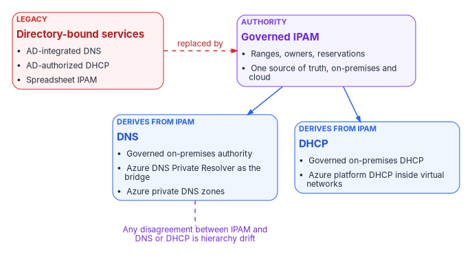
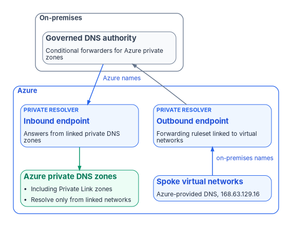

# Chapter 06 — Network Services: DNS, DHCP and IPAM

*DNS, DHCP and address management keep working after identity moves, which is exactly how they keep the old directory alive.*

::: {.callout-note}
## In this chapter
Why DNS, DHCP and IP address management form one surface and move together. How AD-integrated DNS gives way to a governed on-premises authority and Azure private resolution, what Active Directory's authorization of DHCP servers does and doesn't protect against, and why one IPAM authority owns the address space. [Book 08](../b08-ddi/index.md) carries the full DDI design, migration sequence and federal requirements; [Book 09](../b09-network/index.md) carries the network underneath.
:::

> **Dependency chain:** Inventory → Plan → Identity → Policy → **Network services** → Devices and servers → Access plane → Retire AD DS → Prove steady state

## The services claim

DNS, DHCP and IP address management are the services organizations most often defer when they modernize Active Directory, on the theory that because they still work they don't need to move. In the program's experience, AD-integrated DNS, AD-authorized DHCP and informal IPAM are frequent sources of post-migration governance regression: fine from the outside, quietly broken inside.

{#fig-ch06-ipam-authority fig-alt="Top, a violet card for the governed IPAM authority: ranges, owners, reservations, one source of truth. Two arrows lead down to a blue card for DNS, with three layers listed: governed on-premises authority, Azure DNS Private Resolver as the hybrid bridge, and Azure private DNS zones for cloud workloads; and a blue card for DHCP: governed on-premises DHCP, with Azure platform DHCP inside virtual networks. A red card at the left shows the legacy state it replaces: AD-integrated DNS, AD-authorized DHCP and a spreadsheet IPAM. A dashed violet line from DNS and DHCP back to IPAM is labeled any disagreement is hierarchy drift."}

In the program's reading of commercial practice, these stopped being background utilities some years ago: per-site Windows DNS gave way to unified DDI platforms in which DNS is a security control, and DHCP's lease data became part of the authoritative device inventory that Zero Trust depends on. The federal requirements point the same way. NIST SP 800-53 carries secure name resolution as its own controls (SC-20 for authoritative sources, SC-21 for recursive and caching resolvers, SC-22 for the architecture of the service) and treats the system component inventory as CM-8, which an IP address inventory feeds.[^c06-nist53] OMB M-22-09 directs agencies to encrypt DNS traffic,[^c06-m2209] and OMB M-26-14, issued May 22, 2026, now governs agency logging and network visibility in place of the rescinded M-21-31.[^c06-m2614] [Book 08, Chapter 03](../b08-ddi/03-federal-requirements.md) works through what each source requires of the name layer.

## Why these three, why together

The three form one addressing and resolution surface:

- **DNS** resolves names, usually from AD-integrated zones that replicate with AD and inherit its access model.
- **DHCP** assigns addresses from servers authorized in the forest, and often registers DNS records on clients' behalf.
- **IPAM** records which ranges exist, who owns them and which records point where. Without it, DNS and DHCP drift.

Moving DNS but leaving AD-authorized DHCP gives two authorities for assignment and resolution. Moving both but leaving IPAM in a spreadsheet produces conflicts and ghost records. The program treats the three as one domain: IPAM owns addressing, and DNS and DHCP derive from it.

## DNS — AD-integrated to private resolution

AD-integrated zones live inside the AD replication graph. DNS servers running on domain controllers can store their zones in AD DS, so zone data replicates through AD replication instead of zone transfers, every domain controller that runs DNS for the domain can accept updates, and secure dynamic updates become available.[^c06-adidns] Secure dynamic updates work only in AD-integrated zones, and zone permissions are AD access control lists.[^c06-dynupdate] In the common design every domain controller also runs DNS. As a result, every domain controller sits in the name-resolution trust path; AD can't retire until DNS moves; stale records from deleted computer objects need AD-side aging and scavenging; and domain-joined clients find domain controllers through the SRV records the Netlogon service registers in DNS,[^c06-dclocator] so DNS retirement and AD retirement must be sequenced together.

The target has three layers:

| Layer | Target | Purpose |
|-------|--------|---------|
| **Authoritative on-premises** | A governed DNS authority outside AD: a DDI platform under one policy plane, or file-backed Windows DNS as a waypoint | Records for the on-premises namespace once AD-integrated zones retire |
| **Hybrid resolution** | Azure DNS Private Resolver (inbound and outbound endpoints, forwarding rulesets)[^c06-dnspr] | Resolution in both directions between virtual networks and on-premises |
| **Authoritative cloud** | Azure private DNS zones linked to virtual networks, including the Private Link zones[^c06-pdns] | Records for cloud workloads and private endpoints |

On-premises conditional forwarders point to the resolver's inbound endpoint, which answers from the private zones linked to its virtual network.[^c06-hybrid-dns] Virtual networks keep using Azure-provided DNS at 168.63.129.16.[^c06-vnetdns] A forwarding ruleset attached to the outbound endpoint and linked to those networks sends on-premises domains to the on-premises servers.[^c06-dnspr] Records in a private zone resolve only from virtual networks linked to it, and a virtual network that uses custom DNS servers doesn't query its linked private zones automatically,[^c06-pdns] which is why the resolver sits in the path. The Private Resolver is a forwarding bridge, not an authority; the agency's own resolver stays the first hop for its clients, and every forwarding rule lives in the policy plane ([Book 08, Chapter 07](../b08-ddi/07-cloud-private-endpoints-and-ipam.md) and [Chapter 08](../b08-ddi/08-reference-architecture.md)). Arc-connected servers stay on-premises and use on-premises DNS.

{#fig-ch06-hybrid-resolution fig-alt="Top, an on-premises cluster with a slate card for the governed DNS authority holding conditional forwarders for Azure private zones. Below it, an Azure cluster with two blue Private Resolver cards, the inbound endpoint that answers from linked private DNS zones and the outbound endpoint whose forwarding ruleset is linked to virtual networks, a green card for Azure private DNS zones including Private Link zones that resolve only from linked networks, and a blue card for spoke virtual networks using Azure-provided DNS at 168.63.129.16. Arrows: on-premises authority to inbound endpoint labeled Azure names, inbound endpoint to private zones, spoke networks to outbound endpoint labeled on-premises names, and outbound endpoint back to the on-premises authority."}

Cloud-delivered DDI is available at federal impact levels. Infoblox Government Cloud, for example, has been FedRAMP certified at Moderate since December 15, 2022.[^c06-fedramp-ibx] Platform choice, cost and residual risk are in [Book 08, Chapter 12](../b08-ddi/12-selection-cost-and-residual-risk.md).

The program's DNS adapter **discovers** zones, records (with age and staleness), forwarders and recursion settings; **flags risk** (stale records, ownerless zones, aliases to decommissioned resources); **proposes** a target per zone (private DNS, keep on-premises, or retire); **migrates** one zone at a time with per-zone rollback; and **validates** record by record, including names other services depend on, such as certificate revocation (CRL and OCSP) endpoints. Records carry the owning object's attributes, so a record whose device has been deleted shows up as orphan drift. Scavenging needs care once workloads move: Azure's DHCP leases are long, and Microsoft warns that scavenging can remove dynamically registered records prematurely if it isn't adjusted.[^c06-vnetdns]

Migration runs in six steps: inventory ([Chapter 10](10-analyzing-the-estate.md)); a steward-reviewed target for each zone; one low-risk pilot zone; zone-by-zone cutover with a validation gate per zone; deletion of AD-integrated zones, with the forest's own `_msdcs` and domain zones retiring last alongside the domain controllers; and steady state with zero DNS drift. [Book 08, Chapter 04](../b08-ddi/04-active-directory-dns-departure.md) lists every record the domain maintains today, and [Chapter 10](../b08-ddi/10-migration-sequence.md) of that book runs the same work as six phases from inventory to hardening.

## DHCP — AD-authorized to governed DHCP

In an AD domain, a Windows DHCP server must be authorized before it leases addresses. Authorization writes the server into a list in the Configuration container of AD; the DHCP server checks that list every hour and, if its address isn't there, stops serving clients.[^c06-dhcpauth][^c06-dhcpquick] That check is a Windows DHCP Server service policing itself. It stops a misconfigured or unauthorized Windows server, but it doesn't stop a rogue device that was never a Windows DHCP server; switch-level controls do that ([Book 08, Chapter 05](../b08-ddi/05-edge-interception-and-bypass.md)). Earlier versions of this chapter called authorization "rogue-server detection"; it is narrower than that.

Assessments commonly find reservations for MAC addresses not seen in years, options that push DNS servers whose addresses will change, oversized scopes, and failover relationships never tested.

The target depends on the environment:

- **On-premises-heavy:** keep DHCP on dedicated, governed hosts or a DDI platform, decoupled from forest authorization.
- **Cloud-forward:** Azure virtual networks provide DHCP and DNS to Azure virtual machines, with no scopes to manage. A DHCP server running in an Azure VM can serve on-premises clients only through a DHCP relay agent; direct client-to-server DHCP traffic into Azure isn't supported, and renewals succeed only through the relay.[^c06-vnetfaq] On-premises subnets therefore still need a governed DHCP service.
- **Hybrid:** both, with IPAM as the single source of truth.

The DHCP adapter discovers every server (joined or not), scope, reservation, failover relationship and option set, especially scope-level DNS server options, and writes changes only through the plan pipeline. Scopes are tagged with the site they serve, which enables ownership drift checks and blast-radius analysis.

## IPAM — informal to governed

Many organizations discover during modernization that they have no real IPAM: a spreadsheet one person maintains, a stale wiki page, or partial tools covering some subnets, with reservations that conflict with actual use. The goal is **one governed IPAM authority** covering the full address surface, on-premises and cloud.

Inside Azure, Azure Virtual Network Manager IPAM provides hierarchical address pools that assign non-overlapping CIDRs to virtual networks, supports IPv4 and IPv6, and accepts reserved ranges for addresses used elsewhere.[^c06-ipam] It is generally available in all regions where Virtual Network Manager is available, apart from a short list of exceptions.[^c06-ipam-policy] Pools can be nested up to seven layers deep, but teams can still create virtual networks with directly assigned address space outside the pools, so Microsoft pairs IPAM with an Azure Policy definition that denies any virtual network without a pool allocation.[^c06-avnm-design][^c06-ipam-policy] In the program's design the enterprise IPAM stays the authority, and the Azure pools mirror the blocks reserved there ([Book 08, Chapter 07](../b08-ddi/07-cloud-private-endpoints-and-ipam.md)).

Whatever the product, the IPAM adapter discovers ranges, syncs host records with DNS and reservations with DHCP, tags every change with a correlation ID, and commits it to the repository.

IPAM is the source of truth, and DNS and DHCP produce matching records from it. Disagreement between IPAM and either service is *hierarchy drift*: the tree exists, but the leaves don't agree. Every services run therefore produces one coordinated plan of IPAM, DNS and DHCP actions, and the plan fails validation if any of the three would drift from the others. There is no DNS-only run. Three checks run continuously and produce evidence: no CIDR overlap between environments, every zone's integrity protection (DNSSEC signing or validation) in its expected state, and every workload address matched to an inventory entry.

## Validation

Services migration passes when:

- IPAM covers the full address surface, every private DNS record and DHCP reservation matches an IPAM entry, and no two environments' address blocks overlap;
- every on-premises conditional forwarder targets the resolver's inbound endpoint, and every virtual network that needs on-premises names is linked to a forwarding ruleset on the outbound endpoint;
- AD-integrated zones are retired or excluded with a documented rationale.

## Why "Phase 2" never comes

The common pattern is to modernize identity and policy and leave DNS, DHCP and IPAM for "Phase 2," which rarely happens. AD is retired for sign-in but kept because DNS still lives there. A forest that still hosts AD-integrated DNS has not been retired. Services migration is core modernization, not a follow-on.

## Key takeaways

1. DNS, DHCP and IP address management move together, with one IPAM authority as the source of truth.
2. Hybrid resolution runs through Azure DNS Private Resolver as a bridge, not an authority; AD-integrated zones retire last, with the domain controllers.
3. AD authorization stops unauthorized Windows DHCP servers, not rogue devices.
4. A forest that still hosts DNS has not been retired.

::: {.callout-tip}
## Continue the book
[← Previous: Chapter 05 — Policy Transformation](05-policy-transformation.md) · [Book index](index.md) · [Next: Chapter 07 — Compute Transformation →](07-compute-transformation.md)
:::

[^c06-nist53]: National Institute of Standards and Technology, SP 800-53 Rev. 5, *Security and Privacy Controls for Information Systems and Organizations*, September 2020 (updated December 10, 2020; minor release 5.2.0, August 27, 2025), controls SC-20, SC-21, SC-22 and CM-8, <https://csrc.nist.gov/pubs/sp/800/53/r5/upd1/final> (accessed Oct 21, 2026).
[^c06-m2209]: Office of Management and Budget, M-22-09, *Moving the U.S. Government Toward Zero Trust Cybersecurity Principles*, January 26, 2022, <https://www.whitehouse.gov/wp-content/uploads/2022/01/M-22-09.pdf> (accessed Oct 21, 2026).
[^c06-m2614]: Office of Management and Budget, M-26-14, *Ensuring Effective and Efficient Agency Logging and Network Visibility to Defend Against Evolving Cyber Threats*, May 22, 2026, <https://www.whitehouse.gov/wp-content/uploads/2026/05/M-26-14-Ensuring-Effective-and-Efficient-Agency-Logging-and-Network-Visibility-to-Defend-Against-Evolving-Cyber-Threats.pdf> (accessed Oct 21, 2026).
[^c06-adidns]: Microsoft Learn, "Active Directory-Integrated DNS Zones," <https://learn.microsoft.com/windows-server/identity/ad-ds/plan/active-directory-integrated-dns-zones> (accessed Oct 21, 2026).
[^c06-dynupdate]: Microsoft Learn, "How to configure DNS dynamic updates in Windows" (KB 816592), section "Summary" (AD integration, aging and scavenging, secure dynamic updates only in AD-integrated zones), <https://learn.microsoft.com/troubleshoot/windows-server/networking/configure-dns-dynamic-updates-windows-server-2003> (accessed Oct 21, 2026).
[^c06-dclocator]: Microsoft Learn, "Locating domain controllers in Windows and Windows Server," section "Domain controller locator process," <https://learn.microsoft.com/windows-server/identity/ad-ds/manage/dc-locator> (accessed Oct 21, 2026).
[^c06-dnspr]: Microsoft Learn, "What is Azure DNS Private Resolver?," sections "Inbound endpoints," "Outbound endpoints," "Virtual network links" and "DNS forwarding rulesets," <https://learn.microsoft.com/azure/dns/dns-private-resolver-overview> (accessed Oct 21, 2026).
[^c06-pdns]: Microsoft Learn, "Azure Private DNS zone overview," section "Private DNS zone resolution," <https://learn.microsoft.com/azure/dns/private-dns-privatednszone> (accessed Oct 21, 2026).
[^c06-hybrid-dns]: Microsoft Learn, "Resolve Azure and on-premises domains," section "Configure on-premises DNS conditional forwarders," <https://learn.microsoft.com/azure/dns/private-resolver-hybrid-dns> (accessed Oct 21, 2026).
[^c06-vnetdns]: Microsoft Learn, "Configure DNS name resolution for Azure virtual networks," sections "Azure-provided name resolution" and "Name resolution that uses your own DNS server" (168.63.129.16; long Azure DHCP leases and DNS record scavenging), <https://learn.microsoft.com/azure/virtual-network/virtual-networks-name-resolution-for-vms-and-role-instances> (accessed Oct 21, 2026).
[^c06-fedramp-ibx]: FedRAMP Marketplace, "Infoblox Government Cloud" (FR2017257053): FedRAMP Certified, Class C (Moderate), Rev5, agency path, certified since December 15, 2022, <https://www.fedramp.gov/marketplace/products/FR2017257053/> (accessed Oct 21, 2026).
[^c06-dhcpauth]: Microsoft Learn, "Troubleshooting guide: DHCP authorization failures," section "DHCP authorization flow," <https://learn.microsoft.com/troubleshoot/windows-server/networking/troubleshooting-guide-dhcp-authorization-failures> (accessed Oct 21, 2026).
[^c06-dhcpquick]: Microsoft Learn, "Quickstart: Install and configure DHCP Server," section "Authorize the DHCP server in Active Directory," <https://learn.microsoft.com/windows-server/networking/technologies/dhcp/quickstart-install-configure-dhcp-server> (accessed Oct 21, 2026).
[^c06-vnetfaq]: Microsoft Learn, "Azure Virtual Network frequently asked questions (FAQ)," entry "Can I deploy a DHCP server in a virtual network?," <https://learn.microsoft.com/azure/virtual-network/virtual-networks-faq> (accessed Oct 21, 2026).
[^c06-ipam]: Microsoft Learn, "What is IP address management (IPAM) in Azure Virtual Network Manager?," <https://learn.microsoft.com/azure/virtual-network-manager/concept-ip-address-management> (accessed Oct 21, 2026).
[^c06-ipam-policy]: Microsoft Learn, "Prevent overlapping virtual network address spaces with Azure Policy and IPAM" (availability note and sample deny policy), <https://learn.microsoft.com/azure/virtual-network-manager/prevent-overlapping-ip-address-space-policy-ipam> (accessed Oct 21, 2026).
[^c06-avnm-design]: Microsoft Learn, "Centralized network management with Azure Virtual Network Manager," section "Azure Virtual Network Manager capabilities" (hierarchical pools up to seven layers; allocations outside pools; Azure Policy to enforce IPAM), <https://learn.microsoft.com/azure/networking/design-guide/azure-virtual-network-manager> (accessed Oct 21, 2026).
