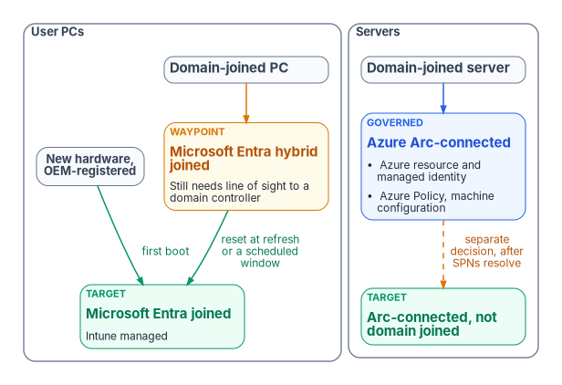
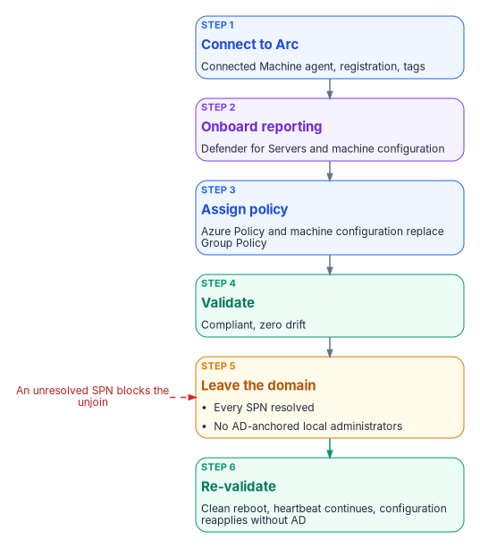

# Chapter 07 — Compute Transformation

*A machine leaves Active Directory only when its identity, its policy and its trust have each been replaced; the domain join is the last thing to go, not the first.*

::: {.callout-note}
## In this chapter
The device states and which one each class of machine ends in. Three migration patterns for user PCs, the Arc path for servers, and where compute should run while its data stays put. How Kerberos service principal names and NTLM are resolved before any server leaves the domain, how device attributes and certificates replace OU placement and AD CS logon, and what device lifecycle looks like afterward. [Book 05](../b05-devices/index.md) carries the device and server detail, [Book 06](../b06-data-platform/index.md) the SQL Server estate, and [Book 07](../b07-pki/index.md) the certificates.
:::

> **Dependency chain:** Inventory → Plan → Identity → Policy → Network services → **Devices and servers** → Access plane → Retire AD DS → Prove steady state

## The compute claim

Once identity ([Chapter 04](04-identity-transformation.md)), policy ([Chapter 05](05-policy-transformation.md)) and network services ([Chapter 06](06-network-services.md)) have moved, domain-joined PCs and servers are the largest remaining Active Directory dependency. PCs move to Microsoft Entra join and Intune. Servers move to Azure Arc and Azure machine configuration. Kerberos-bound applications lose their domain-join anchor and either move to modern authentication or retire. This chapter ends when no device authenticates to Active Directory, the last precondition for retiring AD DS.

{#fig-ch07-device-paths fig-alt="Left column, user PCs. A slate card for a domain-joined PC leads to an amber card, Microsoft Entra hybrid joined, labeled waypoint: still needs line of sight to a domain controller. From it an arrow labeled reset at refresh or a scheduled window leads to a green card, Microsoft Entra joined and Intune managed. A separate slate pill for new hardware, registered by the OEM, leads straight to the green card. Right column, servers. A slate card for a domain-joined server leads to a blue card, Azure Arc-connected: Azure resource, managed identity, Azure Policy and machine configuration. A dashed amber arrow labeled separate decision, after SPNs are resolved, leads to a green card, Arc-connected and no longer domain joined."}

## The device states

| State | Primary auth | Managed by | When to use |
|-------|--------------|------------|-------------|
| **Domain-joined** (legacy) | AD Kerberos | Group Policy | Migration origin |
| **Entra registered**[^c07-registered] | Personal device with a work account added | Intune (optional) | Bring-your-own-device and mobile scenarios; the program keeps it to a minimum for government-furnished equipment |
| **Hybrid joined**[^c07-hybrid] | AD and Entra ID together | Group Policy and Intune | Transition state, not a target |
| **Entra joined** | Entra ID | Intune | Target for user PCs |
| **Arc-connected server**[^c07-arc] | OS logon unchanged; system-assigned managed identity for Azure-plane operations | Azure Arc, Azure Policy and machine configuration | Target for servers |

Two rules follow. **Hybrid join is a transition, not a destination.** Microsoft describes hybrid join as an interim step on the road to Entra join,[^c07-devid] and says it shouldn't be any organization's long-term or end-goal state.[^c07-join-types] A program that leaves devices hybrid joined has not finished. Hybrid-joined devices also need periodic line of sight to a domain controller; without it, device and user password changes and TPM resets break and the device eventually becomes unusable.[^c07-hybrid-plan] **The target depends on device class.** User PCs go to Entra join and Intune; Windows and Linux servers go to Arc and machine configuration, because Intune's supported platforms don't include Windows Server.[^c07-intune-platforms] The two share compliance telemetry but not a management model.

Before a device leaves the domain, three AD dependencies need replacements, or it ships with a gap:

- **Identity.** The computer account authenticates with Kerberos and receives Group Policy through its OU.
- **Policy.** Local administrators, registry settings, software and startup scripts arrive through Group Policy.
- **Trust.** The certificate store trusts AD-issued CAs, smart-card logon relies on AD CS, and network access control may use AD credentials ([Book 07, Chapter 02](../b07-pki/02-what-ad-cs-holds-up.md)).

## Three migration patterns for user PCs

1. **Greenfield.** New hardware ships from the OEM already registered with Windows Autopilot, and first boot is an Entra join. An OEM can register devices on the organization's behalf only after a Global Administrator approves it.[^c07-oem] No AD dependency is ever created. Every hardware refresh should use this pattern, whatever the state of the wider program ([Book 05, Chapter 04](../b05-devices/04-intune-first-onboarding.md)).
2. **Reset and re-enroll.** Back up user state, reset the device, and re-enroll it as Entra joined. It is heavy for the user but technically clean, and a common choice for high-privilege users' devices.
3. **Hybrid, then cloud.** Where an immediate reset isn't feasible, devices are hybrid joined first while workloads move from Group Policy to Intune. There is no Microsoft-supported path to convert a hybrid-joined device to Entra join without resetting Windows, and Autopilot Reset doesn't support hybrid-joined devices, so the last step is a full wipe;[^c07-join-types] Windows Autopilot for existing devices, a Configuration Manager task sequence that reimages the machine, is one documented way to do it.[^c07-existing] Microsoft recommends timing the move to a complementary event such as a hardware refresh or rebuild.[^c07-join-types] This is the most common and slowest path; it defers the reset rather than avoiding it, and drift detection keeps devices from stalling in hybrid state. [Book 05, Chapter 02](../b05-devices/02-the-hybrid-join-trap.md) covers why the fleet-wide hybrid flip is close to a tenant switch and how to govern it.

## Servers — the Arc path

Azure Arc projects an on-premises or other-cloud server into Azure as a resource. The server stays where it is physically. It gains a system-assigned managed identity for Azure-plane operations, receives Azure Policy and machine configuration assignments, appears in Defender for Cloud and Azure Monitor, and is governed like a native Azure VM.[^c07-arc] Each projected server is tagged with its organizational attributes, and policy assignments target those tags, the same pattern Intune uses for user devices.

Onboarding doesn't change how people sign in to the server. Windows Server 2025 with Desktop Experience can optionally use Microsoft Entra ID for Remote Desktop sign-in, with Azure roles deciding who may sign in. Enabling it Entra joins the machine, so it is meant for servers that won't stay joined to AD, and Conditional Access isn't supported for those servers.[^c07-arc-login]

For each domain-joined server:

1. **Connect to Arc.** Install the Connected Machine agent, register, and apply tags.[^c07-arc]
2. **Onboard reporting.** Defender for Servers and machine configuration report posture. Microsoft recommends onboarding non-Azure servers to Defender for Cloud through Arc,[^c07-mdfc] and Defender for Cloud onboards the Defender for Endpoint extension to Arc-enabled machines automatically.[^c07-mde-server] Conditional Access governs user and workload sign-ins to Entra-protected resources; it doesn't evaluate server compliance for server-to-server traffic.
3. **Assign policy.** Settings that came from Group Policy now come through Azure Policy and machine configuration ([Chapter 05](05-policy-transformation.md)).
4. **Validate.** Machine configuration reports compliant and drift is zero.
5. **Leave the domain,** only once Kerberos-bound clients have moved and no local administrators are AD-anchored. In the program's target, Arc-enabled servers run without a domain join, and the unjoin is a separately sequenced decision for each workload ([Book 05, Chapter 09](../b05-devices/09-servers-under-azure-arc.md)).
6. **Re-validate.** The server reboots clean, the Arc heartbeat continues, and configuration reapplies without AD.

{#fig-ch07-server-arc-path fig-alt="A vertical chain of six cards. Step 1, blue, connect to Arc: Connected Machine agent, registration, tags. Step 2, violet, onboard reporting: Defender for Servers and machine configuration. Step 3, blue, assign policy: Azure Policy and machine configuration replace Group Policy. Step 4, green, validate: compliant, zero drift. Step 5, amber, leave the domain: only after every SPN on the server is resolved and no local administrators are AD-anchored. Step 6, green, re-validate: clean reboot, heartbeat continues, configuration reapplies without AD. A red side note beside step 5 reads unresolved SPN blocks the unjoin."}

Duration depends mostly on the Kerberos-application inventory, so budget per application, not per server. SQL Server hosts are the largest single class and have their own sequence in [Book 06, Chapter 10](../b06-data-platform/10-arc-deployment-sequencing.md).

### Where compute runs

Arc changes how a server is governed, not where it runs, and the program keeps it that way until the application is ready to move. Every synchronous call between an application and its authoritative data pays the network's propagation delay once, and no amount of bandwidth removes it. Separating an application from its data therefore multiplies that delay by the number of round trips a business transaction makes. The program's rule is that an application's compute stays co-located with its authoritative data until transaction profiling shows the round-trip count has been reduced: by consolidating fine-grained calls into one, moving work off the user's critical path with asynchronous processing, caching repeat reads, batching operations, and reusing connections. That check is a gate in the migration plan, not a network purchase. [Book 09](../b09-network/index.md) covers the network physics behind it.

## Kerberos and SPN retirement

Every service principal name in the inventory's Kerberos map ([Chapter 10](10-analyzing-the-estate.md)) is an application that expects Kerberos. Each needs one of three decisions:

- **Migrate** to OAuth 2.0 and OpenID Connect through an Entra app registration. This is the preferred path. For a web application that can't be rewritten yet, Entra application proxy can publish it with Entra pre-authentication and use Kerberos constrained delegation to reach the back end, which keeps the SPN but moves the user's sign-in to Entra ID.[^c07-kcd]
- **Retire** it, often the cheapest option for end-of-life applications.
- **Island** it, as a last resort: a minimal AD island hosting only that application, with a documented end-of-life date.

No server leaves the domain until every SPN on it is resolved. [Book 06, Chapter 18](../b06-data-platform/18-the-four-class-pattern-for-applications.md) applies the same decision to SQL-consuming applications.

NTLM is resolved in the same pass. Microsoft has deprecated every version of NTLM and recommends replacing NTLM calls with Negotiate, which tries Kerberos first.[^c07-ntlm] NTLMv1 is removed starting with Windows 11, version 24H2 and Windows Server 2025, and NTLMv2 still works on Windows Server 2025 but will be removed in a future release.[^c07-ntlm-ws] NTLM authentication is opaque to Entra ID's sign-in logs and to Conditional Access, so the program treats every remaining NTLM flow as an item to remove, not to accept ([Book 06, Chapter 15](../b06-data-platform/15-the-three-phases-of-ntlm-elimination.md)).

### What distance does and doesn't break

Kerberos is often blamed for failures that distance causes elsewhere, so the program states the protocol facts precisely. By default a user's ticket-granting ticket lasts 10 hours and can be renewed for 7 days,[^c07-tgt][^c07-renew] and a service ticket lasts 600 minutes.[^c07-st] The well-known five-minute figure is the clock-skew tolerance between client, server and KDC, not a latency budget.[^c07-skew] What distance does hurt are the operations that need a domain controller: initial ticket acquisition at logon, Group Policy and SYSVOL retrieval ([Chapter 05](05-policy-transformation.md)), password changes and hybrid-join registration.[^c07-hybrid-plan] Moving devices to Entra join removes most of those calls. Access to remaining Kerberos resources from Entra-joined devices still needs a domain controller: Microsoft Entra Kerberos can issue a partial ticket-granting ticket at sign-in, but the device must exchange it with an on-premises domain controller for a full one, which needs line of sight.[^c07-entra-kerberos]

## Devices, attributes and certificates

Devices carry organizational attributes, typically the device extension attributes 1 to 15 set through Microsoft Graph, or rules on properties such as the enrollment profile name.[^c07-dyn] Those attributes drive device dynamic groups, Intune compliance scoping and Conditional Access device-state targeting. A device whose attributes disagree with its owner's is value drift.

When domain-joined PCs go, AD CS-anchored smart-card logon goes with them. Microsoft Entra certificate-based authentication replaces it: users can sign in to Windows with a smart card directly against Entra ID on Entra-joined and hybrid-joined devices, with no special client configuration, provided they use managed authentication rather than federation.[^c07-cbasc] It still needs a reader, a valid user certificate and a configured username binding ([Chapter 08](08-access-plane.md); [Book 07, Chapter 06](../b07-pki/06-device-and-user-certificates.md)). Single sign-on from Entra-joined devices to on-premises resources keeps working, but it needs line of sight to on-premises domain controllers and a sync service that carries the user's on-premises attributes, so those resources still depend on AD until they retire.[^c07-ssoonprem]

## Lifecycle after the move

- **Joiner.** The device ships from the OEM, the user signs in with Entra ID, compliance enrollment and Conditional Access apply, and apps install from Intune. Silent BitLocker encryption backs the recovery key up to Entra ID automatically on Entra-joined devices.[^c07-bitlocker]
- **Mover.** Attribute changes recompute device groups and Intune reapplies policy.
- **Leaver.** The device is retired or wiped in Intune first, after its BitLocker recovery key and local administrator credentials are backed up, because retiring or deleting the Intune object suspends BitLocker on the OS volume.[^c07-retire] Its Entra device object is deleted last; that deletion is nonrecoverable and removes the device's BitLocker keys.[^c07-delete] A device that is reused is reset for its next user instead. [Book 05, Chapter 06](../b05-devices/06-who-owns-the-endpoint.md) sets out who owns each step.

There are no OU moves, domain unjoins, GPO re-links or AD cleanup. Device lifecycle becomes policy, not infrastructure.

## Validation

Compute migration passes when:

- every user PC is Entra joined, and every server is Arc-connected or exempt with a retirement date;
- every device has valid attributes, and Intune and Azure Policy assignments target attribute-scoped groups or tags;
- every SPN in the legacy map is migrated, retired or islanded with an end-of-life date, and no NTLM flow remains outside a dated exception.

When every device, application, DNS zone, DHCP scope, SPN and GPO has moved, AD DS has no active consumers. The retirement itself is mechanical ([Chapter 12](12-migration-roadmap.md)); the hard part is Chapters 04 to 07.

## Key takeaways

1. User PCs end Entra joined; reaching that from hybrid join requires a reset or reimage, best timed to a refresh.
2. Servers are Arc-connected for governance; their operating-system logon and domain membership are separate decisions.
3. No server leaves the domain until every SPN on it is migrated, retired or islanded, and NTLM is removed in the same pass.
4. Compute stays with its data until the application's round trips have been reduced.

::: {.callout-tip}
## Continue the book
[← Previous: Chapter 06 — Network Services: DNS, DHCP and IPAM](06-network-services.md) · [Book index](index.md) · [Next: Chapter 08 — The Access Plane →](08-access-plane.md)
:::

[^c07-registered]: Microsoft Learn, "Microsoft Entra registered devices," <https://learn.microsoft.com/entra/identity/devices/concept-device-registration> (accessed Oct 21, 2026).
[^c07-hybrid]: Microsoft Learn, "Microsoft Entra hybrid joined devices," <https://learn.microsoft.com/entra/identity/devices/concept-hybrid-join> (accessed Oct 21, 2026).
[^c07-arc]: Microsoft Learn, "What is Azure Arc-enabled servers?," section "Supported cloud operations," <https://learn.microsoft.com/azure/azure-arc/servers/overview> (accessed Oct 21, 2026).
[^c07-devid]: Microsoft Learn, "What is a device identity?," section "Modern device scenario," <https://learn.microsoft.com/entra/identity/devices/overview> (accessed Oct 21, 2026).
[^c07-join-types]: Microsoft Learn, "Microsoft Entra joined vs. Hybrid Microsoft Entra joined in cloud-native endpoints," section "Which option is right for your organization," <https://learn.microsoft.com/intune/solutions/cloud-native-endpoints/entra-join-types> (accessed Oct 21, 2026).
[^c07-hybrid-plan]: Microsoft Learn, "Plan your Microsoft Entra hybrid join implementation," section "Prerequisites" (scenarios that break without line of sight to domain controllers), <https://learn.microsoft.com/entra/identity/devices/hybrid-join-plan> (accessed Oct 21, 2026).
[^c07-intune-platforms]: Microsoft Learn, "Supported operating systems and browsers in Intune," <https://learn.microsoft.com/intune/fundamentals/ref-supported-platforms> (accessed Oct 21, 2026).
[^c07-oem]: Microsoft Learn, "OEM registration," sections "Device registration process" and "Customer consent," <https://learn.microsoft.com/autopilot/oem-registration> (accessed Oct 21, 2026).
[^c07-existing]: Microsoft Learn, "Windows Autopilot deployment for existing devices," <https://learn.microsoft.com/autopilot/existing-devices> (accessed Oct 21, 2026).
[^c07-arc-login]: Microsoft Learn, "Sign in to an Azure Arc-enabled server using Microsoft Entra ID and Azure Roles Based Access Control," sections "Important" note and "Requirements," <https://learn.microsoft.com/entra/identity/devices/howto-arc-sign-in-windows> (accessed Oct 21, 2026).
[^c07-mdfc]: Microsoft Learn, "Connect your non-Azure machines to Microsoft Defender for Cloud," <https://learn.microsoft.com/azure/defender-for-cloud/quickstart-onboard-machines> (accessed Oct 21, 2026).
[^c07-mde-server]: Microsoft Learn, "Onboard servers to Microsoft Defender," section "Server plans," <https://learn.microsoft.com/defender-endpoint/onboard-server#server-plans> (accessed Oct 21, 2026).
[^c07-kcd]: Microsoft Learn, "Kerberos Constrained Delegation for single sign-on (SSO) to your apps with application proxy," <https://learn.microsoft.com/entra/identity/app-proxy/how-to-configure-sso-with-kcd> (accessed Oct 21, 2026).
[^c07-ntlm]: Microsoft Learn, "Deprecated features for Windows client," entry NTLM (announced June 2024; November 2024 update on NTLMv1 removal), <https://learn.microsoft.com/windows/whats-new/deprecated-features> (accessed Oct 21, 2026).
[^c07-ntlm-ws]: Microsoft Learn, "Features removed or no longer developed in Windows Server," Windows Server 2025, entries NTLMv1 (removed) and NTLM (no longer in development), <https://learn.microsoft.com/windows-server/get-started/removed-deprecated-features-windows-server> (accessed Oct 21, 2026).
[^c07-tgt]: Microsoft Learn, "Max-Ticket-Age attribute" (10 hours by default in the Default Domain Policy), <https://learn.microsoft.com/windows/win32/adschema/a-maxticketage> (accessed Oct 21, 2026).
[^c07-renew]: Microsoft Learn, "Max-Renew-Age attribute" (7 days by default in the Default Domain Policy), <https://learn.microsoft.com/windows/win32/adschema/a-maxrenewage> (accessed Oct 21, 2026).
[^c07-st]: Microsoft Learn, "Create and manage Active Directory connections for Azure NetApp Files," section "Requirements and considerations for Active Directory connections" (Active Directory's default service ticket lifetime of 600 minutes), <https://learn.microsoft.com/azure/azure-netapp-files/create-active-directory-connections> (accessed Oct 21, 2026).
[^c07-skew]: Microsoft Learn, "Kerberos protocol registry entries and KDC configuration keys in Windows," entry SkewTime (default 5 minutes), <https://learn.microsoft.com/troubleshoot/windows-server/windows-security/kerberos-protocol-registry-kdc-configuration-keys> (accessed Oct 21, 2026).
[^c07-entra-kerberos]: Microsoft Learn, "Introduction to Microsoft Entra Kerberos," section "Authentication flow," <https://learn.microsoft.com/entra/identity/authentication/kerberos> (accessed Oct 21, 2026).
[^c07-dyn]: Microsoft Learn, "Manage rules for dynamic membership groups in Microsoft Entra ID," section "Rules for devices," <https://learn.microsoft.com/entra/identity/users/groups-dynamic-membership> (accessed Oct 21, 2026).
[^c07-cbasc]: Microsoft Learn, "Windows smart card sign-in using Microsoft Entra certificate-based authentication," sections "User experience" and "Restrictions and caveats," <https://learn.microsoft.com/entra/identity/authentication/concept-certificate-based-authentication-smartcard> (accessed Oct 21, 2026).
[^c07-ssoonprem]: Microsoft Learn, "How SSO to on-premises resources works on Microsoft Entra joined devices," section "Prerequisites," <https://learn.microsoft.com/entra/identity/devices/device-sso-to-on-premises-resources> (accessed Oct 21, 2026).
[^c07-bitlocker]: Microsoft Learn, "Encrypt Windows devices with BitLocker using Intune," section "Troubleshooting" (recovery keys backed up to Microsoft Entra ID during silent encryption), <https://learn.microsoft.com/intune/device-configuration/endpoint-security/encrypt-bitlocker-windows> (accessed Oct 21, 2026).
[^c07-retire]: Microsoft Learn, "Device action: retire," section "Before retiring or deleting a Microsoft Entra joined device," <https://learn.microsoft.com/intune/device-management/actions/retire> (accessed Oct 21, 2026).
[^c07-delete]: Microsoft Learn, "Manage devices" (Microsoft Entra PowerShell), section "Delete a Microsoft Entra device," <https://learn.microsoft.com/powershell/entra-powershell/manage-devices> (accessed Oct 21, 2026).
