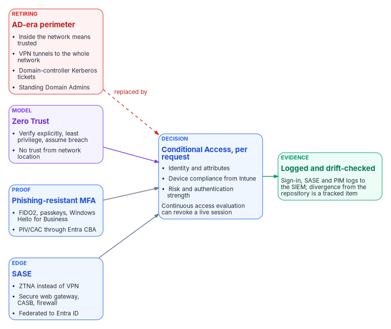
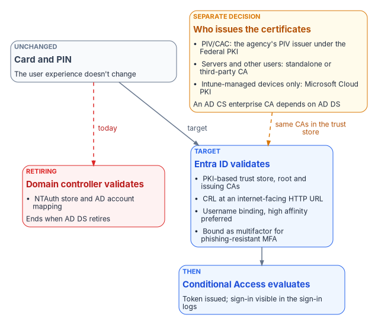
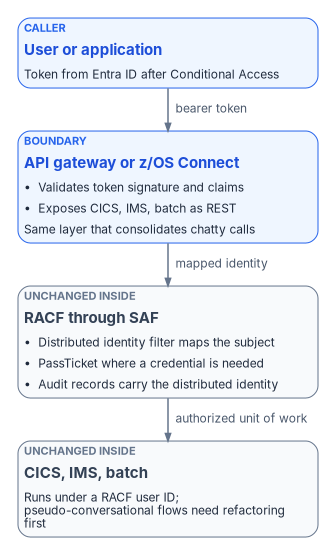

# Chapter 08 — The Access Plane

*When Active Directory retires, being inside the network stops meaning anything; every access decision has to be made again, per request, from who is asking, from what device and with what proof.*

::: {.callout-note}
## In this chapter
The four surfaces of the access plane that replaces the AD network perimeter: Zero Trust as the model, Conditional Access as the decision, SASE as the edge, and phishing-resistant MFA with certificate-based authentication as the proof. Why the move from session-based to token-based identity is the heart of it, how smart-card sign-in is re-anchored in Entra ID before AD DS retires, how privileged access works without standing rights, what continuous access evaluation can and can't revoke, and how the same token pattern reaches the mainframe. [Book 04](../b04-access/index.md) owns the policy library and the privilege model in depth; this chapter is the arc-level view.
:::

> **Dependency chain:** Inventory → Plan → Identity → Policy → Network services → Devices and servers → **Access plane** → Retire AD DS → Prove steady state

## The access claim

Retiring Active Directory removes the network perimeter as an authorization boundary. Its replacement is an **identity-bound access plane** with four coordinated surfaces: **Zero Trust** (the architectural model), **Conditional Access** (policy enforcement, [Chapter 05](05-policy-transformation.md)), **SASE** (edge delivery), and **phishing-resistant MFA with certificate-based authentication** (proof of identity). Every access decision becomes a per-request evaluation of identity, device and signal, made at the cloud edge, logged, and visible to the drift engine.

{#fig-ch08-access-plane fig-alt="Left to right. A red card labeled retiring, the AD-era perimeter, lists inside the network means trusted, VPN tunnels to the whole network, domain-controller Kerberos tickets and standing Domain Admins; a dashed red arrow labeled replaced by runs from it to the central decision card. Three cards in a column feed that decision: a violet model card, Zero Trust, with verify explicitly, least privilege, assume breach and no trust from network location; a blue proof card, phishing-resistant MFA, with FIDO2, passkeys and Windows Hello for Business plus PIV or CAC through Entra certificate-based authentication; and a blue edge card, SASE, with ZTNA instead of VPN, secure web gateway, CASB and firewall, federated to Entra ID. The blue decision card, Conditional Access per request, weighs identity and attributes, device compliance from Intune, risk and authentication strength, and notes that continuous access evaluation can revoke a live session. It feeds a green evidence card: sign-in, SASE and PIM logs go to the SIEM, and divergence from the repository is a tracked item."}

Federal policy states the same move in plain terms. OMB M-22-09 says that users should log into applications rather than networks, that every application should be treated as internet-accessible from a security perspective, and that MFA belongs at the application layer rather than in network authentication such as a VPN.[^c08-m2209] [Book 04, Chapter 01](../b04-access/01-access-is-a-policy-decision.md) develops the consequence: once network location stops deciding access, the policy engine does, and the policy library becomes the agency's access control in practice.

## The model — Zero Trust

Zero Trust is a set of architectural principles, not a product. NIST SP 800-207 defines it through basic tenets, including that all communication is secured regardless of network location and that access to each enterprise resource is granted per session, with least privilege, by dynamic policy that weighs the client's identity, the requesting asset's state and other attributes.[^c08-n207] Microsoft condenses the same idea into three principles:[^c08-zt]

1. **Verify explicitly.** Identity, device posture, risk and session state are evaluated per request; being inside the network confers no trust.
2. **Use least-privilege access.** Access is time-bound and scoped to resource and purpose, with no standing privilege.
3. **Assume breach.** Treat every session as potentially compromised; continuous access evaluation can revoke it mid-flight, and break-glass exclusions stay minimal and audited.

No single control is Zero Trust. The pattern is Conditional Access, Intune compliance, privileged identity management and certificate-based authentication working together. Three AD-era patterns retire with it:

- **Network segment as authority.** IP allowlists stop being authoritative; policy is per identity, device and session. CISA's Zero Trust Maturity Model places perimeter macro-segmentation and bulk-traffic VPN tunnels at its lowest, Traditional stage of the Networks pillar.[^c08-ztmm]
- **Pass-through AD Kerberos.** Modernized services accept short-lived cloud tokens instead of domain-controller tickets. Services on a documented Kerberos island keep Kerberos until they retire. Microsoft's bridges for those islands are Entra Application Proxy or Entra Private Access with Kerberos constrained delegation, where the user authenticates to Entra ID and a connector obtains the Kerberos ticket on the user's behalf, and cloud Kerberos trust for passwordless sign-in to on-premises resources.[^c08-soa]
- **Persistent administrative rights.** Domain Admins, local administrator groups and never-expiring service accounts move to just-in-time elevation, group managed service accounts on remaining Kerberos islands,[^c08-gmsa] or workload identity federation for workloads that would otherwise hold a secret.[^c08-wif]

## From sessions to tokens

Active Directory Kerberos assumes clients and servers sit in the same building. Tokens assume they are strangers on the internet. A token is a signed assertion: this user is who they claim to be, this device is compliant, this request is authorized, issued now, signed here. The resource doesn't have to trust the network or call back to a domain controller; it verifies the signature. Entra ID, Conditional Access and device compliance are the token-based equivalents of what AD used to do, and [Book 02, Chapter 03](../b02-identity/03-ad-and-entra-side-by-side.md) sets the two models side by side.

Three federal anchors push in this direction:

- **OMB M-22-09** requires phishing-resistant MFA for agency staff, contractors and partners, and requires agency systems to stop supporting, for routine self-service access by those users, methods that fail to resist phishing, including SMS or voice codes, one-time codes and push notifications.[^c08-m2209]
- **CISA BOD 25-01** makes the policies CISA lists as mandatory in its SCuBA baselines binding on federal civilian agencies.[^c08-bod2501] The mandatory list for Microsoft Entra ID includes MS.AAD.1.1v1, "Legacy authentication SHALL be blocked," and MS.AAD.3.1v1, phishing-resistant MFA for all users.[^c08-scuba-required]
- **CISA's Zero Trust Maturity Model** describes the Identity pillar's Advanced stage as beginning to authenticate all identity with phishing-resistant MFA, including passwordless MFA through FIDO2 or PIV, and the Optimal stage as validating identity continuously with phishing-resistant MFA, not only when access is first granted.[^c08-ztmm] The model names FIDO2 and PIV as examples; it doesn't make certificate-based authentication the required primary method, and CISA says the model is a guide, not a strict set of requirements.[^c08-ztmm]

NTLM is the protocol with the weakest story here. It can't carry a device signal or an authentication strength, so Conditional Access can't evaluate it. It isn't invisible, though: domain controllers log NTLM logons, and Microsoft documents NTLM auditing as the way to find what still uses it.[^c08-ntlm-audit] Microsoft deprecated all versions of NTLM in June 2024 and removed NTLMv1 starting with Windows 11, version 24H2 and Windows Server 2025; NTLMv2 still works and is slated for removal in a future release.[^c08-ntlm-deprecated] The program treats every NTLM dependency as a finding with an owner and a date. [Book 06, Chapter 14](../b06-data-platform/14-ntlm-and-the-patterns-that-generate-it.md) works through the patterns that generate it on the data platform.

> **Tokens only work if the identity model behind them is right.** If what a user is allowed to do is still encoded in OU trees with no authoritative HR-derived source, tokens won't fix it; they will sign broken authorizations very efficiently. A token has to assert an authorization that is *true*, not merely well-formed. That is why the access plane depends on the identity work in [Chapter 04](04-identity-transformation.md) and on the HR source of authority in [Book 03](../b03-hr-identity/index.md).

## SASE — the edge delivery surface

Secure Access Service Edge (SASE) is the cloud-delivered security surface that replaces the on-premises firewall, VPN, proxy and CASB stack. CISA defines SASE as a framework that combines networking tools such as SD-WAN, routing and bandwidth optimization with security tools such as a secure web gateway, a cloud access security broker, zero trust network access and a next-generation firewall, so that a distributed workforce can reach internal and external resources securely.[^c08-cisa-sase] SD-WAN alone chooses paths by application; it doesn't decide access by user identity or device posture. That is what the security half of SASE adds. Microsoft's own security service edge is Global Secure Access, made up of Entra Internet Access and Entra Private Access; Private Access gives per-app access to private resources without a VPN.[^c08-gsa] Global Secure Access is available in GCC but not yet in GCC High or the DoD cloud.[^c08-gsa-limits] The program doesn't pick a vendor; it governs the integration contract.

| Component | Function | Integration |
|-----------|----------|-------------|
| **Zero Trust Network Access** | Per-application access; replaces VPN | Attribute-scoped application groups; Conditional Access enforces compliance and MFA |
| **Secure Web Gateway** | Outbound web filtering and DLP | Attribute-scoped user groups; logs to the SIEM |
| **Cloud Access Security Broker** | Inline enforcement for sanctioned cloud apps | Reads the cloud app catalog; attribute-scoped policies |
| **Firewall as a Service** | Distributed firewall plane | Policy targeted by projected tags |
| **Data Loss Prevention** | Content-aware filtering | Attribute-scoped sensitive-data groups |

Whatever the vendor, the contract is the same:

1. **Federation.** Users authenticate through Entra ID; there is no local SASE user database.
2. **Group targeting.** Policies reference attribute-scoped dynamic groups.
3. **Device posture.** The Intune compliance signal is a policy input.
4. **Logging.** Access logs go to the SIEM, and the drift engine correlates them with Entra sign-in logs. Agencies adopting TIC 3.0 use cases also have to work out with CISA what telemetry they share, because traffic that no longer passes the old TIC sensors still has to be visible to CISA.[^c08-cisa-sase]
5. **Provenance.** Policy changes flow through the repository, never through direct portal edits.

Transport, branch control and the TIC 3.0 posture behind this edge are [Book 09](../b09-network/index.md)'s subject; its [Chapter 05](../b09-network/05-sd-wan-sase-and-governed-transport.md) covers SD-WAN, SASE and governed transport, and [Chapter 03](../b09-network/03-what-tic-3-requires.md) what TIC 3.0 requires.

## Phishing-resistant MFA

Phishing-resistant methods are the target for every user. M-22-09 requires them for agency staff, contractors and partners and requires agencies to offer them to the public.[^c08-m2209] Privileged users and high-risk resources move first, because that is where a phished credential costs the most.

| Method | Phishing-resistant | Typical use |
|--------|--------------------|-------------|
| **FIDO2 security keys** | Yes | Tier-0 administrators, high-privilege users |
| **Windows Hello for Business** (and Platform SSO on macOS)[^c08-whfb][^c08-pr-plan] | Yes | Default daily sign-in on user PCs |
| **Certificate-based authentication** (PIV/CAC), configured as multifactor[^c08-pr-plan] | Yes | Smart-card holders |
| **Passkey in Authenticator** (device-bound)[^c08-passkey] | Yes | Mobile and cross-device sign-in |
| **Authenticator push** (number matching always on)[^c08-numm] | No; resists push fatigue, not phishing | Transition and secondary method |
| **SMS / voice** | No | Not permitted |

Two details in that table matter more than they look. Passkeys in Authenticator are device-bound and never leave the device that created them; synced passkeys also exist, but they can't be attested, so the program uses device-bound passkeys where it needs attestation.[^c08-passkey] And a smart card is only phishing-resistant MFA if the tenant's CBA binding policy treats it as multifactor: the default protection level for certificates is single-factor, and Microsoft's deployment guidance says to configure the smart card policy OID and affinity binding so that users truly complete multifactor authentication.[^c08-cbacfg][^c08-pr-plan]

The program's Conditional Access design ([Chapter 05](05-policy-transformation.md); the policy library itself lives in [Book 04, Chapter 07](../b04-access/07-the-conditional-access-policy-library.md)) requires FIDO2 or CBA for Tier-0 administrators and privileged roles, and requires phishing-resistant authentication for everyone else as the end state. On the way there it uses an authentication strength that excludes SMS and voice. The built-in "Multifactor authentication" strength still accepts SMS and voice as a second factor; the built-in "Phishing-resistant MFA" strength accepts only Windows Hello for Business or a platform credential, passkeys (FIDO2), and CBA configured as multifactor.[^c08-authstr] CISA's Entra ID baseline says SMS, voice call and email one-time passcode methods shall be disabled.[^c08-scuba-aad] Emergency access accounts are the deliberate exception: they use phishing-resistant credentials of their own but are excluded from blocking policies, so they work when everything else fails ([Book 04, Chapter 04](../b04-access/04-privileged-roles-and-tiers.md#emergency-access-accounts)). Where smart cards exist, CBA is the user default: card plus PIN reaches the same phishing-resistant session as Windows Hello for Business. Which methods roll out in what order is [Book 02, Chapter 10](../b02-identity/10-migrating-and-governing.md)'s subject.

## Cloud certificate-based authentication — the AD CS retirement path

Smart-card logon has historically been anchored in AD CS and AD DS. When AD DS retires, that validation path goes with it unless the chain is re-anchored in Entra ID.

{#fig-ch08-cba-reanchor fig-alt="Top to bottom. A slate card, card and PIN, unchanged, notes that the user experience doesn't change. It has two arrows. A dashed red arrow labeled today goes to a red card, domain controller validates, with the NTAuth store and AD account mapping, which ends when AD DS retires. A blue arrow labeled target goes to a blue card, Entra ID validates: PKI-based trust store with root and issuing CAs, CRL at an internet-facing HTTP URL, username binding with high affinity preferred, and bound as multifactor for phishing-resistant MFA. That card leads to a blue card, Conditional Access evaluates, where the token is issued and the sign-in is visible in the sign-in logs. An amber card, separate decision, who issues the certificates, lists PIV or CAC from the agency's PIV issuer under the Federal PKI, servers and other users from a standalone or third-party CA, Intune-managed devices only from Microsoft Cloud PKI, and notes that an AD CS enterprise CA depends on AD DS; a dashed amber arrow labeled same CAs in the trust store runs from it to the Entra ID card."}

Entra CBA accepts X.509 certificates from CAs in the tenant's PKI-based trust store, which holds root and issuing CA certificates and their revocation-list locations. Every CA up to the root must be uploaded, or CBA fails.[^c08-cbaca] Each CA gets one CRL distribution point, which must be an internet-facing HTTP or HTTPS URL; OCSP and LDAP URLs aren't supported, and if no CRL URL is set, a revoked certificate still authenticates.[^c08-cbaca][^c08-cba-crl] At sign-in, Entra ID validates the chain, binds the certificate to a user through username-binding rules, issues a token, and evaluates Conditional Access. Microsoft classes bindings on the SAN principal name, RFC 822 name, subject, or issuer and subject as low affinity, and bindings on the subject key identifier, SHA-1 public key, or issuer and serial number as high affinity, and tells administrators to use high-affinity bindings exclusively for the highest assurance.[^c08-cba-deep][^c08-cbacfg] The user still inserts a card and enters a PIN; only the end of the validation chain moves.

The retirement sequence:

1. Add root and issuing CA certificates, with revocation-list locations, to the PKI-based trust store.
2. Configure username bindings, and the authentication binding that makes smart-card certificates multifactor.
3. Enable CBA as an authentication method.
4. Require CBA for designated attribute-scoped groups through Conditional Access.
5. Validate smart-card sign-ins in the sign-in logs.
6. Retire the AD smart-card logon GPO ([Chapter 05](05-policy-transformation.md)).

Issuance is a separate decision. An AD CS *enterprise* CA is integrated with AD DS and uses it to approve requests; only stand-alone CAs work without it.[^c08-entca] So issuance must move before AD retires. For PIV and CAC, the agency's PIV issuer under the Federal PKI usually already fills this role. Microsoft Cloud PKI is a managed cloud CA, but it issues only to Intune-enrolled devices through SCEP profiles, so it covers device certificates such as Wi-Fi and VPN, not smart cards, domain controllers or servers.[^c08-cpki] Everything else needs a stand-alone, third-party or federal shared-service CA. The program keeps issuance and the Entra trust store pointed at the same CAs. [Book 07](../b07-pki/index.md) carries the depth: [Chapter 04](../b07-pki/04-the-target-pki.md) on the target PKI, [Chapter 06](../b07-pki/06-device-and-user-certificates.md) on Entra CBA, and [Chapter 07](../b07-pki/07-coexistence-and-migration.md) on what stays on AD CS until Active Directory retires.

## Privileged access management

Privileged access in the target has two mechanisms, and the program uses each where it fits:

- **No standing privilege in Entra ID and Azure.** Every human administrative assignment is held as *eligible* in Privileged Identity Management, which provides just-in-time, time-bound, approval-based activation with MFA and a recorded justification.[^c08-pim] The only standing active assignments are the emergency access accounts and service principals that can't perform an activation. [Book 04, Chapter 08](../b04-access/08-pim-self-request-with-approval.md) is the build, including the step that has to come first so approval settings can't lock the agency out of its own tenant.
- **A vault for what can't be made just-in-time.** Standing credentials that PIM can't govern, such as on-premises Tier-0 accounts during coexistence, appliance and hypervisor administrators and non-federated systems, go through a PAM vault, whichever vendor supplies it, with check-out, session recording and rotation on release. Session recording (video, keystrokes, command lines) is a third-party PAM capability, not part of Entra PIM, and goes to the SIEM.
- **Break-glass accounts** follow [Book 04, Chapter 04](../b04-access/04-privileged-roles-and-tiers.md#emergency-access-accounts): at least two cloud-only accounts with permanent Global Administrator, phishing-resistant credentials stored securely, excluded from blocking Conditional Access policies, alerted on every use, and validated at least every 90 days.
- **Elevated service accounts** use managed identities and workload identity federation where possible, gMSAs on remaining Kerberos islands, and vaulted accounts only as a last resort.

Two drift types apply here: a standing privileged assignment that isn't one of the documented exceptions is *privilege drift*; a vaulted credential whose owner or system no longer exists is *orphan drift*. Both become tracked items.

## Continuous access evaluation

A Zero Trust session is not "good for twelve hours." With continuous access evaluation (CAE), Entra ID and participating services revoke a live session in near real time, with up to 15 minutes of propagation delay, when:[^c08-cae]

- the user's account is disabled or deleted, the password is changed or reset, MFA is enabled for the user, or an administrator revokes the user's refresh tokens;
- user risk rises to high, as detected by Entra ID Protection;[^c08-idp]
- the network location moves outside an allowed IP range, which is enforced immediately for IP-based named locations.

CAE works only with CAE-capable services and clients: the initial implementation covers Exchange Online, SharePoint Online and Teams, and Microsoft Graph can also synchronize location policies.[^c08-cae] It reacts to the critical events above and to IP-location changes, not to every Conditional Access condition. Three limits shape policy design. First, clients in CAE sessions get long-lived access tokens of up to 28 hours, so a condition CAE doesn't watch, such as a device falling out of compliance, can take effect only at the next token refresh, potentially many hours later. Second, Conditional Access policy and group membership changes can take up to a day to reach the resource providers; to apply them immediately, revoke the user's sessions. Third, CAE doesn't support guest accounts.[^c08-cae] Strict location enforcement, which removes CAE's tolerance for IP addresses that differ between Entra ID and the resource, is in public preview,[^c08-cae] and Microsoft warns that with Global Secure Access it can block users who are in a trusted range for non-Microsoft resources.[^c08-gsa-limits] [Book 04, Chapter 03](../b04-access/03-the-conditional-access-model.md) explains where CAE sits in the Conditional Access model.

## Mainframe access: tokens at the boundary

Many agencies still run core transactions on z/OS, so the access plane has to reach the mainframe too. The same move from sessions to tokens applies one layer further back.

Mainframe access is natively governed by RACF through the System Authorization Facility. Interactive access is typically session-bound, through 3270 terminal emulation or z/OS's own Kerberos implementation, and CICS and IMS transactions run in a region that expects a resolved RACF identity for the whole unit of work. None of that is token-based in the OAuth or OpenID Connect sense.

{#fig-ch08-mainframe-token-boundary fig-alt="Top to bottom, four cards. A blue caller card, user or application, holds a token from Entra ID issued after Conditional Access. An arrow labeled bearer token leads to a blue boundary card, API gateway or z/OS Connect, which validates the token signature and claims, exposes CICS, IMS and batch as REST, and is the same layer that consolidates chatty calls. An arrow labeled mapped identity leads to a slate card, RACF through SAF, unchanged inside: a distributed identity filter maps the subject, a PassTicket is used where a credential is needed, and audit records carry the distributed identity. An arrow labeled authorized unit of work leads to a slate card, CICS, IMS and batch, unchanged inside, which runs under a RACF user ID; pseudo-conversational flows need refactoring first."}

The established pattern puts an API gateway or IBM z/OS Connect in front of CICS, IMS or batch assets, exposes them as REST services, and terminates a token issued by the enterprise identity provider. z/OS Connect validates a third-party token and can map the identity in it to a user ID in its registry.[^c08-zosconnect] Where the identity isn't a RACF user ID, a RACF distributed identity filter, defined with the RACMAP command, maps it to one; IBM documents the same mapping for JSON Web Tokens accepted by a CICS Liberty JVM server.[^c08-cics-jwt] Where a back end needs a RACF credential, a PassTicket replaces a stored password: a one-time password generated for a specific RACF user ID and application from a shared secret key, usable once and within ten minutes of generation.[^c08-passticket] z/OS identity propagation carries the end user's distributed identity into the RACF security context, so RACF audit records show both the RACF user ID and the original identity. That keeps transactions accountable to the real user rather than a shared technical ID.[^c08-idprop]

What doesn't change is the inside. The transaction engine still runs under a RACF user ID; token-based access is a translation at the boundary, not a replacement for the mainframe's security model. Pseudo-conversational transactions, which hold state across several screen interactions, are the hard case: converting them to stateless, per-request calls is a refactoring job. That is the same round-trip reduction work that moving an application away from its data already demands, so the program treats mainframe token access as part of the gateway and interface-consolidation work, not a separate initiative. Sequence it by transaction type. Discrete, read-mostly transactions come first; multi-step pseudo-conversational ones are refactored toward statelessness first. Validate PassTicket and identity-propagation configuration against the actual z/OS estate, including CICS and IMS versions, RACF class configuration and the gateway's posture, before committing to a timeline.

## Federal anchors for the access plane

[Appendix A](appendix-a-requirements-mapping.md) holds the book's full requirements mapping. For this chapter the anchors are:

| Access-plane element | Requirement or reference | What it says |
|---|---|---|
| Users log into applications, not networks; ZTNA instead of VPN | OMB M-22-09[^c08-m2209]; NIST SP 800-207 §2.1[^c08-n207] | Treat applications as internet-accessible; MFA at the application layer; no trust from network location |
| Phishing-resistant MFA, PIV through CBA | OMB M-22-09[^c08-m2209]; CISA ZTMM v2.0 Identity pillar[^c08-ztmm] | Required for staff, contractors and partners; Advanced stage uses FIDO2 or PIV |
| Block legacy authentication; phishing-resistant MFA for all users | BOD 25-01 and SCuBA MS.AAD.1.1v1, MS.AAD.3.1v1[^c08-bod2501][^c08-scuba-required] | Mandatory Entra ID policies |
| SASE as the edge | CISA SASE guidance for TIC 3.0[^c08-cisa-sase] | SASE components and CISA telemetry sharing |
| Device compliance as an access input | OMB M-22-09[^c08-m2209] | Consider at least one device-level signal alongside identity |

## The access plane in one flow

1. **Boot.** Intune compliance checks pass and the disk unlocks with an escrowed key.
2. **Sign-in.** Smart card and PIN; CBA validates the chain; a CAE-capable token is issued.
3. **Conditional Access.** Compliant device, phishing-resistant MFA, expected location and low risk: allowed.
4. **Apps.** Single sign-on covers later authentications; CAE can revoke the session if risk rises.
5. **Internal apps.** ZTNA accepts the cloud token, checks compliance, MFA and attribute scope, proxies the connection and logs it. No VPN.
6. **Mainframe transactions.** The gateway validates the same token and maps it to a RACF identity; RACF audits against the real user.
7. **Privileged change.** Just-in-time elevation re-challenges MFA, grants a time-boxed window, records the activation and, for vaulted systems, the session, and emits the event.
8. **End of day.** Tokens expire or refresh at the next sign-in, and the cycle restarts.

Each step is attribute-scoped and logged. Any failure becomes a tracked item.

## Validation

Access-plane migration passes when:

- every user's primary method is FIDO2, a passkey, Windows Hello for Business or CBA configured as multifactor, with no SMS or voice as primary;
- every smart-card user signs in through Entra CBA, not AD-anchored smart-card logon, and every CA in the trust store has a reachable CRL;
- user-facing policies target attribute-scoped dynamic groups;
- at least ZTNA, a secure web gateway and a CASB are in place and federated with Entra ID;
- every human Entra and Azure administrative assignment is eligible in PIM, every standing credential outside PIM goes through the PAM vault with session recording, and break-glass use is audited on a schedule;
- CAE is enabled for supported applications, with strict location enforcement only where the network's egress addresses are stable and known;
- legacy authentication is blocked and every remaining NTLM dependency has an owner and an end date;
- the VPN remains only for named legacy applications with an end-of-life date.

## Key takeaways

1. Access decisions move from network location to identity, device and risk, enforced by Conditional Access.
2. Phishing-resistant MFA (FIDO2, Windows Hello for Business, passkeys, PIV/CAC through CBA configured as multifactor) is the target for all users.
3. Certificate issuance needs a successor before AD retires, because an enterprise CA depends on AD DS, and Cloud PKI covers Intune-managed devices only.
4. The token pattern reaches the mainframe at the gateway: validate the token, map it to RACF, and leave the transaction engine alone.

::: {.callout-tip}
## Continue the book
[← Previous: Chapter 07 — Compute Transformation](07-compute-transformation.md) · [Book index](index.md) · [Next: Chapter 09 — Who Leads the Transformation →](09-who-leads-the-transformation.md)
:::

[^c08-m2209]: Office of Management and Budget, M-22-09, *Moving the U.S. Government Toward Zero Trust Cybersecurity Principles*, January 26, 2022, §III.A (Identity: enterprise-wide identity systems, multi-factor authentication, authorization), §III.C (Networks) and §III.D (Applications and Workloads), <https://www.whitehouse.gov/wp-content/uploads/2022/01/M-22-09.pdf> (accessed Oct 21, 2026).
[^c08-n207]: National Institute of Standards and Technology, SP 800-207, *Zero Trust Architecture*, August 2020, §2.1 (Tenets of Zero Trust), <https://csrc.nist.gov/pubs/sp/800/207/final> (accessed Oct 21, 2026).
[^c08-zt]: Microsoft Learn, "Zero Trust as a security foundation," <https://learn.microsoft.com/security/zero-trust/zero-trust-overview> (accessed Oct 21, 2026).
[^c08-ztmm]: Cybersecurity and Infrastructure Security Agency, *Zero Trust Maturity Model*, Version 2.0, April 2023, §4 and §5.1 (Table 2, Identity pillar, Authentication) and §5.3 (Table 4, Networks pillar, Network Segmentation), <https://www.cisa.gov/sites/default/files/2023-04/zero_trust_maturity_model_v2_508.pdf> (accessed Oct 21, 2026).
[^c08-soa]: Microsoft Learn, "Microsoft Entra cloud-first identity guidance for IT architects," sections "Step 8. Handling Kerberos-Based Applications" and "Conclusion," <https://learn.microsoft.com/entra/identity/hybrid/guidance-it-architects-source-of-authority> (accessed Oct 21, 2026).
[^c08-gmsa]: Microsoft Learn, "Group Managed Service Accounts overview," <https://learn.microsoft.com/windows-server/identity/ad-ds/manage/group-managed-service-accounts/group-managed-service-accounts/group-managed-service-accounts-overview>; and "Manage group Managed Service Accounts," <https://learn.microsoft.com/windows-server/identity/ad-ds/manage/group-managed-service-accounts/group-managed-service-accounts/manage-group-managed-service-accounts> (both accessed Oct 21, 2026).
[^c08-wif]: Microsoft Learn, "Workload identity federation concepts," <https://learn.microsoft.com/entra/workload-id/workload-identity-federation> (accessed Oct 21, 2026).
[^c08-bod2501]: Cybersecurity and Infrastructure Security Agency, BOD 25-01, *Implementing Secure Practices for Cloud Services*, December 17, 2024, <https://www.cisa.gov/news-events/directives/bod-25-01-implementing-secure-practices-cloud-services> (accessed Oct 21, 2026).
[^c08-scuba-required]: Cybersecurity and Infrastructure Security Agency, "BOD 25-01: Implementing Secure Practices for Cloud Services — Required Configurations," Azure Active Directory / Entra ID mandatory policies, <https://www.cisa.gov/resources-tools/services/bod-25-01-implementing-secure-practices-cloud-services-required-configurations> (accessed Oct 21, 2026).
[^c08-scuba-aad]: Cybersecurity and Infrastructure Security Agency, ScubaGear, *Microsoft Entra ID secure configuration baseline* (MS.AAD.1.1v1, MS.AAD.3.1v1, MS.AAD.3.5v2), <https://github.com/cisagov/ScubaGear/blob/main/PowerShell/ScubaGear/baselines/aad.md> (accessed Oct 21, 2026). MS.AAD.3.5v2 is not on the BOD 25-01 mandatory list.
[^c08-ntlm-audit]: Microsoft Learn, "Audit use of NTLMv1 on a Windows Server-based domain controller," <https://learn.microsoft.com/troubleshoot/windows-server/windows-security/audit-domain-controller-ntlmv1>; and "Resources for deprecated features," section "NTLM," <https://learn.microsoft.com/windows/whats-new/deprecated-features-resources#ntlm> (both accessed Oct 21, 2026).
[^c08-ntlm-deprecated]: Microsoft Learn, "Deprecated features for Windows client," entry "NTLM," <https://learn.microsoft.com/windows/whats-new/deprecated-features>; and "Features removed or no longer developed in Windows Server," Windows Server 2025, entry "NTLM," <https://learn.microsoft.com/windows-server/get-started/removed-deprecated-features-windows-server> (both accessed Oct 21, 2026).
[^c08-cisa-sase]: Cybersecurity and Infrastructure Security Agency, *The Journey to Zero Trust: Using Secure Access Service Edge in a Modern TIC 3.0 Solution*, Version 1.0, June 2026, §3 and §4 (SASE definition and components), <https://www.cisa.gov/sites/default/files/2026-07/The_Journey_to_Zero_Trust-Using_SAS_in_a_Modern_TIC3.0_Solution.pdf>, linked from <https://www.cisa.gov/resources-tools/resources/using-sase-modern-tic-30-solution> (accessed Oct 21, 2026).
[^c08-gsa]: Microsoft Learn, "What is Global Secure Access?," <https://learn.microsoft.com/entra/global-secure-access/overview-what-is-global-secure-access> (accessed Oct 21, 2026).
[^c08-gsa-limits]: Microsoft Learn, "Known limitations for Global Secure Access," sections "Access controls limitations" and "Global Secure Access In Government Cloud limitations," <https://learn.microsoft.com/entra/global-secure-access/reference-current-known-limitations> (accessed Oct 21, 2026).
[^c08-whfb]: Microsoft Learn, "Windows Hello for Business," <https://learn.microsoft.com/windows/security/identity-protection/hello-for-business/> (accessed Oct 21, 2026).
[^c08-pr-plan]: Microsoft Learn, "Plan a phishing-resistant passwordless authentication deployment in Microsoft Entra ID," section "Register users for phishing-resistant credentials," <https://learn.microsoft.com/entra/identity/authentication/how-to-deploy-phishing-resistant-passwordless-authentication> (accessed Oct 21, 2026).
[^c08-passkey]: Microsoft Learn, "How to enable passkeys (FIDO2) in Microsoft Entra ID," section "What are synced versus device-bound passkeys?," <https://learn.microsoft.com/entra/identity/authentication/how-to-authentication-passkeys-fido2>; and "Authentication methods in Microsoft Entra ID - Microsoft Authenticator app," section "Device-bound passkey," <https://learn.microsoft.com/entra/identity/authentication/concept-authentication-authenticator-app> (both accessed Oct 21, 2026).
[^c08-numm]: Microsoft Learn, "How number matching works in MFA push notifications for Authenticator," <https://learn.microsoft.com/entra/identity/authentication/how-to-mfa-number-match> (accessed Oct 21, 2026).
[^c08-authstr]: Microsoft Learn, "Overview of Conditional Access authentication strengths," <https://learn.microsoft.com/entra/identity/authentication/concept-authentication-strengths>, section "Built-in and custom authentication strengths" (accessed Oct 21, 2026).
[^c08-cbacfg]: Microsoft Learn, "Set up Microsoft Entra certificate-based authentication," sections "Considerations," "Step 1: Configure the CAs with a PKI-based trust store" and "Step 3: Configure an authentication binding policy," <https://learn.microsoft.com/entra/identity/authentication/how-to-certificate-based-authentication> (accessed Oct 21, 2026).
[^c08-cbaca]: Microsoft Learn, "How to configure certificate authorities for Microsoft Entra certificate-based authentication," <https://learn.microsoft.com/entra/identity/authentication/how-to-configure-certificate-authorities> (accessed Oct 21, 2026).
[^c08-cba-crl]: Microsoft Learn, "Microsoft Entra certificate-based authentication Certificate Revocation List (CRL)," <https://learn.microsoft.com/entra/identity/authentication/concept-certificate-based-authentication-certificate-revocation-list> (accessed Oct 21, 2026).
[^c08-cba-deep]: Microsoft Learn, "Microsoft Entra certificate-based authentication technical concepts," section "Username binding policy," <https://learn.microsoft.com/entra/identity/authentication/concept-certificate-based-authentication-technical-deep-dive> (accessed Oct 21, 2026).
[^c08-entca]: Microsoft Learn, "What is the Certification Authority Role Service?," section "Enterprise and Standalone certification authorities," <https://learn.microsoft.com/windows-server/identity/ad-cs/certification-authority-role> (accessed Oct 21, 2026).
[^c08-cpki]: Microsoft Learn, "Overview of Microsoft Cloud PKI for Microsoft Intune," sections "Architecture" and "Prerequisites," <https://learn.microsoft.com/intune/cloud-pki/> (accessed Oct 21, 2026).
[^c08-pim]: Microsoft Learn, "What is Microsoft Entra Privileged Identity Management?," <https://learn.microsoft.com/entra/id-governance/privileged-identity-management/pim-configure> (accessed Oct 21, 2026).
[^c08-cae]: Microsoft Learn, "Continuous access evaluation," sections "Critical event evaluation," "Conditional Access policy evaluation," "Token lifetime," "Exception for IP address variations" and "Limitations," <https://learn.microsoft.com/entra/identity/conditional-access/concept-continuous-access-evaluation> (accessed Oct 21, 2026).
[^c08-idp]: Microsoft Learn, "What are risk detections?," <https://learn.microsoft.com/entra/id-protection/concept-identity-protection-risks> (accessed Oct 21, 2026).
[^c08-zosconnect]: IBM Documentation, *IBM z/OS Connect* 3.0, "API provider authentication and identification," <https://www.ibm.com/docs/en/SSNPJM_3.0/securing/oa3/provider_auth_id.html> (accessed Oct 21, 2026).
[^c08-cics-jwt]: IBM Documentation, *CICS Transaction Server for z/OS* 6.x, "Configuring JWT authentication," <https://www.ibm.com/docs/en/SSJL4D_6.x/security/liberty/configuring-authentication-jwt.html> (accessed Oct 21, 2026).
[^c08-passticket]: IBM Documentation, *CICS Transaction Server for z/OS* 6.x, "PassTickets," <https://www.ibm.com/docs/en/SSJL4D_6.x/security/cics/passtickets.html> (accessed Oct 21, 2026).
[^c08-idprop]: IBM Redbooks, *z/OS Identity Propagation*, SG24-7850-00, September 29, 2011, abstract, <https://redbooks.ibm.com/abstracts/sg247850.html> (accessed Oct 21, 2026).
