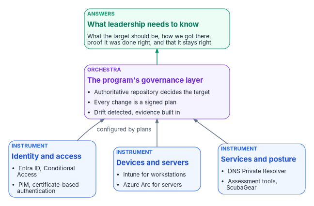
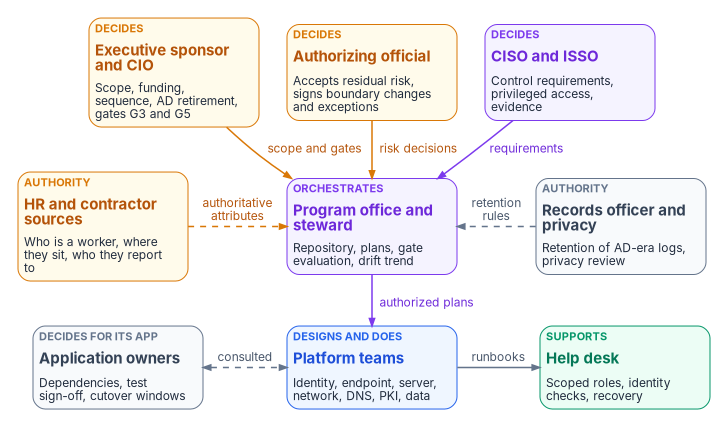

# Chapter 09 — Who Leads the Transformation

*Microsoft supplies excellent instruments, but nobody hands an agency the orchestra or the conductor; leading the transformation means naming who decides, who does the work and who signs for the risk, before the first change reaches production.*

::: {.callout-note}
## In this chapter
Why retiring Active Directory is a governance transformation that has to be led, not a platform swap that can be delegated. Who leads, decides and does the work across the whole program: the sponsor and CIO, the CISO and authorizing official, the program office, the platform teams, application owners, the help desk, HR and records. A program-level decision matrix, a map of where each book in the workbook assigns ownership for its own domain, and the questions a sponsor should ask before and during the program.
:::

> **Dependency chain:** Inventory → Plan → Identity → Policy → Network services → Devices and servers → Access plane → Retire AD DS → Prove steady state — this chapter is the leadership view of the whole chain.

## The framing that matters

Microsoft provides the instruments. The program provides the orchestra.

Cloud identity, device management, hybrid server management, Conditional Access, private DNS resolution, privileged identity management and baseline assessment tools are each excellent. None of them tells an organization how to govern the move from the Active Directory-centric client/server era to the hybrid-cloud, Zero Trust era. That is the gap the program fills, and it is a leadership gap before it is a technical one.

Microsoft's own guidance now points hybrid customers toward a cloud-first, AD-minimized identity model, moving the source of authority for users and groups from AD to Entra ID in phases rather than in one cutover.[^c09-soa] AD DS itself remains supported and still gets new capabilities: Windows Server 2025 added a new forest and domain functional level, a 32k database page option and security changes such as LDAP signing by default for new deployments.[^c09-ws2025] So there is no vendor deadline that forces the decision. The replacements are individually strong, but replacing them together needs something no platform vendor supplies: a way to decide the target, get there, prove it was done right, and keep it right. Without one, organizations migrate in pieces, lose governance continuity, and finish with a modernized surface that can't answer last year's audit questions.

{#fig-ch09-instruments-and-orchestra fig-alt="Three blue instrument cards along the bottom: identity and access (Entra ID, Conditional Access, PIM, certificate-based authentication); devices and servers (Intune for workstations, Azure Arc for servers); and services and posture (DNS Private Resolver, assessment tools, ScubaGear). Arrows labeled configured by plans run up from each to a violet orchestra card, the program's governance layer: the authoritative repository decides the target, every change is a signed plan, drift is detected and evidence is built in. A green arrow leads to a green card at the top, what leadership needs to know: what the target should be, how we got there, proof it was done right, and that it stays right."}

## What the program is — and is not

The program is an **orchestration, governance and evidence layer** above Microsoft and third-party modernization tools:

- A **platform host** that holds the canonical repository, terminates client certificates behind a reverse proxy, bridges legacy and modern authentication, and runs the transformation engine and its adapters ([Chapter 03](03-platform-foundation.md)).
- A **canonical repository** of policies, plans and evidence, stored as versioned, signed files.
- A **transformation engine** (PowerShell, Python and API integrators) that reads the estate, produces deterministic plans and delivers them ([Chapters 10](10-analyzing-the-estate.md) and [11](11-analysis-plan-delivery.md)).
- A **target surface** of identity, policy, network services, compute and access, one chapter each ([Chapters 04](04-identity-transformation.md)–[08](08-access-plane.md)).
- An **illustrative program roadmap** with six gates (G0–G5), five workstreams and mechanically evaluable exit criteria ([Chapter 12](12-migration-roadmap.md)).

It is **not** a replacement for the native tools; it orchestrates them. It is **not** a product: it is a reference architecture to be built, and while the program needs no license of its own, the services it orchestrates do. Conditional Access requires Microsoft Entra ID P1, Privileged Identity Management requires P2 or Entra ID Governance, and Lifecycle Workflows and access reviews for member users require Entra ID Governance.[^c09-licensing] It is **not** a shortcut: running without it tends to produce the failure modes [Chapter 12](12-migration-roadmap.md) lists, half-finished identity, permanent hybrid join and evidence-less migration among them.

## The instruments, revisited

| Instrument | What it does | What it does not decide |
|------------|--------------|-------------------------|
| **Cloud identity** | Cloud identity directory | What your organizational structure should become |
| **Device management** | Device enrollment and policy | Which Group Policy Objects map to which profiles |
| **Hybrid management** | Hybrid server management | Which servers retire versus move under Azure Arc |
| **Conditional Access** | Access-policy enforcement | Which users need which policies |
| **Just-in-time privilege** | Time-bound, approval-based role activation[^c09-pim] | Which roles, if any, stay standing |
| **Baseline assessment tools** | Baseline assessment | What to do with the findings |
| **Private resolver** | Hybrid DNS resolution through conditional forwarding; it isn't an authoritative name server[^c09-dnspr] | Which zones are authoritative where |
| **Certificate-based authentication** | Certificate-based authentication | Who gets certificates versus FIDO2 |

The middle column is operationally mature. The right-hand column is what the program governs, and every entry in it is a decision someone has to own. The rest of this chapter names who.

## Who leads, decides and does the work

Federal policy already says that modernization of this kind belongs to more than the IT shop. OMB M-22-09 says agency CFOs, chief acquisition officers, senior agency officials for privacy and other leaders should work with IT and security leadership to deploy and sustain zero trust capabilities, that it is critical the whole "C-suite" be aligned and committed to overhauling the agency's security architecture, and it required each agency to designate a zero trust strategy implementation lead within 30 days.[^c09-m2209] OMB M-19-17 requires an integrated, agency-wide ICAM office, team or other governance structure that includes the offices of the CIO, CFO, Human Resources, General Counsel, CISO, the Senior Agency Official for Privacy, the Chief Acquisition Officer and physical security.[^c09-m1917] NIST's Risk Management Framework defines who carries accountability for a system's risk.[^c09-sp80037] None of them says who decides when a forest retires, or who signs off on the last legacy-authentication exception. That is the program's recommended model, set out below as design.

{#fig-ch09-who-leads fig-alt="Three rows of cards. Top row, decision makers: the executive sponsor and CIO in amber, who own scope, funding, sequence, AD retirement and gates G3 and G5; the authorizing official in amber, who accepts residual risk and signs boundary changes and exceptions; and the CISO and ISSO in violet, who set control requirements, privileged access rules and evidence. Each sends an arrow, labeled scope and gates, risk decisions and requirements, to a violet card in the middle row, the program office and steward, which holds the repository, plans, gate evaluation and drift trend. Beside it in the middle row, HR and contractor sources in amber supply authoritative attributes, who is a worker, where they sit and who they report to, and the records officer and privacy office in slate supply retention rules for AD-era logs and privacy review; both send dashed arrows to the program office. The program office sends authorized plans down to platform teams in blue in the bottom row, covering identity, endpoint, server, network, DNS, PKI and data. Application owners in slate, who decide dependencies, test sign-off and cutover windows for their applications, are consulted in both directions with the platform teams. The platform teams send runbooks to the help desk in green, which supports users with scoped roles, identity checks and recovery."}

### The executive sponsor and the CIO

The sponsor owns scope, funding and sequence, breaks ties between teams, and decides when Active Directory components retire. Those are system-ownership decisions that end a fallback the rest of the program relies on. Under the RMF, the CIO designates the senior agency information security officer, maintains security policy, oversees personnel with significant security responsibilities and reports to the head of the agency on the security program's effectiveness.[^c09-sp80037] In most agencies the CIO's organization also holds the system owner role for the identity platform, the official responsible for a system's procurement, development, integration, modification, operation, maintenance and disposal.[^c09-sp80037] In the [Chapter 12](12-migration-roadmap.md) roadmap the sponsor shares gate G3 (rollout complete) with the steering committee and gate G5 (AD retired) with the CIO. The sponsor's job is to keep the program a program: five workstreams running in parallel, not five projects that finish one at a time.

### The CISO and the authorizing official

The CISO, acting as the senior agency information security officer, carries out the CIO's security responsibilities and is the CIO's primary liaison to authorizing officials, system owners and system security officers.[^c09-sp80037] In the program's model the CISO decides the control requirements every target surface must meet: phishing-resistant authentication, the Conditional Access baseline, the privileged-access model and logging. Logging requirements now come from OMB M-26-14, which rescinded M-21-31 on May 22, 2026 and replaced its fixed baselines with a risk-based, prioritized approach and a logging maturity model.[^c09-m2614]

The authorizing official is the only organizational official who can accept security and privacy risk on the organization's behalf, and approves plans of action and milestones.[^c09-sp80037] Every place the program proposes to carry risk instead of removing it reaches the authorizing official: a deferred legacy-authentication cutoff, a Kerberos island with no retirement date, a deviation from a mandatory baseline. CISA's BOD 25-01 says this outright for cloud baselines: authorizing officials may accept risk for deviations from the mandatory SCuBA policies, under agency policy, and agencies must explain those deviations when they report.[^c09-bod2501]

The program's posture for automated change is **gated actuation**: the governance layer detects drift and generates the corrective action, and a human approves it before it runs, with a dry run before production. High-blast-radius operations, such as tenant-wide role changes or network policy that touches thousands of endpoints, stay gated permanently. That is a program design choice, chosen because it is a posture an authorizing official can sign. It isn't a federal mandate: neither M-22-09 nor CISA's Zero Trust Maturity Model requires a particular maturity stage, and CISA describes the model as a general guide rather than a strict set of requirements.[^c09-ztmm]

### The program office and the steward

The program office runs the orchestra. It holds the authoritative repository, turns assessments into authorized plans, evaluates every gate criterion from the repository and drift reports, and reports the drift trend to the steering committee. The steward is the program office's accountable lead: in [Chapter 12](12-migration-roadmap.md) the steward clears gates G0, G1 and G4 and co-signs G2, and the pull request that merges a gate decision records who made it. Many agencies will give this role to the zero trust implementation lead M-22-09 required them to designate.[^c09-m2209] The program office doesn't decide risk or scope. It makes sure the people who do decide have the evidence in front of them, and that nothing reaches production without a plan.

### The platform teams

Five workstreams do the work ([Chapter 12](12-migration-roadmap.md)): identity, policy, services, compute and access, each with a named lead. Behind them stand the teams that own each technology after the migration: identity engineering, endpoint engineering, server infrastructure, network engineering, the DNS and DDI team, PKI and CA administrators, the data platform team, and the AD administrators who run the source estate until it retires. Each team designs and does the work inside its domain under the CISO's requirements, and each book in this workbook assigns those teams their decisions in detail (see the table below).

### Application owners

Application owners decide for their own applications. Only they know which service accounts, Kerberos dependencies, LDAP binds and hard-coded groups an application needs, and only they can accept a test result or a cutover window. No application moves without its owner's sign-off, and an application that can't move needs its owner to fund the change or carry a dated exception to the authorizing official. Microsoft's own cloud-first guidance starts with an application inventory for the same reason: users can't move off AD while the applications they use still depend on it.[^c09-soa]

### The help desk

The help desk supports users through every wave and becomes a high-value target while it does. CISA's advisory on the Scattered Spider group describes attackers phoning IT help desks to get passwords reset and MFA tokens transferred, and recommends phishing-resistant MFA as the defense.[^c09-scatteredspider] The program scopes help desk roles narrowly, makes the identity-verification procedure for resets and Temporary Access Passes a CISO decision rather than a help desk one, and treats ticket volume and method-registration rates as go/no-go inputs for each wave.

### HR and the contractor sources

HR supplies the facts the directory can't verify on its own: who is a worker, what kind, where they sit and who they report to. In an AD estate those facts were typed in by administrators. In the target they arrive from the HR system of record and drive account creation, changes and removal, and contractors need an authoritative source of their own because HR usually doesn't hold them. HR decides what the authoritative attributes mean; identity engineering decides how they flow. [Book 03](../b03-hr-identity/index.md) carries this in full.

### Records management and privacy

Retiring AD and its servers retires the systems that hold years of access records, and those records have retention rules of their own. NARA's General Records Schedule 3.2 covers system access records, including user profiles, log-in files and audit trail files, and keeps records for systems that require special accountability for access for six years after the password is altered or the account is terminated, unless business use requires longer.[^c09-grs32] Federal regulation requires each agency to assign records management responsibility to a person and office with the authority to carry it out, and to build records requirements into the design of electronic systems.[^c09-cfr1220] The program therefore consults the agency records officer before it decommissions any domain controller, AD FS farm, sync server or SIEM connector, and the privacy office before any new attribute flow carries personal data. Both are named in M-19-17's ICAM governance structure, as the Senior Agency Official for Privacy and General Counsel.[^c09-m1917]

## Decision rights across the program

The matrix is the program's recommended model at the level of the whole program. Each book's Who chapter refines it for its domain; where they go deeper, they govern. Adapt it to the agency's governance structure, but keep one decider per row; the one deliberate exception is gate G2, which the steward and the executive sponsor co-sign ([Chapter 12](12-migration-roadmap.md)).

D = decides (accountable) · R = does the work · C = consulted · blank = informed at most.

| Decision or work item | Sponsor / CIO | CISO | AO | Program office | Platform teams | App owners | Help desk | HR | Records / privacy |
|---|---|---|---|---|---|---|---|---|---|
| Program scope, funding and sequence | D | C | C | R | C | C | | C | |
| Target architecture and the authoritative repository | C | C | | D, R | R | C | | | |
| Control requirements (MFA strength, Conditional Access baseline, logging) | | D | C | C | R | | | | |
| Gate decisions G0, G1, G4 ([Chapter 12](12-migration-roadmap.md)) | C | C | | D | R | C | | | |
| Gate decision G2 (co-signed) | D | C | C | D, R | R | C | C | | |
| Gate decisions G3, G5 | D | C | C | R | R | C | C | | |
| Authorize systems and boundary changes; accept residual risk | C | C | D | R | C | | | | |
| Authoritative worker attributes and their meaning | | | | C | R | | | D | C |
| Application cutover and test sign-off, per application | | | | C | R | D | C | | |
| Help desk identity verification and recovery procedure | | D | | C | C | | R | | |
| Legacy authentication and NTLM end dates | C | C | D | R | R | C | C | | |
| Retention of AD-era logs and records before decommission | C | C | | R | R | | | | D |
| Retire domain controllers, AD FS and AD-dependent services | D | C | C | R | R | C | | | C |
| Continuous monitoring evidence and drift findings | | D | C | R | R | | | | |

Two rows need comment. Legacy-authentication end dates sit with the authorizing official because keeping legacy authentication open is a risk acceptance, and BOD 25-01 makes blocking it a mandatory baseline.[^c09-bod2501] Retention before decommissioning sits with the records officer because once a domain controller is gone, its logs can't be recovered for an audit or a legal hold.

## Where each book assigns ownership

Every book in the workbook has a Who chapter that applies this model to its own domain. Read the one for the domain you are about to change.

| Book | Who chapter | What it settles |
|---|---|---|
| [Book 02 — Identity & Directory](../b02-identity/index.md) | [Chapter 06 — Who Owns the Migration](../b02-identity/06-who-owns-the-migration.md) | The migration-wide model: RMF roles, the decide/do/consult rule, Entra roles per team, and which native tools the program consumes |
| [Book 03 — HR-Driven Identity](../b03-hr-identity/index.md) | [Chapter 07 — Who Owns Workforce Identity](../b03-hr-identity/07-who-owns-workforce-identity.md) | Who owns, guards and uses the workforce data; the data architect; contractor sources |
| [Book 04 — Access & Privilege](../b04-access/index.md) | [Chapter 06 — Who Decides Access](../b04-access/06-who-decides-access.md) | Day-to-day access decisions after the migration: approvers don't execute, risk tiers, emergency access |
| [Book 05 — Devices](../b05-devices/index.md) | [Chapter 06 — Who Owns the Endpoint](../b05-devices/06-who-owns-the-endpoint.md) | Workstations in Intune and servers under Azure Arc; three role systems, one access model |
| [Book 06 — Data Platform](../b06-data-platform/index.md) | [Chapter 13 — Who Owns the Data Platform](../b06-data-platform/13-who-owns-the-data-platform.md) | SQL Server's move from Windows authentication to Entra ID; consolidation verdicts and closure |
| [Book 07 — PKI](../b07-pki/index.md) | [Chapter 05 — Who Owns the Certificate Estate](../b07-pki/05-who-owns-the-certificate-estate.md) | CA hierarchy, trust anchors, CBA bindings and a renewal owner per certificate class |
| [Book 08 — DNS, DHCP and IPAM](../b08-ddi/index.md) | [Chapter 09 — Who Owns DNS, DHCP and IPAM](../b08-ddi/09-who-owns-dns.md) | Zones, the resolver path, record change approval and the AD DNS departure |
| [Book 09 — Network](../b09-network/index.md) | [Chapter 09 — Who Owns the Network and Its Transport](../b09-network/09-who-owns-the-network.md) | Transport, branch control, TIC 3.0 posture, network access control, and an owner for each step of the decision sequence |

The books agree on three habits. Deciding and doing are separate: the person whose role lets them make a change is rarely the person who should decide it. Every decision has exactly one decider. And every risk that the program carries rather than removes reaches the authorizing official in writing.

## The governance properties that matter

1. **The authoritative source is the operational truth.** Attributes, dynamic groups, Conditional Access policies, device profiles and server tags are defined in the repository before they exist in the target. The target is a materialization, not the source.
2. **Every change is a plan.** Nothing reaches the target except through an authorized plan, so every change has provenance by construction.
3. **Drift is detected, not reported.** Divergence between source and reality becomes a tracked item within hours, before auditors find it.
4. **Evidence is built in.** Every plan produces an evidence packet, and authorization packages regenerate from the source instead of spreadsheets.
5. **Governance and execution are separate.** A component that could both decide and act could cover its tracks; these can't.

## How a sponsor evaluates the program

An executive sponsor should require a "yes" to each of these before the program starts:

- Is the authoritative source in version control, not a vendor portal or shared drive?
- Can every production change be traced to a signed commit?
- Is drift detection continuous, not quarterly?
- Does the target surface come from plan artifacts, so every change has a rollback?
- Is the platform host one hardened Tier-0 box?
- Does every row of the decision matrix have one named decider, and has the authorizing official agreed to the risk-acceptance rows?

Once the program is underway, the steering committee should ask monthly (thresholds are illustrative):

1. **What is the drift trend?** Rising drift is a leading indicator of failure.
2. **What share of production changes had a signed plan?** In steady state, anything short of all of them means ad-hoc changes have returned.
3. **What share of employees have valid organizational attributes?** Set a threshold, such as 95%, and treat a drop as a regression.
4. **How many Group Policy Objects are active?** The number should fall every month of Phase 4; a plateau above zero is a blocker.
5. **How many devices have stayed hybrid-joined past the agreed limit (for example, 180 days)?** Hybrid join is a waypoint, not the end state; a growing number means the program is stuck at [Chapter 07](07-compute-transformation.md).
6. **How many risk acceptances are open, and how many are past their end date?** Exceptions that never close are how a half-migration becomes permanent.

## What to do next

None of this requires a vendor decision on day one. It requires an inventory, an owner and a date.

1. **Name the owners.** Fill in the decision matrix with names, starting with the sponsor, the authorizing official and the steward, and confirm who in the agency already holds the zero trust implementation lead and ICAM governance roles.
2. **Treat the series as project guidance.** Turn it into versioned artifacts: adapter interfaces, policy libraries, validation checks. The series is the narrative; the artifacts are the authority.
3. **Run a read-only assessment** ([Chapter 10](10-analyzing-the-estate.md)). In the program's experience a first pass takes days to a few weeks, depending on forest size and access approvals, and its output feeds every later decision.
4. **Stand up the platform host** ([Chapter 03](03-platform-foundation.md)). Everything else follows from it.
5. **Set the dates.** Put the gate dates from [Chapter 12](12-migration-roadmap.md) on the sponsor's calendar, and the end date of every exception on the authorizing official's.

Microsoft has supplied the instruments for the new era. The program is the orchestra, this series is the score, and the people named in this chapter are the ones who have to play it. Retiring Active Directory is a governance transformation, and it should be led as one.

## Key takeaways

1. The platform tools exist; what is missing is a governed way to sequence and evidence them, and named people to decide.
2. One decider per decision: the sponsor owns scope and retirement, the CISO owns requirements, the authorizing official owns risk, the program office owns the plan, and application owners own their applications.
3. Ask monthly: drift trend, share of changes with a signed plan, active GPOs, hybrid-joined age, open risk acceptances.
4. Start with the owners and a read-only assessment ([Chapter 10](10-analyzing-the-estate.md)).

::: {.callout-tip}
## Continue the book
[← Previous: Chapter 08 — The Access Plane](08-access-plane.md) · [Book index](index.md) · [Next: Chapter 10 — Analyzing the Estate →](10-analyzing-the-estate.md)
:::

[^c09-soa]: Microsoft Learn, "Microsoft Entra cloud-first identity guidance for IT architects," sections "Roadmap to Cloud Identity" and "Application inventory and authentication analysis," <https://learn.microsoft.com/entra/identity/hybrid/guidance-it-architects-source-of-authority> (accessed Oct 21, 2026).
[^c09-ws2025]: Microsoft Learn, "What's new in Windows Server 2025," section "Active Directory Domain Services," <https://learn.microsoft.com/windows-server/get-started/whats-new-windows-server-2025> (accessed Oct 21, 2026).
[^c09-licensing]: Microsoft Learn, "Microsoft Entra licensing," sections "Microsoft Entra Conditional Access" and "Microsoft Entra ID Governance," <https://learn.microsoft.com/entra/fundamentals/licensing> (accessed Oct 21, 2026).
[^c09-pim]: Microsoft Learn, "What is Microsoft Entra Privileged Identity Management?," <https://learn.microsoft.com/entra/id-governance/privileged-identity-management/pim-configure> (accessed Oct 21, 2026).
[^c09-dnspr]: Microsoft Learn (Azure Architecture Center), "Azure DNS Private Resolver," section "Scenario details," <https://learn.microsoft.com/azure/architecture/networking/architecture/azure-dns-private-resolver> (accessed Oct 21, 2026).
[^c09-m2209]: Office of Management and Budget, M-22-09, *Moving the U.S. Government Toward Zero Trust Cybersecurity Principles*, January 26, 2022, §II and §III (introduction), <https://www.whitehouse.gov/wp-content/uploads/2022/01/M-22-09.pdf> (accessed Oct 21, 2026).
[^c09-m1917]: Office of Management and Budget, M-19-17, *Enabling Mission Delivery through Improved Identity, Credential, and Access Management*, May 21, 2019, "Governance," item 1, <https://www.whitehouse.gov/wp-content/uploads/2019/05/M-19-17.pdf> (accessed Oct 21, 2026).
[^c09-sp80037]: National Institute of Standards and Technology, SP 800-37 Rev. 2, *Risk Management Framework for Information Systems and Organizations: A System Life Cycle Approach for Security and Privacy*, December 2018, Appendix D (Roles and Responsibilities), <https://nvlpubs.nist.gov/nistpubs/SpecialPublications/NIST.SP.800-37r2.pdf> (accessed Oct 21, 2026).
[^c09-m2614]: Office of Management and Budget, M-26-14, *Ensuring Effective and Efficient Agency Logging and Network Visibility to Defend Against Evolving Cyber Threats*, May 22, 2026, rescission of M-21-31 and "Prioritization," <https://www.whitehouse.gov/wp-content/uploads/2026/05/M-26-14-Ensuring-Effective-and-Efficient-Agency-Logging-and-Network-Visibility-to-Defend-Against-Evolving-Cyber-Threats.pdf> (accessed Oct 21, 2026).
[^c09-bod2501]: Cybersecurity and Infrastructure Security Agency, BOD 25-01, *Implementing Secure Practices for Cloud Services*, December 17, 2024, <https://www.cisa.gov/news-events/directives/bod-25-01-implementing-secure-practices-cloud-services>; and "BOD 25-01 Required Configurations" (MS.AAD.1.1v1, legacy authentication blocked), <https://www.cisa.gov/resources-tools/services/bod-25-01-implementing-secure-practices-cloud-services-required-configurations> (both accessed Oct 21, 2026).
[^c09-ztmm]: Cybersecurity and Infrastructure Security Agency, *Zero Trust Maturity Model*, Version 2.0, April 2023, §4, <https://www.cisa.gov/sites/default/files/2023-04/zero_trust_maturity_model_v2_508.pdf> (accessed Oct 21, 2026).
[^c09-scatteredspider]: Cybersecurity and Infrastructure Security Agency, Cybersecurity Advisory AA23-320A, *Scattered Spider*, November 16, 2023, revised July 29, 2025, <https://www.cisa.gov/news-events/cybersecurity-advisories/aa23-320a> (accessed Oct 21, 2026).
[^c09-grs32]: National Archives and Records Administration, General Records Schedule 3.2, *Information Systems Security Records*, Transmittal No. 33, January 2023, items 030 and 031, <https://www.archives.gov/files/records-mgmt/grs/grs03-2.pdf> (accessed Oct 21, 2026).
[^c09-cfr1220]: 36 CFR § 1220.34, "What must an agency do to carry out its records management responsibilities?," paragraphs (a) and (e), <https://www.law.cornell.edu/cfr/text/36/1220.34> (accessed Oct 21, 2026).
