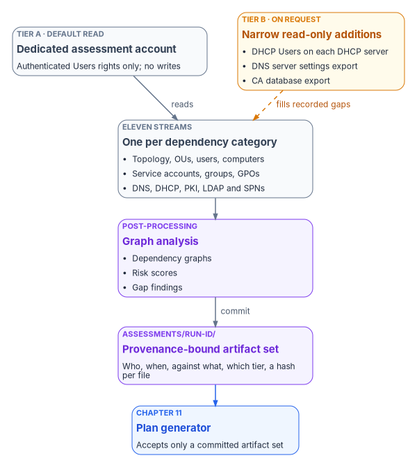

# Chapter 10 — Analyzing the Estate

*Nothing in the estate can be retired until someone has written down, read-only and with proof of how they looked, everything it was quietly doing.*

::: {.callout-note}
## In this chapter
The assessment discipline that starts every modernization: why it is read-only, how the access it needs is split into a default tier and a narrow, requested tier, and what provenance every run carries. Then the eleven ingestion streams, one per dependency category, what each captures and which later chapter consumes it; the analysis layer; the committed artifact set; and the transaction profile that has to exist before any application is separated from its data. The forest-level depth is in [Book 02](../b02-identity/index.md), Chapters 07 and 08.
:::

> **Dependency chain:** **Inventory** → Plan → Identity → Policy → Network services → Devices and servers → Access plane → Retire AD DS → Prove steady state

## The assessment discipline

You can't modernize what you haven't enumerated. Every modernization in the Federal Modernization Program begins with a read-only, least-privilege, provenance-bound analysis of the existing client/server estate. The output is a structured, versioned artifact set, one stream per dependency category, committed to the program's authoritative repository and consumed by every later chapter.

No writes. No guesses. No "we'll handle that later."

{#fig-ch10-assessment-pipeline fig-alt="A vertical flow. A slate box for the dedicated assessment account at Tier A, with default Authenticated Users rights and no writes, reads into a slate box for the eleven streams, one per dependency category. Beside the account, an amber Tier B box lists narrow read-only additions: DHCP Users membership on each DHCP server, a DNS server settings export and a CA database export; a dashed amber arrow shows it filling recorded gaps in the streams. The streams feed a violet graph-analysis box (dependency graphs, risk scores, gap findings), which commits to a violet provenance-bound artifact set recording who, when, against what, which tier and a hash per file. A blue arrow leads to the plan generator of Chapter 11, which accepts only a committed artifact set."}

## The assessment problem

Ask what is in a long-lived Active Directory forest and the honest answer is usually "more than anyone on the current team knows." Twenty-five years of organic growth leave:

- Forests with trust relationships no one can fully map.
- OU trees with orphan branches created for long-dismissed projects.
- Group Policy Objects whose authors left a decade ago and whose effects are unknown.
- Service accounts with service principal names pointing at applications no one operates.
- Certificate templates whose permissions silently open privilege-escalation paths. An enterprise CA decides what to issue from information in AD DS and the template, so the template's permissions decide who can obtain which certificate.[^c10-entca]
- DNS zones with stale records that still resolve and still route.
- DHCP scopes whose reservations reference machines retired years ago.

A successful modernization starts with the complete, structured, current-state picture. Not a best-effort inventory, not a sample: the full record, good enough to attest to.

## Three design principles

The assessment layer enforces three principles that distinguish it from a general-purpose Active Directory scan.

### 1. Read-only by policy

Every assessment operation is limited to read rights. No group membership is changed, no Group Policy Object is edited, no password is reset. The program enforces this at three levels: the account (it holds no write rights), the code (no write cmdlets are imported) and the audit trail (every call is logged with its operation class). Read-only isn't an honor system.

Because the assessment changes nothing, it usually qualifies for a lighter change process than a write operation would. Whether it needs a change record is the agency's configuration-management decision. It is not invisible, though: broad directory enumeration looks like reconnaissance to monitoring tools, so the security operations team is told the window, the account and the expected query pattern before the first run ([Book 02, Chapter 07](../b02-identity/07-read-only-discovery.md)).

### 2. Least-privilege delegation in two tiers

The assessment needs forest-wide read, but never Domain Admin or Enterprise Admin. Least privilege for the assessment account is NIST SP 800-53 AC-6 applied to the assessment team itself.[^c10-sp80053]

The source of this chapter assumed that a basic read-only account sees little Group Policy, certificate-template or DNS data. That understates the default. In most domains a standard authenticated account can read the topology, the OU tree and Group Policy links, most Group Policy settings, users, groups, computers and their service principal names, the certificate templates and enrollment services in the configuration partition, and often the AD-integrated DNS zones, because those come from default grants to Authenticated Users and Pre–Windows 2000 Compatible Access.[^c10-writeback] What it can't see are server-side settings and secrets. The tiers are therefore defined by what has to be added, not by what is withheld:

- **Tier A, default read.** A dedicated standard account with no added rights. It reads everything the defaults expose, and a pre-flight records what this forest actually lets it read, since hardened OUs and trimmed groups change the result.
- **Tier B, narrow additions.** Read-only rights or administrator-run exports for the gaps Tier A recorded: membership of the DHCP Users group on each DHCP server, which is limited to read-only access to the server;[^c10-dhcpusers] DNS server settings such as aging, scavenging and forwarders; the CA's issued-certificate database; replication health and domain controller event logs. Rights that expose secrets (replicating secret domain data, reading confidential attributes) are never requested.

The tier is a governance decision. A common pattern is Tier B for the initial full assessment and Tier A for the continuous re-assessment cadence. [Book 02, Chapter 07](../b02-identity/07-read-only-discovery.md) sets out the default read boundary and the delegation request; [Chapter 08](../b02-identity/08-assessing-the-forest.md) the privileged half.

### 3. Provenance-bound output

Every assessment run produces an artifact set with required metadata:

- Who ran it (account or service principal).
- When (UTC timestamp).
- Against what (forest DNS name, domain FQDNs, the domain controller that served each read).
- With what profile (Tier A, Tier B or a recorded custom profile).
- Producing what (a SHA-256 hash of each output file).
- Committed where (repository branch and commit).

The engine rejects a run without provenance.

## The eleven ingestion streams

The assessment produces eleven streams organized along the dependency categories in [Chapter 02](02-the-problem.md). They don't map one to one: DNS and DHCP are separate streams, the forest topology and the OU hierarchy get streams of their own, trust relationships are collected with the forest topology, and RADIUS/NPS, which depends on AD rather than living in it, is inventoried separately from the NPS servers themselves; [Book 09, Chapter 07](../b09-network/07-network-access-control.md) covers that inventory and its migration. Each stream has its own normalized schema and its own committed location. Where a stream needs Tier B, the stream says which part.

### Stream 1 — Forest and domain topology

Forest and domain functional levels, trust relationships, sites and site links, domain controller roles, replication intervals, operations master (FSMO) holders, DNS integration mode and schema version. The functional level matters to the plan: Windows Server 2025 introduced a new forest and domain functional level, which only Windows Server 2025 domain controllers can run.[^c10-fl] Replication health is a Tier B item. Feeds identity strategy ([Chapter 04](04-identity-transformation.md)) and the AD DS retirement gates ([Chapter 12](12-migration-roadmap.md)).

### Stream 2 — OU hierarchy

Every OU, its distinguished name, parent-child relationships, linked Group Policy Objects, delegation ACLs and user and computer counts. Feeds attribute mapping and policy-linkage mapping ([Chapter 05](05-policy-transformation.md)).

### Stream 3 — Users

Every user object: UPN, `sAMAccountName`, distinguished name, enabled state, password last set, last logon, manager, group memberships, extension attributes, mail, employee identifier, department, office and any HR-sourced attributes. Feeds user migration and the attribute plan, which takes its authority from HR ([Book 03](../b03-hr-identity/index.md)). Production exports redact identifiers under the agency's data-handling rules.

### Stream 4 — Computers

Every computer object: distinguished name, DNS host name, operating system and version, password last set, service principal names, last logon timestamp, delegation settings and supported encryption types. Feeds compute migration ([Chapter 07](07-compute-transformation.md)) and risk scoring:

- **Unconstrained delegation.** A host trusted for delegation to any service can be made to impersonate any user who authenticates to it, including a domain admin; Microsoft's guidance is to remove it or move to constrained delegation.[^c10-mdi-deleg]
- **Weak encryption types.** Windows Server 2025 domain controllers no longer issue ticket-granting tickets with RC4,[^c10-ws2025] so a host or account that supports only RC4 is a finding before migration starts.
- **Unsupported operating systems.** Windows Server 2012 and 2012 R2 Extended Security Updates through Azure Arc ended on October 13, 2026, and Windows Server 2016 reaches end of support on January 12, 2027.[^c10-esu] Every server on those versions needs a disposition in the plan.

### Stream 5 — Service accounts and service principal names

All accounts with a populated `servicePrincipalName`, grouped by likely application boundary; delegation targets; managed service account status; and password-age gaps that indicate stale credentials. Microsoft recommends group managed service accounts wherever a service can use one and documenting every remaining service account's owner, purpose, permissions, risk and lifetime.[^c10-svcaccts] Windows Server 2025 adds delegated managed service accounts as a migration path for existing service accounts.[^c10-ws2025] Feeds compute and application migration: a Kerberos-bound application needs a modern application registration or a documented Kerberos island ([Chapter 07](07-compute-transformation.md); for SQL Server, [Book 06](../b06-data-platform/index.md)).

### Stream 6 — Security and distribution groups

Every group: distinguished name, `sAMAccountName`, scope, type, members, `memberOf`, and whether membership is static or rule-based. Feeds dynamic-group authoring from attribute rules ([Chapter 04](04-identity-transformation.md)).

### Stream 7 — Group Policy Objects

Every GPO: display name, GUID, link targets, security filtering, WMI filters, enabled state, the full Computer and User configuration, and the date each section last changed. Most of this is readable at Tier A unless security filtering restricts a GPO. Feeds the Group Policy to device-management mapping and is typically the highest-complexity stream ([Book 05, Chapter 07](../b05-devices/07-the-gpo-sunset-program.md)).

### Stream 8 — DNS zones and records

AD-integrated zones, non-integrated zones hosted on domain controllers, conditional forwarders, per-record TTL and timestamp, and stale records whose owning computer object has aged out. Zone and record objects are often readable at Tier A; recursion, aging and scavenging settings are server settings and come from a Tier B export. Feeds network services ([Chapter 06](06-network-services.md); [Book 08, Chapter 10](../b08-ddi/10-migration-sequence.md)).

### Stream 9 — DHCP scopes and reservations (Tier B)

All DHCP servers, scopes, reservations, option sets and failover relationships, read through DHCP Users membership on each server or an administrator export. Feeds network services.

### Stream 10 — Certificate services (highest sensitivity)

All CAs in the forest (root and issuing), published templates, template permissions including escalation patterns, certificates issued for high-value enhanced key usages, and CRL distribution health. Templates and enrollment services are Tier A; the issued-certificate database is a Tier B export. The escalation patterns have names and detections: a template that lets the requester supply the subject alternative name, allows client authentication and grants enrollment to an unprivileged group is the pattern Microsoft Defender for Identity reports as ESC1, alongside assessments for other template and CA patterns, among them ESC2 to ESC4, ESC6 to ESC8, ESC11 and ESC15.[^c10-mdi-adcs] Feeds certificate-based authentication migration and compliance findings ([Chapter 08](08-access-plane.md); [Book 07, Chapter 02](../b07-pki/02-what-ad-cs-holds-up.md)).

### Stream 11 — LDAP bindings and the Kerberos SPN map

Every application that binds over LDAP or LDAPS or authenticates with Kerberos against a service principal name, found from computer accounts, SPN patterns and, where available, application-server configuration and domain controller logs (a Tier B item). In practice it is a major source of modernization blockers.

## The analysis layer

PowerShell is good at Active Directory reads; it is less good at graph analysis. Every stream that produces relational data (the OU hierarchy, the Group Policy link graph, the SPN-to-application map, the trust graph) is post-processed by an analyzer, in the program's reference build a Python one, that produces:

- **Dependency graphs:** which OUs inherit which GPOs; which applications depend on which SPNs.
- **Risk scores:** stale accounts, over-privileged delegation, certificate-template escalation exposure, unsupported operating systems.
- **Gap findings:** OUs with no linked GPOs, GPOs with no enabled settings, empty groups, computers that haven't logged on within a stale threshold (for example 90 days; the threshold is the agency's choice).

The analyzer writes JSON and Markdown reports into an analysis folder, readable by the engine and by a human reviewer.

## One artifact set per run

Every run produces the same folder layout, committed under `assessments/<run-id>/`. The run identifier is `YYYY-MM-DD-HHmm-<host>-<tier>` (UTC).

```text
assessments/
└── 2026-04-24-1030-host-tierB/
    ├── provenance.yaml              ← who, what, when, hashes
    ├── forest-topology.json
    ├── ou-hierarchy.json
    ├── users.jsonl
    ├── computers.jsonl
    ├── spn-inventory.json
    ├── groups.jsonl
    ├── gpos/
    │   ├── gpo-index.json
    │   └── {guid}.xml
    ├── dns-zones.json
    ├── dns-records.jsonl
    ├── dhcp-scopes.json
    ├── adcs/
    ├── ldap-bindings.jsonl
    ├── kerberos-spn-map.json
    ├── transaction-profiles/        ← see below
    └── analysis/
        ├── attribute-mapping.md
        ├── risk-scorecard.md
        ├── dependency-graph.json
        └── gap-findings.md
```

Every commit of this folder is signed and attributable. No assessment artifact lives outside the repository, and no run identifier is used twice. The set is sensitive: it maps privileged groups, service accounts and certificate-template permissions, so it is stored encrypted and handled under the agency's data classification policy.

## Profiling transactions before separation

The eleven streams describe what the directory governs. One more input decides whether an application may move: how chatty it is with its authoritative data.

[Chapter 07](07-compute-transformation.md#where-compute-runs) sets the rule: an application's compute stays co-located with its authoritative data until profiling shows its round trips have been reduced, because each synchronous call pays the propagation delay once and separation multiplies it by the number of calls. That makes profiling an assessment job. For each application proposed to move away from its data, the assessment records, per business transaction:

- the number of synchronous round trips to the authoritative store, measured, not estimated;
- which of them can be removed by the program's techniques: consolidating fine-grained calls into one aggregated call, moving work off the user's critical path with asynchronous or event-driven processing, read-through caching, batching, connection pooling (which removes repeated setup, not the data round trip), and converting multi-step conversational transactions into atomic calls;
- the measured result after reduction, from performance testing.

The profiles are committed under `transaction-profiles/` in the same run, and the plan's gated actuation ([Chapter 11](11-analysis-plan-delivery.md)) treats "profiled and reduced" as a required check before approving a separation. A cache or aggregation layer is only safe once there is one authoritative source to reconcile against, which is why this follows the identity work rather than preceding it. The physics behind the rule, and the measurements that confirm or refute it in a given estate, are in [Book 09, Chapter 01](../b09-network/01-why-physics-decides-the-architecture.md) and [Chapter 13](../b09-network/13-sequencing-cost-and-evidence.md); SQL Server's version of the same discovery is [Book 06, Chapter 04](../b06-data-platform/04-the-estate-inventory.md).

## What happens next

The output of this chapter is the input to the next. The transformation engine takes the assessment folder, runs it through the plan generator, and produces a matched plan folder of deterministic actions, which is reviewed, authorized and then dispatched for delivery.

Assessment and planning are deliberately separate steps. An assessment without a plan is a report; a plan without an assessment is a guess. Only together do they produce governed modernization.

## Key takeaways

1. Nothing is retired until it has been inventoried, read-only, across all eleven categories.
2. Tier A is broader than most teams expect; Tier B adds only the server-side settings and exports Tier A recorded as gaps, and never secrets.
3. Every run carries provenance: who, when, against what, with which rights.
4. No application leaves its data until its transactions have been profiled.
5. The committed artifact set is the only input the planning step accepts.

::: {.callout-tip}
## Continue the book
[← Previous: Chapter 09 — Who Leads the Transformation](09-who-leads-the-transformation.md) · [Book index](index.md) · [Next: Chapter 11 — Analysis, Plan, Delivery →](11-analysis-plan-delivery.md)
:::

[^c10-entca]: Microsoft Learn, "What is the Certification Authority Role Service in Windows Server?" (enterprise CAs use AD DS information and certificate templates to approve or deny requests), <https://learn.microsoft.com/windows-server/identity/ad-cs/certification-authority-role> (accessed Oct 21, 2026).
[^c10-sp80053]: NIST, SP 800-53 Rev. 5, *Security and Privacy Controls for Information Systems and Organizations*, release 5.2.0, AC-6 Least Privilege, <https://csrc.nist.gov/pubs/sp/800/53/r5/upd1/final>; title checked against NIST's OSCAL Rev. 5 catalog, version 5.2.0, <https://github.com/usnistgov/oscal-content/tree/main/nist.gov/SP800-53/rev5> (both accessed Oct 21, 2026).
[^c10-writeback]: Microsoft Learn, "Troubleshoot password writeback access rights and permissions" (default permissions for Authenticated Users and Pre-Windows 2000 Compatible Access), <https://learn.microsoft.com/troubleshoot/entra/entra-id/user-prov-sync/password-writeback-access-rights-permissions>; the full read-boundary analysis is in Book 02, Chapter 07 (accessed Oct 21, 2026).
[^c10-dhcpusers]: Microsoft Learn, "Active Directory security groups" (DHCP Users: "limited to read-only access to the DHCP server"), <https://learn.microsoft.com/windows-server/identity/ad-ds/manage/understand-security-groups> (accessed Oct 21, 2026).
[^c10-fl]: Microsoft Learn, "Active Directory Domain Services functional levels" (only Windows Server 2025 domain controllers run at the Windows Server 2025 functional level), <https://learn.microsoft.com/windows-server/identity/ad-ds/active-directory-functional-levels> (accessed Oct 21, 2026).
[^c10-mdi-deleg]: Microsoft Learn, "Accounts security posture assessments," Unsecure Kerberos delegation, <https://learn.microsoft.com/defender-for-identity/security-posture-assessments/accounts> (accessed Oct 21, 2026).
[^c10-ws2025]: Microsoft Learn, "What's new in Windows Server 2025" (Active Directory Domain Services: the KDC no longer issues RC4 ticket-granting tickets; delegated managed service accounts), <https://learn.microsoft.com/windows-server/get-started/whats-new-windows-server-2025> (accessed Oct 21, 2026).
[^c10-esu]: Microsoft Learn, "Cloud-native licensing and cost management with Azure Arc-enabled servers," Extended Security Updates, <https://learn.microsoft.com/azure/azure-arc/servers/cloud-native/licensing-cost-management> (accessed Oct 21, 2026).
[^c10-svcaccts]: Microsoft Learn, "Introduction to Active Directory service accounts," <https://learn.microsoft.com/entra/architecture/service-accounts-on-premises> (accessed Oct 21, 2026).
[^c10-mdi-adcs]: Microsoft Learn, "Security assessment: Certificates" (ESC1 and related template and CA assessments), <https://learn.microsoft.com/defender-for-identity/security-posture-assessments/certificates>, and "What's new archive for Microsoft Defender for Identity" (ESC15, December 2024), <https://learn.microsoft.com/defender-for-identity/whats-new-archive> (both accessed Oct 21, 2026).
