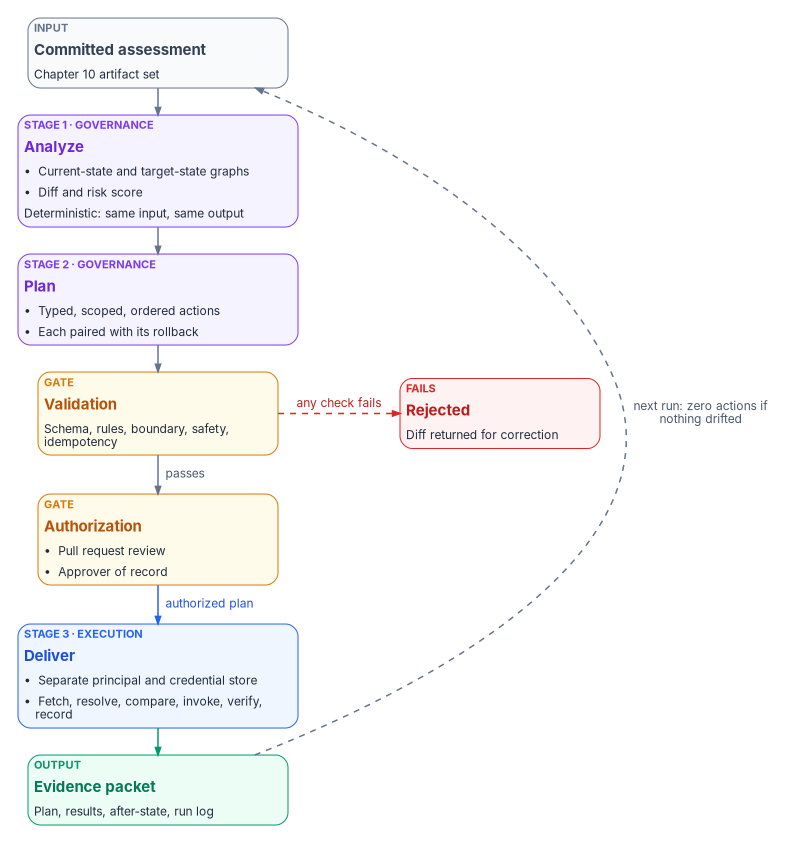
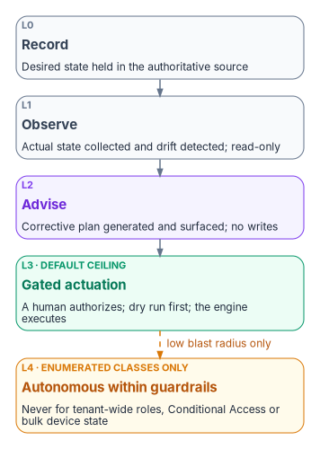

# Chapter 11 — Analysis, Plan, Delivery

*Nothing touches the target surface without a plan, and no plan touches it without someone of record having read it first.*

::: {.callout-note}
## In this chapter
The pipeline contract of the Federal Modernization Program's transformation engine: why it has three stages rather than one, what Analyze and Plan produce, how a plan is validated and authorized, and how the execution layer delivers it, with correlation, failure handling and rollback. Then the actuation ladder that caps how far automation may go for each class of change, the evidence packet a run leaves behind, and a worked example. Book-level depth for each surface is in [Book 04, Chapter 10](../b04-access/10-access-as-code-and-evidence.md) (access as code) and [Book 05, Chapter 02](../b05-devices/02-the-hybrid-join-trap.md) (gated device-state change).
:::

> **Dependency chain:** Inventory → **Plan** → Identity → Policy → Network services → Devices and servers → Access plane → Retire AD DS → Prove steady state

## The pipeline contract

The engine turns an Active Directory assessment into delivered hybrid-cloud change through three sequential stages: **Analyze**, **Plan** and **Deliver**. Each stage produces a signed, versioned artifact in the authoritative repository. Each has a distinct responsibility (governance review or execution) and a distinct gate. Nothing skips a stage. Nothing touches the target surface without a plan, and no plan touches it without authorization.

{#fig-ch11-three-stages fig-alt="A vertical flow. A slate box for the committed assessment from Chapter 10 leads to a violet Analyze stage (current-state and target-state graphs, diff and risk score, deterministic) and a violet Plan stage (typed, scoped, ordered actions, each paired with its rollback), both labeled governance. The plan reaches an amber validation gate checking schema, rules, boundary, safety and idempotency; a dashed red arrow leads to a red Rejected box when any check fails, returning the diff for correction. On passing, an amber authorization gate requires pull request review and an approver of record. A blue arrow carries the authorized plan to the blue Deliver stage, labeled execution, with a separate principal and credential store and the steps fetch, resolve, compare, invoke, verify, record. A green evidence packet follows. A dashed arrow returns to the assessment, labeled next run: zero actions if nothing drifted."}

## Why three stages, not one

The obvious alternative, "scan the forest, apply the changes," is how many one-off migration scripts work. It fails for three reasons:

1. **The change can't be reviewed.** A tool that reads and writes in one pass gives no one a chance to inspect what is about to happen.
2. **Provenance is thin.** If the source drifts between read and write, the change is attributed to an input nobody can reproduce.
3. **Rollback is impossible.** Without a materialized plan there is no diff to invert.

Separating the stages gives three review points, three audit trails and three named artifacts per run. That is what "governed modernization" means in practice.

## Stage 1 — Analyze

**Input:** the committed assessment artifact set from [Chapter 10](10-analyzing-the-estate.md).
**Output:** a normalized analysis and a proposed change set.
**Responsibility:** governance layer.

Analyze reads the eleven ingestion streams and writes four artifacts under `plans/<plan-id>/analysis/`:

- **Current-state graph.** One normalized graph of the forest: OUs, users, computers, groups, Group Policy links, trust edges and the SPN map. Every later decision reads it.
- **Target-state graph.** The proposed hybrid-cloud equivalent: attribute-driven hierarchy, dynamic group rules, administrative-unit map, Conditional Access targeting, device compliance groupings, hybrid-management tags and the IP address management record set.
- **Diff.** The machine-readable delta: additions, modifications, retirements and no-change items, each typed and each linked to a source record in the assessment.
- **Risk score.** The blast-radius model for the change set: which users are affected, which downstream systems are touched, which boundaries are crossed and which controls are in scope.

Analysis is deterministic: the same assessment input produces the same four artifacts. The review gate depends on that property, so an analysis whose output varies from run to run is treated as broken and rejected.

## Stage 2 — Plan

**Input:** the Analyze output, plus the authoritative group library, delegation matrix and decision guidance.
**Output:** a signed, executable plan.
**Responsibility:** governance layer.

Plan expands the diff into a deterministic action sequence. Each action is:

- **Typed:** one of a defined set, for example `create-user`, `set-extension-attribute`, `create-dynamic-group`, `create-administrative-unit`, `assign-role-scoped`, `set-conditional-access-target`, `create-compliance-policy`, `update-ipam-record`, `enroll-hybrid-server`, `rotate-service-principal`.
- **Scoped:** bounded to a single target object. No action type permits "update all users whose…"; the scope is pre-materialized.
- **Dependency-ordered:** create the administrative unit before scoping a role to it.
- **Rollback-paired:** every action has a generated inverse, so the plan can run in reverse.
- **Provenance-linked:** it points back to the assessment record, the governing rule and the analysis step that produced it.

::: {.callout-warning}
## Illustrative, not tested against a production tenant
The plan below shows the shape of the program's plan format. It isn't a Microsoft schema, and the action types are the engine's own. Review any generated plan against the current Microsoft Graph documentation before delivery.
:::

A plan is a YAML document; in abbreviated form:

```yaml
plan_id: 2026-04-24-1200-structure-phase2
assessment_id: 2026-04-24-1030-host-tierB
authorized_by: ~          # filled at the authorization step
boundary: defined-scope
actions:
  - id: A0001
    type: create-administrative-unit
    target:
      display_name: AU-NCR-Finance
      membership_rule: '(user.extensionAttribute4 -eq "NCR") -and (user.department -eq "Finance")'
      restricted: false   # see "Restricted management" below
    provenance:
      source: assessments/2026-04-24-1030-host-tierB/ou-hierarchy.json#ou/FIN
      rule: delegation-matrix/tier2-au
    rollback:
      type: delete-administrative-unit
      target: AU-NCR-Finance
    depends_on: []
  - id: A0002
    type: assign-role-scoped
    target:
      role: User Administrator
      principal: Structure-NCR-Finance-Admins   # role-assignable group, assigned membership
      scope: /administrativeUnits/AU-NCR-Finance
    provenance: …
    depends_on: [A0001]
```

Three platform facts shape these two actions:

- **Dynamic administrative units.** Rules use the same syntax as dynamic groups, and `extensionAttribute1` through `extensionAttribute15` are usable as string properties.[^c11-dynrules] The example reads the region code from `extensionAttribute4`, its slot in the [program attribute map](../b03-hr-identity/06-canonical-attribute-schema.md#program-attribute-map). Each member of an administrative unit that uses a dynamic membership rule needs a Microsoft Entra ID P1 license, as does each administrator assigned a role over the unit.[^c11-aulicense]
- **Role-assignable groups.** A role assignment in a plan always targets a role-assignable group with assigned membership, because Microsoft Entra ID doesn't allow dynamic membership for role-assignable groups.[^c11-rag]
- **Restricted management.** The program sets `restricted: false` for department administrative units. A restricted management administrative unit blocks modification by anyone not explicitly assigned at its scope, which is its purpose, but its members also can't be managed with Privileged Identity Management, entitlement management, Lifecycle Workflows or access reviews; the setting can't be changed after creation; a tenant can have at most 100 of them; and Microsoft Graph application permissions don't apply to their objects, so the execution layer's service principal would need a Microsoft Entra role assigned at that unit's scope.[^c11-rmau] Restricted units are reserved for small, sensitive populations such as executive accounts and break-glass groups, and their plans carry that role assignment explicitly.

### Plan validation

Before a plan is eligible for authorization, it is validated:

- **Schema:** it conforms to the plan schema.
- **Rules:** every dynamic-group name fits the naming pattern, every administrative unit matches the tier structure, every role assignment is valid at the chosen scope, and no administrative unit is restricted outside the reserved list.
- **Boundary:** no action targets an out-of-scope service, and classification tags are set.
- **Safety:** no action deletes more than a defined number of items without explicit confirmation; no rotation of credentials marked high-permanence; no change to the governance substrate itself outside a controlled change process; no separation of an application from its data without a transaction profile ([Chapter 10](10-analyzing-the-estate.md#profiling-transactions-before-separation)).
- **Idempotency:** the plan is equivalent to re-planning from current state, so re-running a partly completed plan is safe.

A plan that fails any check is rejected and its diff returned for correction; no action in a failed plan is dispatched. A plan that passes can still halt mid-delivery (see failure modes below).

### Authorization gate

A validated plan isn't yet executable. Authorization requires:

- Review in the repository's pull-request interface.
- A summary of the plan's blast radius attached to the pull request.
- At least one approver of record other than the author (separation of duties).
- Explicit sign-off on every action marked require-confirmation.
- A signed commit merging the plan into `plans/<plan-id>/authorized/`.

Only then does the plan move from proposed to authorized, and only an authorized plan crosses to the execution layer. This is the same change-control rule [Book 04, Chapter 10](../b04-access/10-access-as-code-and-evidence.md) applies to access policy: the repository is the only normal path to production.

## Stage 3 — Deliver

**Input:** the authorized plan.
**Output:** a result log, an evidence packet and updated state on the target surface.
**Responsibility:** execution layer.

The execution layer is deliberately a different process, running under a different service principal, with a different credential store and a different log stream from the governance layer. That is the separation of governance and execution from [Chapter 03](03-platform-foundation.md) made concrete.

Delivery walks the plan's action list in order. For each action:

1. **Fetch** the action from the authorized plan.
2. **Resolve** the target object (a Microsoft Graph lookup, an IPAM fetch, a device-management policy lookup).
3. **Compare** live state with the action's expected-before state. If the object already matches expected-after, mark the action skipped as already-matching and continue.
4. **Invoke** the adapter's write method.
5. **Verify** by re-reading the object and comparing it with expected-after.
6. **Record** the result (correlation identifier, API response, timing, actual-after state) to `plans/<plan-id>/results/<action-id>.json`.

### Correlation identifiers

Every invocation carries a correlation record that ties the plan identifier, the action identifier and the run identifier together, and the record appears in the local event log and commit message, the evidence packet's provenance chain and the telemetry stream.

The run identifier doesn't go into Microsoft Graph request headers as is. Microsoft asks callers to generate a unique GUID for every request, send it in the `client-request-id` header and log it, so that Microsoft support can trace the call.[^c11-graphbp] The engine therefore sends a fresh GUID per request and records the mapping from that GUID to its plan, action and run in the result file. A support case on a specific action can then be traced end to end through every log stream, including Microsoft's.

### Failure modes and rollback

An action can fail in three ways:

- **Transient:** a network error or throttling. Microsoft Graph signals throttling with HTTP 429 and a `Retry-After` header; the engine waits the stated interval and retries, falls back to exponential backoff when no header is present, and caps the number of attempts.[^c11-throttle]
- **Adapter error:** the vendor API returned an error. The action is marked failed, delivery stops and no dependent action runs.
- **Verification mismatch:** the call succeeded but the re-read doesn't match expected-after. The action is marked drift and the plan pauses.

On any non-transient failure the plan either:

- **Halts:** stops at the failure, leaves completed actions in place and returns for remediation; or
- **Rolls back:** invokes the inverse of every completed action in reverse order, each as a verified operation with its own result.

The choice is set per action type, and the default is halt; rollback is explicit. Some action types are rollback-never by design. A leaver's deprovisioning is the clearest case: Microsoft Entra ID can restore some deleted objects, including users and groups, within 30 days,[^c11-graphbp] but the program doesn't treat that window as an undo. A wrongly deprovisioned person is restored through the joiner process with a recorded exception, so the lifecycle record stays true ([Book 03, Chapter 08](../b03-hr-identity/08-joiner-mover-leaver.md)).

## How far automation may go

The three stages say how change flows. A separate rule says how much of the flow may run without a person: the actuation ladder. It is the modernization whitepaper's fourth principle, "govern actively," stated as a design position. The governance layer isn't a passive registry that records desired state and reports divergence; it holds desired state, observes actual state, classifies drift and reconciles toward intent, while Microsoft Entra ID, Intune, the network fabric, DDI and the SIEM remain the data planes that authenticate, enforce, resolve and store at runtime.

{#fig-ch11-actuation-ladder fig-alt="Five stacked rungs. L0 Record, slate: desired state held in the authoritative source. L1 Observe, slate: actual state collected and drift detected, read-only. L2 Advise, violet: corrective plan generated and surfaced, no writes. L3 Gated actuation, green, labeled default ceiling: a human authorizes, dry run first, the engine executes. A dashed amber arrow labeled low blast radius only leads to L4 Autonomous within guardrails, amber, labeled enumerated classes only: never for tenant-wide roles, Conditional Access or bulk device state."}

Every operation class has a ceiling on this ladder. [Chapter 03](03-platform-foundation.md#the-control-plane-over-the-data-planes) names the same postures against the four stages of CISA's Zero Trust Maturity Model, and [Book 05, Chapter 02](../b05-devices/02-the-hybrid-join-trap.md) numbers them L0 to L4 for fleet-wide device-state change. Both namings are the program's own correspondence, not CISA's definitions:

| Rung | Name | Chapter 03 stage | What the engine may do |
|---|---|---|---|
| L0 | Record | Traditional (record and observe) | Hold desired state in the authoritative source |
| L1 | Observe | Initial (observe and advise) | Collect actual state and detect drift; read-only |
| L2 | Advise | Initial (observe and advise) | Generate a corrective plan and surface it; no writes |
| L3 | Gated actuation | Advanced | Execute a plan a human has authorized, after a dry run; the default ceiling for high-blast-radius classes |
| L4 | Autonomous within guardrails | Optimal | Close the loop without a person, only for enumerated low-blast-radius classes |

Tenant-wide role changes, Conditional Access enforcement changes, bulk device-state changes and network policy that touches thousands of endpoints stay at L3 permanently, whatever the program's overall maturity.

L3 is the program's target because it is a posture an authorizing official can sign, not because a federal document requires it. At Advanced, the maturity model's Automation and Orchestration capability describes an agency that "automates orchestration and response activities enterprise-wide," and CISA calls the model "a general guide," not "a strict set of requirements."[^c11-ztmm] M-22-09 organizes its goals by the model's pillars but sets specific actions, not a maturity stage.[^c11-m2209] What the ladder gives an authorizing official is narrower and more useful: for each class of change, a record of the ceiling, the dry run, the approver and the rollback.

## Evidence packet

At the end of delivery the engine produces one immutable evidence packet that summarizes the run for compliance and audit:

- The authorized plan, with the approver's signature.
- Every action result, with verification state and correlation records.
- The actual-after state of every affected object.
- The full structured run log.
- A telemetry export.
- A signed attestation from the execution layer that the authorized plan ran to completion with the results recorded.

The packet is committed at `plans/<plan-id>/evidence.json` and forwarded to the SIEM. Federal logging requirements now come from OMB M-26-14, which rescinded M-21-31 on May 22, 2026, and asks each agency for a risk-based Agency Logging Plan and logging maturity levels on a timeline counted from CISA's Logging Reference Architecture.[^c11-m2614] The packet is one of the event sources that plan names. The SP 800-53 controls this evidence supports are mapped in [Appendix A](appendix-a-requirements-mapping.md).

## A worked example

*Illustrative.* An assessment finds a Finance OU with 312 users. Analyze proposes attribute values (department Finance, with divisions GRC and Data), three dynamic groups, one Tier 2 administrative unit and one scoped role assignment.

Plan expands that into roughly 320 actions: 312 user attribute updates, three dynamic-group creates, one administrative-unit create, one role assignment and the validation actions.

Validation runs. The reviewer reads the summary (blast radius 312 users, boundary respected, no out-of-scope calls, every action rollback-paired, no restricted unit) and approves, and the plan merges to authorized.

The execution layer delivers in dependency order: the administrative unit first, the dynamic groups second, the user attributes third, the role assignment last. Each action writes a result file, and the evidence packet closes the run.

The next assessment reads the new state and, because the world now matches the target, produces a **zero-action plan**. That is the steady-state contract: when nothing has drifted, nothing needs to happen.

## What governed modernization feels like

A long-lived forest has usually been modernized by:

- Running vendor tools by hand, project by project.
- Writing change tickets after the change.
- Reconciling outcomes in spreadsheets.
- Discovering drift during the audit.

Governed modernization instead:

- Reads the forest once, structurally, into a versioned artifact.
- Proposes the whole target state as a reviewable diff.
- Executes the diff under governance, with evidence for every action.
- Detects drift continuously, before the audit finds it.

Every stage produces a file in the repository, every file has a signature, and every signature points to a person or a service principal. "Who changed what, when and why?" has a literal answer in the commit history.

## Key takeaways

1. Analyze, Plan and Deliver are separate stages with separate gates and separate identities.
2. Every action is scoped, dependency-ordered, rollback-paired and traceable to its source.
3. Each operation class has an actuation ceiling; high-blast-radius classes stay at gated actuation permanently.
4. When nothing has drifted, the next run produces a zero-action plan.

::: {.callout-tip}
## Continue the book
[← Previous: Chapter 10 — Analyzing the Estate](10-analyzing-the-estate.md) · [Book index](index.md) · [Next: Chapter 12 — The Migration Roadmap →](12-migration-roadmap.md)
:::

[^c11-dynrules]: Microsoft Learn, "Manage rules for dynamic membership groups in Microsoft Entra ID" (extension attributes `extensionAttribute1`–`15` as string properties), <https://learn.microsoft.com/entra/identity/users/groups-dynamic-membership> (accessed Oct 21, 2026).
[^c11-aulicense]: Microsoft Learn, "Administrative units in Microsoft Entra ID," License requirements, <https://learn.microsoft.com/entra/identity/role-based-access-control/administrative-units> (accessed Oct 21, 2026).
[^c11-rag]: Microsoft Learn, "Use Microsoft Entra groups to manage role assignments," <https://learn.microsoft.com/entra/identity/role-based-access-control/groups-concept> (accessed Oct 21, 2026).
[^c11-rmau]: Microsoft Learn, "Restricted management administrative units in Microsoft Entra ID," Limitations and Programmability, <https://learn.microsoft.com/entra/identity/role-based-access-control/admin-units-restricted-management> (accessed Oct 21, 2026).
[^c11-graphbp]: Microsoft Learn, "Best practices for working with Microsoft Graph" (Reliability and support: a unique GUID in the `client-request-id` header on every request; Handling expected errors: some deleted resources such as users and groups can be restored within 30 days), <https://learn.microsoft.com/graph/best-practices-concept> (accessed Oct 21, 2026).
[^c11-throttle]: Microsoft Learn, "Microsoft Graph throttling guidance," Best practices to handle throttling, <https://learn.microsoft.com/graph/throttling> (accessed Oct 21, 2026).
[^c11-ztmm]: Cybersecurity and Infrastructure Security Agency, *Zero Trust Maturity Model*, Version 2.0, April 2023, §5 and §5.6, Table 7 (cross-cutting capabilities), <https://www.cisa.gov/sites/default/files/2023-04/zero_trust_maturity_model_v2_508.pdf> (accessed Oct 21, 2026).
[^c11-m2209]: Office of Management and Budget, M-22-09, *Moving the U.S. Government Toward Zero Trust Cybersecurity Principles*, January 26, 2022, §III, <https://www.whitehouse.gov/wp-content/uploads/2022/01/M-22-09.pdf> (accessed Oct 21, 2026).
[^c11-m2614]: Office of Management and Budget, M-26-14, *Ensuring Effective and Efficient Agency Logging and Network Visibility to Defend Against Evolving Cyber Threats*, May 22, 2026, <https://www.whitehouse.gov/wp-content/uploads/2026/05/M-26-14-Ensuring-Effective-and-Efficient-Agency-Logging-and-Network-Visibility-to-Defend-Against-Evolving-Cyber-Threats.pdf> (accessed Oct 21, 2026).
