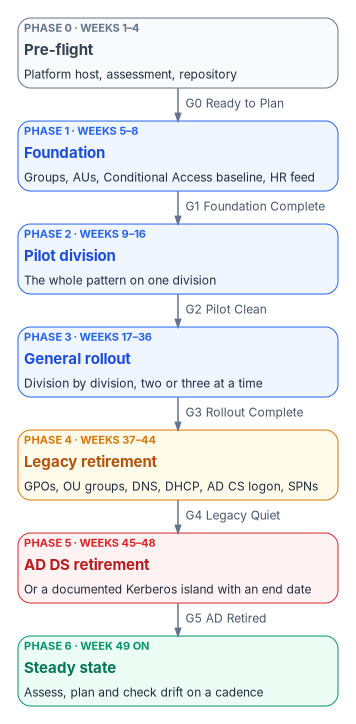
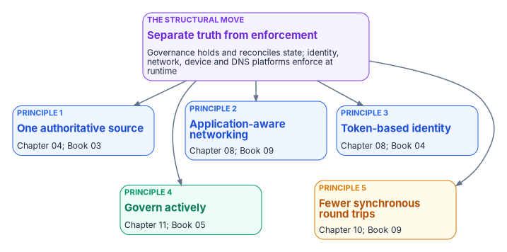

# Chapter 12 — The Migration Roadmap

*Run the workstreams together, open each phase only when the last gate is green, and let the data, not a signature, say when a gate is green.*

::: {.callout-note}
## In this chapter
The structural move the whole program turns on and the five principles that follow from it. Then the roadmap: seven phases, each with entry work and an exit gate; the five workstreams that run in parallel through them; how gates are evaluated, what triggers a rollback and who decides; the external clocks (FedRAMP's Consolidated Rules and the agency's own authorization); where mainframe access fits in the sequence; the common failure modes; and the first three things to do. Each book in the workbook carries its own phase plan for its surface, linked from the workstream table.
:::

> **Dependency chain:** Inventory → Plan → Identity → Policy → Network services → Devices and servers → Access plane → **Retire AD DS** → **Prove steady state**. This chapter sequences the whole chain as a program.

## The program claim

This chapter sequences Chapters 03 to 08 as an **illustrative fifty-two-week program** with five parallel workstreams (identity, policy, services, compute, access) and six named gates, G0 to G5. The week numbers are a sequencing model, not a commitment: large federal estates typically run multi-year. The roadmap lives in the authoritative repository, and every gate criterion can be evaluated mechanically.

{#fig-ch12-phase-gates fig-alt="Seven stacked phase boxes joined by arrows labeled with gates. Phase 0, Pre-flight, weeks 1 to 4, slate: platform host, assessment, repository; gate G0 Ready to Plan. Phase 1, Foundation, weeks 5 to 8, blue: groups, administrative units, Conditional Access baseline, HR feed; gate G1 Foundation Complete. Phase 2, Pilot division, weeks 9 to 16, blue: the whole pattern on one division; gate G2 Pilot Clean. Phase 3, General rollout, weeks 17 to 36, blue: division by division, two or three at a time; gate G3 Rollout Complete. Phase 4, Legacy retirement, weeks 37 to 44, amber: GPOs, OU groups, DNS, DHCP, AD CS logon, SPNs; gate G4 Legacy Quiet. Phase 5, AD DS retirement, weeks 45 to 48, red: or a documented Kerberos island with an end date; gate G5 AD Retired. Phase 6, Steady state, week 49 on, green: assess, plan and check drift on a cadence."}

Two properties define the program:

1. **Parallel, not sequential.** The five workstreams run together. Finishing one before starting the next doubles the duration and produces worse outcomes.
2. **Gated, not open-ended.** A phase starts only when the prior gate clears, and ends only when its own criteria are green.

Illustratively, a mid-size organization (5,000 to 50,000 users, 500 to 5,000 servers) with a clean forest and few Kerberos applications might finish in about fifty-two weeks. Scale changes the duration of each phase, not the structure.

## The direction of travel

The roadmap rests on one structural move, carried over from the modernization whitepaper's closing argument. Active Directory combined **the directory**, which held the truth about people, devices and their relationships, with **the domain controller**, which enforced it in the path of every logon. The target keeps them apart: a governance layer holds and reconciles authoritative state, while identity providers, enforcement points, network fabrics and data platforms remain the runtime data planes.

That is the program's design position, and it is consistent with the federal reference architecture rather than dictated by it. NIST SP 800-207 separates the policy decision point from the enforcement points and puts their control traffic on a control plane logically separate from the data plane.[^c12-207] It is guidance, not a mandate, so the program cites it as alignment. [Chapter 01](01-why-modernization-is-hard.md) tells how the two were fused; [Chapter 03](03-platform-foundation.md#the-control-plane-over-the-data-planes) puts the platform host on the decision side of the line.

{#fig-ch12-five-principles fig-alt="A violet hub box, the structural move: separate truth from enforcement; governance holds and reconciles state while identity, network, device and DNS platforms enforce at runtime. Arrows lead to five principle boxes. Principle 1, one authoritative source, blue, Chapter 04 and Book 03. Principle 2, application-aware networking, blue, Chapter 08 and Book 09. Principle 3, token-based identity, blue, Chapter 08 and Book 04. Principle 4, govern actively, green, Chapter 11 and Book 05. Principle 5, fewer synchronous round trips, amber, Chapter 10 and Book 09."}

Five principles follow from it, and each phase below advances all five:

| Principle | What it means for the roadmap | Carried by |
|---|---|---|
| 1. One authoritative source | Every attribute that drives access has one designated source, with lineage from source to decision; regional variation is documented, not hidden in schema | [Chapter 04](04-identity-transformation.md); [Book 03](../b03-hr-identity/index.md) |
| 2. Application-aware networking | Access decisions use identity, device and application context, not network location | [Chapter 08](08-access-plane.md); [Book 09](../b09-network/index.md) |
| 3. Token-based identity | Signed tokens replace session-bound Kerberos and NTLM; the token must assert an authorization that is true, which is why Principle 3 depends on Principle 1 | [Chapter 08](08-access-plane.md); [Book 04](../b04-access/index.md) |
| 4. Govern actively | The control plane reconciles toward intent under an actuation ceiling per operation class | [Chapter 11](11-analysis-plan-delivery.md); [Book 05, Chapter 02](../b05-devices/02-the-hybrid-join-trap.md) |
| 5. Fewer synchronous round trips | No application leaves its data until its transactions are profiled and reduced | [Chapter 10](10-analyzing-the-estate.md#profiling-transactions-before-separation); [Book 09](../b09-network/index.md) |

## The seven phases

### Phase 0 — Pre-flight (weeks 1–4)

**Goal.** Produce the planning artifacts and stand up the platform host.

- **Entry:** executive sponsor and steward named; platform host provisioned; read-only assessment account created.
- **Work:** build the platform host ([Chapter 03](03-platform-foundation.md)); run the assessment ([Chapter 10](10-analyzing-the-estate.md)); seed the repository; create least-privilege service principals for Microsoft Entra ID, Intune and Azure Arc; profile the transactions of any application proposed to move away from its data.
- **Gate G0, Ready to Plan:** platform host operational; assessment committed; no open priority-one findings.

### Phase 1 — Foundation (weeks 5–8)

**Goal.** Put the identity primitives in place before anything else moves.

- **Identity:** enterprise-level dynamic groups; administrative units for Tier 1 and selected Tier 2 scopes; the HR-to-cloud provisioning feed for the foundation scope ([Book 03, Chapter 12](../b03-hr-identity/12-execution-plan.md)).
- **Policy:** the enterprise Conditional Access baseline: MFA for all users, legacy authentication blocked, emergency access accounts excluded from every policy that blocks or restricts sign-in. Microsoft's own procedure starts the legacy-authentication block in report-only mode so the impact can be read before enforcement.[^c12-legacy] Microsoft recommends at least two cloud-only emergency access accounts using phishing-resistant methods, monitored on every use and tested at least every 90 days.[^c12-breakglass]
- **Services:** IP address management covering the platform host and Tier 0 infrastructure.
- **Compute:** the platform host and pilot servers connected through Azure Arc.
- **Access:** single sign-on configured; FIDO2 security keys and passkeys open for registration to Tier 0 administrators.
- **Gate G1, Foundation Complete:** enterprise groups and administrative units drift-clean; baseline Conditional Access enforced, with no user outside the MFA requirement other than the documented emergency access accounts; Tier 0 covered by IPAM; emergency access accounts vaulted and tested; HR-to-cloud provisioning operational for the foundation scope; zero drift across the foundation.

### Phase 2 — Pilot division (weeks 9–16)

**Goal.** Prove the full pattern on one division, typically IT, which tolerates disruption best.

- **Identity:** organizational attributes populated; dynamic groups, administrative units and delegated roles live.
- **Policy:** division-scoped Conditional Access and Intune policies applied; the first Group Policy Objects retired ([Book 05, Chapter 07](../b05-devices/07-the-gpo-sunset-program.md)).
- **Services:** the division's DNS zones migrated, DHCP scopes re-homed, address space in IPAM ([Book 08, Chapter 10](../b08-ddi/10-migration-sequence.md)).
- **Compute:** PCs moved by pattern (new devices Entra joined, existing devices reset and re-enrolled, or hybrid joined as a waypoint with a cut date); servers connected through Azure Arc, since Intune doesn't manage Windows Server ([Book 05, Chapters 02](../b05-devices/02-the-hybrid-join-trap.md) and [09](../b05-devices/09-servers-under-azure-arc.md)).
- **Access:** certificate-based authentication for PIV and CAC holders, which Microsoft Entra ID supports directly without a federated identity provider;[^c12-cba] ZTNA for the division's applications.
- **Gate G2, Pilot Clean:** zero drift for a hold period (for example fourteen consecutive days, illustrative); no AD-only users and no hybrid-joined PCs without a cut date; retrospective and runbook updates committed.

### Phase 3 — General rollout (weeks 17–36)

**Goal.** Scale the pattern to every remaining division.

This is the longest phase. Illustratively, budget two to three weeks per division, with two or three divisions in parallel. Each division follows the same sub-pattern (plan, in-division pilot, full availability, drift-clean hold), reports green, yellow or red weekly, and draws on the shared authoritative source.

- **Gate G3, Rollout Complete:** every division has passed its exit gate; every HR-listed employee has valid attributes; every user PC is cloud-joined and every server Arc-connected, or recorded in a documented exception; zero cross-division drift.

### Phase 4 — Legacy retirement (weeks 37–44)

**Goal.** Retire legacy infrastructure, each artifact through its own plan with steward approval. Typical order:

1. Group Policy Objects already migrated to Intune.
2. OU-based security groups superseded by dynamic groups.
3. AD-integrated DNS zones, one at a time, except the domain's own locator zones.
4. AD-authorized DHCP.
5. The Group Policy configuration for AD CS smart-card logon.
6. The remaining AD-bound service principal names, application by application.

**Gate G4, Legacy Quiet:**

- No active GPOs beyond the minimum set a Kerberos island needs, and no AD security groups in active use.
- Every DNS zone moved or retired except the AD domain's zones, including `_msdcs`. The source made "zero AD-integrated DNS zones" a G4 criterion, but while any domain controller runs, its domain's zones must stay on a DNS service that accepts secure dynamic registration from domain controllers; they move last ([Book 08, Chapter 10](../b08-ddi/10-migration-sequence.md)).
- Certificate issuance for users and devices moved to a CA that doesn't depend on AD DS, and AD CS no longer used for smart-card logon. Domain controller and LDAPS certificates stay on AD CS until Active Directory itself retires ([Book 07, Chapter 07](../b07-pki/07-coexistence-and-migration.md)).
- Every service principal name migrated, retired or islanded.
- AD authentication volume below an agreed threshold (for example 5% of the peak-migration rate, illustrative).

### Phase 5 — AD DS retirement (weeks 45–48)

**Goal.** Shut down AD DS. This is the shortest phase, because Phases 0 to 4 did the work.

1. Freeze AD changes and run a final assessment and evidence packet.
2. Demote the domain controllers that hold no operations master roles.
3. If a Kerberos island is retained, transfer the operations master roles to a surviving domain controller.
4. Demote or isolate the remaining domain controllers. Demoting the last domain controller in a domain needs Enterprise Admins membership because it removes the domain itself, and the forest if it is the last domain.[^c12-demote] The domain's DNS zones move or retire with it.
5. Decommission the VMs, archive the final state, and commit the retirement record.

The source kept "the forest in backup" as the fallback. A backup is only valid for restoring Active Directory within the tombstone lifetime, 180 days by default in forests created since Windows Server 2003 SP1,[^c12-tsl] so the archive is a records copy, not an indefinite rollback. The real rollback point is the last moment a domain controller still runs.

- **Gate G5, AD Retired:** domain controllers decommissioned, or retained as a documented Kerberos island with an end-of-life date; evidence packet in the repository and the SIEM; no live production dependency on AD authentication.

### Phase 6 — Steady state (week 49 on)

**Goal.** Operate under governed control, indefinitely. Assessments, plans and drift checks run on a cadence ([Chapters 10](10-analyzing-the-estate.md) and [11](11-analysis-plan-delivery.md)), every delivery emits evidence, continuous monitoring feeds compliance reporting, and changes flow through reviewed pull requests. Periodic retrospectives confirm that the authoritative source still matches organizational intent.

## The five parallel workstreams

| Workstream | Lead | Book 01 chapter | Detailed phase plan | Key artifacts |
|---|---|---|---|---|
| Identity | Identity architect | [04](04-identity-transformation.md) | [Book 02, Chapter 10](../b02-identity/10-migrating-and-governing.md); [Book 03, Chapter 12](../b03-hr-identity/12-execution-plan.md) | Dynamic groups, administrative units, HR feed |
| Policy | Security engineer | [05](05-policy-transformation.md) | [Book 05, Chapter 07](../b05-devices/07-the-gpo-sunset-program.md); [Book 04, Chapter 07](../b04-access/07-the-conditional-access-policy-library.md) | Intune configurations, Conditional Access, machine configuration |
| Services | Network engineer | [06](06-network-services.md) | [Book 08, Chapter 10](../b08-ddi/10-migration-sequence.md); [Book 09, Chapter 13](../b09-network/13-sequencing-cost-and-evidence.md) | DNS, DHCP and IPAM adapters; transport |
| Compute | Endpoint administrator and server engineer | [07](07-compute-transformation.md) | [Book 05, Chapter 09](../b05-devices/09-servers-under-azure-arc.md); [Book 06](../b06-data-platform/index.md) | Device enrollments, Arc projections, SQL Server authentication |
| Access | Identity and security jointly | [08](08-access-plane.md) | [Book 04](../b04-access/index.md); [Book 07, Chapter 07](../b07-pki/07-coexistence-and-migration.md) | ZTNA, certificate-based authentication, PIM, MFA |

A weekly cross-workstream sync resequences work around dependencies; a division's devices can't move, for example, until its Conditional Access policies are in place. Who leads, decides and does the work across the program is [Chapter 09](09-who-leads-the-transformation.md).

## Gates, rollback and authority

Every gate criterion is evaluated from the repository and the drift reports. "Zero drift for fourteen days" is a filtered drift query, "valid attributes for every employee" a query on the canonical user table, and "every PC cloud-joined" a device-inventory query. The engine reports green, the steward concurs, and the pull request merges. A gate the engine can't evaluate needs a better criterion.

Rollback triggers are thresholds, not judgment calls. The values are the agency's to set:

| Trigger | Scope | Action |
|---|---|---|
| Drift above threshold for more than 24 hours | Phase | Halt; no new deliveries until clean |
| Conditional Access blocks more than a set share of legitimate sign-ins | Enterprise | Revert the policy; authorize a replacement |
| Drift detection stops reporting | Platform | Escalate; halt all phase work |
| An evidence packet fails signature validation | Delivery | Halt; investigate; restore the last known-good state |
| SLA breach on a priority-one finding | Any | Notify steward and sponsor |

Pilots exist to catch problems before they become rollbacks.

| Gate | Authority | Backup |
|---|---|---|
| G0 — Ready to Plan | Steward | Executive sponsor |
| G1 — Foundation Complete | Steward | — |
| G2 — Pilot Clean | Steward and executive sponsor | — |
| G3 — Rollout Complete | Executive sponsor and steering committee | — |
| G4 — Legacy Quiet | Steward | Executive sponsor |
| G5 — AD Retired | Executive sponsor and CIO | — |
| Division-level exit | Division lead and steward | — |

The pull request that merges a gate decision records who made it.

## The clocks the roadmap runs against

Two external clocks bear on the schedule, and the source conflated them.

**FedRAMP certifies cloud services; the agency authorizes its own systems.** FedRAMP's Consolidated Rules for 2026, announced June 25, 2026, govern how cloud service offerings are certified. They become mandatory for all stakeholders on January 1, 2027, after optional early adoption from July 4, 2026, the end of new FedRAMP Ready submissions on July 28, 2026, and the opening of the 20x Class A pipeline on August 3 and the Class B and C pipelines on August 31; FedRAMP stops accepting new Rev5 certification applications on June 11, 2027.[^c12-fedramp-dates] Under 20x, cloud providers demonstrate Key Security Indicators, measurable indicators meant to support continuous validation rather than one-time compliance.[^c12-ksi] None of this certifies the agency's own estate. FedRAMP is explicit that each agency "still authorizes its own federal information systems" and should never create a standalone authorization to operate for a cloud service offering; it authorizes the system that uses the service.[^c12-fedramp-use] So the source's claim that agencies which haven't modernized "will not be able to produce" FedRAMP evidence by 2027 is wrong as stated. What the date does is change the evidence the program's cloud providers publish and the agency inherits, and it makes the program's own machine-readable evidence ([Chapter 11](11-analysis-plan-delivery.md#evidence-packet)) easier to line up with what the providers report. Book-level indicator mappings are in [Book 04, Chapter 10](../b04-access/10-access-as-code-and-evidence.md) and [Book 02, Chapter 10](../b02-identity/10-migrating-and-governing.md).

**The agency's own deadlines.** The program's systems are authorized by the agency under its own process, and the deadlines that bind the agency directly come from OMB and CISA: OMB M-26-14's logging plan and maturity levels,[^c12-m2614] CISA BOD 25-01's secure configuration baselines for in-scope Microsoft 365 tenants,[^c12-bod2501] and the end-of-support dates of what the estate runs (Windows 10 reached end of support on October 14, 2025;[^c12-win10] Windows Server 2012 and 2012 R2 Extended Security Updates ended on October 13, 2026, and Windows Server 2016 reaches end of support on January 12, 2027[^c12-esu]). [Appendix A](appendix-a-requirements-mapping.md) maps them to the chapters and books that answer them.

## Mainframe access in the sequence

Where the estate includes a z/OS mainframe, access to it joins the access workstream late and in steps. The pattern, a gateway that validates the enterprise token and maps it to a RACF identity while CICS and IMS stay unchanged inside, is in [Chapter 08](08-access-plane.md#mainframe-access-tokens-at-the-boundary), with the identity side in [Chapter 04](04-identity-transformation.md). For the roadmap the rule is sequencing by transaction type: discrete, read-mostly transactions first; multi-step pseudo-conversational transactions only after they have been refactored toward stateless calls, which is the round-trip reduction [Chapter 10](10-analyzing-the-estate.md#profiling-transactions-before-separation) profiles. The mainframe also needs its own answer for the device workstream: OMB M-22-09 notes that mainframes may not have compatible endpoint detection and response tools and may need other zero trust mechanisms to mitigate risk.[^c12-m2209]

## Common failure modes

1. **Half-finished identity.** The HR connector breaks mid-rollout and the program stalls. *Mitigation:* G1 requires HR provisioning before rollout.
2. **Unscoped Conditional Access.** A broad MFA policy blocks critical edge-case sign-ins. *Mitigation:* attribute scoping, report-only first, pilot groups first.
3. **DNS left for "phase 2."** Identity moves, DNS stays AD-integrated, and AD can never retire. *Mitigation:* DNS, DHCP and IPAM move together, with the locator zones last.
4. **Permanent hybrid join.** *Mitigation:* treat hybrid join as a waypoint, give every hybrid-joined device a cut date, and monitor time in that state.
5. **Evidence-less migration.** Ad hoc changes leave no provenance. *Mitigation:* plan-based delivery.

## Cadence and finish line

Weekly: Monday status, Tuesday dependency sync, Wednesday plan reviews merge, Thursday off-peak deliveries, Friday evidence and drift review. Monthly: gate reviews against the schedule. Two consecutive red weeks escalate to the sponsor.

At steady state the program meeting sees zero drift findings, zero actions from the nightly plan run, signed evidence flowing to the SIEM and continuous monitoring, a refreshed authorization package, and only routine tickets. The program is never "done," but the modernization is: AD is gone, or reduced to documented Kerberos islands with end-of-life dates.

## Where to start

None of this requires a vendor decision on day one. It requires three things, and Phase 0 produces them:

1. **An inventory.** The read-only assessment of [Chapter 10](10-analyzing-the-estate.md), committed with provenance.
2. **An owner.** A named executive sponsor and steward, and a lead for each workstream ([Chapter 09](09-who-leads-the-transformation.md)).
3. **A date.** Gate G0 on the calendar, with the external clocks above beside it.

## Key takeaways

1. Workstreams run in parallel, but gates follow the dependency chain.
2. Gate criteria are evaluated from data, not executive signature.
3. The AD domain's own DNS zones and domain controller certificates are the last things to move, not the first.
4. FedRAMP's 2027 date governs cloud providers' certification; the agency's own systems run on the agency's authorization and OMB's and CISA's deadlines.
5. Week numbers are illustrative; large estates run multi-year.

::: {.callout-tip}
## Continue the book
[← Previous: Chapter 11 — Analysis, Plan, Delivery](11-analysis-plan-delivery.md) · [Book index](index.md) · [Next: Appendix A — Requirements Mapping →](appendix-a-requirements-mapping.md)
:::

[^c12-207]: NIST, SP 800-207, *Zero Trust Architecture*, August 2020, §3 (logical components; policy decision and enforcement points) and §3.4.1 (the data plane and control plane are logically separate), <https://csrc.nist.gov/pubs/sp/800/207/final> (accessed Oct 21, 2026).
[^c12-legacy]: Microsoft Learn, "Block legacy authentication with Conditional Access" (exclusions; create the policy in report-only mode), <https://learn.microsoft.com/entra/identity/conditional-access/policy-block-legacy-authentication> (accessed Oct 21, 2026).
[^c12-breakglass]: Microsoft Learn, "Manage emergency access admin accounts," Security guardrails summary, <https://learn.microsoft.com/entra/identity/role-based-access-control/security-emergency-access> (accessed Oct 21, 2026).
[^c12-cba]: Microsoft Learn, "Meet multifactor authentication requirements of memorandum 22-09" (Microsoft Entra certificate-based authentication without a federated identity provider, including CAC, PIV and derived PIV credentials), <https://learn.microsoft.com/entra/standards/memo-22-09-multi-factor-authentication> (accessed Oct 21, 2026).
[^c12-demote]: Microsoft Learn, "Demote domain controllers and domains," <https://learn.microsoft.com/windows-server/identity/ad-ds/deploy/demoting-domain-controllers-and-domains--level-200-> (accessed Oct 21, 2026).
[^c12-tsl]: Microsoft Learn, "Back up and restore Active Directory domain controllers using Azure Backup," Best practices (backup age mustn't exceed the tombstone lifetime; 180 days by default), <https://learn.microsoft.com/azure/backup/active-directory-backup-restore> (accessed Oct 21, 2026).
[^c12-fedramp-dates]: FedRAMP, "Propelling Change: FedRAMP Launches Consolidated Rules for 2026," June 25, 2026, <https://www.fedramp.gov/2026-06-25-propelling-change-fedramp-launches-consolidated-rules-for-2026/>, and "Important Dates for the Consolidated Rules for 2026," <https://www.fedramp.gov/2026/timeline/> (both accessed Oct 21, 2026).
[^c12-ksi]: FedRAMP, "Key Security Indicators," FedRAMP 20x Certification Rules, *Consolidated Rules for 2026*, <https://www.fedramp.gov/2026/providers/20x/key-security-indicators/> (accessed Oct 21, 2026).
[^c12-fedramp-use]: FedRAMP, "Using a FedRAMP Certified Cloud Service," *Consolidated Rules for 2026*, <https://www.fedramp.gov/2026/agencies/use/> (accessed Oct 21, 2026).
[^c12-m2614]: Office of Management and Budget, M-26-14, *Ensuring Effective and Efficient Agency Logging and Network Visibility to Defend Against Evolving Cyber Threats*, May 22, 2026, <https://www.whitehouse.gov/wp-content/uploads/2026/05/M-26-14-Ensuring-Effective-and-Efficient-Agency-Logging-and-Network-Visibility-to-Defend-Against-Evolving-Cyber-Threats.pdf> (accessed Oct 21, 2026).
[^c12-bod2501]: Cybersecurity and Infrastructure Security Agency, Binding Operational Directive 25-01, *Implementing Secure Practices for Cloud Services*, December 17, 2024, <https://www.cisa.gov/news-events/directives/bod-25-01-implementing-secure-practices-cloud-services> (accessed Oct 21, 2026).
[^c12-win10]: Microsoft Learn, "Windows 10 reaching end of support," <https://learn.microsoft.com/lifecycle/announcements/windows-10-end-of-support> (accessed Oct 21, 2026).
[^c12-esu]: Microsoft Learn, "Cloud-native licensing and cost management with Azure Arc-enabled servers," Extended Security Updates, <https://learn.microsoft.com/azure/azure-arc/servers/cloud-native/licensing-cost-management> (accessed Oct 21, 2026).
[^c12-m2209]: Office of Management and Budget, M-22-09, *Moving the U.S. Government Toward Zero Trust Cybersecurity Principles*, January 26, 2022, §III.B (Devices), <https://www.whitehouse.gov/wp-content/uploads/2022/01/M-22-09.pdf> (accessed Oct 21, 2026).
