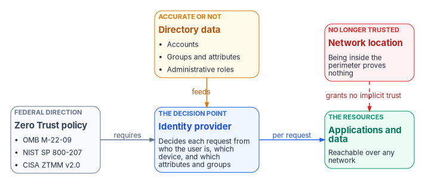
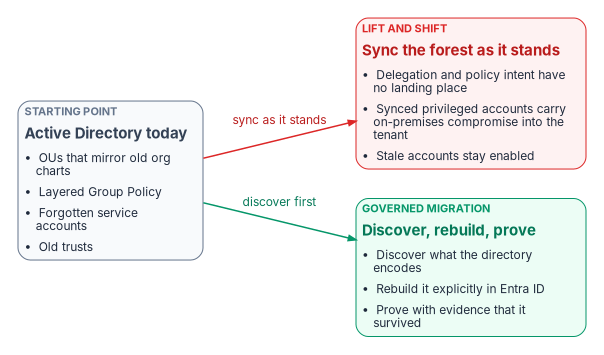

# Chapter 01 — Why Identity Matters

*Once the network stops deciding who gets in, the directory decides, and most directories were never built to carry that decision.*

::: {.callout-note}
## In this chapter
Why federal Zero Trust policy makes identity, not the network, the place where every access decision is made. What more than twenty-five years of Active Directory accumulated, and why nobody owns it. Why the move to Microsoft Entra ID is forced, and what exactly is doing the forcing. What is at stake if the forest is synchronized into the cloud as it stands.
:::

## The access decision moved to identity

For most of the directory era, the network made the first access decision. A user inside the perimeter reached what the perimeter allowed, and the directory's job was to answer "who is this?" for systems that were already on the same network. Federal direction has moved that decision off the network and onto identity.

- **OMB M-22-09** sets the federal Zero Trust strategy. It requires agencies to use centralized identity management systems for agency users, to enforce multifactor authentication at the application layer rather than the network layer, to require phishing-resistant MFA for staff, contractors and partners, and to consider at least one device-level signal alongside identity when authorizing access. It states that federal applications can't rely on network perimeter protections, and that users should log into applications rather than networks. It also directs agencies to consolidate identity systems so that protections and monitoring apply consistently.[^c01-m2209]
- **NIST SP 800-207** defines the architecture. Zero trust grants no implicit trust based on network location or asset ownership. Access to each resource is granted per session, decided by dynamic policy that includes the client's identity and the attributes the enterprise assigns to it, and authentication and authorization are re-evaluated continually rather than once at the door.[^c01-sp800207]
- **CISA's Zero Trust Maturity Model** makes identity the first of its five pillars (Identity, Devices, Networks, Applications and Workloads, Data) and defines an identity as an attribute or set of attributes that uniquely describes a user or entity. At its optimal level, an agency validates identity continuously, not only when access is first granted.[^c01-ztmm]

M-22-09 is explicit about where the data behind those decisions comes from. Zero Trust needs metadata about the user at the policy enforcement point, and the enterprise identity system maintains that metadata and keeps it correct when a person leaves or changes position, drawing on human resources, contract management and personnel security systems.[^c01-m2209] The identity provider becomes the policy decision point for the whole estate. Whatever it believes about a person, a group or a device is what the estate enforces.

{#fig-ch01-identity-control-plane fig-alt="Left to right. A grey box, federal direction: OMB M-22-09, NIST SP 800-207, CISA Zero Trust Maturity Model. An arrow labelled requires leads to a blue box, the decision point: the identity provider decides each request from who the user is, which device, and which attributes and groups. An arrow labelled per request leads to a green box: applications and data, reachable over any network. A red box, network location, is joined to the applications box by a dashed line labelled grants no implicit trust. An amber box below, directory data (accounts, groups and attributes, administrative roles), tagged accurate or not, feeds the decision point."}

That is the sense in which identity is the control plane. A wrong attribute used to produce a wrong entry in the phone book. Under Zero Trust it produces a wrong group, a wrong policy match and the wrong access, enforced consistently everywhere. A stale account used to be reachable only from inside the building. Under Zero Trust it is a valid identity that can be used from anywhere the applications are published. The workforce side of that dependency, the employee data that identity attributes are projected from, is the subject of [HR-Driven Identity](../b03-hr-identity/index.md). This book is about the directory those attributes land in.

## What twenty-five years of Active Directory accumulated

Active Directory arrived with Windows 2000, and with it the organizational unit: a hierarchical container inside a domain, used to group users, computers and groups so that administrative rights could be delegated and policies applied to them as a unit.[^c01-adds-ou] That design worked, and organizations built on it for a quarter of a century. Most of them, federal agencies included, never ended up with a clean, well-governed directory. What they have is decades of organic growth.

| What accumulated | How it looks today | Why it matters now |
|---|---|---|
| Regional domain controllers and domains | Never fully consolidated; some exist because a region once needed its own | Each is a separate administrative boundary to discover and reconcile |
| OUs that mirror old organization charts | Containers named for offices, programs and reorganizations that no longer exist | Delegation and policy still follow the old structure |
| Group Policy layered on Group Policy | Inherited settings whose original purpose nobody can state | Policy intent has to be recovered before it can be rebuilt |
| Service accounts nobody remembers creating | Enabled, often privileged, frequently with non-expiring passwords | Each is a dependency or a standing risk, and usually both |
| Trusts created to make something work quickly | Cross-forest and cross-domain trusts with no current owner | Entra ID has no equivalent concept to carry them into[^c01-road-posture] |

The consolidation projects that followed often didn't clean this up. They moved it behind a load balancer and added a layer on top. And nobody wants to own it. Active Directory became infrastructure that everything depends on and nobody champions. It runs until it doesn't.

It is also the target. CISA, with the Australian Signals Directorate and other partners, published joint guidance in September 2024 on detecting and mitigating Active Directory compromises. It describes Active Directory as the most widely used authentication and authorization solution in enterprise networks and explains how attackers use it to escalate privilege toward the most sensitive objects in the directory.[^c01-cisa-ad] An estate whose access decisions now flow from identity can't treat its oldest identity store as background plumbing.

## Why the move to Entra ID is forced

The usual worry is that Microsoft will retire Active Directory and force the migration. That isn't what is happening, and planning against the wrong threat leads to the wrong plan. Microsoft states that it continues to support and enhance Windows Server Active Directory for on-premises identity.[^c01-new-name] The forcing comes from two directions at once: federal policy, described above, and the direction of Microsoft's own identity investment, which is moving every hybrid component toward the cloud.

| Signal | What Microsoft states | What it means for the migration |
|---|---|---|
| Synchronization | Cloud Sync is replacing Entra Connect Sync, which will be retired once Cloud Sync reaches full functional parity.[^c01-connect-sync] Microsoft announced that, beginning in July 2026, it would notify each customer of its own transition window, in phases that start with tenants whose needs Cloud Sync already meets.[^c01-whatsnew] | The sync engine most hybrid estates run today is on a published replacement path |
| Federation | Microsoft recommends migrating from AD FS to cloud authentication and recommends password hash synchronization for it.[^c01-fed-to-cloud] It identifies federation trusts as one of the two main paths by which an on-premises compromise reaches the cloud.[^c01-protect-m365] | AD FS is a dependency to retire, not a component to modernize in place |
| Legacy protocols | All versions of NTLM were deprecated in June 2024. NTLMv1 is removed in Windows 11 version 24H2 and Windows Server 2025.[^c01-ntlm] Microsoft's cloud-first guidance says new applications that use NTLM, Kerberos or LDAP should be exceptions.[^c01-road-posture] | Applications that depend on the oldest protocols are on a clock |
| Source of authority | Converting synced users from Active Directory to cloud-managed users became generally available in January 2026, supported by both Connect Sync and Cloud Sync.[^c01-whatsnew] Groups can be converted the same way.[^c01-group-soa] | Moving authority to the cloud is now a supported, object-by-object operation, not a rebuild |
| Target posture | Microsoft models the journey as five states (cloud attached, hybrid, cloud first, AD minimized, 100% cloud) and describes it as a multi-year effort for large organizations.[^c01-road-posture] | The question is no longer whether to move, but how far and in what order |

There is precedent for this pattern, and it is more precise than "Microsoft forces migrations." Skype for Business Online was retired on July 31, 2021, after two years' notice, while on-premises Skype for Business Server remained supported.[^c01-skype] Exchange Server 2016 and 2019 reached end of support on October 14, 2025. The options Microsoft lists are migrating to Microsoft 365 or upgrading on-premises to Exchange Server Subscription Edition.[^c01-exchange] In each case the on-premises path narrowed and the new capability went to the cloud, and organizations that had already cleaned up their environments made the transition far more easily than those that hadn't.

What makes the identity version harder is that the gap is structural, not only technical. An organization whose authority model depends on the OU hierarchy can't script its way into a flat tenant. It has to rebuild that model in a different paradigm, and it can only do that if it knows what the old model was. In most estates that knowledge is tribal, if it exists at all. [Chapter 02](02-the-structural-problem.md) explains the structural mismatch in detail.

## What a lift-and-shift puts at risk

The tempting plan is to install a sync engine, synchronize the forest as it stands, and call the identity layer migrated. The sync works. What it carries across is the problem.

{#fig-ch01-two-paths fig-alt="A grey box on the left, Active Directory today: OUs that mirror old org charts, layered Group Policy, forgotten service accounts, old trusts. Two arrows leave it. The upper arrow, labelled sync as it stands, leads to a red box, lift and shift: delegation and policy intent have no landing place, synced privileged accounts carry on-premises compromise into the tenant, stale accounts stay enabled. The lower arrow, labelled discover first, leads to a green box, governed migration: discover what the directory encodes, rebuild it explicitly in Entra ID, and prove with evidence that it survived."}

| Carried across as it stands | Consequence in Entra ID |
|---|---|
| OU-based delegation and Group Policy | Neither has a landing place. Entra ID has no OU tree, so delegation and policy have to be rebuilt as administrative units, scoped roles, dynamic groups and Conditional Access, or they are simply lost ([Chapter 05](05-delegation-without-ous.md)) |
| Privileged accounts mastered on-premises | If a synchronized account holds cloud privileges, an attacker who gets its on-premises credentials can use them in the cloud. Microsoft's guidance is that privileged cloud roles use cloud-only accounts and that synchronized objects hold no privileges beyond those of a user[^c01-zt-identities][^c01-protect-m365] |
| Groups and attributes that drive access | On-premises membership or attribute manipulation can change cloud group membership, including dynamic groups, so owners of groups used for access have to be treated as privileged[^c01-protect-m365] |
| Federation through AD FS | A compromised token-signing certificate lets its holder impersonate any user in the cloud tenant[^c01-protect-m365] |
| Stale and orphaned accounts | Accounts that were reachable only from inside the perimeter become valid cloud identities, usable wherever the applications are published |
| Undocumented dependencies | Kerberos-dependent services, Windows-authenticated SQL Server, LDAP-bound applications and certificate chains break silently when the directory underneath them changes ([Chapter 04](04-the-hidden-migration-surface.md)) |

The last risk is the quiet one. If the program moves the objects but not the governance, it inherits the OU-driven model in a platform that can't express it. The organization pays for a cloud identity platform and runs it as a copy of the old directory, losing most of what made the move worth doing: access computed from attributes, scoped and time-bound privilege, and evidence of who has access and why.

## An illustrative starting point

The workbook's case studies are framing patterns, not real engagements. They describe the situation a program should expect, with no agency names or metrics. Two patterns frame this book.

- **A large, multi-forest directory.** An agency runs Active Directory at scale: more than 100,000 identities, a multi-forest topology, and an OU hierarchy that is a decade old and runs to several thousand OUs. Group memberships are maintained by hand, and movers are handled by ticket-driven re-permissioning. SIEM, the identity provider, IP address management and the authorization package each consume identity claims inconsistently. The authorization package describes the intended controls, but nobody can reproduce what the directory actually enforces at a given moment. The program has chosen its migration tooling. It hasn't addressed the inversion from placement in a hierarchy to access computed from attributes.
- **A twenty-year forest with SQL Server sprawl.** A civilian agency runs a twenty-year-old forest alongside twenty years of SQL Server instance and database growth. Service principal names, service accounts and LDAP-dependent applications have never been inventoried, and evidence that services kept working through past changes was assembled after the fact. The directory and the database estate share one authentication boundary, so neither can move safely without the other.

Neither pattern is unusual. Both show why the migration can't be scoped as a directory project, and both reappear in the How chapters as the estate that discovery ([Chapter 07](07-read-only-discovery.md)) and assessment ([Chapter 08](08-assessing-the-forest.md)) are built to read.

## The argument in brief

1. Federal Zero Trust policy moves the access decision from the network to identity, and the identity provider enforces whatever it believes about people, groups and devices.
2. The identity data most agencies hold is a twenty-five-year accumulation of OUs, policy layers, service accounts and trusts that nobody owns and few have documented.
3. Active Directory isn't being retired, but Microsoft's synchronization, federation, protocol and source-of-authority direction all point to the cloud, and federal policy requires the outcome that direction delivers.
4. A lift-and-shift synchronizes the accumulated risk into the tenant and discards the governance that the hierarchy carried.
5. The migration therefore has to be treated as a governance event: discover what the directory encodes, rebuild it explicitly, and prove it survived. [Chapter 02](02-the-structural-problem.md) shows why that rebuild is structural, and [Chapter 06](06-who-owns-the-migration.md) assigns who owns it.

::: {.callout-tip}
## Continue the book
[Book index](index.md) · [Next: Chapter 02 — The Structural Problem →](02-the-structural-problem.md)
:::

[^c01-m2209]: Office of Management and Budget, M-22-09, *Moving the U.S. Government Toward Zero Trust Cybersecurity Principles*, January 26, 2022, <https://www.whitehouse.gov/wp-content/uploads/2022/01/M-22-09.pdf> (accessed Oct 20, 2026).
[^c01-sp800207]: National Institute of Standards and Technology, SP 800-207, *Zero Trust Architecture*, August 2020, <https://csrc.nist.gov/pubs/sp/800/207/final> (accessed Oct 20, 2026).
[^c01-ztmm]: Cybersecurity and Infrastructure Security Agency, *Zero Trust Maturity Model*, Version 2.0, April 2023, section 5.1 (Identity), <https://www.cisa.gov/sites/default/files/2023-04/CISA_Zero_Trust_Maturity_Model_Version_2_508c.pdf> (accessed Oct 20, 2026).
[^c01-adds-ou]: Microsoft Learn, "Users in Active Directory Domain Services," <https://learn.microsoft.com/en-us/windows/win32/ad/users-in-active-directory-domain-services> (accessed Oct 20, 2026).
[^c01-road-posture]: Microsoft Learn, "Cloud transformation posture" (road to the cloud), <https://learn.microsoft.com/en-us/entra/architecture/road-to-the-cloud-posture> (accessed Oct 20, 2026).
[^c01-cisa-ad]: Cybersecurity and Infrastructure Security Agency, "ASD's ACSC, CISA, and US and International Partners Release Guidance on Detecting and Mitigating Active Directory Compromises," September 2024, <https://www.cisa.gov/news-events/alerts/2024/09/25/asds-acsc-cisa-and-us-and-international-partners-release-guidance-detecting-and-mitigating-active> (accessed Oct 20, 2026).
[^c01-new-name]: Microsoft Learn, "New name for Azure Active Directory" (FAQ: "Does Microsoft still support on-premises identity management?"), <https://learn.microsoft.com/en-us/entra/fundamentals/new-name> (accessed Oct 20, 2026).
[^c01-connect-sync]: Microsoft Learn, "Microsoft Entra Connect Sync: Understand and customize synchronization," <https://learn.microsoft.com/en-us/entra/identity/hybrid/connect/how-to-connect-sync-whatis> (accessed Oct 20, 2026).
[^c01-whatsnew]: Microsoft Learn, "Microsoft Entra releases and announcements" (April 2026: "Upcoming Change - Migrate from Microsoft Entra Connect Sync to Microsoft Entra Cloud Sync"; January 2026: "General Availability - Ability to convert Source of Authority of synced on-premises AD users to cloud users"), <https://learn.microsoft.com/en-us/entra/fundamentals/whats-new> (accessed Oct 20, 2026).
[^c01-fed-to-cloud]: Microsoft Learn, "Migrate from federation to cloud authentication," <https://learn.microsoft.com/en-us/entra/identity/hybrid/connect/migrate-from-federation-to-cloud-authentication> (accessed Oct 20, 2026).
[^c01-protect-m365]: Microsoft Learn, "Protect Microsoft 365 from on-premises attacks," <https://learn.microsoft.com/en-us/entra/architecture/protect-m365-from-on-premises-attacks> (accessed Oct 20, 2026).
[^c01-ntlm]: Microsoft Learn, "Deprecated features for Windows client" (NTLM, deprecation announced June 2024), <https://learn.microsoft.com/en-us/windows/whats-new/deprecated-features> (accessed Oct 20, 2026).
[^c01-group-soa]: Microsoft Learn, "Embrace cloud-first posture: Convert Group Source of Authority to the cloud," <https://learn.microsoft.com/en-us/entra/identity/hybrid/concept-source-of-authority-overview> (accessed Oct 20, 2026).
[^c01-skype]: Microsoft Learn, "Skype for Business Online retirement," <https://learn.microsoft.com/en-us/microsoftteams/skype-for-business-online-retirement> (accessed Oct 20, 2026).
[^c01-exchange]: Microsoft Learn, "Exchange Server 2019 and 2016 end of support roadmap," <https://learn.microsoft.com/en-us/troubleshoot/exchange/administration/exchange-2019-2016-end-of-support> (accessed Oct 20, 2026).
[^c01-zt-identities]: Microsoft Learn, "Configure Microsoft Entra for Zero Trust: Protect identities and secrets" (privileged accounts are cloud-native identities), <https://learn.microsoft.com/en-us/entra/fundamentals/zero-trust-protect-identities> (accessed Oct 20, 2026).
