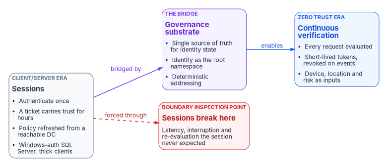

# Chapter 02 — The Structural Problem

*Active Directory governs an object by where it sits; Entra ID governs it by what the object says about itself, and nothing translates one into the other automatically.*

::: {.callout-note}
## In this chapter
How the forest, domain, OU and Group Policy hierarchy carries an organization's governance, and what a flat tenant offers in its place. The two limits that decide whether the mapping works. The session-versus-telemetry divide that makes hybrid identity break at a continuous-verification boundary such as FedRAMP's. Why the migration is a governance and single-source-of-truth event, and the capabilities that treatment requires.
:::

## Hierarchy is the governance model

Active Directory's structure isn't only technical. Forests and domains form the outer layers of the hierarchy, and within each domain the organizational unit, introduced with Windows 2000, groups users, computers and groups so that administrative rights can be delegated and policies applied to them as a unit.[^c02-adds-ou] Kerberos ticket policy is defined per domain and enforced by the domain's key distribution center.[^c02-kerberos-policy] Group Policy objects are linked to sites, domains and OUs, and by default their settings are inherited and cumulative down the tree, with the container closest to the object taking precedence. Their contents are stored in the directory and in each domain controller's SYSVOL folder and replicate between domain controllers.[^c02-gp-processing]

The result is that an object's position decides how it is governed. Move a user into a different OU and its delegated administrators, inherited policies and often its access all change, without anyone editing the user. Over twenty-five years, organizations built operational process on that property: help desk scope by regional OU, server baselines by OU, service accounts parked in a protected OU, and the organization chart itself encoded as the tree.

Entra ID has no tree to put an object in. A tenant holds users, groups, devices and service principals side by side, and governs them by what they carry: attributes, group memberships, role assignments and policy conditions. Microsoft notes that because Active Directory and Entra ID are separate products for different environments, they don't have like-for-like features, and Entra ID has no notion of Active Directory domain and forest trusts.[^c02-road-posture]

{#fig-ch02-placement-vs-attributes fig-alt="Two columns. Left column, grey, Active Directory, governed by placement: a forest box (the outermost container) above a domain box (authentication and Kerberos ticket policy) above an OU box (delegated administrators and linked Group Policy) above a user box; arrows labelled contains run down the column, and the user box notes that scope and policy are inherited from position. Right column, blue, Entra ID, governed by attributes: a user box listing department, location, employee type and extension attributes, an arrow labelled evaluated by to a rules box (membership rules and policy conditions), and an arrow labelled places it in to a box listing administrative unit, dynamic group and Conditional Access policy."}

So the gap between the two isn't a missing feature that a later release will fill. It is a different idea of where governance lives. An OU tree carries governance by containment. A tenant carries it by predicate. Every piece of governance that relied on containment has to be found and rewritten as an explicit predicate, an explicit role assignment or an explicit policy.

## Two limits decide whether the mapping works

Microsoft's usual answer to "where do my OUs go?" is administrative units. That answer is right, but two limits determine how far it gets you.

### Administrative units can't nest

Microsoft lists this as the first constraint on administrative units.[^c02-au] An OU tree doesn't become an administrative-unit tree. It becomes a flat set of administrative units, each with its own membership. Governance that depended on inheritance down the tree has to be expressed as a separate predicate for each unit. Several related constraints shape the design:

- A user, group or device can be a member of no more than 30 administrative units.[^c02-limits]
- An administrative unit with dynamic membership rules can contain users or devices, but not both, and dynamic rules for groups aren't supported. Adding a group to an administrative unit brings the group into scope, not its members.[^c02-au-dynamic][^c02-au]
- Dynamic membership requires a Microsoft Entra ID P1 license for each unique member, and Microsoft documents dynamic administrative units for the global Azure cloud, not for specialized clouds such as Azure Government.[^c02-au-dynamic]

### The attributes that drive membership are mastered in Active Directory

For a user synchronized from Active Directory, Microsoft Graph treats the on-premises extension attributes as read-only: their source of authority is the on-premises directory. For a cloud-only user, including one whose source of authority has been converted to the cloud, they can be set directly. Device extension attributes are managed only in Entra ID.[^c02-ext-attrs] In a hybrid estate where every user is synchronized, the values that administrative-unit and dynamic-group rules match on are written in Active Directory and reach the tenant through directory sync. That has two consequences. The migration can't stamp the attributes cloud-side for synced users, and every membership change waits on a synchronization cycle. The device plane and the user plane behave differently for the same reason.

Source-of-authority conversion, generally available for users since January 2026, changes this one object at a time: a converted user stops being synchronized and becomes cloud-managed.[^c02-whatsnew] It doesn't remove the need to decide which attributes are authoritative and where they come from. It moves that decision earlier. [Chapter 05](05-delegation-without-ous.md) works through the administrative-unit design, and [HR-Driven Identity](../b03-hr-identity/index.md) covers the upstream source for the attributes themselves.

## Every delegation concept needs an explicit counterpart

The reconstruction isn't guesswork. Each Active Directory delegation concept has an Entra ID counterpart, but it has to be built rather than inherited. The table is the starting map; [Chapter 03](03-ad-and-entra-side-by-side.md) compares the two platforms in full and [Chapter 05](05-delegation-without-ous.md) turns this map into a design.

| Active Directory concept | Entra ID counterpart | What changes |
|---|---|---|
| Organizational unit | Administrative unit | Membership is assigned or computed from attributes, not from containment. No nesting.[^c02-au] |
| OU-scoped delegation | A Microsoft Entra role assigned at administrative-unit scope | Same kind of role, different scope binding. Only roles that act on users, groups or devices can be scoped this way, for example User Administrator, Helpdesk Administrator, Authentication Administrator and Groups Administrator.[^c02-au-roles] |
| Help desk delegation on a leaf OU | Helpdesk Administrator or Authentication Administrator scoped to an administrative unit | The unit's membership rule matches organizational attributes. Scoped roles act only on non-administrator users in the unit.[^c02-au-roles] |
| Security group creation by a department administrator | Groups Administrator scoped to the department's administrative unit | Role plus scope replace the OU's access control list.[^c02-au-roles] |
| Group Policy inherited down the OU tree | Device-management policy assigned to dynamic groups | A group rule replaces OU position (program design position; device policy is covered in its own book) |
| Site-linked Group Policy for network behavior | Conditional Access with named locations | Evaluated per sign-in from token and signals, not from network proximity |
| Domain Admins | Global Administrator, eligible through Privileged Identity Management, never permanently active | Microsoft recommends just-in-time activation with phishing-resistant authentication for privileged roles.[^c02-protect-m365] |
| OU read delegation for a service account | Microsoft Graph application permissions with least privilege | Explicit scope; no implicit traversal of a tree |
| Privileged service accounts parked in a protected OU | Application Administrator or Cloud Application Administrator, eligible through Privileged Identity Management, or roles scoped to a single application | No containment; every privilege is an explicit role binding.[^c02-roles] |

The mapping step in the How chapters operationalizes this table. For each delegation record found in discovery it produces the administrative-unit definition, its membership rule and the role assignment Entra ID needs, so the output is executable guidance rather than a spreadsheet.

## The session-versus-telemetry divide

The governance gap has a deeper root, and it explains why hybrid identity fails in ways that look like application bugs.

The typical federal network was built on an assumption of proximity. Users were near their data. Domain controllers were near users. Then the servers and the data moved to consolidated data centers and the cloud, and the architecture didn't move with them. Users in field offices now reach centralized systems with protocols designed for a local network.

Those protocols are session-oriented. Trust is established once and carried forward:

- A Kerberos ticket-granting ticket is good for 10 hours by default and renewable for 7 days, under the Default Domain Policy.[^c02-tgt][^c02-renew] Every service ticket the user obtains in that window rests on the original sign-in.
- Group Policy is applied at startup and logon and refreshed in the background every 90 minutes, plus a random offset of up to 30 minutes. A change reaches a desktop only after it replicates to the domain controller that client talks to.[^c02-gp-processing] When no domain controller can be located, processing fails.[^c02-gp-fail]
- Windows-authenticated SQL Server connections, thick clients and file shares assume the session they opened stays intact.

Zero Trust inverts that model. NIST SP 800-207 describes authentication and authorization as dynamic and strictly enforced before access, with continual monitoring and possible reauthentication throughout a user's transactions.[^c02-sp800207] CISA's maturity model puts the optimal state at validating identity continuously, not only when access is first granted.[^c02-ztmm] Entra ID implements this with short-lived tokens and event-driven revocation. Access tokens are valid for one hour by default. Continuous access evaluation lets services such as Exchange Online, SharePoint Online and Teams act on critical events (an account disabled or deleted, a password reset, a high user risk) in near real time, with Microsoft noting latency of up to 15 minutes for event propagation.[^c02-cae]

| | Client/server era: sessions | Cloud and Zero Trust era: continuous verification |
|---|---|---|
| When trust is established | Once, at sign-in | On every request, and again when conditions change |
| What carries trust forward | A ticket or an open session | A short-lived token, revocable on events |
| Inputs to the decision | Credentials and domain membership | Identity, device health, location, risk and behavior |
| Where policy comes from | A domain controller the client can reach | The identity provider, evaluated at sign-in and at the resource |
| What failure looks like | Expired tickets, unreachable domain controllers, broken sessions | A denied request with a stated reason |

{#fig-ch02-session-vs-telemetry fig-alt="Three boxes left to right. A grey box, the client/server era, sessions: authenticate once, a ticket carries trust for hours, policy refreshed from a reachable domain controller, Windows-authenticated SQL Server and thick clients. An arrow labelled bridged by leads to a violet box, the governance substrate: a single source of truth for identity state, identity as the root namespace, deterministic addressing. An arrow labelled enables leads to a blue box, Zero Trust, continuous verification: every request evaluated, short-lived tokens with event-driven revocation, device, location and risk as inputs. A dashed red arrow labelled forced through leads from the session box to a red box, the boundary inspection point, titled sessions break here: latency, interruption and re-evaluation the session never expected."}

The two models aren't compatible. A session-based application can't pass through a continuous-verification enforcement point without its session model breaking: the inspection point sits in the path the session assumed was uninterrupted, adds latency, and re-evaluates trust the application believed was settled. Many applications with a web front end are still client/server at the protocol level, and they fail. The symptoms look like user error, WAN trouble or application defects, which is why they get diagnosed one at a time.

## Why it breaks at the FedRAMP boundary

The program's reading is that FedRAMP's boundary and monitoring expectations were written for cloud-native services that never had long-lived sessions: stateless, token-based, short-lived authentication, every component reachable from the cloud, telemetry flowing continuously to a SIEM. FedRAMP's own direction reinforces that reading. FedRAMP 20x is a new approach to assessment and authorization, and its early pilots validated security decisions automatically through Key Security Indicators.[^c02-fedramp20x]

Impose those expectations on a hybrid estate that still runs on-premises domain controllers, Kerberos, Windows Server Update Services, Windows-authenticated SQL Server and thick clients, and defense in depth becomes defense in conflict. Each control added for the boundary breaks something that worked before, because the controls and the estate assume different trust models. Hybrid identity lives on that fault line, and FedRAMP is where federal environments meet it most sharply. The same mechanism applies to any client/server application pushed through a Zero Trust or SASE enforcement point.

## Why nobody wants to own it

Fixing this correctly means admitting that the problem isn't one system or one team. It is the architecture. In federal IT, saying "we need to re-architect" is career risk, so the easier path is to patch the symptom, write a plan of action and milestones, add a proxy and move on. The people who understand the problem well enough to fix it are pushed aside because the fix sounds too large, and the people deciding often lack the depth to judge whether the diagnosis is right, so they default to incremental change. [Chapter 06](06-who-owns-the-migration.md) assigns the ownership this chapter says is missing.

## The migration is a governance event

A conventional migration moves users. A governance-aware migration moves the entire identity namespace and every dependency attached to it.

| Domain | What moves or changes | Migration risk |
|---|---|---|
| Identity | User accounts, service accounts, service principal names | Orphaned accounts, broken dependencies |
| Network | DNS, DHCP, DFS namespaces | Namespace drift, split-horizon DNS |
| Security | PKI, RADIUS, certificate templates | Broken authentication chains |
| Policy | Group Policy, and the Conditional Access that replaces it | Policy gap |
| Applications | LDAP-dependent applications, legacy single sign-on | Silent authentication failures |
| Devices | Domain-joined endpoints, hybrid management | Device trust drift |

Conventional engagements manage that surface by hand. No shared, tamper-evident record of the pre-migration state, the migration events or the post-migration posture survives the engagement, so each one starts from scratch, findings aren't reusable, and evidence is assembled afterward. [Chapter 04](04-the-hidden-migration-surface.md) inventories this surface in detail.

### The data-governance obligations it already sits under

Federal agencies already carry data-governance law. The Foundations for Evidence-Based Policymaking Act of 2018, whose Title II is the OPEN Government Data Act, requires each agency to designate a Chief Data Officer, to develop and maintain a comprehensive data inventory, and to make data open by default.[^c02-evidence-act] The program's reading is that none of these authorities mandates a single source of truth as such. SSOT is the architectural response agencies adopt to meet them, because a credible data inventory can't be maintained from sources that disagree about the same fact.

Agencies almost always run that data-governance program and the directory migration as two unrelated efforts. They shouldn't. Directory and identity infrastructure is the domain data-governance programs have historically left out, and it is the layer under every one of the decisions those programs care about. The program's position is to run them as one: treat the identity namespace as the root of the SSOT hierarchy, put governance in place before any identity object moves, and give the Chief Data Officer and the identity team one shared register of which system is authoritative for which fact.

### What that treatment requires

The program's design rests on four mechanisms, applied to the identity layer:

- **Authoritative origin.** Every principal has one authoritative representation. Downstream systems reference it or synchronize from it. They don't keep independent copies.
- **Provenance chain.** Every change records who made it, from what source, when and under which policy authority: the identity-layer equivalent of data-catalog lineage.
- **Drift detection.** Differences between the authoritative state and what systems actually hold are classified (schema, semantic, provenance, authorization, identity and source-of-truth contention), each with a severity and a remediation commitment.
- **Governance domains.** Identity, authorization, compliance, migration, evidence and operations each have a named owner.

Together they make the bridge in the figure above concrete. An agency can't move from sessions to continuous verification without knowing its authoritative identity state, can't implement Zero Trust unless identity is the root namespace that every decision resolves against, and can't run an access plane that enforces policy against named services unless addressing is deterministic.

The migration itself then becomes five capabilities rather than one tool:

| Capability | What it answers |
|---|---|
| Discovery | What governance does the current directory actually encode, whether or not it was set up well? ([Chapter 07](07-read-only-discovery.md), [Chapter 08](08-assessing-the-forest.md)) |
| Normalization | What is the clean authority model, decided before the migration rather than after? |
| Mapping | Which administrative units, scoped roles, access packages and Conditional Access policies express that model in Entra ID? ([Chapter 05](05-delegation-without-ous.md), [Chapter 09](09-building-the-entra-target.md)) |
| Continuity | What governed transition path do Kerberos-dependent services, SQL Server, legacy applications and on-premises systems get, instead of a cliff? ([Chapter 04](04-the-hidden-migration-surface.md)) |
| Validation | What evidence shows that the governance model survived the move? ([Chapter 10](10-migrating-and-governing.md)) |

The phased posture follows from it: assess, govern, migrate, validate, operate, with governance in place before the first identity object moves.

### The pattern, illustrated

The framing case studies show what this looks like across an engagement. They describe the pattern a program should expect, not the outcome of a real engagement.

1. **Model first.** Define the canonical attribute set (for example assignment scope, organizational role and clearance), the group rules computed from combinations of those attributes, and the provenance carried with each identity claim. Validate the model before any runtime change.
2. **Connect the sources.** Stand up read connections to Entra ID, Active Directory, Conditional Access targeting and the attribute sources, such as the PIV credential system and the agency's HR system. Each emits claims with full provenance from day one, including during parallel running.
3. **Clean up before cutover.** Pre-cutover runs surface inherited inconsistencies (stale attributes, group rules that reference retired values, broken provenance chains) as drift findings, and each is remediated on a set timetable. Orphaned accounts and broken dependencies are found before cutover, and silent authentication failures become explicit findings.
4. **Cut over.** The identity plane's authoritative source switches from on-premises Active Directory to Entra ID, and the model is already in place to interpret claims afterward. Where SQL Server shares the authentication boundary, its move from Windows authentication to token-based authentication runs in parallel with the directory.
5. **Operate.** Drift findings keep surfacing inconsistencies, deterministic fixes are automated, and changes to the model go through the program's decision process.

A real engagement would report, with metrics, how often provenance broke during cutover, how many identities passed validation before and after, whether the same person resolves identically across PIV, Entra ID and HR, and what share of access decisions are computed from attributes rather than administered by hand. Those measures are what a releasable case study would have to show. The lessons the patterns carry are already clear: findings must be reusable so that each engagement doesn't start from scratch, and the SQL Server estate and the directory must be governed together because they share one authentication boundary. Evidence then becomes a byproduct of the migration instead of something reconstructed after it.

::: {.callout-tip}
## Continue the book
[← Previous: Chapter 01 — Why Identity Matters](01-why-identity-matters.md) · [Book index](index.md) · [Next: Chapter 03 — Active Directory and Entra ID, Side by Side →](03-ad-and-entra-side-by-side.md)
:::

[^c02-adds-ou]: Microsoft Learn, "Users in Active Directory Domain Services," <https://learn.microsoft.com/en-us/windows/win32/ad/users-in-active-directory-domain-services> (accessed Oct 20, 2026).
[^c02-kerberos-policy]: Microsoft Learn, "Kerberos Policy," <https://learn.microsoft.com/en-us/windows/win32/secauthn/kerberos-policy> (accessed Oct 20, 2026).
[^c02-gp-processing]: Microsoft Learn, "Group Policy processing," <https://learn.microsoft.com/en-us/windows-server/identity/ad-ds/manage/group-policy/group-policy-processing> (accessed Oct 20, 2026).
[^c02-road-posture]: Microsoft Learn, "Cloud transformation posture" (road to the cloud), <https://learn.microsoft.com/en-us/entra/architecture/road-to-the-cloud-posture> (accessed Oct 20, 2026).
[^c02-au]: Microsoft Learn, "Administrative units in Microsoft Entra ID" (Constraints; Groups), <https://learn.microsoft.com/en-us/entra/identity/role-based-access-control/administrative-units> (accessed Oct 20, 2026).
[^c02-limits]: Microsoft Learn, "Microsoft Entra service limits and restrictions" (Administrative units), <https://learn.microsoft.com/en-us/entra/identity/users/directory-service-limits-restrictions> (accessed Oct 20, 2026).
[^c02-au-dynamic]: Microsoft Learn, "Manage users or devices for an administrative unit with rules for dynamic membership groups," <https://learn.microsoft.com/en-us/entra/identity/role-based-access-control/admin-units-members-dynamic> (accessed Oct 20, 2026).
[^c02-ext-attrs]: Microsoft Learn, "onPremisesExtensionAttributes resource type," Microsoft Graph v1.0, <https://learn.microsoft.com/en-us/graph/api/resources/onpremisesextensionattributes?view=graph-rest-1.0> (accessed Oct 20, 2026).
[^c02-whatsnew]: Microsoft Learn, "Microsoft Entra releases and announcements" (January 2026: "General Availability - Ability to convert Source of Authority of synced on-premises AD users to cloud users"), <https://learn.microsoft.com/en-us/entra/fundamentals/whats-new> (accessed Oct 20, 2026).
[^c02-au-roles]: Microsoft Learn, "Assign Microsoft Entra roles" (Roles that can be assigned with administrative unit scope), <https://learn.microsoft.com/en-us/entra/identity/role-based-access-control/manage-roles-portal> (accessed Oct 20, 2026).
[^c02-protect-m365]: Microsoft Learn, "Protect Microsoft 365 from on-premises attacks" (Isolate privileged identities), <https://learn.microsoft.com/en-us/entra/architecture/protect-m365-from-on-premises-attacks> (accessed Oct 20, 2026).
[^c02-roles]: Microsoft Learn, "Microsoft Entra built-in roles" (Application Administrator; Cloud Application Administrator), <https://learn.microsoft.com/en-us/entra/identity/role-based-access-control/permissions-reference> (accessed Oct 20, 2026).
[^c02-tgt]: Microsoft Learn, "Max-Ticket-Age attribute," Active Directory schema, <https://learn.microsoft.com/en-us/windows/win32/adschema/a-maxticketage> (accessed Oct 20, 2026).
[^c02-renew]: Microsoft Learn, "Max-Renew-Age attribute," Active Directory schema, <https://learn.microsoft.com/en-us/windows/win32/adschema/a-maxrenewage> (accessed Oct 20, 2026).
[^c02-gp-fail]: Microsoft Learn, "Windows 7 Clients intermittently fail to apply group policy at startup," <https://learn.microsoft.com/en-us/troubleshoot/windows-client/group-policy/fail-to-apply-group-policy-at-startup> (accessed Oct 20, 2026).
[^c02-sp800207]: National Institute of Standards and Technology, SP 800-207, *Zero Trust Architecture*, August 2020, section 2.1 (tenet 6), <https://csrc.nist.gov/pubs/sp/800/207/final> (accessed Oct 20, 2026).
[^c02-ztmm]: Cybersecurity and Infrastructure Security Agency, *Zero Trust Maturity Model*, Version 2.0, April 2023, Table 2 (Identity pillar, Authentication), <https://www.cisa.gov/sites/default/files/2023-04/CISA_Zero_Trust_Maturity_Model_Version_2_508c.pdf> (accessed Oct 20, 2026).
[^c02-cae]: Microsoft Learn, "Continuous access evaluation," <https://learn.microsoft.com/en-us/entra/identity/conditional-access/concept-continuous-access-evaluation> (accessed Oct 20, 2026).
[^c02-fedramp20x]: FedRAMP, "FedRAMP 20x," <https://www.fedramp.gov/20x/> (accessed Oct 20, 2026).
[^c02-evidence-act]: *Foundations for Evidence-Based Policymaking Act of 2018*, Pub. L. No. 115-435, approved January 14, 2019, Title II (OPEN Government Data Act), <https://www.govinfo.gov/content/pkg/PLAW-115publ435/html/PLAW-115publ435.htm> (accessed Oct 20, 2026).
