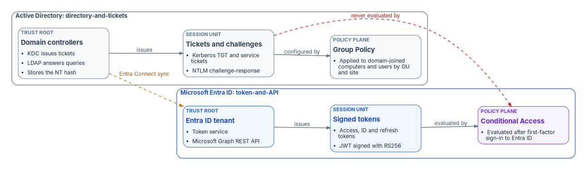
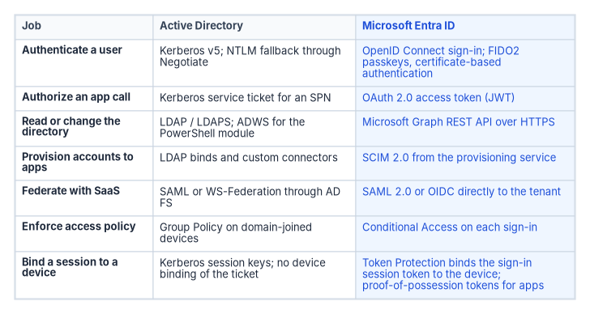

# Chapter 03 — Active Directory and Entra ID, Side by Side

*The scripts mostly survive the move; the protocols, the session unit, and the policy plane don't.*

::: {.callout-note}
## In this chapter
The two identity worlds at a glance, and the protocols each one speaks. Where the old protocols stand in Windows as of late 2026, and how the cryptography changes. Which languages and tools carry over and which modules are gone. The eight core concepts the program uses to frame directory migration, and why treating the move as a tooling swap keeps the old failure modes alive.
:::

## The shift in one paragraph

Microsoft identity has moved from a *directory-and-tickets* world to a *token-and-API* world. In the old world, the on-premises Active Directory domain controller is the trust root. It issues Kerberos tickets, answers LDAP queries, and replicates SYSVOL to its peers. Clients talk to domain controllers directly over Kerberos, NTLM, LDAP, and MS-RPC, and administrators automate against those same interfaces. In the new world, the Microsoft Entra ID tenant is the trust root. It issues OAuth 2.0 access tokens and OpenID Connect ID tokens, exposes the directory through the Microsoft Graph REST API, and federates with SaaS applications over SAML 2.0 and OpenID Connect. Around it sits an operating layer that barely existed around Active Directory: infrastructure as code, pipelines as code, and compliance as code.

{#fig-ch03-two-worlds fig-alt="Two rows of three boxes. The bottom row, labeled Active Directory: directory-and-tickets, in slate: domain controllers as the trust root (KDC issues tickets, LDAP answers queries, stores the NT hash), which issue Kerberos tickets and NTLM challenge-response sessions, which are configured by Group Policy applied to domain-joined computers and users by OU and site. The top row, labeled Microsoft Entra ID: token-and-API, in blue: the Entra ID tenant as trust root (token service, Microsoft Graph REST API), which issues signed access, ID and refresh tokens (JWT signed with RS256), which are evaluated by Conditional Access after first-factor sign-in. A dashed amber arrow labeled Entra Connect sync runs from the domain controllers to the tenant. A dashed red arrow from the Kerberos and NTLM sessions to Conditional Access is labeled never evaluated by."}

The figure carries the chapter's main point. A Kerberos ticket or an NTLM exchange is settled between a client and a domain controller. Microsoft Entra Conditional Access is enforced after first-factor authentication to Entra ID completes,[^c03-ca-overview] and when a cloud-native device reaches an on-premises file server or printer, the domain controller still returns a Kerberos ticket-granting ticket or an NTLM response.[^c03-onprem-sso] Every access decision that rides on those protocols sits outside the cloud policy engine. That gap is the silent-failure surface that [Chapter 04](04-the-hidden-migration-surface.md) inventories.

## The two worlds at a glance

| Dimension | Active Directory | Microsoft Entra ID |
|---|---|---|
| Trust root | On-premises domain controllers and the Key Distribution Center (KDC) | The Entra ID tenant |
| Primary authentication protocol | Kerberos v5, with NTLM as fallback through Negotiate | OpenID Connect sign-in; OAuth 2.0 for authorization |
| Directory wire protocol | LDAP and LDAPS; Active Directory Web Services for the PowerShell module | Microsoft Graph REST API over HTTPS |
| Federation | SAML and WS-Federation through Active Directory Federation Services (AD FS) | SAML 2.0 and OpenID Connect directly to the tenant |
| Strong authentication | Smart card logon with certificates from an enterprise CA | Certificate-based authentication with PIV/CAC, FIDO2 passkeys, Windows Hello for Business, Microsoft Authenticator |
| Stored password form | NT hash (MD4) | For synced users, a PBKDF2-HMAC-SHA256 hash of the NT hash |
| Session unit | Kerberos ticket-granting ticket and service tickets | JWT access tokens, ID tokens, and refresh tokens |
| Policy plane | Group Policy Objects linked to sites, domains, and OUs | Conditional Access, the Authentication methods policy, and device-management policy |
| Account lifecycle | Manual tools and scripts against the directory | Lifecycle workflows, entitlement management, access reviews |
| Provisioning to applications | LDAP binds and custom connectors | SCIM 2.0 from the Entra provisioning service |
| Audit pipeline | Windows Security event log, forwarded to a SIEM | Entra sign-in and audit logs, streamed to a SIEM through diagnostic settings |
| Infrastructure as code | Little native support | Bicep templates with the Microsoft Graph extension, alongside other declarative tools |
| Compliance authoring | Word and Excel system security plans | OSCAL models (catalog, profile, control mapping, component definition, SSP, assessment plan, assessment results, POA&M) |

: The two identity worlds at a glance {.striped .hover}

Each row is covered in the sections below or in a later chapter. Two rows need a caveat now. Entra ID stores a password hash only for users in scope of password hash synchronization: Microsoft Entra Connect never sends the original MD4 hash; it sends a PBKDF2 derivation of it, salted per user and run through 1,000 iterations of HMAC-SHA256.[^c03-phs] And the policy plane doesn't map one to one. Group Policy configures domain-joined machines. Conditional Access decides whether a sign-in gets a token. Device configuration moves to a device-management service, part of the target build in [Chapter 09](09-building-the-entra-target.md).

## Protocols: what each side speaks

### The Active Directory protocol stack

- **Kerberos v5** (RFC 4120) is the default authentication protocol for domain accounts.[^c03-rfc4120] Clients reach it through SPNEGO, the Simple and Protected GSS-API Negotiation Mechanism (RFC 4178), which Windows exposes as the Negotiate package.[^c03-rfc4178]
- **NTLM** (NTLMv1, NTLMv2, and LANMAN) is the challenge-response fallback when Kerberos can't be used: no line of sight to a domain controller, a local account, or a missing service principal name.
- **LDAP and LDAPS** carry directory reads and writes. Binds can be signed, sealed, or wrapped in TLS, and channel binding ties a SASL bind to its TLS session.
- **MS-RPC and SMB** carry replication, Netlogon, the legacy SAM password-change calls, and Group Policy file delivery from SYSVOL.
- **SAML and WS-Federation** reach SaaS applications through AD FS, a separate federation server the agency runs.

### The Entra ID protocol stack

- **OAuth 2.0** (RFC 6749) is the authorization framework that issues access tokens to applications.[^c03-rfc6749]
- **OpenID Connect Core 1.0** adds an ID token and user sign-in on top of OAuth 2.0.[^c03-oidc]
- **SAML 2.0** remains supported for applications that need it, now federated directly to the tenant.
- **SCIM 2.0** (RFC 7643 for the schema, RFC 7644 for the protocol) is how the Entra provisioning service creates, updates, and removes accounts in applications.[^c03-rfc7643][^c03-rfc7644] Entra ID acts as a SCIM client for outbound app provisioning and can also expose a SCIM service endpoint for inbound provisioning.[^c03-entra-scim]
- **Proof-of-possession tokens** bind a token to a key the client holds. Microsoft's authentication libraries describe two target variants, mutual-TLS certificate-bound tokens (RFC 8705) for service-to-service calls and DPoP (RFC 9449) for public clients, with the older signed-HTTP-request form being phased out.[^c03-pop][^c03-rfc8705][^c03-rfc9449] Separately, Conditional Access Token Protection accepts only device-bound sign-in session tokens such as the Primary Refresh Token.[^c03-token-protection]
- **FIDO2/WebAuthn passkeys and certificate-based authentication** are the phishing-resistant user credentials. Entra certificate-based authentication validates X.509 certificates, including PIV and CAC smart cards and derived PIV credentials, directly against the tenant, without a federation server.[^c03-ms-m2209][^c03-cba]

### The protocol mapping

{#fig-ch03-protocol-mapping fig-alt="A three-column table with columns Job, Active Directory, and Microsoft Entra ID. Authenticate a user: Kerberos v5 with NTLM fallback through Negotiate, versus OpenID Connect sign-in with FIDO2 passkeys or certificate-based authentication. Authorize an app call: Kerberos service ticket for an SPN, versus an OAuth 2.0 access token. Read or change the directory: LDAP or LDAPS and ADWS for the PowerShell module, versus the Microsoft Graph REST API over HTTPS. Provision accounts to apps: LDAP binds and custom connectors, versus SCIM 2.0 from the provisioning service. Federate with SaaS: SAML or WS-Federation through AD FS, versus SAML 2.0 or OIDC directly to the tenant. Enforce access policy: Group Policy on domain-joined devices, versus Conditional Access on each sign-in. Bind a session to a device: Kerberos session keys with no device binding of the ticket, versus Token Protection binding the sign-in session token to the device and proof-of-possession tokens for apps."}

The mapping is a planning aid, not a promise of equivalence. Some Active Directory jobs have no cloud equivalent that applications can use without change. An application that binds to LDAP or expects a Kerberos service ticket keeps needing a domain controller, or a bridge such as Microsoft Entra application proxy with Kerberos constrained delegation, until it's rewritten or replaced.[^c03-kcd]

Kerberos delegation is one of those jobs, and its riskiest form, unconstrained delegation, has no counterpart in Entra ID at all. When a cloud API has to call another API as the user, it uses the OAuth 2.0 on-behalf-of flow: it trades the user's token for a new one scoped to the downstream API, carrying only delegated scopes, never the user's roles.[^c03-obo] Delegation becomes a token per API rather than a ticket that works everywhere, so the unconstrained-delegation findings from the forest assessment ([Chapter 08](08-assessing-the-forest.md)) are fixed in Active Directory and don't migrate.

### What Conditional Access can and can't see

Conditional Access is the Zero Trust policy engine for Entra ID, and its policies run after first-factor authentication to the tenant completes.[^c03-ca-overview] It sees modern-authentication clients and it can block legacy-authentication clients. Microsoft notes that legacy clients don't support multifactor authentication and don't pass device state, so a policy that requires MFA or a compliant device blocks them.[^c03-ca-conditions] Kerberos and NTLM traffic between a client and a domain controller never reaches it.[^c03-onprem-sso] In the program's planning model, every remaining Kerberos or NTLM dependency is an access path with no cloud policy decision, and every one has to be found, moved to a token-based protocol, or accepted as a documented exception.

## Where the old protocols stand in 2026

The Active Directory protocols aren't frozen; Microsoft has been hardening and retiring them. Plans that assume 2015-era defaults will misjudge both the risk and the breakage.

| Protocol or setting | Status as of October 2026 |
|---|---|
| NTLM (all versions) | Deprecated since June 2024 and no longer under active feature development. Calls should move to Negotiate, which tries Kerberos first.[^c03-ntlm-deprecated] |
| NTLMv1 | Removed starting with Windows 11, version 24H2 and Windows Server 2025.[^c03-ntlm-deprecated] Beginning with the October 2026 security update, those versions and Windows 11 25H2 and 26H2 restrict generating NTLMv1-derived credentials for single sign-on by default on devices without Credential Guard, which can break Wi-Fi, Ethernet, and VPN connections that rely on MS-CHAPv2.[^c03-ntlmv1-oct2026] |
| NTLMv2 and LANMAN | Deprecated in Windows Server 2025; NTLMv2 still works but is slated for removal in a future release.[^c03-ws-deprecated] Microsoft's January 2026 plan adds NTLM auditing now, IAKerb and a local KDC in the second half of 2026, and network NTLM disabled by default in the next major Windows release.[^c03-ntlm-plan] |
| Kerberos RC4 | Deprecated in Windows Server 2025; AES should be used instead.[^c03-ws-deprecated] DES is removed from Windows Server 2025.[^c03-ws-deprecated] |
| LDAP signing | Required by default for new Active Directory deployments on Windows Server 2025 or later. Upgrades keep existing policy, and if none is set, Windows Server 2025 requires signing.[^c03-ldap-signing] |
| LDAP channel binding | Defaults to "When supported" for new Windows Server 2025 deployments, with auditing on; Windows Server 2022 and earlier default to "Never," with auditing on since the March 2023 updates.[^c03-ldap-cbt] |

: Status of the Active Directory protocols as of October 2026 {.striped .hover}

The source material for this chapter called NTLM simply "legacy." That understates the schedule: NTLMv1 is already gone from current Windows, and Microsoft has said network NTLM will be off by default in the next major release, though the code stays so administrators can turn it back on by policy.[^c03-ntlm-plan] An agency that waits for the cutover to find its NTLM dependencies will find them in production. That's why NTLM auditing belongs in the read-only discovery described in [Chapter 07](07-read-only-discovery.md).

## Cryptography

| Purpose | Active Directory | Microsoft Entra ID |
|---|---|---|
| Stored password | NT hash, an MD4 hash of the password[^c03-phs] | For synced users, a salted PBKDF2-HMAC-SHA256 hash of the NT hash; the original MD4 hash isn't sent to the cloud and can't be replayed on-premises[^c03-phs] |
| Ticket or token protection | Kerberos encryption types; RC4 deprecated, AES preferred[^c03-ws-deprecated] | JWT signatures from asymmetric keys such as RS256, published through the tenant's OpenID Connect metadata and rotated on a schedule[^c03-tokens] |
| Transport | LDAP signing and sealing, LDAPS, SMB signing | TLS on every endpoint; the provisioning service connects to applications over TLS 1.2[^c03-provisioning] |
| User credential | Password; smart card logon | Passkeys (FIDO2), certificate-based authentication with PIV/CAC, Windows Hello for Business[^c03-ms-m2209] |

: Cryptography in the two worlds {.striped .hover}

The source table listed ES256 and ES384 among Entra's token-signing algorithms and said the cloud hash lives "in an HSM-backed boundary." Microsoft's documentation shows RS256 as the signing algorithm for Entra access and ID tokens and doesn't make the HSM claim for password hashes, so both statements are dropped here.[^c03-tokens]

## Languages and tooling

Most languages carry over; the libraries and endpoints underneath them change.

| Language | Active Directory era | Entra ID era |
|---|---|---|
| PowerShell | `ActiveDirectory` module from RSAT, talking to Active Directory Web Services on a domain controller[^c03-adws] | Microsoft Graph PowerShell SDK and Microsoft Entra PowerShell, both authenticating with MSAL[^c03-graph-ps-migration] |
| .NET (C#) | `System.DirectoryServices`, `System.DirectoryServices.AccountManagement` | MSAL.NET, Microsoft.Identity.Web, the Microsoft Graph SDK, Azure.Identity[^c03-msal] |
| Python | python-ldap, ldap3, pywin32 | MSAL Python, the Microsoft Graph SDK, azure-identity[^c03-msal] |
| JavaScript and TypeScript | Rare | MSAL.js for browser apps, MSAL Node, MSAL React and Angular[^c03-msal] |
| Java and Go | Java via JNDI over LDAP | MSAL Java and MSAL Go[^c03-msal] |
| VBScript | Logon scripts and directory automation | Deprecated in Windows; available as a Feature on Demand in Windows Server 2025 before removal; rewrite in PowerShell[^c03-ws-deprecated] |
| C++ | Native clients over ADSI, LDAP, and SSPI | Little greenfield identity work; native apps usually use MSAL for their platform |
| YAML | Little use | Pipeline definitions, parameter files, and policy-as-code repositories |

: Languages and libraries in the two worlds {.striped .hover}

### The retired modules

PowerShell stayed the primary administration language, but three modules that many scripts still import are gone. Microsoft Learn lists the Azure AD, Azure AD Preview, and MSOnline modules as deprecated and points to Microsoft Graph PowerShell instead.[^c03-graph-ps-migration] MSOnline stopped working between early April and late May 2025, and Microsoft scheduled the AzureAD module's retirement for later in 2025, after the MSOnline migration.[^c03-msol-retire] Microsoft's own security checklist now includes a check to block the legacy Azure AD PowerShell application in the tenant.[^c03-configure-security] Any script that calls `Connect-MsolService` or `Connect-AzureAD` should be treated as already broken. Microsoft publishes cmdlet maps from both old modules to Microsoft Graph PowerShell and to Microsoft Entra PowerShell, which offers a backward-compatibility option for AzureAD scripts.[^c03-entra-ps]

The same task in each world shows the protocol shift inside a familiar language. The Active Directory version reads from a domain controller. The Graph version gets an OAuth token with a named permission scope and calls a REST API.

::: {.callout-warning}
## Illustrative code
The code in this chapter is illustrative. It hasn't been tested against a production forest or tenant. Review it, and run it first in a test environment with read-only permissions.
:::

```powershell
# Active Directory: the RSAT ActiveDirectory module queries a domain controller
Import-Module ActiveDirectory
Get-ADUser -Filter "Department -eq 'Finance'" -Properties Department, Manager |
    Select-Object SamAccountName, Department, Manager

# Microsoft Entra ID: Microsoft Graph PowerShell gets an OAuth token, then calls Graph
Connect-MgGraph -Scopes "User.Read.All"
Get-MgUser -Filter "department eq 'Finance'" -Property "userPrincipalName,department" -All |
    Select-Object UserPrincipalName, Department
```

Two differences matter more than the syntax. The Graph session carries a consented permission (`User.Read.All`) that shows up in the tenant's audit trail, while the Active Directory session runs with whatever rights the signed-in account holds. And the Graph call works from any network that can reach the service; it doesn't need line of sight to a domain controller.

## Infrastructure, pipelines, and compliance as code

Three layers that Active Directory never had grow up around Entra ID.

- **Infrastructure as code.** The Microsoft Graph Bicep extension lets a Bicep template declare Entra resources, such as groups, applications, and service principals, next to Azure resources, and deploy them repeatably.[^c03-graph-bicep] It covers a limited set of resource types today: role-assignable groups can't be deployed through it, and application passwords aren't supported.[^c03-graph-bicep-limits] Other declarative tools fill gaps; the program doesn't prescribe one.
- **Pipelines as code.** In the program's design, changes to identity configuration move through YAML pipelines with review and approval, the same way application code does.
- **Compliance as code.** NIST's Open Security Controls Assessment Language (OSCAL) defines eight models in three layers: catalog, profile, and control mapping (control layer); system security plan and component definition (implementation layer); and assessment plan, assessment results, and plan of action and milestones (assessment layer).[^c03-oscal] The source material listed seven; the control mapping model is the newer addition. Generating these from the configuration, instead of writing them in Word, is what makes the evidence in [Appendix A](appendix-a-federal-requirements-crosswalk.md) regenerable.

## The eight core concepts of directory migration

The Federal Modernization Program frames every migration workstream with eight concepts. They're the program's own architecture principles, not external standards, and they apply beyond identity. Directory migration is where most of them are tested first.

| # | Core concept | What it means |
|---|---|---|
| 1 | Single source of truth | Every claim has one authoritative origin. Every other representation is a pointer, not a copy. |
| 2 | Conversation as the atomic unit | Each interaction binds identity, certificates, addressing, path, quality of service, and telemetry together. |
| 3 | Identity as the root namespace | Addresses, certificates, subnets, policies, and telemetry events all derive from identity. |
| 4 | Deterministic addressing | Addressing is derived from identity and driven by policy. |
| 5 | Certificate-anchored overlay | Mutual TLS anchors tunnels, services, and trust relationships. |
| 6 | Telemetry as control | Telemetry is a real-time control input, not passive reporting. |
| 7 | Embedded governance | Governance runs through orchestrated workflows, not manual tickets. |
| 8 | User experience first | If governance was done right, the migration is invisible to end users. |

: The eight core concepts {.striped .hover}

### How the concepts map to the migration adapters

The program breaks directory migration into adapters, each one an interface to a service that Active Directory either provides or underpins. Each adapter names the concepts it has to satisfy.

| Adapter | Concepts | Why |
|---|---|---|
| IP address management | 1, 4 | Addressing records have one master and are derived from identity, not maintained by hand. |
| PKI | 5 | Certificates anchor service and device trust once Kerberos is no longer the trust mechanism. |
| RADIUS | 3, 5 | Network access decisions key off identity and certificates instead of domain group membership. |
| LDAP proxy | 3 | Applications that still bind over LDAP get identity from the authoritative source, not a stale copy. |
| Directory synchronization engine | 1 | Retiring sync is the moment the single source of truth moves to the cloud identity platform. |
| Device management | 7 | Device configuration moves from Group Policy to workflow-driven policy. |
| NTP | 5 | Time remains a dependency while Kerberos is in use: by default, Kerberos tolerates at most five minutes of clock difference.[^c03-kerberos-skew] |
| Distributed File System | 8 | Users' path names must not break when the namespace behind them changes. |

: Migration adapters and the core concepts they implement {.striped .hover}

The directory synchronization row is the one most programs get wrong. While Microsoft Entra Connect is synchronizing, Active Directory stays the master for synced users and the sync cycle, every 30 minutes by default, is the floor for how fast a change reaches the cloud.[^c03-sync-scheduler] Retiring sync is not a cleanup task at the end. It's the change of authority that concept 1 describes, and it has to be planned as one.

## Why the shift matters

The languages mostly carry over. The protocols, the cryptography, the session unit, and the policy plane don't. A program that treats the move as swapping one admin tool for another will carry Active Directory's silent failures into the new estate: NTLM fallback that nobody audited, services that work only because a service principal name happens to be missing, and database logins that authenticate outside the directory entirely. Those dependencies don't show up in a user count or a group export. They show up when a domain controller is switched off. [Chapter 04](04-the-hidden-migration-surface.md) lays out where they hide, and [Chapter 05](05-delegation-without-ous.md) takes on the other concept that doesn't carry over: delegation through organizational units.

::: {.callout-tip}
## Continue the book
[← Previous: Chapter 02 — The Structural Problem](02-the-structural-problem.md) · [Book index](index.md) · [Next: Chapter 04 — The Hidden Migration Surface →](04-the-hidden-migration-surface.md)
:::

[^c03-ca-overview]: Microsoft Learn, "What is Conditional Access?," <https://learn.microsoft.com/entra/identity/conditional-access/overview> (accessed Oct 20, 2026).
[^c03-onprem-sso]: Microsoft Learn, "Cloud-native endpoints and on-premises resources," <https://learn.microsoft.com/intune/solutions/cloud-native-endpoints/on-premises-resources> (accessed Oct 20, 2026).
[^c03-phs]: Microsoft Learn, "Implement password hash synchronization with Microsoft Entra Connect Sync," <https://learn.microsoft.com/entra/identity/hybrid/connect/how-to-connect-password-hash-synchronization> (accessed Oct 20, 2026).
[^c03-rfc4120]: IETF, RFC 4120, *The Kerberos Network Authentication Service (V5)*, July 2005, <https://www.rfc-editor.org/rfc/rfc4120> (accessed Oct 20, 2026).
[^c03-rfc4178]: IETF, RFC 4178, *The Simple and Protected Generic Security Service Application Program Interface (GSS-API) Negotiation Mechanism*, October 2005, <https://www.rfc-editor.org/rfc/rfc4178> (accessed Oct 20, 2026).
[^c03-rfc6749]: IETF, RFC 6749, *The OAuth 2.0 Authorization Framework*, October 2012, <https://www.rfc-editor.org/rfc/rfc6749> (accessed Oct 20, 2026).
[^c03-oidc]: OpenID Foundation, *OpenID Connect Core 1.0 incorporating errata set 2*, <https://openid.net/specs/openid-connect-core-1_0.html> (accessed Oct 20, 2026).
[^c03-rfc7643]: IETF, RFC 7643, *System for Cross-domain Identity Management: Core Schema*, September 2015, <https://www.rfc-editor.org/rfc/rfc7643> (accessed Oct 20, 2026).
[^c03-rfc7644]: IETF, RFC 7644, *System for Cross-domain Identity Management: Protocol*, September 2015, <https://www.rfc-editor.org/rfc/rfc7644> (accessed Oct 20, 2026).
[^c03-entra-scim]: Microsoft Learn, "SCIM support in Microsoft Entra ID," <https://learn.microsoft.com/entra/identity/app-provisioning/scim-support-in-entra-id> (accessed Oct 20, 2026).
[^c03-pop]: Microsoft Learn, "Proof-of-Possession (PoP) tokens," MSAL.NET documentation, <https://learn.microsoft.com/entra/msal/dotnet/advanced/proof-of-possession-tokens> (accessed Oct 20, 2026).
[^c03-rfc8705]: IETF, RFC 8705, *OAuth 2.0 Mutual-TLS Client Authentication and Certificate-Bound Access Tokens*, February 2020, <https://www.rfc-editor.org/rfc/rfc8705> (accessed Oct 20, 2026).
[^c03-rfc9449]: IETF, RFC 9449, *OAuth 2.0 Demonstrating Proof of Possession (DPoP)*, September 2023, <https://www.rfc-editor.org/rfc/rfc9449> (accessed Oct 20, 2026).
[^c03-token-protection]: Microsoft Learn, "Token Protection in Microsoft Entra Conditional Access," <https://learn.microsoft.com/entra/identity/conditional-access/concept-token-protection> (accessed Oct 20, 2026).
[^c03-ms-m2209]: Microsoft Learn, "Meet multifactor authentication requirements of memorandum 22-09," <https://learn.microsoft.com/entra/standards/memo-22-09-multi-factor-authentication> (accessed Oct 20, 2026).
[^c03-cba]: Microsoft Learn, "What is Microsoft Entra certificate-based authentication?," <https://learn.microsoft.com/entra/identity/authentication/concept-certificate-based-authentication> (accessed Oct 20, 2026).
[^c03-kcd]: Microsoft Learn, "Windows authentication - Kerberos constrained delegation with Microsoft Entra ID," <https://learn.microsoft.com/entra/architecture/auth-kcd> (accessed Oct 20, 2026).
[^c03-obo]: Microsoft Learn, "Microsoft identity platform and OAuth 2.0 On-Behalf-Of flow" (the middle tier "only uses delegated scopes and not application roles"), <https://learn.microsoft.com/entra/identity-platform/v2-oauth2-on-behalf-of-flow> (accessed Oct 27, 2026).
[^c03-ca-conditions]: Microsoft Learn, "Conditional Access: Conditions," <https://learn.microsoft.com/entra/identity/conditional-access/concept-conditional-access-conditions> (accessed Oct 20, 2026).
[^c03-ntlm-deprecated]: Microsoft Learn, "Deprecated features for Windows client," <https://learn.microsoft.com/windows/whats-new/deprecated-features> (accessed Oct 20, 2026).
[^c03-ntlmv1-oct2026]: Microsoft Learn, "Windows message center," entry "Take action: NTLMv1 hardening changes might affect network connections on devices without Credential Guard," October 14, 2026, <https://learn.microsoft.com/windows/release-health/windows-message-center> (accessed Oct 20, 2026).
[^c03-ws-deprecated]: Microsoft Learn, "Features removed or no longer developed in Windows Server," <https://learn.microsoft.com/windows-server/get-started/removed-deprecated-features-windows-server> (accessed Oct 20, 2026).
[^c03-ntlm-plan]: Microsoft Windows IT Pro Blog, "Advancing Windows security: Disabling NTLM by default," January 29, 2026, <https://techcommunity.microsoft.com/blog/windows-itpro-blog/advancing-windows-security-disabling-ntlm-by-default/4489526> (accessed Oct 20, 2026).
[^c03-ldap-signing]: Microsoft Learn, "LDAP signing overview for Active Directory Domain Services," <https://learn.microsoft.com/windows-server/identity/ad-ds/ldap-signing> (accessed Oct 20, 2026).
[^c03-ldap-cbt]: Microsoft Learn, "LDAP channel binding overview for Active Directory Domain Services," <https://learn.microsoft.com/windows-server/identity/ad-ds/ldap-channel-binding> (accessed Oct 20, 2026).
[^c03-tokens]: Microsoft Learn, "Access tokens in the Microsoft identity platform," <https://learn.microsoft.com/entra/identity-platform/access-tokens> (accessed Oct 20, 2026).
[^c03-provisioning]: Microsoft Learn, "How Application Provisioning works in Microsoft Entra ID," <https://learn.microsoft.com/entra/identity/app-provisioning/how-provisioning-works> (accessed Oct 20, 2026).
[^c03-adws]: Microsoft Learn, "Configure the Active Directory Web Services (ADWS) to start automatically on all the servers," Microsoft Engage Center, <https://learn.microsoft.com/services-hub/microsoft-engage-center/health/remediation-steps-ad/configure-the-active-directory-web-services-adws-to-start-automatically-on-all-servers> (accessed Oct 20, 2026).
[^c03-graph-ps-migration]: Microsoft Learn, "Upgrade from Azure AD PowerShell to Microsoft Graph PowerShell," <https://learn.microsoft.com/powershell/microsoftgraph/migration-steps> (accessed Oct 20, 2026).
[^c03-msal]: Microsoft Learn, "Overview of the Microsoft Authentication Library (MSAL)," <https://learn.microsoft.com/entra/msal/overview> (accessed Oct 20, 2026).
[^c03-msol-retire]: Microsoft Learn, "Archive for Microsoft Entra releases and announcements," January 2025 entry "Take action to avoid impact when legacy MSOnline and AzureAD PowerShell modules retire," <https://learn.microsoft.com/entra/fundamentals/whats-new-archive> (accessed Oct 20, 2026).
[^c03-configure-security]: Microsoft Learn, "Configure Microsoft Entra for increased security (Preview)," <https://learn.microsoft.com/entra/fundamentals/configure-security> (accessed Oct 20, 2026).
[^c03-entra-ps]: Microsoft Learn, "What is Microsoft Entra PowerShell?," <https://learn.microsoft.com/powershell/entra-powershell/overview> (accessed Oct 20, 2026).
[^c03-graph-bicep]: Microsoft Learn, "Bicep templates for Microsoft Graph resources," <https://learn.microsoft.com/graph/templates/bicep/overview-bicep-templates-for-graph> (accessed Oct 20, 2026).
[^c03-graph-bicep-limits]: Microsoft Learn, "Microsoft Graph Bicep feature limitations and restrictions," <https://learn.microsoft.com/graph/templates/bicep/limitations> (accessed Oct 20, 2026).
[^c03-oscal]: National Institute of Standards and Technology, "OSCAL: Layers and Models," <https://pages.nist.gov/OSCAL/learn/concepts/layer/> (accessed Oct 20, 2026).
[^c03-kerberos-skew]: Microsoft Learn, "Kerberos protocol registry entries and KDC configuration keys in Windows," <https://learn.microsoft.com/troubleshoot/windows-server/windows-security/kerberos-protocol-registry-kdc-configuration-keys> (accessed Oct 20, 2026).
[^c03-sync-scheduler]: Microsoft Learn, "Microsoft Entra Connect Sync: Scheduler," <https://learn.microsoft.com/entra/identity/hybrid/connect/how-to-connect-sync-feature-scheduler> (accessed Oct 20, 2026).
