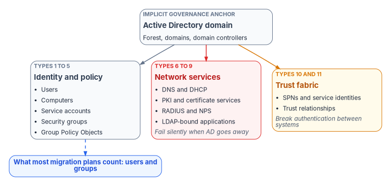
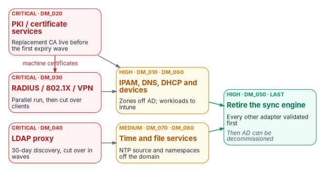

# Chapter 04 — The Hidden Migration Surface

*Moving the users is the visible tenth of the work; the rest is every service that quietly trusted the domain.*

::: {.callout-note}
## In this chapter
The eleven types of object that depend on Active Directory, and why most of them fail without an error when AD goes away. The eight adapter interfaces the Federal Modernization Program uses to move those services off AD, ranked by risk, with what Microsoft's products do and don't replace. The six-phase adapter model, how adapters register, how a migration is validated before AD is decommissioned, and the inventory categories that feed the whole effort.
:::

When an organization plans its move from Active Directory to Microsoft Entra ID, it plans for users and groups. It rarely plans for everything else AD was holding together. For twenty years AD was the implicit governance model for name resolution, certificates, network access, application sign-in, time, and file paths. None of those services were designed as "AD projects"; they simply assumed a domain controller would always be there.

When that assumption breaks, most of them don't fail loudly. There's no error and no alert. Certificates stop renewing and nobody notices until they expire. RADIUS authentications start failing at the network edge. DNS records go stale. Applications that bind to a domain controller over LDAP stop letting people in. Each of these looks like a local outage with a local cause, and the connection to the identity migration is made late, if at all.

{#fig-ch04-dependency-surface fig-alt="An Active Directory domain at the top connects to three groups of dependent objects. Identity and policy, types 1 to 5, holds users, computers, service accounts, security groups and Group Policy Objects. Network services, types 6 to 9, shown in red, holds DNS and DHCP, PKI and certificate services, RADIUS and NPS, and LDAP-bound applications, and is marked as failing silently when AD goes away. Trust fabric, types 10 and 11, shown in amber, holds SPNs and service identities and trust relationships, and is marked as breaking authentication between systems. A dashed line from identity and policy points to a blue label reading what most migration plans count: users and groups."}

## The eleven AD dependency object types

The program's dependency inventory names eleven object types. The first five are what a migration plan usually covers. Types 6 through 11 are the hidden surface.

| # | Object type | What AD was doing | What breaks without governance |
|---|---|---|---|
| 1 | Users | Identity lifecycle, OU placement, attribute authority | Orphaned accounts, privilege drift, compliance gaps |
| 2 | Computers | Domain join, Group Policy targeting, machine certificates | Unmanaged endpoints, missed patches, security exposure |
| 3 | Service accounts | Service principal names (SPNs), Kerberos delegation, password management | Application authentication failures, silent service outages |
| 4 | Security groups | Access control, policy scoping, resource permissions | Permission sprawl, ungoverned access, audit findings |
| 5 | Group Policy Objects | Device configuration, security baselines, software deployment | Configuration drift, inconsistent baselines |
| 6 | DNS and DHCP | Name resolution, IP allocation, AD-integrated zones | Resolution failures, IP conflicts, split-brain DNS |
| 7 | PKI and certificate services | Certificate issuance, auto-enrollment, CRL distribution | Silent certificate expiration, authentication failures, broken mutual TLS |
| 8 | RADIUS and NPS | 802.1X wired and wireless access, VPN authentication | Network access failures, VPN outages |
| 9 | LDAP | Application authentication, directory queries, legacy integrations | Application sign-in failures, broken integrations |
| 10 | SPNs and service identities | Kerberos service principal names, application identity | Single sign-on breaks, delegation failures |
| 11 | Trust relationships | Cross-domain and forest trusts, selective authentication | Cross-domain access failures between organizations |

Types 10 and 11 have no direct counterpart in Entra ID. An Entra ID tenant has app registrations and service principals rather than Kerberos SPNs, and it has cross-tenant access settings and cross-tenant synchronization rather than forest trusts: cross-tenant synchronization creates and removes B2B collaboration users across the tenants of one organization.[^c04-cross-tenant] Neither is a drop-in replacement; each needs its own design, which is why the program lists both as adapter gaps (see [the adapter priority matrix](#the-adapter-priority-matrix)).

## The adapter interface

Each AD-dependent service gets a dedicated adapter: an interface that defines how that service is governed while it moves off AD. Vendor implementations plug in underneath the interface. Every adapter has the same six parts:

- **Discovery**: what to inventory and how to find it in AD.
- **Risk assessment**: what fails if the service is migrated badly.
- **Target architecture**: the modern equivalent and how governance works there.
- **Migration path**: the step-by-step governed migration.
- **Validation**: how to confirm governance survived the move.
- **Rollback**: what to do if the migration causes failures.

### The core concepts behind every adapter

The adapters rest on eight architectural concepts the Federal Modernization Program applies everywhere. They're design positions, not product facts, and they explain why the adapters are ordered as they are.

| Core concept | Definition | Adapter relevance |
|---|---|---|
| Single source of truth | Every claim has one authoritative origin | Each adapter names its source of truth for governance decisions |
| Conversation as atomic unit | Every interaction binds identity, certificates, addressing, path, QoS, and telemetry | A migration must keep every conversation intact end to end |
| Identity as root namespace | IPs, certificates, subnets, policy, and telemetry all derive from identity | All adapter governance traces back to identity authority |
| Deterministic addressing | Addressing is identity-derived and policy-driven | The IPAM and DNS adapters enforce deterministic assignment |
| Certificate-anchored overlay | Mutual TLS anchors tunnels, services, and trust | The PKI adapter is the foundation; others depend on it |
| Telemetry as control | Telemetry is a real-time control input, not passive reporting | Every adapter emits governance telemetry for drift detection |
| Embedded governance | Governance runs through orchestrated workflows, not manual tickets | Each migration is a governed workflow, not an ad hoc project |
| User experience first | If governance was done right, users notice nothing | The final validation: users don't notice the move |

## The adapter priority matrix

The program ranks the eight adapters by the cost of getting them wrong.

| ID | Adapter | Priority | Risk if ignored |
|---|---|---|---|
| DM_020 | PKI and certificate services | **Critical** | Silent authentication failure weeks after the migration is declared complete |
| DM_030 | RADIUS, 802.1X, and VPN | **Critical** | Total network access failure, not a degraded experience |
| DM_040 | LDAP proxy | **Critical** | Silent application sign-in failure across the largest uninventoried surface |
| DM_010 | IPAM (DNS, DHCP, IP management) | High | DNS resolution failure, rogue DHCP |
| DM_050 | Sync engine (Microsoft Entra Connect) | High | Permanent AD dependency |
| DM_060 | Device management | High | Non-deterministic policy application |
| DM_070 | NTP and time services | Medium | Kerberos clock-skew failures that look like identity problems |
| DM_080 | DFS and file services | Medium | Silent UNC path failure |

The three critical adapters share a property: they fail silently. They must be addressed before any AD infrastructure is decommissioned. The sync engine is high priority but finishes last, because it's the tether that keeps AD in production until every other adapter has moved.

{#fig-ch04-adapter-sequence fig-alt="A left-to-right flow in three columns. The first column, in red, holds the three critical adapters: PKI and certificate services (DM_020, replacement CA live before the first expiry wave), RADIUS, 802.1X and VPN (DM_030, parallel run then cut over clients), and LDAP proxy (DM_040, 30-day discovery then cut over in waves). An arrow labeled machine certificates runs from PKI to RADIUS. The second column, in amber, holds IPAM, DNS, DHCP and devices (high, DM_010 and DM_060) and time and file services (medium, DM_070 and DM_080). Both feed the third column, in green: retire the sync engine (DM_050), done last after every other adapter is validated, after which AD can be decommissioned."}

### Gaps in the adapter registry

The program's adapter taxonomy has twelve leaves. Eight have adapter specifications; four are open gaps.

| Leaf | Adapter | Status |
|---|---|---|
| D.1 | IPAM — DM_010 | Specified |
| D.2 | DNS — DM_015 | Gap: not yet in the registry (covered today inside DM_010) |
| D.3 | DHCP — DM_016 | Gap (covered today inside DM_010) |
| D.4 | PKI / AD CS — DM_020 | Specified |
| D.5 | RADIUS / NPS — DM_030 | Specified |
| D.6 | LDAP proxy — DM_040 | Specified |
| D.7 | Sync engine — DM_050 | Specified |
| D.8 | Device management — DM_060 | Specified |
| D.9 | NTP — DM_070 | Specified |
| D.10 | DFS — DM_080 | Specified |
| D.11 | SPN and app registration — DM_085 | Gap |
| D.12 | Trust relationship — proposed DM_090 | Gap; the proposed ID collides with the validation checklist (DM_090) and needs a new number |

Object types 10 and 11 map to the last two gaps. Until those adapters exist, treat SPNs and trusts as manual line items in the inventory (see [the transformation inventory](#the-transformation-inventory)).

## Adapter by adapter

The adapter specifications below keep the program's discovery lists and migration sequences. Where a source named a Microsoft capability, the claim has been checked against current Microsoft documentation and corrected where needed.

### IPAM: DNS, DHCP, and IP management (DM_010, high)

AD-integrated DNS is the most visible dependency. Domain-joined computers find domain controllers through the DC locator, which queries DNS for SRV records that domain controllers register, such as `_ldap._tcp.<domain>`, plus records for capabilities like the Key Distribution Center and the global catalog.[^c04-dc-locator] Retiring AD means moving those zones to standalone DNS without losing the records that hybrid clients still need during the transition.

Required capabilities:

- Full zone export as a canonical snapshot and drift-detection baseline.
- Migration of the DC locator SRV records (`_kerberos`, `_ldap`, `_gc`) for as long as any domain remains.
- Side-by-side operation with AD-integrated DNS during the hybrid window.
- DHCP scope inventory and rogue DHCP detection.

The program's registry lists Infoblox, BlueCat Address Manager, and a generic RFC-compliant IPAM as implementations. The earlier description of "Infoblox NIOS (FedRAMP authorized)" was imprecise: the FedRAMP authorization belongs to the Infoblox Government Cloud service, listed on the FedRAMP Marketplace as FedRAMP Certified at the Moderate impact level, not to on-premises NIOS appliances.[^c04-fedramp-marketplace] The DNS and DHCP leaves (DM_015, DM_016) will split out of this adapter once specified.

### PKI and certificate services (DM_020, critical)

Active Directory Certificate Services (AD CS) is embedded deeply in most federal environments. Auto-enrollment flows through Group Policy, machine certificates support 802.1X and VPN, and smart card logon to Windows relies on trust configuration anchored in the domain. The failure mode is the reason this adapter is critical: certificates keep working until they expire. If the replacement CA isn't issuing before the first expiry wave, authentication fails across the organization weeks or months after the migration was declared complete.

Required capabilities:

- Full certificate inventory: issued, pending, revoked, and expired.
- Certificate-to-identity binding: who owns each certificate.
- Expiry timeline export in 90-, 180-, and 365-day windows.
- CA hierarchy mapping: root, issuing, and subordinate chains.
- Smart card, PIV, and CAC certificate inventory.
- Migration of auto-enrollment from Group Policy to Intune certificate profiles.

Migration sequence:

1. Inventory every issued certificate and its expiry date.
2. Map certificates to identity objects.
3. Stand up the replacement CA **before** any AD retirement begins.
4. Move auto-enrollment to Intune certificate profiles.
5. Validate the certificate chain through the new CA.
6. Retire AD CS only after every renewal is confirmed through the new CA.

Three corrections to the target architecture:

- **Intune delivers certificates by SCEP, PKCS, or imported PKCS profiles**, with a trusted-root profile that deploys the CA chain; network authentication (802.1X) and VPN are the typical uses.[^c04-intune-certs] Using SCEP with a Microsoft CA still requires an NDES server and the Certificate Connector for Microsoft Intune. The earlier reference to "Intune/SCEP/EST" is corrected: Intune's documented provisioning methods are SCEP and PKCS, not EST.
- **Microsoft Cloud PKI** (an Intune capability) can host a two-tier root and issuing CA in the cloud, or anchor a cloud issuing CA to an existing private root ("bring your own CA"). It issues leaf certificates through SCEP to Intune-managed devices and hosts the CRL distribution point and AIA endpoint.[^c04-cloud-pki] That's a direct path off AD CS for device certificates.
- **Microsoft Entra certificate-based authentication (CBA) is a relying party, not a CA.** The earlier registry listed "Entra CBA" alongside DigiCert and Entrust as an implementation; it belongs in a different column. CBA validates user certificates against CAs uploaded to the Entra trust store, and every CA in the chain must be uploaded.[^c04-cba-ca] Its CRL distribution point must be an internet-facing HTTP URL; OCSP and LDAP URLs aren't supported, and a CA with no CRL configured gets no revocation checking at all.[^c04-cba-setup] AD CS deployments that publish CRLs only over LDAP need a new HTTP distribution point before CBA can rely on them.

Windows Hello for Business also shrinks the PKI surface. Its cloud Kerberos trust model is the only hybrid deployment option that needs no certificates, and Microsoft recommends it over key trust when certificate authentication isn't otherwise required.[^c04-whfb-plan]

### RADIUS and Network Policy Server (DM_030, critical)

Windows Network Policy Server (NPS) authenticates 802.1X wired and wireless, VPN, and dial-up connections against AD groups. Every access point, VPN concentrator, and managed switch that uses RADIUS is an AD dependency. If NPS goes down before its replacement is validated, users can't connect at all.

Required capabilities:

- Inventory of all NPS policies (connection request, network, and health).
- Map of every NPS policy to the AD groups it depends on.
- Inventory of RADIUS clients: access points, VPN concentrators, switches.
- Inventory of 802.1X certificate profiles and EAP methods.
- Translation of policy from AD groups to Entra ID groups.
- Side-by-side validation before cutover.

Migration sequence:

1. Inventory every RADIUS client and NPS policy.
2. Map every NPS AD group dependency to its Entra ID equivalent.
3. Deploy the replacement RADIUS service.
4. Validate in parallel, with NPS and the replacement serving at the same time.
5. Cut RADIUS clients over to the new server.
6. Decommission NPS only after a 30-day validation window.

Entra ID has no native RADIUS service, and the earlier "Entra RADIUS Proxy" implementation doesn't exist as a Microsoft product; it has been removed. The NPS extension for Microsoft Entra multifactor authentication is often mistaken for an exit path. It isn't one: NPS still performs primary authentication against AD and then hands off to Entra ID for the second factor.[^c04-radius-entra] The extension also identifies users by their on-premises UPN by default.[^c04-nps-ext] It's a useful interim control, not a retirement.

The retirement paths are a non-Microsoft RADIUS or network access control service (the program's registry lists Cisco ISE and Aruba ClearPass), certificate-based EAP-TLS using device certificates delivered by Intune, and, for VPNs, replacing RADIUS altogether. Microsoft recommends moving VPNs to SAML federated directly with Entra ID so they get Conditional Access, MFA, and device compliance.[^c04-radius-entra]

### LDAP proxy (DM_040, critical)

LDAP is the largest hidden AD dependency. Applications deployed ten or fifteen years ago bind to domain controllers to authenticate users and read attributes. Nobody kept an inventory because nobody had to; AD was always there. Discovery for this adapter takes the longest, because you can't migrate what you can't see.

Required capabilities:

- Network traffic analysis identifying every host that binds to a domain controller.
- Inventory of service accounts used for LDAP binds.
- Application-to-LDAP dependency map.
- Query analysis: which attributes each application reads.
- Bind type inventory: simple, SASL, certificate-based.
- Attribute mapping from AD names to Entra ID equivalents.

Migration sequence:

1. Deploy a passive LDAP traffic monitor on the domain controller network segment.
2. Run a **30-day discovery window** to capture every bind source.
3. Build the application-to-LDAP dependency map.
4. Deploy the LDAP target (Microsoft Entra Domain Services or a standalone directory).
5. Validate each application against the target.
6. Cut applications over **in waves, never all at once**.

Domain controllers can help with step 2 but can't replace network capture. A DC logs a daily summary (Event 2887) of unsigned SASL binds and clear-text simple binds, and with the `16 LDAP Interface Events` diagnostic level set to 2 it logs Event 2889 for each such bind, with the client IP address and identity.[^c04-ldap-signing] Those events cover only the insecure binds. Applications that already sign their binds don't appear, which is why the passive monitor stays in the sequence.

::: {.callout-warning}
## Illustrative code
The PowerShell in this chapter is illustrative. It hasn't been tested against a production forest. Review it, and run it first in a lab, before using it on a domain controller.
:::

```powershell
# On a domain controller: log each unsigned or clear-text LDAP bind (Event 2889)
$diag = 'HKLM:\SYSTEM\CurrentControlSet\Services\NTDS\Diagnostics'
Set-ItemProperty -Path $diag -Name '16 LDAP Interface Events' -Value 2 -Type DWord

# After the collection window: count binds per client address
Get-WinEvent -FilterHashtable @{ LogName = 'Directory Service'; Id = 2889 } |
    ForEach-Object { ($_.Properties[0].Value) -replace ':\d+$', '' } |
    Group-Object |
    Sort-Object Count -Descending |
    Select-Object Count, Name

# Turn detailed logging back off when the investigation ends
Set-ItemProperty -Path $diag -Name '16 LDAP Interface Events' -Value 0 -Type DWord
```

Microsoft's guidance is to set the diagnostic value back to 0 after the investigation.[^c04-ldap-gpo]

Microsoft Entra ID itself has no LDAP endpoint. The Microsoft-managed option is Entra Domain Services, a standalone managed domain that supports LDAP bind and read, secure LDAP, Kerberos, and NTLM. LDAP writes work only for objects created in the managed domain, not for objects synchronized from Entra ID.[^c04-entra-ds] Two prerequisites matter for planning. Cloud-only users must change their password before they can use the managed domain, because that's when Entra ID generates the legacy password hashes it needs. And Microsoft Entra Cloud Sync isn't supported with Domain Services; synchronized users need Microsoft Entra Connect Sync to carry their password hashes.[^c04-entra-ds-hashes] For web applications that use Integrated Windows Authentication, Entra application proxy can provide single sign-on through Kerberos constrained delegation, but its connector servers must be domain-joined.[^c04-app-proxy-kcd] Both are bridges that keep a domain alive. The real exit is re-platforming the application onto SAML or OpenID Connect.

### Sync engine: Microsoft Entra Connect (DM_050, high, finishes last)

The sync engine is both the bridge between AD and Entra ID and the tether that keeps AD alive. As long as it runs, AD is a production dependency. It isn't retired until every other adapter has moved.

Retirement criteria (all must be true):

- Every user is provisioned from the authoritative source for its population, not from AD sync: employees from HR, contractors and vendors from the source the agency designates for them ([Book 03, Chapter 06](../b03-hr-identity/06-canonical-attribute-schema.md#contractors-and-vendors-the-population-hrit-doesnt-cover)), and guests through invitation and entitlement management ([Chapter 10](10-migrating-and-governing.md)).
- Every group is dynamic or managed in Entra ID.
- No application uses on-premises AD authentication.
- Every device is managed by Intune with no AD dependency.
- Every service account has moved to an Entra ID workload identity.
- AD CS is replaced; DNS, RADIUS, and LDAP applications are migrated and validated.

These six conditions are the core of the 12-point retirement readiness checklist in the program's adapter specification. HR-sourced provisioning is the subject of [the provisioning pipeline in the HR-driven IAM series](../b03-hr-identity/05-the-provisioning-pipeline.md).

Current Microsoft facts that shape this adapter:

- **Two sync clients.** Microsoft Entra Connect Sync runs a full sync engine on premises; Microsoft Entra Cloud Sync runs the engine in the cloud with lightweight on-premises agents. Microsoft recommends Cloud Sync where it meets an organization's requirements, because new sync features are arriving there.[^c04-connect-v2] The clients aren't equivalent. Cloud Sync supports disconnected forests and multiple active agents but limits groups to 50,000 members and supports up to 150,000 objects per domain; Connect Sync keeps advanced sync rules and cross-forest references.[^c04-cloud-sync-compare] The two can't sync the same objects side by side; migration between them uses OU-based scoping.[^c04-cloud-sync-faq]
- **Source of authority can move object by object.** Group source of authority conversion turns a synced group into a cloud-managed group; both sync clients then stop syncing it from AD, and the change can be reversed.[^c04-group-soa] User source of authority conversion works the same way through the `onPremisesSyncBehavior` property.[^c04-user-soa] That makes the retirement criteria above achievable incrementally rather than in one cutover.
- **Provisioning back to AD is asymmetric.** Cloud Sync can provision groups from Entra ID to AD, but neither client provisions users from the cloud to AD.[^c04-cloud-sync-compare] An application that still needs an AD user account keeps AD, and a writer into it, alive.

### Device management (DM_060, high)

Configuration Manager collections query AD, Group Policy flows down the OU tree, and co-management splits responsibility between Configuration Manager and Intune. This adapter governs the move from AD-dependent device policy to Intune-native management.

Co-management moves seven workloads, individually or together: compliance policies, Windows Update policies, resource access policies, Endpoint Protection, device configuration, Office Click-to-Run apps, and client apps.[^c04-comanage] Before switching any workload, run Group Policy analytics in Intune. It imports GPO exports, reports which settings have an MDM equivalent, flags deprecated settings, and can migrate the supported ones into a Settings Catalog policy.[^c04-gpa] Settings without an equivalent become explicit decisions: replace, accept the loss, or keep a GPO-managed island.

### NTP and time services (DM_070, medium)

Kerberos tolerates a maximum clock difference of five minutes by default.[^c04-kerberos-skew] In a domain, time follows the AD hierarchy: member computers synchronize with a domain controller in their own domain, domain controllers synchronize up the hierarchy, and the PDC emulator of the forest root domain is the best time source unless another reliable source is configured.[^c04-w32time] The earlier statement that every domain-joined machine syncs from the PDC emulator is corrected: only the domain controllers chain to the PDC emulator; members use any domain controller in their domain.

Decommission domain controllers without redirecting time and authentication fails across whatever still uses Kerberos, with symptoms that look like identity problems. Two facts shape the fix:

- Computers that aren't joined to a domain, which includes Microsoft Entra joined Windows devices, get time from `time.windows.com` by default.[^c04-w32time]
- Intune can set the NTP source explicitly through the `ADMX_W32Time` policy area (Configure Windows NTP Client, `NtpServer`), whose default value is `time.windows.com,0x09`.[^c04-w32time-csp]

The program's position is to set the time source by policy before any domain controller is decommissioned, rather than rely on defaults, and to choose the source deliberately: many agencies require an authoritative government time source. Microsoft notes that manually specified NTP sources aren't authenticated, unlike time inside the domain hierarchy.[^c04-w32time]

### DFS and file services (DM_080, medium)

A domain-based DFS namespace has a path that starts with the domain name (`\\domain\root`), and its configuration lives in AD DS.[^c04-dfs-types] When the domain is retired, those paths fail silently in drive mappings, shortcuts, scripts, and embedded links.

Migration targets:

- **SharePoint Online and OneDrive**, for collaborative content.
- **Azure Files with Microsoft Entra Kerberos**, which lets Entra ID issue the Kerberos tickets for SMB access. Cloud-only identities no longer need a domain controller for authentication or authorization; hybrid identities still need line of sight to a domain controller to set Windows ACLs.[^c04-azfiles-kerb]
- **A standalone DFS namespace**, whose configuration lives in the namespace server's registry rather than AD. With root consolidation it can keep an old file server's UNC path (`\\oldserver\share`) working after migration, which Microsoft recommends when migrating shares to Azure Files.[^c04-azfiles-dfs]

Drive mappings delivered by Group Policy move with the device management adapter.

### Kerberos for whatever remains

Every adapter above shrinks the set of resources that still need an AD Kerberos ticket, but rarely to zero during the transition. Microsoft Entra Kerberos bridges the gap for Entra-joined and hybrid-joined Windows devices: Entra ID issues a cloud ticket-granting ticket for cloud resources such as Azure Files and a partial ticket that an on-premises domain controller exchanges for a full one. The on-premises half requires users synchronized from AD.[^c04-entra-kerberos] It's a bridge for the transition, not a target state.

## The six migration phases

Every adapter follows the same six-phase, governance-gated migration.

| Phase | What happens | Governance gate |
|---|---|---|
| 1. Discover | Complete inventory of what AD encodes for this service | Inventory signed off by the service owner |
| 2. Normalize | Rationalize decades of organic growth into a clean model | Normalized model reviewed against the canonical model |
| 3. Map | Translate AD governance constructs to modern equivalents | Mapping validated: no governance gaps, no orphaned objects |
| 4. Migrate | Execute with continuous validation | Each step validated before the next; no big-bang cutover |
| 5. Validate | Confirm governance integrity after migration | Full drift scan, telemetry confirmation, user experience check |
| 6. Decommission | Retire the legacy infrastructure after a stability window | Legacy systems offline, rollback window expired with no incidents, provenance archived for audit |

An adapter that adds a net-new capability without retiring legacy infrastructure may record Phase 6 as `N/A — net-new capability`, with a short justification in its registry entry.

### Canon phase mapping

Each adapter's operational guide may have its own internal steps, but every guide, existing or future, must open with a canon phase mapping table that maps its steps onto the six phases above. Two guides serve as reference implementations. The DNS modernization guide maps eleven internal steps onto the six phases; the PKI modernization guide maps six onto six. The mapping is what lets a program manager read the status of a DNS migration and a RADIUS migration on the same scale.

## Adapter registration

Every adapter registers in the program's migration adapter registry (`migration-adapter-registry.yaml`), validated against a JSON schema (`migration-adapter-registry.schema.json`). Each entry records:

- Adapter ID and name.
- Priority tier: `CRITICAL`, `HIGH`, or `MEDIUM`.
- Current migration phase, one of `Discover`, `Normalize`, `Map`, `Migrate`, `Validate`, `Decommission`, or `N/A — net-new capability`.
- Dependencies: which adapters must complete first.
- Validation criteria: machine-checkable success conditions.
- Canon crosswalk: links to the relevant `FMP_` canon documents. The older `MOD_` document namespace has been retired into `FMP_`.

The registry lives with the adapter specifications in the program's source tree under `src/fmp/modernization/directory-migration/`, alongside the full adapter interface specifications and vendor manifests (`adapters/`), the eight core concepts, and the AD dependency inventory.

## Post-migration validation

After all adapters have moved, the program's validation checklist (DM_090) is the pass/fail gate for each service category before AD decommission is authorized. The gate restates each adapter's own validation criteria in one place:

| Service | Passes when |
|---|---|
| DNS and DHCP | Zones resolve without AD-integrated storage; no client still depends on DC locator records; no rogue DHCP |
| PKI | Every renewal in the expiry window issued by the new CA; trust chain validated on every platform |
| RADIUS | Every RADIUS client points at the new service; 30-day parallel window closed with no failures |
| LDAP | Every application in the dependency map validated against its target; no bind traffic to domain controllers |
| Sync engine | All six retirement criteria true |
| Devices | Every workload on Intune; no GPO setting left without a decision |
| Time | Every device and server has an explicit, policy-set time source |
| File services | No domain-based namespace path in use |

## The transformation inventory

The adapters need data, and that data comes from the identity and directory transformation inventory: a structured assessment of the current estate that answers what exists, what depends on it, and what must be decided before anything is moved or retired.

| Category | Key questions |
|---|---|
| Forest and domains | Functional levels, trusts, sites, domain controllers |
| Users | Count, privileged, service, stale, external |
| Groups | Count, nested, privileged, dynamic or static |
| Computers | Domain-joined, OS distribution, last logon |
| Authentication | NTLM usage, Kerberos delegation, certificate-based |
| Applications | Apps that require AD, LDAP, or Kerberos |
| Group Policy | Count, high-risk settings, link structure |
| DNS and PKI | Zones, CAs, templates, issued certificates |
| Dependencies | Systems that break if a domain controller, GPO, or trust is removed |

The output is a decision-ready inventory that feeds identity transformation sequencing, GPO sunset planning, application remediation, and residual-risk acceptance. [Chapter 07](07-read-only-discovery.md) explains how to collect it without changing the forest, and [Chapter 08](08-assessing-the-forest.md) turns it into an assessment.

::: {.callout-tip}
## Continue the book
[← Previous: Chapter 03 — Active Directory and Entra ID, Side by Side](03-ad-and-entra-side-by-side.md) · [Book index](index.md) · [Next: Chapter 05 — Delegation Without OUs →](05-delegation-without-ous.md)
:::

[^c04-cross-tenant]: Microsoft Learn, "What is cross-tenant synchronization?," <https://learn.microsoft.com/entra/identity/multi-tenant-organizations/cross-tenant-synchronization-overview> (accessed Oct 20, 2026).
[^c04-dc-locator]: Microsoft Learn, "Locating domain controllers in Windows and Windows Server," <https://learn.microsoft.com/windows-server/identity/ad-ds/manage/dc-locator> (accessed Oct 20, 2026).
[^c04-fedramp-marketplace]: FedRAMP, Marketplace product data (entry FR2017257053, Infoblox Government Cloud: FedRAMP Certified, Moderate), <https://www.fedramp.gov/marketplace/products.json> (accessed Oct 20, 2026).
[^c04-intune-certs]: Microsoft Learn, "Use certificates for authentication in Microsoft Intune," <https://learn.microsoft.com/intune/fundamentals/certificates/overview> (accessed Oct 20, 2026).
[^c04-cloud-pki]: Microsoft Learn, "Overview of Microsoft Cloud PKI for Microsoft Intune," <https://learn.microsoft.com/intune/cloud-pki/> (accessed Oct 20, 2026).
[^c04-cba-ca]: Microsoft Learn, "How to configure certificate authorities for Microsoft Entra certificate-based authentication," <https://learn.microsoft.com/entra/identity/authentication/how-to-configure-certificate-authorities> (accessed Oct 20, 2026).
[^c04-cba-setup]: Microsoft Learn, "Set up Microsoft Entra certificate-based authentication," <https://learn.microsoft.com/entra/identity/authentication/how-to-certificate-based-authentication> (accessed Oct 20, 2026).
[^c04-whfb-plan]: Microsoft Learn, "Plan a Windows Hello for Business deployment," <https://learn.microsoft.com/windows/security/identity-protection/hello-for-business/deploy/> (accessed Oct 20, 2026).
[^c04-radius-entra]: Microsoft Learn, "RADIUS authentication with Microsoft Entra ID," <https://learn.microsoft.com/entra/architecture/auth-radius> (accessed Oct 20, 2026).
[^c04-nps-ext]: Microsoft Learn, "Integrate your existing Network Policy Server (NPS) infrastructure with Microsoft Entra multifactor authentication," <https://learn.microsoft.com/entra/identity/authentication/howto-mfa-nps-extension> (accessed Oct 20, 2026).
[^c04-ldap-signing]: Microsoft Learn, "LDAP signing overview for Active Directory Domain Services," <https://learn.microsoft.com/windows-server/identity/ad-ds/ldap-signing> (accessed Oct 20, 2026).
[^c04-ldap-gpo]: Microsoft Learn, "Configure LDAP signing by using Group Policy for Active Directory Domain Services," <https://learn.microsoft.com/windows-server/identity/manage-ldap-signing-group-policy> (accessed Oct 20, 2026).
[^c04-entra-ds]: Microsoft Learn, "What is Microsoft Entra Domain Services?," <https://learn.microsoft.com/entra/identity/domain-services/overview> (accessed Oct 20, 2026).
[^c04-entra-ds-hashes]: Microsoft Learn, "Tutorial: Create and configure a Microsoft Entra Domain Services managed domain," <https://learn.microsoft.com/entra/identity/domain-services/tutorial-create-instance> (accessed Oct 20, 2026).
[^c04-app-proxy-kcd]: Microsoft Learn, "Kerberos Constrained Delegation for single sign-on (SSO) to your apps with application proxy," <https://learn.microsoft.com/entra/identity/app-proxy/how-to-configure-sso-with-kcd> (accessed Oct 20, 2026).
[^c04-cloud-sync-faq]: Microsoft Learn, "Migrate from Microsoft Entra Connect Sync to Cloud Sync FAQ," <https://learn.microsoft.com/entra/identity/hybrid/cloud-sync/cloud-sync-migration-faq> (accessed Oct 20, 2026).
[^c04-connect-v2]: Microsoft Learn, "Introduction to Microsoft Entra Connect V2," <https://learn.microsoft.com/entra/identity/hybrid/connect/whatis-azure-ad-connect-v2> (accessed Oct 20, 2026).
[^c04-cloud-sync-compare]: Microsoft Learn, "Migrate from Microsoft Entra Connect to Cloud Sync: Decision Guide," <https://learn.microsoft.com/entra/identity/hybrid/cloud-sync/connect-to-cloud-sync-decision-guide> (accessed Oct 20, 2026).
[^c04-group-soa]: Microsoft Learn, "Embrace cloud-first posture: Convert Group Source of Authority to the cloud," <https://learn.microsoft.com/entra/identity/hybrid/concept-source-of-authority-overview> (accessed Oct 20, 2026).
[^c04-user-soa]: Microsoft Learn, "Configure user Source of Authority (SOA)," <https://learn.microsoft.com/entra/identity/hybrid/how-to-user-source-of-authority-configure> (accessed Oct 20, 2026).
[^c04-comanage]: Microsoft Learn, "Co-management workloads," <https://learn.microsoft.com/intune/configmgr/comanage/workloads> (accessed Oct 20, 2026).
[^c04-gpa]: Microsoft Learn, "Import and analyze your on-premises GPOs using Group Policy analytics in Microsoft Intune," <https://learn.microsoft.com/intune/device-configuration/import-group-policy-analytics> (accessed Oct 20, 2026).
[^c04-kerberos-skew]: Microsoft Learn, "Kerberos protocol registry entries and KDC configuration keys in Windows," <https://learn.microsoft.com/troubleshoot/windows-server/windows-security/kerberos-protocol-registry-kdc-configuration-keys> (accessed Oct 20, 2026).
[^c04-w32time]: Microsoft Learn, "How the Windows Time Service works," <https://learn.microsoft.com/windows-server/networking/windows-time-service/how-the-windows-time-service-works> (accessed Oct 20, 2026).
[^c04-w32time-csp]: Microsoft Learn, "Policy CSP - ADMX_W32Time," <https://learn.microsoft.com/windows/client-management/mdm/policy-csp-admx-w32time> (accessed Oct 20, 2026).
[^c04-dfs-types]: Microsoft Learn, "Choose a namespace type," <https://learn.microsoft.com/windows-server/storage/dfs-namespaces/choose-a-namespace-type> (accessed Oct 20, 2026).
[^c04-azfiles-kerb]: Microsoft Learn, "Enable Microsoft Entra Kerberos authentication for hybrid and cloud-only identities on Azure Files," <https://learn.microsoft.com/azure/storage/files/storage-files-identity-auth-hybrid-identities-enable> (accessed Oct 20, 2026).
[^c04-azfiles-dfs]: Microsoft Learn, "How to use DFS Namespaces with Azure Files," <https://learn.microsoft.com/azure/storage/files/files-manage-namespaces> (accessed Oct 20, 2026).
[^c04-entra-kerberos]: Microsoft Learn, "Introduction to Microsoft Entra Kerberos," <https://learn.microsoft.com/entra/identity/authentication/kerberos> (accessed Oct 20, 2026).
