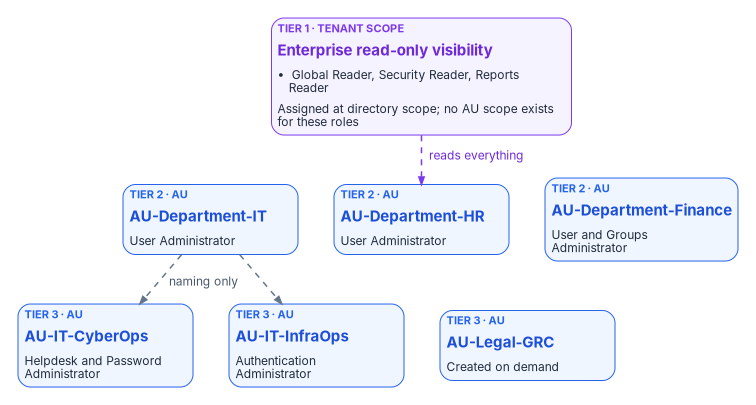
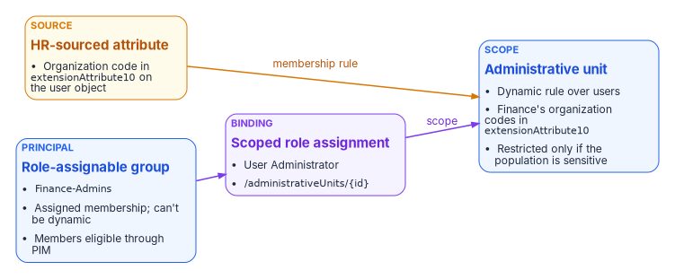

# Chapter 05 — Delegation Without OUs

*In Active Directory the OU tree was the delegation model; in Entra ID the scope has to be declared on purpose, from governed attributes.*

::: {.callout-note}
## In this chapter
Why removing OUs removes the delegation model, and the two bad choices organizations fall into. What administrative units are, what they don't do, and what dynamic and restricted management units cost and constrain. The program's three-tier model and role assignment matrix, corrected against current Microsoft behavior, followed by the delegation principles and the drift checks that keep the matrix true.
:::

In Active Directory, delegation was implicit. Place a user in an OU, grant an administrators' group rights on that OU, and delegation was done. Every branch of the tree defined a scope of management authority, and the tree was usually drawn to match the organization.

Microsoft Entra ID has no OUs. Its directory is flat: every user sits at the same level. Without a replacement for OU-based scope, organizations make one of two bad choices:

1. **Over-delegate.** Give administrators tenant-wide roles such as User Administrator, or worse Global Administrator, because nothing narrower exists. This breaks least privilege and produces audit findings.
2. **Under-delegate.** Keep all administration with a small central team, so every password reset, group change, and profile update becomes a ticket and a queue.

Administrative units (AUs) are the replacement. They create scope boundaries inside the flat directory. The program's Delegation Matrix (`FMP_154`) names the canonical AUs and the role assignments they carry. This chapter presents that matrix with the corrections that current Microsoft behavior requires.

{#fig-ch05-three-tier-delegation fig-alt="Three rows. The top row is a single violet card, Tier 1 at tenant scope, enterprise read-only visibility, holding Global Reader, Security Reader and Reports Reader, assigned at directory scope because no administrative unit scope exists for these roles. A dashed violet line labeled reads everything runs down to the second row. The second row holds three blue Tier 2 administrative units: AU-Department-IT with User Administrator, AU-Department-HR with User Administrator, and AU-Department-Finance with User and Groups Administrator. The third row holds three blue Tier 3 administrative units: AU-IT-CyberOps with Helpdesk and Password Administrator, AU-IT-InfraOps with Authentication Administrator, and AU-Legal-GRC, created on demand. Dashed lines labeled naming only connect AU-Department-IT to the two IT division units, showing that the relationship is a naming convention, not nesting."}

## What administrative units are

An administrative unit is a Microsoft Entra resource that contains users, groups, or devices, and nothing else. Assigning a role at the scope of an AU limits that role's permissions to the AU's members. A user can belong to several AUs, for example one for geography and one for division.[^c05-au-overview] The constraints matter more than the definition:

- **AUs can't be nested.**[^c05-au-overview] There's no tree. A department AU and its division AUs are siblings; "division inside department" is a naming convention and a design intent, not containment.
- **A group in an AU brings the group, not its members.** An administrator scoped to the AU can rename the group and change its membership, but can't manage the users in it or reset their passwords unless those users are themselves members of the AU.[^c05-au-overview]
- **AUs scope management, not visibility.** They don't stop administrators or users from browsing users and groups outside the AU with their default permissions in the Entra admin center or PowerShell. Only the Microsoft 365 admin center filters out users outside a scoped administrator's AUs.[^c05-au-overview] Treat AUs as a write boundary, not a confidentiality boundary.
- **Only some roles can be scoped to an AU.** The list includes User Administrator, Groups Administrator, Helpdesk Administrator, Password Administrator, Authentication Administrator, Privileged Authentication Administrator, License Administrator, Cloud Device Administrator, and a few others, plus custom roles with permissions over users, groups, or devices. AU-scoped Helpdesk and Password Administrators can reset passwords only for users who don't hold administrator roles.[^c05-assign-roles]
- **Licensing.** Each administrator assigned a role over an AU needs Microsoft Entra ID P1; members need only Entra ID Free.[^c05-au-overview]

### Dynamic administrative units

An AU's membership can be maintained by a rule, using the same attributes as dynamic membership groups. That's what lets the program derive scope from HR-sourced attributes instead of hand-maintained lists. A dynamic AU has limits of its own:[^c05-au-dynamic]

- One object type per AU: users or devices, not both. Dynamic rules for groups aren't supported.
- Every unique user who is a member of one or more dynamic AUs must be covered by an Entra ID P1 license count; devices need no license.
- Dynamic AUs are available in the global Azure cloud, not in specialized clouds such as Azure Government. A tenant in a Microsoft government cloud may have to maintain membership another way.
- Dynamic groups and dynamic AUs together can't exceed 15,000 per tenant, and a rule can't exceed 3,072 characters.[^c05-au-faq]
- Membership can't be edited by hand; to add a single exception, extend the rule with an `-or` clause.[^c05-au-faq]

### Restricted management administrative units

A restricted management AU protects its members from tenant-level administrators. Only administrators with a role assigned at the scope of that AU (or of another restricted management AU the object belongs to) can change the Entra properties of its users, groups, and devices.[^c05-rmau] Tenant-scoped Global Administrators and Privileged Role Administrators can't modify the objects, but they **can** manage the AU itself: create or delete it, add and remove members, and assign roles over it, including to themselves. Those actions are written to the audit log.[^c05-rmau]

Restricted management has limits that shape any design that uses it:[^c05-rmau]

- The setting is chosen when the AU is created and can't be changed afterward.
- A tenant can have at most 100 restricted management AUs.
- Users and groups in a restricted management AU can't be managed by Microsoft Entra ID Governance features: Privileged Identity Management, entitlement management, lifecycle workflows, and access reviews.
- Role-assignable groups added to one can't have their membership modified, except by Global Administrators and Privileged Role Administrators.
- Operations whose role can't be AU-scoped become impossible inside it. For example, nobody can reset the password of a Global Administrator who sits in a restricted management AU until that user is removed from it.
- Only users, devices, and security groups can be members; Microsoft 365, mail-enabled, and distribution groups can't.
- Applications can't modify members through Microsoft Graph application permissions; they need an Entra role assigned at the AU's scope.

## The three-tier model

| Tier | Scope | Who | What they can do |
|---|---|---|---|
| Tier 1 | Enterprise | Security, compliance, executives | Read-only visibility across all governed principals |
| Tier 2 | Department or division | Department administrators | Full user lifecycle management within their AU |
| Tier 3 | Sub-team (department, division, and role tier) | Help desk and per-team administrators | Password resets and basic user support within a narrow AU |

The program's matrix mapped each tier to an AU: `AU-Enterprise` for Tier 1, department AUs such as `AU-Department-IT` for Tier 2, and division AUs such as `AU-IT-CyberOps` for Tier 3. Tier 1 needs a correction. Its roles (Global Reader, Security Reader, Reports Reader) aren't on the list of roles that can be assigned at AU scope,[^c05-assign-roles] so they're assigned at tenant scope. Because AUs don't restrict reading anyway, a tenant-scoped reader role delivers exactly the "read-only visibility across everything" that Tier 1 calls for.

`AU-Enterprise` keeps a narrower job: it defines the governed population. Its rule treats a populated Department attribute as the "this principal has been HR-provisioned" predicate, `(user.department -ne null)`. That population is useful for reporting and for scoping services that accept AUs, such as Microsoft Purview,[^c05-purview] but it isn't the scope of the Tier 1 role assignments.

## Administrative unit registry

### Enterprise AU (Tier 1 population)

| AU | Membership | Restricted management |
|---|---|---|
| `AU-Enterprise` | Dynamic: `(user.department -ne null)` | No (see below) |

### Department AUs (Tier 2)

| AU | Department | Membership |
|---|---|---|
| `AU-Department-IT` | IT | Dynamic: `(user.department -eq "IT")` |
| `AU-Department-HR` | HR | Dynamic: `(user.department -eq "HR")` |
| `AU-Department-Finance` | Finance | Dynamic: `(user.department -eq "Finance")` |
| `AU-Department-Legal` | Legal | Dynamic: `(user.department -eq "Legal")` |
| `AU-Department-Engineering` | Engineering | Dynamic: `(user.department -eq "Engineering")` |
| `AU-Department-Operations` | Operations | Dynamic: `(user.department -eq "Operations")` |
| `AU-Department-Sales` | Sales | Dynamic: `(user.department -eq "Sales")` |
| `AU-Department-Executive` | Executive | Dynamic: `(user.department -eq "Executive")` |

### Division AUs (Tier 3, created on demand)

| AU | Scope |
|---|---|
| `AU-IT-CyberOps` | IT / CyberOps |
| `AU-IT-InfraOps` | IT / Infrastructure |
| `AU-IT-AppDev` | IT / AppDev |
| `AU-Legal-GRC` | Legal / GRC |

Division AUs use a rule that combines the department with the division code the HR feed supplies. The program carries the division code in `extensionAttribute6`, a copy of `employeeOrgData.division` that rules can read; the slot is fixed in the [program attribute map](../b03-hr-identity/06-canonical-attribute-schema.md#program-attribute-map) in the HR-driven IAM series.

## Role assignment matrix

| Role | Assigned to | Scope | Tier |
|---|---|---|---|
| Global Reader | `IT-CyberOps-Users` | Tenant | 1 |
| Security Reader | `Legal-GRC-Users` | Tenant | 1 |
| Reports Reader | `Department-Executive-Users` | Tenant | 1 |
| User Administrator | `Finance-Admins` | `AU-Department-Finance` | 2 |
| Groups Administrator | `Finance-Admins` | `AU-Department-Finance` | 2 |
| User Administrator | `HR-Admins` | `AU-Department-HR` | 2 |
| User Administrator | `IT-Admins` | `AU-Department-IT` | 2 |
| Helpdesk Administrator | `IT-CyberOps-Admins` | `AU-IT-CyberOps` | 3 |
| Password Administrator | `IT-CyberOps-Admins` | `AU-IT-CyberOps` | 3 |
| Authentication Administrator | `IT-InfraOps-Admins` | `AU-IT-InfraOps` | 3 |

Two corrections to the principals in this table:

- **The groups that hold roles must be role-assignable, and role-assignable groups can't be dynamic.** The earlier design derived the `*-Admins` groups from the `*-Users` groups by a dynamic rule. Entra ID doesn't allow that: a role-assignable group's membership type must be Assigned, the `isAssignableToRole` property can only be set at creation, nested groups aren't allowed, and a tenant can have at most 500 role-assignable groups.[^c05-role-groups] The program's position is to keep the `*-Admins` groups assigned, populate them through an approval workflow, and make members eligible rather than permanently active through Privileged Identity Management, which supports eligible assignments scoped to an AU.[^c05-pim-scope]
- **Tier 1 assignees need the same treatment.** The `*-Users` groups in the Tier 1 rows are department populations. If they're dynamic, they can't hold a role. Assign Tier 1 roles to a separate assigned, role-assignable group for each reader population.

{#fig-ch05-au-assignment fig-alt="A left-to-right flow. An amber card, the HR-sourced attribute department on the user object, feeds a blue administrative unit card through an arrow labeled membership rule; the unit has a dynamic rule over users, user.department equals Finance, and is restricted only if the population is sensitive. Separately, a blue role-assignable group card, Finance-Admins, with assigned membership that can't be dynamic and members eligible through PIM, points to a violet scoped role assignment card: User Administrator at scope slash administrativeUnits slash id. An arrow labeled scope runs from the role assignment to the administrative unit."}

::: {.callout-warning}
## Illustrative code
The PowerShell in this chapter is illustrative and hasn't been tested against a production tenant. Review it and run it first in a test tenant. The scope string `/administrativeUnits/<id>` grants management of the AU's members, not of the AU itself.[^c05-assign-roles]
:::

```powershell
# Illustrative: assign User Administrator to Finance-Admins over AU-Department-Finance
Connect-MgGraph -Scopes 'RoleManagement.ReadWrite.Directory', 'AdministrativeUnit.Read.All', 'Group.Read.All'

$au    = Get-MgDirectoryAdministrativeUnit -Filter "displayName eq 'AU-Department-Finance'"
$group = Get-MgGroup -Filter "displayName eq 'Finance-Admins'"
$role  = Get-MgRoleManagementDirectoryRoleDefinition -Filter "displayName eq 'User Administrator'"

New-MgRoleManagementDirectoryRoleAssignment `
    -DirectoryScopeId ('/administrativeUnits/' + $au.Id) `
    -PrincipalId $group.Id `
    -RoleDefinitionId $role.Id
```

## Restricted management: a per-AU decision

The program's matrix marked every AU as restricted management and called that non-negotiable, on the reasoning that restriction prevents privilege escalation because even a Global Administrator can't bypass AU-scoped delegation. The documented behavior is narrower. A Global Administrator can't edit a protected object directly, but can add or remove the AU's members and assign themselves a role over it; restriction makes that bypass deliberate and audited, not impossible.[^c05-rmau]

Applied to every AU, restriction also collides with the rest of this book. HR-driven provisioning relies on lifecycle workflows, access packages, access reviews, and PIM, and none of those can manage users or groups inside a restricted management AU.[^c05-rmau] An `AU-Enterprise` that is both restricted and dynamic over every HR-provisioned user would take the whole governed workforce out of Entra ID Governance and out of reach of every tenant-scoped administrator.

So this chapter treats restriction as a per-AU decision with a default of **no**:

| Use restricted management for | Don't use it for |
|---|---|
| Executive accounts and their devices | Broad department populations under HR-driven lifecycle |
| Break-glass and other high-value accounts that must not be reset by the help desk | `AU-Enterprise` |
| Security groups that gate sensitive applications | Groups governed by access packages, access reviews, or PIM for Groups |
| Populations with a legal or regional rule on who may administer them | Anything that needs Microsoft 365 or distribution groups as members |

Because the setting can't be changed after creation, decide it before the AU exists, and record the decision in the registry entry. The program default is unrestricted; restriction is chosen per AU where the table above calls for it.

## Delegation principles

Delegation defines who may perform which actions on which objects. In a modernized environment the scope comes from governed attributes, not from OUs. Five principles govern every row of the matrix:

| Principle | Implication |
|---|---|
| Least privilege | Each role is limited to the minimum actions required |
| Scoped by attribute | Scope is an attribute value or combination, not a manually maintained group |
| Time-bound where possible | Standing access is the exception; eligible assignments are the default |
| Recorded | Every delegation has an owner, a scope, and a review date |
| Separated | Requestor and approver are different people for high-privilege actions |

These map to the access control family of NIST SP 800-53 Revision 5, which federal systems are assessed against.[^c05-nist-80053] Review cadence follows the risk of the scope:

| Scope | Typical roles | Review cadence |
|---|---|---|
| Single department | Help desk, local administration | Quarterly |
| Division or region | Tier 2 operations | Quarterly |
| Tier 0 privileged roles | Global, Privileged Role, Privileged Authentication, Security and Conditional Access Administrator | Monthly |
| Other privileged roles | Service administrators, such as Exchange, SharePoint, Intune and Application Administrator | Quarterly |
| Break-glass | Emergency only | Continuous monitoring |

These cadences are the program's design choice, not a Microsoft or NIST requirement. SP 800-53 leaves the frequency to the organization: AC-2(j) requires reviewing accounts "[Assignment: organization-defined frequency]", and AC-6(7) requires reviewing the privileges assigned to defined roles and classes of users at an organization-defined frequency and removing those no longer needed.[^c05-nist-80053][^c05-fedramp-ac] The program picks monthly for Tier 0 because those roles can grant every other role. The tiers and the per-tier reviewers are set in [Book 04, Appendix B](../b04-access/appendix-b-pim-role-settings.md#review-cadence-by-tier). Assignees never review only themselves ([Chapter 10](10-migrating-and-governing.md#access-reviews)).

Delegation stays auditable when the scope is a governed attribute and the assignment is recorded. Manual group membership as the only scope mechanism loses that.

## Drift detection

The registry and matrix are the desired state; the tenant is the actual state. Drift detection compares them on a schedule and classifies every difference.

| Drift type | Severity | Auto-fix |
|---|---|---|
| AU membership drift: rule in the tenant differs from the registry | High | Yes: reapply the registry rule |
| AU rule processing paused | High | Yes: set processing back to `On` |
| Role assignment drift: an assignment not in the matrix | Critical | No: investigate |
| Restriction mismatch: the AU's restricted setting differs from its registry decision | Critical | No: the setting is immutable; create a correctly configured AU, move role assignments and members, then delete the old one |
| Orphaned AU: no role assignments | Low | No: flag |
| Missing AU: registry entry with no tenant AU | High | Yes: create it with the registry's restriction setting |
| Dynamic group used as a role principal | Critical | Not possible in Entra ID; flag any registry entry that assumes it |

Two of these rows differ from the source design. "Unrestricted AU" was marked auto-fixable; it can't be, because the restricted setting can only be set at creation.[^c05-rmau] "Rule processing paused" is new: an AU's dynamic rule can be paused, and a paused rule leaves membership frozen while every other check passes.[^c05-update-au] Restricted management changes are recorded in the Entra audit log (adding a restricted AU, adding or removing members, and adding or removing role members scoped over it), which gives the drift engine an event stream to watch between scheduled comparisons.[^c05-rmau]

The scheduled comparison starts from a read of the tenant's actual state:

```powershell
# Illustrative, read-only: export AU state and AU-scoped role assignments for comparison
Connect-MgGraph -Scopes 'AdministrativeUnit.Read.All', 'RoleManagement.Read.Directory'

$aus = Get-MgDirectoryAdministrativeUnit -All -Property Id, DisplayName, IsMemberManagementRestricted, MembershipType, MembershipRule, MembershipRuleProcessingState

$state = foreach ($au in $aus) {
    $scoped = Get-MgDirectoryAdministrativeUnitScopedRoleMember -AdministrativeUnitId $au.Id -All
    [pscustomobject]@{
        DisplayName     = $au.DisplayName
        Restricted      = [bool]$au.IsMemberManagementRestricted
        MembershipType  = $au.MembershipType
        MembershipRule  = $au.MembershipRule
        RuleProcessing  = $au.MembershipRuleProcessingState
        RoleAssignments = $scoped.Count
    }
}

$state | Export-Csv -Path .\au-actual-state.csv -NoTypeInformation
```

[Chapter 10](10-migrating-and-governing.md) covers how drift findings feed remediation and evidence.

::: {.callout-tip}
## Continue the book
[← Previous: Chapter 04 — The Hidden Migration Surface](04-the-hidden-migration-surface.md) · [Book index](index.md) · [Next: Chapter 06 — Who Owns the Migration →](06-who-owns-the-migration.md)
:::

[^c05-au-overview]: Microsoft Learn, "Administrative units in Microsoft Entra ID," <https://learn.microsoft.com/entra/identity/role-based-access-control/administrative-units> (accessed Oct 20, 2026).
[^c05-assign-roles]: Microsoft Learn, "Assign Microsoft Entra roles," section "Assign roles with administrative unit scope," <https://learn.microsoft.com/entra/identity/role-based-access-control/admin-units-assign-roles> (accessed Oct 20, 2026).
[^c05-au-dynamic]: Microsoft Learn, "Manage users or devices for an administrative unit with rules for dynamic membership groups," <https://learn.microsoft.com/entra/identity/role-based-access-control/admin-units-members-dynamic> (accessed Oct 20, 2026).
[^c05-au-faq]: Microsoft Learn, "Microsoft Entra administrative units: Troubleshooting and FAQ," <https://learn.microsoft.com/entra/identity/role-based-access-control/admin-units-faq-troubleshoot> (accessed Oct 20, 2026).
[^c05-rmau]: Microsoft Learn, "Restricted management administrative units in Microsoft Entra ID," <https://learn.microsoft.com/entra/identity/role-based-access-control/admin-units-restricted-management> (accessed Oct 20, 2026).
[^c05-role-groups]: Microsoft Learn, "Use Microsoft Entra groups to manage role assignments," <https://learn.microsoft.com/entra/identity/role-based-access-control/groups-concept> (accessed Oct 20, 2026).
[^c05-pim-scope]: Microsoft Learn, "Assign Microsoft Entra roles in Privileged Identity Management," section "Assign a role with restricted scope," <https://learn.microsoft.com/entra/id-governance/privileged-identity-management/pim-how-to-add-role-to-user> (accessed Oct 20, 2026).
[^c05-nist-80053]: National Institute of Standards and Technology, SP 800-53 Rev. 5, *Security and Privacy Controls for Information Systems and Organizations*, September 2020 (updated December 10, 2020), <https://csrc.nist.gov/pubs/sp/800/53/r5/upd1/final> (accessed Oct 21, 2026).
[^c05-fedramp-ac]: FedRAMP, "Access Control" (NIST SP 800-53 Rev. 5 controls, catalog release 5.2.0), AC-2(j) and AC-6(7), <https://fedramp.gov/2026/reference/controls/access-control/> (accessed Oct 21, 2026).
[^c05-purview]: Microsoft Learn, "Administrative units in Microsoft Purview," <https://learn.microsoft.com/purview/purview-admin-units> (accessed Oct 20, 2026).
[^c05-update-au]: Microsoft Learn, "Update-MgDirectoryAdministrativeUnit," <https://learn.microsoft.com/powershell/module/microsoft.graph.identity.directorymanagement/update-mgdirectoryadministrativeunit?view=graph-powershell-1.0> (accessed Oct 20, 2026).
