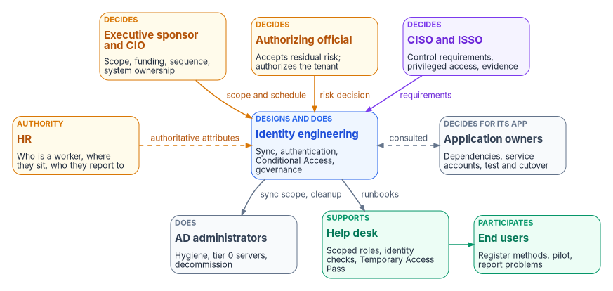
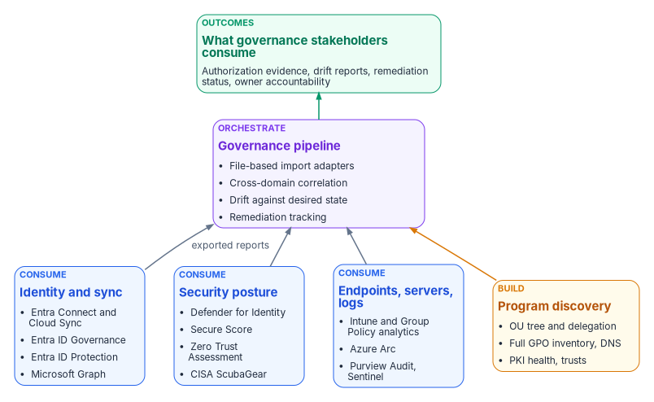

# Chapter 06 — Who Owns the Migration

*Active Directory let a handful of domain administrators own identity by default; Entra ID spreads that ownership across people and tools, so the migration has to assign it on purpose.*

::: {.callout-note}
## In this chapter
The first half names the people: who decides, who does the work and who is consulted, from the executive sponsor and authorizing official down to the help desk and end users, with a responsibility matrix and the Entra roles each team should hold. The second half names the tools: what each Microsoft-native tool does and doesn't do for this migration, a compressed capability matrix and gap analysis, and the line between what the program consumes and what it builds.
:::

In an Active Directory estate, ownership of identity was rarely written down because it didn't need to be. Domain Admins could change anything, the OU tree encoded who managed whom, and most decisions about accounts, groups and Group Policy were made by the same small team that ran the domain controllers. [Chapter 05](05-delegation-without-ous.md) explains why that delegation model doesn't survive the move to a flat directory. This chapter deals with the human version of the same problem. Once identity becomes a cloud control plane that Conditional Access, device compliance, application access and audit evidence all depend on, the decisions about it belong to more people than the directory team, and some of them carry legal accountability.

Federal policy already says so. OMB M-19-17 directs each agency to designate an integrated, agency-wide ICAM office, team or other governance structure, and says it should include personnel from the offices of the CIO, the CFO, Human Resources, General Counsel, the CISO, the Senior Agency Official for Privacy, the Chief Acquisition Officer and physical security, along with the components that run ICAM capabilities.[^c06-m1917] NIST's Risk Management Framework defines the accountable roles, such as the authorizing official, the senior agency information security officer, the system owner and the system security officer, and says what each one is responsible for.[^c06-sp80037] Neither document tells an agency who decides how to replace an OU-based delegation model, or who signs off on moving a wave of users to cloud authentication. That part is the program's recommended model, set out below.

{#fig-ch06-decide-and-do fig-alt="Three rows of cards. The top row holds the decision makers: the executive sponsor and CIO, who own scope, funding, sequence and system ownership; the authorizing official, who accepts residual risk and authorizes the tenant; and the CISO and ISSO, who set control requirements, privileged access rules and evidence expectations. Each sends an arrow to identity engineering in the middle row. The middle row also holds HR, which supplies authoritative worker attributes to identity engineering, and application owners, who are consulted in both directions about dependencies, service accounts and cutover. Identity engineering passes sync scope and cleanup work to AD administrators and runbooks to the help desk, both in the bottom row. The help desk supports end users, who register authentication methods, join pilots and report problems."}

## The people

### Decision rights and work are different things

The program separates three kinds of involvement. A role *decides* when it is accountable for the outcome and can say no. A role *does* the work when it builds, configures or runs the thing. A role is *consulted* when the decision can't be made well without its input, but the decision isn't its to make. Every decision in the matrix below has exactly one decider. Many have several doers.

The split matters because the AD habit is to let the people who can make a change also decide whether to make it. In Entra ID that habit is how an identity engineer ends up choosing the agency's risk posture by default, for example by leaving legacy authentication open because nobody told them to close it. The authorizing official is the only organizational official who can accept security and privacy risk on the organization's behalf, so decisions that amount to accepting risk have to reach that person, not stop at the console.[^c06-sp80037]

### The roles

The following descriptions combine NIST's role definitions, where NIST defines the role, with the program's recommended assignments for this migration, where it doesn't.

The executive sponsor and the CIO set scope, funding and sequence. Under the RMF, the CIO designates the senior agency information security officer, maintains security policy and oversees personnel with significant security responsibilities.[^c06-sp80037] In this migration the CIO's organization also usually holds the system owner role for the identity platform, which NIST describes as the official responsible for a system's procurement, development, integration, operation, maintenance and disposal.[^c06-sp80037] The program recommends that the sponsor own the migration schedule, decide when Active Directory components are retired, and break ties between teams.

The CISO, acting as the senior agency information security officer, carries out the CIO's security responsibilities and is the primary liaison to authorizing officials, system owners and system security officers.[^c06-sp80037] In the program's model the CISO decides the control requirements that the target has to meet: phishing-resistant authentication, the Conditional Access baseline, the privileged-access model and logging. The security operations team inside that organization receives the identity detections and privileged-activation alerts that the target produces.

The authorizing official accepts residual risk and authorizes the system.[^c06-sp80037] For this migration that means the Entra ID tenant and its interconnections, plus every point where the program proposes to carry risk instead of removing it: a deferred legacy-authentication cutoff, a service account that can't be converted yet, a deviation from a mandatory baseline. CISA's BOD 25-01 states this explicitly for cloud configuration baselines. Agencies must explain any deviation from a mandatory SCuBA policy, and authorizing officials may accept the risk under agency policy.[^c06-bod2501]

The information system security officer is responsible for keeping the system's security posture in place day to day and advises on its controls, working closely with the system owner.[^c06-sp80037] In the program's model the ISSO assembles the evidence an assessor will read, tracks findings to closure, and is consulted on every design decision that changes a control.

Identity engineering designs and builds the target. NIST's systems security engineer and system administrator roles describe the two halves of that work.[^c06-sp80037] In this migration identity engineering owns the sync design, authentication methods, Conditional Access policies, the administrative-unit delegation model, Privileged Identity Management settings and the governance features. It is the team most likely to be over-trusted, because it holds the most powerful Entra roles. The program's answer is to give it the roles it needs and route its risk-bearing decisions upward, not to slow it down.

Active Directory administrators run the source estate until it is retired. They clean up stale objects and UPN suffixes before sync, run the hosts that sync depends on, and eventually decommission domain controllers, AD FS and the AD-dependent pieces that [Chapter 04](04-the-hidden-migration-surface.md) catalogs. Microsoft classifies the Cloud Sync provisioning agent server as a tier 0 server, and creating the agent's group managed service account requires Domain Administrator or Enterprise Administrator credentials.[^c06-cloudsync-prereq] Those tasks stay with the AD administrators. The same team often knows more than anyone else about why a group or a delegation exists, so the program consults them on every mapping decision.

Application owners decide for their own applications. They know which service accounts, Kerberos dependencies, LDAP binds and hard-coded groups their application needs, and they're the only people who can accept a test result or a cutover window for it. The identity modernization guidance the program follows already treats them as reviewers of application assignments and requires at least two human owners for every app registration. The program extends that to the migration itself: no application moves without its owner's sign-off.

The help desk supports users through the change and becomes a high-value target while it does. Help desk staff reset passwords, re-register authentication methods and issue Temporary Access Passes for onboarding and recovery. In Entra ID, an Authentication Administrator can create a Temporary Access Pass for members but not for administrators. Only a Privileged Authentication Administrator can do that for admins.[^c06-tap] The program scopes help desk roles to administrative units, as [Chapter 05](05-delegation-without-ous.md) describes, and makes the help desk's identity-verification procedure a CISO decision, not a help desk one.

HR supplies the facts the directory can't verify on its own: who is a worker, what kind of worker, where they sit and who they report to. In an AD estate those facts were typed in by administrators, if anyone recorded them at all. In the target, they should arrive from the HR system of record and drive account creation, changes and removal. The [HR-driven identity series](../b03-hr-identity/index.md) covers that source-of-authority model in full, including why contractors need a separate authoritative source. For this book's purposes, HR decides what the authoritative attributes mean, and identity engineering decides how they flow.

End users are participants, not bystanders. NIST's definition of the system user includes following acceptable-use policy and reporting anomalous or suspicious behavior.[^c06-sp80037] In this migration users register phishing-resistant methods, join pilot waves and report what breaks. The program treats registration rates and help desk ticket volume as go/no-go inputs for each wave.

### The responsibility matrix

The matrix is the program's recommended model. Adapt it to the agency's governance structure, but keep the rule of one decider per row.

D = decides (accountable) · R = does the work · C = consulted · blank = informed at most.

| Decision or work item | Sponsor / CIO | CISO | AO | ISSO | Identity eng. | AD admins | App owners | Help desk | HR | Users |
|---|---|---|---|---|---|---|---|---|---|---|
| Migration scope, funding and sequence | D | C | C | | C | C | C | | C | |
| Sync tool and authentication method (Chapter 09) | | C | | C | D, R | C | C | | | |
| Authorize the tenant; accept residual risk | C | C | D | R | C | | | | | |
| Control requirements (MFA strength, Conditional Access baseline, logging) | | D | C | R | R | | | | | |
| Privileged role mapping and PIM settings | | D | | C | R | C | | | | |
| Delegation model: OUs to administrative units (Chapter 05) | | C | | C | D, R | C | | C | | |
| Directory hygiene before sync (stale objects, UPN suffixes, filtering) | | | | | D | R | C | | | |
| Authoritative worker attributes and their meaning | | | | C | R | | | | D | |
| Service account conversion, per application | | C | | | R | R | D | | | |
| Application sign-in migration and testing | | | | | R | | D, R | | | C |
| Pilot and wave go/no-go (Chapter 10) | C | C | | C | D | C | C | C | | C |
| Help desk identity verification and Temporary Access Pass procedure | | D | | C | C | | | R | | |
| Access review cadence and reviewers | | D | | C | R | | R | | C | |
| Legacy authentication cutoff | C | C | D | C | R | R | C | C | | |
| Retire AD FS, domain controllers and AD-dependent services | D | C | C | C | R | R | C | | | |
| Continuous monitoring evidence and drift findings | | D | C | R | R | | | | | |
| User readiness: method registration and communications | D | | | | C | | | R | | R |

Two rows need comment. The legacy-authentication cutoff sits with the authorizing official because the alternative, keeping it open, is a risk acceptance. Retiring AD components sits with the sponsor because it's a system-ownership decision that ends a fallback the rest of the program relies on. The ISSO and the authorizing official are consulted on it because it changes the authorization boundary.

### Entra roles for each team

Decision rights don't change what a console lets someone do. Roles do. The program maps each team to the least-privileged Microsoft Entra built-in roles for its work, assigns privileged ones as eligible through PIM, and scopes help desk roles to administrative units. [Chapter 10](10-migrating-and-governing.md) covers the PIM rollout itself.

| Team | Work | Least-privileged Entra role(s) |
|---|---|---|
| Identity engineering (sync) | Configure Cloud Sync or Connect Sync, password hash sync, pass-through authentication, federation settings | Hybrid Identity Administrator[^c06-entra-roles] |
| Identity engineering (governance) | Lifecycle Workflows; access reviews and access packages | Lifecycle Workflows Administrator; Identity Governance Administrator[^c06-entra-roles] |
| Help desk | Password resets and basic support in scope; Temporary Access Pass for members | Helpdesk Administrator or Authentication Administrator, scoped to an administrative unit[^c06-tap] |
| CISO, ISSO, assessors | Read configuration and risk without changing it | Global Reader; Security Reader[^c06-least-priv] |
| Small, named group | Assign roles and manage PIM | Privileged Role Administrator, eligible only, with approval |

Restricted management administrative units add a further check. Tenant-level administrators, Global Administrators included, can't modify objects in them unless they assign themselves a role scoped to the unit, and that assignment is written to the audit log.[^c06-rmau] That makes the self-assignment visible, which is the property the program wants, but it doesn't make Global Administrator a low-risk role.

## The tools

{#fig-ch06-instruments-and-orchestra fig-alt="Four cards along the bottom. Three blue Consume cards: identity and sync (Entra Connect and Cloud Sync, Entra ID Governance, Entra ID Protection, Microsoft Graph); security posture (Defender for Identity, Secure Score, Zero Trust Assessment, CISA ScubaGear); and endpoints, servers and logs (Intune and Group Policy analytics, Azure Arc, Purview Audit and Sentinel). One amber Build card, program discovery, covers the OU tree and delegation, full GPO inventory, DNS, PKI health and trusts. All four send exported reports up to a violet governance pipeline card: file-based import adapters, cross-domain correlation, drift against desired state and remediation tracking. The pipeline feeds a green outcomes card: authorization evidence, drift reports, remediation status and owner accountability."}

"Doesn't Microsoft already do this?" is the first question a sponsor asks, and the honest answer is that Microsoft does most of the individual pieces well and none of the connecting. Each Microsoft tool solves one part of the migration and keeps its results in its own portal, report or log. None of them produces one correlated record of the source estate, the target and the drift between them. The program's position is the same one it takes toward CISA's ScubaGear. It doesn't compete with the native tools. It consumes their output and supplies the governance layer above it. Microsoft provides the instruments. The program provides the orchestra.

### What each tool does and doesn't do

Names, capabilities and license tiers below were checked on October 20, 2026. Licensing changes often. Confirm against the agency's own agreements before planning purchases.

| Tool | What it does for this migration | What it doesn't do | License tier |
|---|---|---|---|
| Microsoft Entra Cloud Sync | Synchronizes users, groups, contacts and, with device sync, computer objects from AD to Entra ID through lightweight agents configured in the cloud. Supports disconnected forests and multiple active agents, and is the platform for new features such as group provisioning to AD and source-of-authority changes.[^c06-cloudsync-decision] | Has lower documented limits than Connect Sync (150,000 objects per domain, 50,000-member groups) and doesn't configure pass-through authentication.[^c06-cloudsync-decision] Not an assessment tool. | Provisioning groups back to AD requires Entra ID P1.[^c06-cloudsync-prereq] |
| Microsoft Entra Connect Sync | The on-premises sync engine, with richer sync-rule customization. Microsoft says Cloud Sync is replacing it, and that it will be retired once Cloud Sync reaches full functional parity.[^c06-connectsync] | Not an assessment tool: no OU, GPO, DNS or PKI analysis. Connect Sync must be upgraded to version 2.6.84.0 or later and configured for application-based authentication by April 7, 2027, or synchronization stops.[^c06-connect-prereq] | Free with the Azure subscription.[^c06-connect-license] |
| Microsoft Entra Connect Health | Monitors sync, AD FS and AD DS health through agents on each server.[^c06-connect-license] | Monitors health, not readiness or governance. | Entra ID P1 or P2. The first agent needs one license, and each additional agent needs 25 more.[^c06-connect-health-faq] |
| Microsoft Entra ID Governance | Lifecycle Workflows, entitlement management, access reviews and PIM, all reachable through Microsoft Graph.[^c06-idgov-license] Available in GCC, GCC High and DoD.[^c06-idgov-gcc] | Doesn't decide who should have access, or supply the HR facts it acts on. | Lifecycle Workflows, and access reviews for member users, require Entra ID Governance or Entra Suite. Some entitlement-management and review capabilities work with P2.[^c06-idgov-license] |
| Microsoft Entra ID Protection | Sign-in and user risk detection, risk-based Conditional Access, risk reports through Graph.[^c06-idp] | Doesn't assess the AD source. Some detections depend on Defender licensing. | Full capability requires Entra ID P2 or Entra Suite.[^c06-idp] |
| Microsoft Defender for Identity | Sensors on domain controllers, AD CS, AD FS and Entra Connect servers. Detects identity attacks and publishes security posture assessments in Secure Score across hybrid security, identity infrastructure, certificates, Group Policy, accounts and cloud identities.[^c06-mdi-posture] Its data is queryable in advanced hunting and through the Defender XDR APIs, and can be streamed to Sentinel.[^c06-mdi-api] | Not an inventory tool: no forest topology export, OU tree, full GPO inventory, DNS assessment or trust inventory. Certificate-authority assessments need a sensor on the AD CS server.[^c06-mdi-posture] Advanced hunting keeps data for 30 days.[^c06-mdi-api] | EMS E5, Microsoft 365 E5 or E5 Security, or standalone. In GCC: Microsoft 365 GCC G5, G5 Security GCC or standalone.[^c06-mdi-gcc] |
| Microsoft Graph | The single API endpoint for users, groups, applications, devices, roles and governance in Entra ID.[^c06-graph] | Raw building blocks with no orchestration or reporting. | Calling a feature through an API still needs that feature's license; Intune's licensing terms say so explicitly.[^c06-intune-license] |
| Microsoft Intune with Group Policy analytics | Imports GPO XML exports, reports MDM support per setting, shows whether each GPO is linked to an OU, exports the view to CSV, and migrates supported settings to a settings catalog policy. Flags conflicting settings across imported GPOs during migration.[^c06-gpa][^c06-gpa-migrate] | Analyzes Windows settings only. Each GPO export must be under 4 MB, and non-English, non-ADMX settings skew the MDM support percentage.[^c06-gpa] No WMI-filter analysis or tracking of migration status over time. | Intune is licensed through Plan 1 and higher plans, usually inside a Microsoft 365 bundle.[^c06-intune-license] |
| Security Compliance Toolkit | Policy Analyzer compares sets of GPOs against Microsoft baselines and local policy, and highlights redundant settings and internal inconsistencies across a set. LGPO manages local policy. Baselines include Windows Server 2025.[^c06-sct] | Desktop tools with Excel output, no automation pipeline, and no OU, DNS, PKI or trust analysis. | Downloaded from the Microsoft Download Center with the baselines.[^c06-sct] |
| Azure Arc with Azure Machine Configuration | Audits and enforces OS and application settings on Arc-enabled servers with Azure Policy. Machine Configuration was formerly called Azure Policy Guest Configuration.[^c06-arc-mc] | Requires Arc enrollment, so it can't assess before onboarding. No AD-specific analysis. | Included at no extra charge for Windows Server with Software Assurance or pay-as-you-go licensing. Otherwise billed per server.[^c06-arc-mc] |
| Microsoft Purview Audit | Searchable audit log covering Entra ID and Microsoft 365 activity, with export to CSV and access through the Office 365 Management Activity API. Standard keeps records for 180 days. Premium keeps Entra ID, Exchange and SharePoint records for one year, or up to 10 years with an add-on.[^c06-purview-audit] | Audit, not configuration assessment. | Standard is enabled by default. Premium requires E5-level licensing or an add-on.[^c06-purview-audit] |
| Microsoft Sentinel | SIEM for long-term retention and correlation of Entra, Defender for Identity and AD security events. | Detects threats. Doesn't compare configuration against a desired state. Sentinel won't be supported in the Azure portal after March 31, 2027, only in the Defender portal.[^c06-sentinel] | Billed as part of the agency's Azure bill.[^c06-sentinel-cost] |
| Microsoft Secure Score and the Zero Trust Assessment | Secure Score ranks recommended actions across identity, devices and apps.[^c06-securescore] The Zero Trust Assessment is an open-source, read-only PowerShell module that tests hundreds of tenant configuration items across Entra, Intune and other services and produces a local report.[^c06-zta] | Both describe the cloud tenant, not the AD source. The assessment's first run needs Global Administrator consent. Later runs need Global Reader and the other reader-level roles listed in its prerequisites.[^c06-zta] | Defender for Identity assessments in Secure Score need a Defender for Identity license.[^c06-mdi-posture] The Zero Trust Assessment is open source.[^c06-zta] |
| CISA ScubaGear | Assesses a Microsoft 365 tenant, including Entra ID, against CISA's SCuBA baselines and writes HTML, JSON and CSV results.[^c06-scubagear] BOD 25-01 requires agencies to deploy CISA's SCuBA assessment tools and report results.[^c06-bod2501] | Tenant configuration only. | Open source, published by CISA.[^c06-scubagear] |
| Azure Migrate | Discovers and assesses servers, databases and web apps for migration to Azure.[^c06-azmigrate] | No AD forest, GPO, OU, DNS, PKI or trust analysis. Microsoft still points to the MAP Toolkit for Windows OS migration planning and software usage tracking.[^c06-azmigrate] | Part of Azure. Microsoft charges no tool fee for migration during the first 180 days of a VM's replication.[^c06-azmigrate] |
| Active Directory Migration Tool (ADMT) | Moves users, groups and computers between AD domains and forests, with SID history and password migration. | Doesn't move anything to Entra ID. Microsoft has deprecated the ADMT 3.2 code base, stopped development, and provides no security or bug fixes. It hasn't been updated for Windows Server 2012 R2 or later, and Microsoft says to use it at your own risk.[^c06-admt] | Free download.[^c06-admt] |
| Microsoft Entra Health monitoring | Tenant-level signals and anomaly alerts for MFA, Conditional Access and device-compliance sign-ins, plus monthly SLA attainment.[^c06-entra-health] | Cloud-side only, and scenario monitoring and alerts are still in preview.[^c06-entra-health] | Viewing the signals requires Entra ID P1 or P2.[^c06-entra-licensing] |
| FastTrack | Remote deployment guidance from Microsoft, including Entra Connect, Cloud Sync, authentication methods and hybrid identity.[^c06-fasttrack] | Guidance only. No discovery, inventory or artifacts. | Tenants with 150 or more licenses from eligible plans.[^c06-fasttrack] |

### The capability matrix

The matrix maps each assessment domain the program covers to the native tools that touch it. It replaces the source's tool-by-tool grid with one row per domain. "Partial" means a native tool covers part of the domain but doesn't produce a complete, versioned inventory that a governance process can track.

| Domain | Native coverage | Native tools that touch it | What's missing |
|---|---|---|---|
| Forest topology (domains, DCs, functional levels, FSMO, sites) | Partial | AD PowerShell module (raw cmdlets); Defender for Identity (monitors DCs) | A structured, versioned topology artifact |
| OU hierarchy and delegation ACLs | None | AD PowerShell (raw) | Recursive tree with GPO links, object counts and delegation; see [Chapter 05](05-delegation-without-ous.md) |
| GPO inventory and settings | Partial | Group Policy analytics (Windows MDM subset, OU-linked flag, conflict check at migration); Policy Analyzer (baseline comparison, redundancy and inconsistency across a set); Defender for Identity (Group Policy posture) | Full inventory including server GPOs, link scope, WMI filters and migration status over time |
| DNS zones and records | None | AD and DNS PowerShell modules (raw) | Zone, record, scavenging and SRV assessment |
| PKI and AD CS | Partial | Defender for Identity certificate assessments (template misconfigurations such as ESC1 through ESC4 and ESC15; CA assessments with an AD CS sensor)[^c06-mdi-certs] | Operational PKI health (CRL, AIA, OCSP) and migration readiness |
| Computer objects | Partial | Azure Migrate (server discovery); Defender for Identity (stale entities) | AD-specific attributes: delegation, SPNs, group membership, LAPS |
| Users and groups | Partial | Defender for Identity (accounts posture); Entra Connect or Cloud Sync (sync state) | Complete governance inventory: nesting, service-account classification, ownership |
| Trusts | None | AD PowerShell (raw) | Direction, type, SID filtering, selective authentication |
| ACLs and dangerous delegation | Partial | Defender for Identity (selected dangerous permissions) | A complete delegation audit |
| Cloud tenant configuration | Strong | ScubaGear; Zero Trust Assessment; Secure Score | Correlation back to the AD source and to remediation owners |
| Cross-domain correlation | None | — | One assessment record joining all of the above |
| Drift against desired state | Partial | Machine Configuration (Arc servers); Secure Score and ScubaGear (tenant); Defender for Identity (security drift) | Governance drift against a canonical desired state, with an owner and a deadline |

The source analysis gave headline coverage figures for the native tools (about 30 percent of the discovery surface, 22 percent once governance was included). It labeled those figures illustrative, derived from its own matrix and not from any assessment run. This chapter doesn't repeat them. The program's position is that an agency gets its own numbers by running the read-only assessment in [Chapter 07](07-read-only-discovery.md) and [Chapter 08](08-assessing-the-forest.md) against a representative forest, then counting which findings each tool surfaced.

### The gap analysis

| Category | Native strength | Who owns the gap |
|---|---|---|
| Server discovery | Strong for hardware and VM inventory | Consume Azure Migrate. The program adds AD attributes. |
| Group Policy | Partial: client MDM subset and baseline comparison | The program builds the full inventory, including server GPOs and link scope |
| Security posture | Strong for detection and posture recommendations | Consume Defender for Identity. The program adds correlation. |
| Cloud tenant configuration | Strong | Consume ScubaGear and the Zero Trust Assessment |
| DNS | None | Program-built |
| PKI and AD CS | Partial, security findings only | Program-built health and readiness |
| Trusts | None | Program-built |
| OU and delegation | None | Program-built ([Chapter 05](05-delegation-without-ous.md)) |
| Cross-domain correlation | None | Program-built, the core of the pipeline |
| Governance pipeline and drift | Security drift only | Program-built |

### What the program consumes and what it builds

| Domain | Decision | Why |
|---|---|---|
| Server inventory | Consume Azure Migrate exports | Better at hardware and VM discovery than anything the program would write |
| GPO MDM readiness | Consume Group Policy analytics exports | Microsoft maintains the setting-to-CSP mapping and updates it automatically |
| Identity security posture | Consume Defender for Identity findings | Agencies with E5 or G5 licensing already have it, and it covers AD CS and Group Policy posture |
| Security baselines | Consume Policy Analyzer output | Free, maintained, authoritative |
| Tenant configuration | Consume ScubaGear output | Required reporting under BOD 25-01, and the same baselines the assessors use |
| Lifecycle, access reviews, PIM | Consume Entra ID Governance through Graph | The target's own controls; the program reads their state and results |
| Forest topology, OU tree, trusts, DNS | Build | No native tool inventories them |
| Full GPO inventory | Build | Group Policy analytics covers the Windows MDM subset only |
| PKI and AD CS health | Build | Defender for Identity covers the security subset only |
| Cross-domain correlation and governance drift | Build | The program's reason to exist |

The program-built discovery is read-only and PowerShell-first, using the same Active Directory cmdlets an AD administrator already knows. [Appendix B](appendix-b-forest-assessment-module.md) and [Appendix C](appendix-c-identity-assessment-module.md) document the modules; [Chapter 07](07-read-only-discovery.md) covers the read-only stage.

### How the program consumes native output

The program's import adapters (the `FMPImportAdapters` PowerShell module, specified in FMP_182) take a report that an operator or another tool has already exported and normalize it into the program's assessment schema. The design is deliberately file-based. Each importer reads a report from `-ReportPath` and writes normalized JSON to `-OutputPath`, and the module never calls a live API. That keeps ingestion read-only, credential-free and auditable inside the agency's boundary.

| Function | Consumes | Produces |
|---|---|---|
| `Import-FMPAzureMigrateReport` | Azure Migrate assessment export | Computer inventory |
| `Import-FMPGPOAnalyticsReport` | Intune Group Policy analytics export | GPO migration tracker |
| `Import-FMPDefenderFindings` | Defender for Identity Secure Score export | Security assessment overlay |
| `Import-FMPSCuBAReport` | ScubaGear output | Conformance evidence |
| `Import-FMPADReconReport` | ADRecon output | Computer and identity inventory |
| `Merge-FMPAssessmentSources` | Several normalized sources | One correlated assessment bundle |

Each importer wraps its records in a provenance envelope (`schema: fmp.import.v1`) that records the source tool, its export version, the import time in UTC, a content hash over the normalized data, the source file, and the adapter's identity and version. `Merge-FMPAssessmentSources` checks every envelope's completeness and hash before it correlates them. An envelope that is incomplete, or whose hash no longer matches its data, is a provenance drift finding by definition. Policy Analyzer, Entra Connect Health and Azure Policy compliance exports are candidates for future adapters.

### Third-party tools

A few non-Microsoft tools overlap parts of the assessment. The program treats them as inputs or cross-checks, not competitors.

- ADRecon is an open-source PowerShell tool, licensed AGPL-3.0, that collects forest, domain, trust, site, OU, GPO, DNS, user, group, computer and SPN data. It writes CSV, XML, JSON, HTML and Excel output.[^c06-adrecon] The program uses it as a validation reference: the program's own collection should capture at least what ADRecon captures.
- PingCastle is an Active Directory security assessment tool, now part of Netwrix.[^c06-pingcastle]
- BloodHound Community Edition, from SpecterOps, maps attack paths through AD and Azure identity relationships using graph analysis. It's licensed Apache 2.0.[^c06-bloodhound]
- Purple Knight, from Semperis, is a free assessment of AD, Entra ID and Okta against more than 200 indicators of exposure and compromise.[^c06-purpleknight]

## Ownership in practice

Put the two halves together and a pattern appears. Every native tool in this chapter has an owner in the matrix. Defender for Identity findings go to the CISO's organization. Group Policy analytics belongs to identity engineering working with endpoint management. ScubaGear results go to the ISSO's evidence. Entra ID Governance runs under identity engineering, with application owners and managers as reviewers. What no tool has, unless the program assigns it, is an owner for the gaps between them: the OU tree that nobody inventories, the trust nobody documented, and the drift that no single portal can see. That's the work the program builds and keeps, and it's why the governance pipeline needs a named owner as much as any Entra role does. [Chapter 07](07-read-only-discovery.md) starts that work with read-only discovery.

::: {.callout-tip}
## Continue the book
[← Previous: Chapter 05 — Delegation Without OUs](05-delegation-without-ous.md) · [Book index](index.md) · [Next: Chapter 07 — Read-Only Discovery →](07-read-only-discovery.md)
:::

[^c06-m1917]: Office of Management and Budget, M-19-17, *Enabling Mission Delivery through Improved Identity, Credential, and Access Management*, May 21, 2019, <https://www.whitehouse.gov/wp-content/uploads/2019/05/M-19-17.pdf> (accessed Oct 20, 2026).
[^c06-sp80037]: National Institute of Standards and Technology, SP 800-37 Rev. 2, *Risk Management Framework for Information Systems and Organizations: A System Life Cycle Approach for Security and Privacy*, Appendix D, December 2018, <https://nvlpubs.nist.gov/nistpubs/SpecialPublications/NIST.SP.800-37r2.pdf> (accessed Oct 20, 2026).
[^c06-bod2501]: Cybersecurity and Infrastructure Security Agency, BOD 25-01, *Implementing Secure Practices for Cloud Services*, December 17, 2024, <https://www.cisa.gov/news-events/directives/bod-25-01-implementing-secure-practices-cloud-services> (accessed Oct 20, 2026).
[^c06-cloudsync-prereq]: Microsoft Learn, "Prerequisites for Microsoft Entra Cloud Sync," <https://learn.microsoft.com/entra/identity/hybrid/cloud-sync/how-to-prerequisites> (accessed Oct 20, 2026).
[^c06-tap]: Microsoft Learn, "Configure Temporary Access Pass to register passwordless authentication methods," <https://learn.microsoft.com/entra/identity/authentication/howto-authentication-temporary-access-pass> (accessed Oct 20, 2026).
[^c06-entra-roles]: Microsoft Learn, "Microsoft Entra built-in roles," <https://learn.microsoft.com/entra/identity/role-based-access-control/permissions-reference> (accessed Oct 20, 2026).
[^c06-least-priv]: Microsoft Learn, "Least privileged roles by task in Microsoft Entra ID," <https://learn.microsoft.com/entra/identity/role-based-access-control/delegate-by-task> (accessed Oct 20, 2026).
[^c06-rmau]: Microsoft Learn, "Restricted management administrative units in Microsoft Entra ID," <https://learn.microsoft.com/entra/identity/role-based-access-control/admin-units-restricted-management> (accessed Oct 20, 2026).
[^c06-cloudsync-decision]: Microsoft Learn, "Migrate from Microsoft Entra Connect to Cloud Sync: Decision Guide," <https://learn.microsoft.com/entra/identity/hybrid/cloud-sync/connect-to-cloud-sync-decision-guide> (accessed Oct 20, 2026).
[^c06-connectsync]: Microsoft Learn, "Microsoft Entra Connect Sync: Understand and customize synchronization," <https://learn.microsoft.com/entra/identity/hybrid/connect/how-to-connect-sync-whatis> (accessed Oct 20, 2026).
[^c06-connect-prereq]: Microsoft Learn, "Prerequisites for Microsoft Entra Connect," <https://learn.microsoft.com/entra/identity/hybrid/connect/how-to-connect-install-prerequisites> (accessed Oct 20, 2026).
[^c06-connect-license]: Microsoft Learn, "What is Microsoft Entra Connect?," <https://learn.microsoft.com/entra/identity/hybrid/connect/whatis-azure-ad-connect> (accessed Oct 20, 2026).
[^c06-connect-health-faq]: Microsoft Learn, "Microsoft Entra Connect Health frequently asked questions," <https://learn.microsoft.com/entra/identity/hybrid/connect/reference-connect-health-faq> (accessed Oct 20, 2026).
[^c06-idgov-license]: Microsoft Learn, "Microsoft Entra ID Governance licensing fundamentals," <https://learn.microsoft.com/entra/id-governance/licensing-fundamentals> (accessed Oct 20, 2026).
[^c06-idgov-gcc]: Microsoft Learn, "Microsoft Entra feature availability," <https://learn.microsoft.com/entra/identity/authentication/feature-availability> (accessed Oct 20, 2026).
[^c06-idp]: Microsoft Learn, "What is Microsoft Entra ID Protection?," <https://learn.microsoft.com/entra/id-protection/overview-identity-protection> (accessed Oct 20, 2026).
[^c06-mdi-posture]: Microsoft Learn, "Microsoft Defender for Identity's security posture assessments," <https://learn.microsoft.com/defender-for-identity/security-assessment> (accessed Oct 20, 2026).
[^c06-mdi-api]: Microsoft Learn, "Microsoft Defender for Identity in the Microsoft Defender portal," <https://learn.microsoft.com/defender-for-identity/microsoft-365-security-center-mdi> (accessed Oct 20, 2026).
[^c06-mdi-gcc]: Microsoft Learn, "Microsoft Defender for Identity for US Government offerings," <https://learn.microsoft.com/defender-for-identity/us-govt-gcc-high>; and "Microsoft Defender for Identity sensor v2.x prerequisites," <https://learn.microsoft.com/defender-for-identity/deploy/prerequisites-sensor-version-2> (both accessed Oct 20, 2026).
[^c06-mdi-certs]: Microsoft Learn, "Security assessment: Certificates," <https://learn.microsoft.com/defender-for-identity/security-posture-assessments/certificates> (accessed Oct 20, 2026).
[^c06-graph]: Microsoft Learn, "Overview of Microsoft Graph," <https://learn.microsoft.com/graph/overview> (accessed Oct 20, 2026).
[^c06-gpa]: Microsoft Learn, "Import and analyze your on-premises GPOs using Group Policy analytics in Microsoft Intune," <https://learn.microsoft.com/intune/device-configuration/import-group-policy-analytics> (accessed Oct 20, 2026).
[^c06-gpa-migrate]: Microsoft Learn, "Create a Settings Catalog policy using your imported GPOs in Microsoft Intune," <https://learn.microsoft.com/intune/device-configuration/migrate-group-policy> (accessed Oct 20, 2026).
[^c06-intune-license]: Microsoft Learn, "Microsoft Intune licensing," <https://learn.microsoft.com/intune/fundamentals/licensing> (accessed Oct 20, 2026).
[^c06-sct]: Microsoft Learn, "Microsoft Security Compliance Toolkit - How to use," <https://learn.microsoft.com/windows/security/operating-system-security/device-management/windows-security-configuration-framework/security-compliance-toolkit-10> (accessed Oct 20, 2026).
[^c06-arc-mc]: Microsoft Learn, "Modernize server management from Configuration Manager to Azure Arc," <https://learn.microsoft.com/azure/azure-arc/servers/modernize-server-management>; and "Windows Server Management enabled by Azure Arc," <https://learn.microsoft.com/azure/azure-arc/servers/windows-server-management-overview> (both accessed Oct 20, 2026).
[^c06-purview-audit]: Microsoft Learn, "Learn about auditing solutions in Microsoft Purview," <https://learn.microsoft.com/purview/audit-solutions-overview> (accessed Oct 20, 2026).
[^c06-sentinel-cost]: Microsoft Learn, "Reduce costs for Microsoft Sentinel," <https://learn.microsoft.com/azure/sentinel/billing-reduce-costs> (accessed Oct 20, 2026).
[^c06-sentinel]: Microsoft Learn, "What is Microsoft Sentinel security information and event management (SIEM)?," <https://learn.microsoft.com/azure/sentinel/overview#microsoft-sentinel-in-the-azure-portal-retirement-timeline> (accessed Oct 20, 2026).
[^c06-securescore]: Microsoft Learn, "Assess your security posture with Microsoft Secure Score," <https://learn.microsoft.com/defender-xdr/microsoft-secure-score-improvement-actions> (accessed Oct 20, 2026).
[^c06-zta]: Microsoft Learn, "What is the Zero Trust Assessment?," <https://learn.microsoft.com/security/zero-trust/assessment/overview>; and "Get started with the Zero Trust Assessment," <https://learn.microsoft.com/security/zero-trust/assessment/get-started> (both accessed Oct 20, 2026).
[^c06-scubagear]: Cybersecurity and Infrastructure Security Agency, "ScubaGear," GitHub repository, <https://github.com/cisagov/ScubaGear> (accessed Oct 20, 2026).
[^c06-azmigrate]: Microsoft Learn, "Azure Migrate: Common questions," <https://learn.microsoft.com/azure/migrate/resources-faq> (accessed Oct 20, 2026).
[^c06-admt]: Microsoft Learn, "Support policy and known issues for Active Directory Migration Tool," <https://learn.microsoft.com/troubleshoot/windows-server/active-directory/support-policy-and-known-issues-for-admt> (accessed Oct 20, 2026).
[^c06-entra-health]: Microsoft Learn, "What is Microsoft Entra Health monitoring?," <https://learn.microsoft.com/entra/identity/monitoring-health/concept-microsoft-entra-health> (accessed Oct 20, 2026).
[^c06-entra-licensing]: Microsoft Learn, "Microsoft Entra licensing," <https://learn.microsoft.com/entra/fundamentals/licensing> (accessed Oct 20, 2026).
[^c06-fasttrack]: Microsoft Learn, "Eligibility" (FastTrack for Microsoft 365), <https://learn.microsoft.com/microsoft-365/fasttrack/eligibility>; and "Microsoft Entra" (FastTrack), <https://learn.microsoft.com/microsoft-365/fasttrack/microsoft-entra-id> (both accessed Oct 20, 2026).
[^c06-adrecon]: ADRecon, GitHub repository, <https://github.com/adrecon/ADRecon> (accessed Oct 20, 2026).
[^c06-pingcastle]: PingCastle, <https://www.pingcastle.com/> (accessed Oct 20, 2026).
[^c06-bloodhound]: SpecterOps, "BloodHound," GitHub repository, <https://github.com/SpecterOps/BloodHound> (accessed Oct 20, 2026).
[^c06-purpleknight]: Semperis, "Purple Knight," <https://www.semperis.com/purple-knight/> (accessed Oct 20, 2026).
