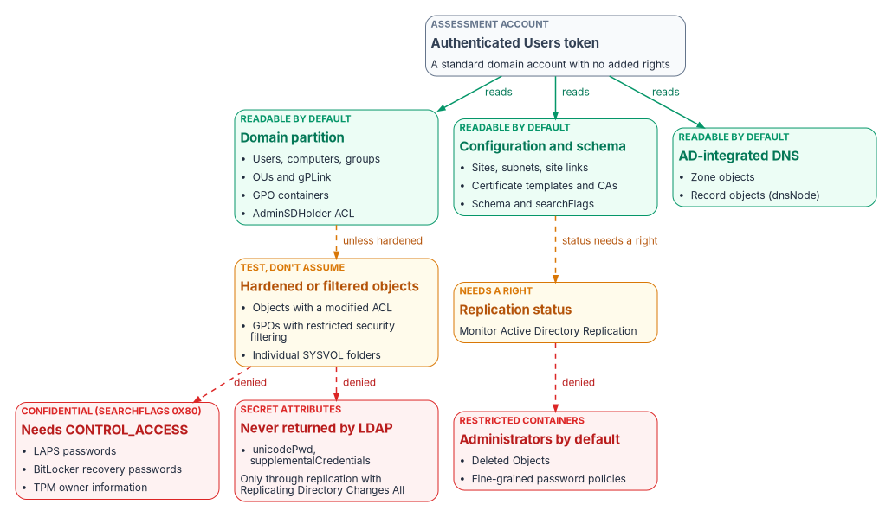
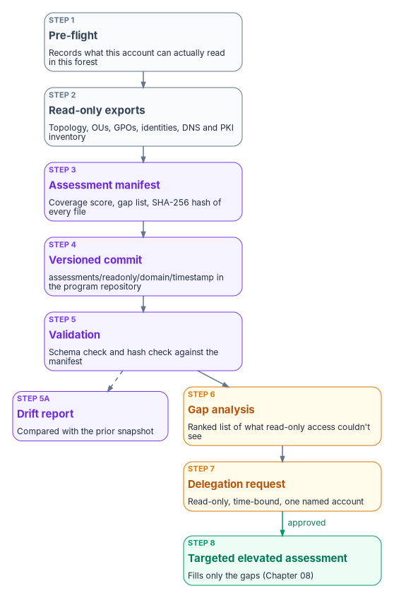

# Chapter 07 — Read-Only Discovery

*The first weeks of an engagement are spent waiting for access; spend them learning what the directory already tells everyone.*

::: {.callout-note}
## In this chapter
Why the assessment starts with read-only access, and what that access actually covers in a default forest. Where the default read boundary sits: protected groups, confidential attributes, secrets, and restricted containers. How to turn what read-only discovery couldn't see into a narrow, time-bound delegation request. And how to run the assessment so that it is visible to the security team and its output is protected.
:::

An assessment team rarely gets privileged access on the first day. Authorization paperwork, security review and trust between the agency's directory team and an outside team all take time. The program uses that window. A standard domain account, with no rights beyond what every employee already has, can read most of what the migration plan needs: the topology, the OU tree, group structure, Group Policy links, sites and subnets, and certificate templates. Read-only discovery captures that baseline first. Only then does the team ask for the specific, limited access needed to see the rest (Chapter 08).

Starting this way has three benefits. It changes nothing in the directory. It applies least privilege, NIST SP 800-53 control AC-6, to the assessment team itself.[^c07-sp80053] And the request for elevated access is built from evidence of what is missing, not from a general request for Domain Admin.

{#fig-ch07-permission-layers fig-alt="A slate box for the assessment account's Authenticated Users token reads three green boxes: the domain partition, the configuration and schema partitions, and AD-integrated DNS. Dashed amber arrows lead to objects that may be hardened or filtered and to replication status, which needs a right. Dashed red arrows lead to three red boxes that are denied without delegation: confidential attributes such as LAPS and BitLocker recovery data, secret attributes such as password hashes, and restricted containers such as Deleted Objects."}

## What a standard account can read

Read access in Active Directory doesn't come from one setting. It is the sum of several default grants, and a careful assessment knows which grant it is relying on.

- **Authenticated Users** receives a limited set of property sets on user objects by default: general, public, personal and web information, plus the right to read permissions.[^c07-writeback]
- **Pre–Windows 2000 Compatible Access** receives list, read-all-properties and read-permissions rights on users, groups and InetOrgPerson objects.[^c07-writeback] Its default membership depends on a choice made when the domain was created. In the Windows 2000-and-later permissions mode it contains Authenticated Users; in the pre-Windows 2000 compatible mode it contains Everyone and Anonymous.[^c07-groups]

Taken together, these mean that in most domains a standard account can read most attributes of users and groups. That is broader than many teams expect. The exact result depends on the domain's history: whether that group's membership was ever trimmed, and whether OUs were hardened. So the assessment's first step is a pre-flight that tests what this account can actually read in this forest, rather than assuming the defaults. Every later export records which access it relied on.

| Area | Typical read-only result | What it contributes to the plan |
|---|---|---|
| Forest and domain topology, domain controllers, sites, subnets, site links | Readable | Scope, functional levels, and the shape of replication |
| OU hierarchy and Group Policy links | Readable | The structure that attribute-driven targeting replaces (Chapters 03 and 05) |
| Group Policy objects and settings reports | Usually readable, unless security filtering restricts a GPO | The GPO-to-Intune inventory |
| Users, groups, computers and service principal names | Readable | The identity inventory and service account discovery (Chapter 09) |
| Certificate templates and enrollment services, in the configuration partition | Readable | The AD CS dependency surface (Chapter 04) |
| AD-integrated DNS zones | Often readable; test it | The DNS dependency surface (Chapter 04) |
| Replication health and DNS server settings such as scavenging | Needs a right or server access | A delegation item or an administrator-provided export |

## Where the default read boundary sits

The assessment report should never claim coverage it doesn't have. Four mechanisms set the default boundary. Each needs to be described accurately, because several are commonly misstated.

### Protected accounts and groups

The AdminSDHolder object in each domain's System container holds template permissions for the protected accounts and groups: Domain Admins, Enterprise Admins, Schema Admins, Administrators, the operator groups, krbtgt and others. A process called SDProp runs every 60 minutes by default on the domain controller that holds the PDC emulator role. It resets the permissions on those protected accounts and groups to match the template, and inheritance is disabled on them.[^c07-adminsdholder]

SDProp acts on *current* members of protected groups. An account removed from a protected group keeps `adminCount` set to 1 unless someone clears it. SDProp no longer updates its permissions, but it still doesn't inherit permissions from its OU.[^c07-attacksurface] For discovery, this means `adminCount=1` lists accounts that are *or were* privileged. That makes it a useful clean-up list, but it is not the current privileged population. Membership of the protected groups is.

### Confidential attributes

Since Windows Server 2003 SP1, setting bit 7 (value 128) of an attribute's `searchFlags` marks the attribute as confidential. Reading it then needs the CONTROL_ACCESS right in addition to read-property, and by default only administrators hold that right on all objects.[^c07-confidential] Base-schema attributes can't be marked confidential.[^c07-searchflags] Local administrator passwords that LAPS stores in Active Directory are an example: they sit in protected attributes that only delegated readers can see.[^c07-mdi-laps]

Read-only discovery can therefore show *where* a capability is deployed without seeing the secret. With Windows LAPS, for example, the presence and age of the expiration attribute (`msLAPS-PasswordExpirationTime`) shows coverage without anyone reading the password.[^c07-laps-schema] The legacy Microsoft LAPS product, which uses the `ms-Mcs-AdmPwd*` attributes, is deprecated as of Windows 11 23H2. Newer Windows versions block its installer, and Windows LAPS is its replacement.[^c07-laps] A forest still on legacy LAPS has a finding before the assessment even reaches identity.

### Secrets

Password hashes are never returned to a directory read. They leave a domain controller only through directory replication, and pulling them that way needs the "Replicating Directory Changes" and "Replicating Directory Changes All" rights. "Replicating Directory Changes All" is the control access right that allows replication of secret domain data.[^c07-getchangesall] Microsoft Entra Connect's password hash sync account holds both rights for exactly this reason.[^c07-phs]

For discovery this boundary cuts both ways. The assessment never needs these rights, and the program never requests them for an assessment account. But *which accounts already hold them* is one of the most important things a later, privileged assessment checks. Any holder that is not a domain controller or the sync service account is a finding (Chapter 08).

### Restricted containers and policy objects

By default, only the System account and members of the Administrators group can view the hidden Deleted Objects container. Microsoft documents granting read (list children and read property) to a named non-administrator if needed; the procedure starts with a Domain Admin taking ownership of the container.[^c07-deleted] Restoring a deleted object is a separate and more sensitive right ("Reanimate Tombstone"), which an assessment never needs.[^c07-restore] In forests created with Windows Server 2003 SP1 or later, the default tombstone lifetime is 180 days.[^c07-recyclebin]

Fine-grained password policies are managed by Domain Admins by default.[^c07-fgpp] Treat their settings and the groups they apply to as a delegation or administrator-export item. Record them as "not seen" rather than inferring them from the default domain policy.

## Recording what read-only discovery couldn't see

Each gap is recorded with four facts: what is missing, the narrowest right or export that would close it, why the migration plan needs it, and whether there's a read-only substitute. A program-standard gap list starts with the rows below and is then edited to match the pre-flight's actual results.

| Gap | Narrowest way to close it | Why the plan needs it | Read-only substitute |
|---|---|---|---|
| Replication health and convergence | An administrator-run replication summary, or SIEM data | Cutover sequencing; domain controllers that fail to converge | None reliable |
| Domain controller event logs | A log export or SIEM read access | Authentication patterns, including NTLM use (Chapter 03) | None |
| DNS server settings (aging, scavenging, forwarders) | DNS administrator export | Stale records that block the DNS adapter (Chapter 04) | Zone object reads cover records, not server settings |
| Issued-certificate database | CA administrator export | Which certificates must be reissued from a new PKI | Template permissions and enrollment services |
| Deleted Objects | Read on the container for one named account | Audit trail of recent deletions | Recycle Bin status only |
| Fine-grained password policies | Domain Admin export | Password policy mapping for Entra ID | None |
| Confidential attributes (LAPS, BitLocker recovery) | Not requested; coverage only | Deployment coverage, not secrets | Expiration and child-object presence |

The source guide quoted a read-only coverage figure of about 87 percent. Its own calculation averages to about 94 percent, because it leaves out the zero-coverage rows. Neither figure is a measurement. The program reports the coverage the pre-flight actually measured in this forest, and nothing else.

## The delegation request

The gap list becomes a short written request to the directory team or security review board. The request is what makes the program's least-privilege position credible, so it follows fixed rules.

- **Read only.** No write, create, delete or permission-change rights. Rights that expose secrets are never requested: replication of secret data, confidential-attribute reads, and tombstone reanimation.
- **Specific.** Each line names the right, the exact object path and the business reason, taken from the gap list. "Domain Admin for the assessment" is not an acceptable line.
- **Time-bound.** Each delegation expires at the end of the assessment window, and the account's `accountExpires` is set to match.
- **One named, dedicated account.** A standard user with no existing elevated memberships. Its activity can then be attributed and told apart from normal use.
- **Preferably an export.** Where the directory team can run a report and hand over the output (replication summary, DNS server settings, CA database export), that is better than granting a right at all.

The directory team implements the delegations with its own change process. The program doesn't hand over commands for others to run with their privileges.

## Running the assessment safely

Read-only queries change nothing, but they aren't invisible, and the output is sensitive.

- **Tell the security operations team first.** Broad LDAP enumeration looks like reconnaissance, and monitoring tools are built to flag it. Microsoft Defender for Identity, for example, raises discovery alerts for Active Directory enumeration and for unusual LDAP queries against sensitive attributes.[^c07-mdi-recon] Give the security operations team the window, the account and the expected query pattern so they can recognize the activity without switching detection off.
- **Be gentle with domain controllers.** Page large queries, run bulk enumeration off-peak, and direct queries to a domain controller designated for administrative load.
- **Protect the output as sensitive.** An assessment output set is a map of the estate. It lists privileged group membership, service accounts and their service principal names, certificate template permissions, and the delegation model. Store it only on encrypted volumes, on a dedicated assessment workstation, and never on a general-purpose endpoint. Handle it under the agency's data classification policy.
- **Make it tamper-evident.** Record a SHA-256 hash of every output file in an assessment manifest. Commit the set to the program's versioned repository under a dated path, so later snapshots can be compared to it for drift.
- **Close it down.** When the assessment ends, disable the account, confirm that every delegation has expired, and brief the engagement authority.

{#fig-ch07-discovery-pipeline fig-alt="A vertical flow of eight steps. Pre-flight records what the account can read. Read-only exports write the inventory. An assessment manifest records coverage, gaps and file hashes. A versioned commit stores the snapshot. Validation checks schema and hashes, with a dashed branch to a drift report against the prior snapshot. A gap analysis ranks what read-only access couldn't see. A delegation request asks for read-only, time-bound access for one named account. When approved, a targeted elevated assessment fills only those gaps in Chapter 08."}

## Checklist

**Before starting**

- Scope documented and approved by the engagement authority.
- Dedicated assessment account provisioned: standard user, no elevated memberships, expiry set to the end of the window.
- Dedicated assessment workstation with the Active Directory and Group Policy management tools installed.
- Output location on an encrypted volume.
- Security operations notified of the window, the account and the expected query pattern.

**After finishing**

- Manifest generated with a hash for every file, and the files verified against it.
- Output committed to the program repository.
- Gap list and delegation request prepared from the measured coverage.
- Assessment account disabled.
- Summary briefed to the engagement authority.

The assessment tooling the program used for this stage is kept with the source guide in the repository archive. It needs a technical review before reuse: the review behind this chapter found several defects. Chapter 08 covers the privileged assessment that fills the gaps.

::: {.callout-tip}
## Continue the book
[← Previous: Chapter 06 — Who Owns the Migration](06-who-owns-the-migration.md) · [Book index](index.md) · [Next: Chapter 08 — Assessing the Forest →](08-assessing-the-forest.md)
:::

[^c07-sp80053]: NIST, SP 800-53 Rev. 5, *Security and Privacy Controls for Information Systems and Organizations*, September 2020 (updates as of December 10, 2020; Release 5.2.0 August 27, 2025), Access Control family, <https://csrc.nist.gov/pubs/sp/800/53/r5/upd1/final> (accessed Oct 20, 2026).
[^c07-writeback]: Microsoft Learn, "Troubleshoot password writeback access rights and permissions" (default permissions for Authenticated Users and Pre-Windows 2000 Compatible Access on the domain root and user objects), <https://learn.microsoft.com/troubleshoot/entra/entra-id/user-prov-sync/password-writeback-access-rights-permissions> (accessed Oct 20, 2026).
[^c07-groups]: Microsoft Learn, "Active Directory security groups" (Pre–Windows 2000 Compatible Access), <https://learn.microsoft.com/windows-server/identity/ad-ds/manage/understand-security-groups> (accessed Oct 20, 2026).
[^c07-adminsdholder]: Microsoft Learn, "Appendix C: Protected Accounts and Groups in Active Directory," <https://learn.microsoft.com/windows-server/identity/ad-ds/plan/security-best-practices/appendix-c--protected-accounts-and-groups-in-active-directory> (accessed Oct 20, 2026).
[^c07-attacksurface]: Microsoft Learn, "Reducing the Active Directory Attack Surface" (AdminSDHolder and SDProp; formerly protected objects), <https://learn.microsoft.com/windows-server/identity/ad-ds/plan/security-best-practices/reducing-the-active-directory-attack-surface> (accessed Oct 20, 2026).
[^c07-confidential]: Microsoft Learn, "Mark an attribute as confidential in Windows Server 2003 Service Pack 1" (KB 922836), <https://learn.microsoft.com/troubleshoot/windows-server/windows-security/mark-attribute-as-confidential> (accessed Oct 20, 2026).
[^c07-searchflags]: Microsoft Learn, "Search-Flags attribute," <https://learn.microsoft.com/windows/win32/adschema/a-searchflags> (accessed Oct 20, 2026).
[^c07-mdi-laps]: Microsoft Learn, "Accounts security posture assessments" (Microsoft LAPS usage), <https://learn.microsoft.com/defender-for-identity/security-posture-assessments/accounts> (accessed Oct 20, 2026).
[^c07-laps-schema]: Microsoft Learn, "Windows LAPS schema extensions reference," <https://learn.microsoft.com/windows-server/identity/laps/laps-technical-reference> (accessed Oct 20, 2026).
[^c07-laps]: Microsoft Learn, "What is Windows LAPS?" (deprecation of the legacy Microsoft LAPS product), <https://learn.microsoft.com/windows-server/identity/laps/laps-overview> (accessed Oct 20, 2026).
[^c07-getchangesall]: Microsoft Learn, "DS-Replication-Get-Changes-All extended right," <https://learn.microsoft.com/windows/win32/adschema/r-ds-replication-get-changes-all> (accessed Oct 20, 2026).
[^c07-phs]: Microsoft Learn, "Implement password hash synchronization with Microsoft Entra Connect Sync," <https://learn.microsoft.com/entra/identity/hybrid/connect/how-to-connect-password-hash-synchronization> (accessed Oct 20, 2026).
[^c07-deleted]: Microsoft Learn, "Let nonadministrators view the contents of the Active Directory deleted objects container" (KB 892806), <https://learn.microsoft.com/troubleshoot/windows-server/active-directory/non-administrators-view-deleted-object-container> (accessed Oct 20, 2026).
[^c07-restore]: Microsoft Learn, "Restoring Deleted Objects" (permissions required), <https://learn.microsoft.com/windows/win32/ad/restoring-deleted-objects> (accessed Oct 20, 2026).
[^c07-recyclebin]: Microsoft Learn, "Advanced AD DS Management using Active Directory Administrative Center (Level 200)" (Active Directory Recycle Bin; tombstoneLifetime), <https://learn.microsoft.com/windows-server/identity/ad-ds/get-started/adac/advanced-ad-ds-management-using-active-directory-administrative-center--level-200-> (accessed Oct 20, 2026).
[^c07-fgpp]: Microsoft Learn, "Configure fine grained password policies for Active Directory Domain Services," <https://learn.microsoft.com/windows-server/identity/ad-ds/get-started/adac/fine-grained-password-policies> (accessed Oct 20, 2026).
[^c07-mdi-recon]: Microsoft Learn, "Microsoft Defender for Identity alerts in Microsoft Defender format" (discovery alerts, including Active Directory enumeration and LDAP queries targeting sensitive attributes), <https://learn.microsoft.com/defender-for-identity/alerts-xdr> (accessed Oct 20, 2026).
